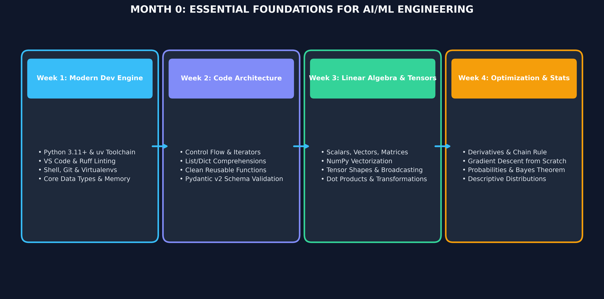

# Month 0: Essential Foundations for AI Engineering
## Modern Programming & Mathematical Engine

Welcome to Month 0! This preparatory foundation is engineered for students starting or formalizing their journey in Applied AI and Machine Learning. 

Rather than teaching generic syntax or abstract math in isolation, Month 0 connects modern developer ergonomics (**`uv`**, **typed Python**, **Pydantic**) directly to the computational primitives required for modern machine learning (**tensors, automatic differentiation, and vectorization**).

---

## 🎯 Learning Objectives & Success Criteria
By the end of Month 0, students will:
* **Master Modern Tooling:** Set up reproducible Python 3.11+ environments using `uv` and lint clean code with Ruff.
* **Write Production Python:** Construct modular functions, leverage list/dictionary comprehensions, and enforce data schemas with **Pydantic v2**.
* **Understand Tensors & Operations:** Manipulate multi-dimensional arrays in NumPy, master broadcasting rules, and execute matrix transformations.
* **Master Optimization Intuition:** Understand derivatives, the chain rule, and build a simple Gradient Descent optimizer from scratch.

---

## 📚 Curriculum Breakdown

### [Week 1: Modern Python Toolchain & Programming Fundamentals](Week_1/lecture_notes/Week1_Python_Basics.md)
* **Modern Developer Stack:** Installing Python 3.11+, using the blazing-fast `uv` package manager (`uv venv`, `uv pip`), terminal workflows, and Git essentials.
* **Memory & Types:** Primitives (`int`, `float`, `str`, `bool`), type mutability vs immutability, variables as memory references.
* **Arithmetic & Boolean Operations:** Mathematical operators, string formatting (f-strings), logical conditions (`and`, `or`, `not`).
* **Deliverable:** Set up local Git repository with `uv`, build a typed CLI diagnostic calculator with automated input checking.

### [Week 2: Control Flow, Functions & Structured Schemas](Week_2/lecture_notes/Week2_Control_Flow_Functions.md)
* **Control Structures:** `if / elif / else` branching, `for` and `while` loops, iterators, `enumerate()`, and `zip()`.
* **Data Collections & Comprehensions:** Lists, tuples, sets, dictionaries, nested structures, and memory-efficient comprehensions.
* **Clean Functional Design:** Defining functions, type hints (`typing.Optional`, `typing.List`, `typing.Dict`), default arguments, `*args`, and `**kwargs`.
* **Data Schema Validation with Pydantic:** Moving beyond raw dictionaries; defining validated schemas for AI input payloads.
* **Deliverable:** Write a validated data preprocessor that ingests dirty JSON dictionaries, validates them using Pydantic models, and filters anomalies.

### [Week 3: Linear Algebra & Tensors from Scratch](Week_3/lecture_notes/Week3_Math_Part1.md)
* **Scalars, Vectors, and Matrices:** Geometric representation, magnitudes, Euclidean distance, and cosine similarity intuition.
* **Tensor Dimensions & NumPy:** Creating 1D, 2D, and 3D arrays, indexing, slicing, reshaping, and contiguous memory layouts.
* **Tensor Broadcasting:** Understanding how arrays of different shapes interact arithmetic-wise.
* **Matrix Multiplication:** Dot product mechanics, why $A \times B$ requires inner dimensions to match, and vectorizing batch calculations.
* **Deliverable:** Implement vector cosine similarity and matrix multiplication from scratch in pure Python, then benchmark against vectorized NumPy.

### [Week 4: Calculus, Autodiff & Probability for Machine Learning](Week_4/lecture_notes/Week4_Math_Part2.md)
* **Calculus of Optimization:** Slopes, limits, single-variable derivatives, power rule, and exponential/log derivatives.
* **Multivariable Calculus & Gradients:** Partial derivatives, the gradient vector ($\nabla f$), and the Chain Rule for composite functions.
* **Gradient Descent Intuition:** Loss surfaces, learning rates, step updates ($w \leftarrow w - \alpha \frac{\partial L}{\partial w}$), and convergence.
* **Descriptive Statistics & Probability:** Mean, median, standard deviation, normal distributions, conditional probability, and Bayes' Theorem.
* **Deliverable:** Build an end-to-end 1D Gradient Descent visualizer in Python that optimizes a quadratic cost function step-by-step.

---

## 🛠️ Month 0 Weekly Quick-Links
| Week | Lecture Notes | Exercises | Assignments | Cheatsheets |
| :--- | :--- | :--- | :--- | :--- |
| **Week 1** | [Notes](Week_1/lecture_notes/Week1_Python_Basics.md) | [Exercises](Week_1/exercises/Week1_Exercises.md) | [Assignment](Week_1/assignments/Week1_Assignment.md) | [Cheatsheet](Week_1/cheatsheets/Week1_Cheatsheet.md) |
| **Week 2** | [Notes](Week_2/lecture_notes/Week2_Control_Flow_Functions.md) | [Exercises](Week_2/exercises/Week2_Exercises.md) | [Assignment](Week_2/assignments/Week2_Assignment.md) | [Cheatsheet](Week_2/cheatsheets/Week2_Cheatsheet.md) |
| **Week 3** | [Notes](Week_3/lecture_notes/Week3_Math_Part1.md) | [Exercises](Week_3/exercises/Week3_Exercises.md) | [Assignment](Week_3/assignments/Week3_Assignment.md) | [Cheatsheet](Week_3/cheatsheets/Week3_Cheatsheet.md) |
| **Week 4** | [Notes](Week_4/lecture_notes/Week4_Math_Part2.md) | [Exercises](Week_4/exercises/Week4_Exercises.md) | [Assignment](Week_4/assignments/Week4_Assignment.md) | [Cheatsheet](Week_4/cheatsheets/Week4_Cheatsheet.md) |
