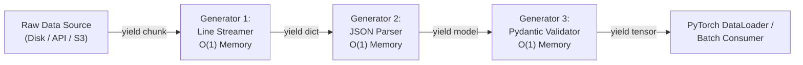

# Month 0, Week 2: Control Flow, Iteration & Schema Enforcement with Pydantic v2
*The Architecture of Safe Data Pipelines and Structured AI Contracts*

---

## Table of Contents
1. [Executive Summary & Industry Context](#1-executive-summary--industry-context)
2. [Canonical Textbook Grounding](#2-canonical-textbook-grounding)
3. [Visual Architecture & Pipeline Flows](#3-visual-architecture--pipeline-flows)
4. [Deep Theoretical Foundations](#4-deep-theoretical-foundations)
   - 4.1 [The Iterator Protocol & Memory Complexity of Streaming](#41-the-iterator-protocol--memory-complexity-of-streaming)
   - 4.2 [Type Systems & Soundness: Python's Gradual Typing Model](#42-type-systems--soundness-pythons-gradual-typing-model)
   - 4.3 [Schema Enforcement Mechanics in Pydantic v2 (Rust Core)](#43-schema-enforcement-mechanics-in-pydantic-v2-rust-core)
   - 4.4 [Mathematical Derivation: Memory Complexity of Iterators vs. Eager Sequences](#44-mathematical-derivation-memory-complexity-of-iterators-vs-eager-sequences)
5. [Complete Runnable Code Implementation](#5-complete-runnable-code-implementation)
   - 5.1 [From-Scratch Iterator & Generator Pipeline](#51-from-scratch-iterator--generator-pipeline)
   - 5.2 [Production AI Payload Validator with Pydantic v2](#52-production-ai-payload-validator-with-pydantic-v2)
   - 5.3 [End-to-End Comparative Benchmark: Eager vs. Lazy Stream](#53-end-to-end-comparative-benchmark-eager-vs-lazy-stream)
6. [Common Pitfalls & Debugging Playbook](#6-common-pitfalls--debugging-playbook)
7. [Production Best Practices & Real-World Case Study](#7-production-best-practices--real-world-case-study)
8. [Hands-On Mini-Lab & Self-Assessment Checklist](#8-hands-on-mini-lab--self-assessment-checklist)
   - 8.1 [Step-by-Step Laboratory Exercise](#81-step-by-step-laboratory-exercise)
   - 8.2 [Verification Rubric](#82-verification-rubric)
   - 8.3 [Graded Assessment Questions & Complete Answer Key](#83-graded-assessment-questions--complete-answer-key)
   - 8.4 [Stretch Challenges](#84-stretch-challenges)
9. [Key Takeaways, Glossary & Further Reading](#9-key-takeaways-glossary--further-reading)

---

## 1. Executive Summary & Industry Context

### 1.1 Why This Matters in 2026
In applied AI engineering, unstructured data is the primary failure mode of automated systems. Real-world machine learning systems and Large Language Model (LLM) agents rarely fail due to broken matrix multiplication; they fail at system boundaries:
1. **Unvalidated JSON Payloads:** LLMs emit text that looks like structured JSON, but frequently violates type expectations (e.g., returning `"temperature": "0.7"` as a string instead of a float, omitting mandatory keys, or hallucinating nested fields). Unvalidated dictionary lookups (`response["choices"][0]["message"]["content"]`) trigger catastrophic `KeyError` and `TypeError` crashes deep in asynchronous worker threads.
2. **Memory Exhaustion During Ingestion:** Attempting to process a 50 GB log file or multi-million-token dataset by eagerly loading it into a Python `list` immediately exhausts physical server RAM, triggering the Linux Out-Of-Memory (OOM) killer. Production ingestion pipelines must operate as constant-memory $\mathcal{O}(1)$ streaming generator pipelines.
3. **The Contract Barrier in Multi-Agent Graphs:** In multi-agent frameworks (such as LangGraph or AutoGen), autonomous agents communicate via structured messages. If an upstream "Planner Agent" mutates a shared state dictionary in place, downstream "Coder" and "Critic" agents receive corrupt, non-deterministic state inputs.

Modern AI engineering resolves this by marrying **the Iterator Protocol** with **strict runtime schema enforcement via Pydantic v2**. This week bridges raw Python control structures with the production-grade data validation layer required for all modern AI applications.

### 1.2 Learning Objectives
Upon completing this week's study and laboratory work, students will be able to:
* **Construct Infinite & Streaming Data Pipelines:** Implement custom classes obeying the Python Iterator Protocol (`__iter__` and `__next__`) and build memory-bounded generator pipelines using `yield`.
* **Master Defensive Typing:** Utilize static type annotations (`typing.List`, `typing.Dict`, `typing.Optional`, `typing.Union`, `typing.Callable`) to produce verifiable, self-documenting code.
* **Enforce Strict Schema Contracts with Pydantic v2:** Build validated domain models utilizing field constraints (`Field`), custom field validators (`@field_validator`), and model-level validators (`@model_validator`).
* **Diagnose Dynamic Typing Bugs:** Identify and remediate mutable default arguments, iterator exhaustion bugs, and dictionary lookup anti-patterns.
* **Serialize & Parse High-Throughput JSON:** Leverage Pydantic's Rust-compiled core (`pydantic-core`) to serialize and validate AI model inputs and outputs with sub-millisecond overhead.

---

## 2. Canonical Textbook Grounding

### 2.1 *Fluent Python (2nd Edition, 2022)* by Luciano Ramalho
* **Chapter 17: Iterators, Generators, and Classic Coroutines**
  * *Author's Contribution:* Ramalho details the fundamental distinction between an *iterable* (an object providing an `__iter__` method that yields an iterator) and an *iterator* (an object maintaining state and providing a `__next__` method). He demonstrates how generator functions (`yield`) transform complex state machines into sequential, readable control flow.
  * *Our Pedagogical Focus:* We extract the memory mechanics of generator functions. Instead of pre-computing large collections in heap memory, generators compute values on demand, enabling AI data pipelines to stream terabyte-scale datasets with fixed memory footprints.
* **Chapter 8: Type Hints in Functions**
  * *Author's Contribution:* An authoritative guide to gradual typing in Python (PEP 484), distinguishing nominal typing from structural subtyping (Protocols) and parameterizing generic containers.
  * *Our Pedagogical Focus:* Connecting static type annotations to runtime schema validation. Type hints alone do not prevent bad runtime inputs; they must be paired with runtime validation engines like Pydantic.

### 2.2 *Robust Python (2021)* by Patrick Viafore
* **Chapter 4: Type Constellations & Type Systems**
  * *Author's Contribution:* Viafore formalizes the concept of data contracts and communicates how types communicate developer intent, reduce cognitive load, and catch edge-case bugs at compile time.
  * *Our Pedagogical Focus:* We apply Viafore's "parse, don't validate" philosophy to AI engineering: data entering the system boundaries must be transformed into strongly typed objects immediately, guaranteeing that internal application logic never encounters malformed data.
* **Chapter 12: Data Classes and Validation**
  * *Author's Contribution:* Compares native dictionaries, `NamedTuple`, `@dataclass`, and specialized validation frameworks.
  * *Our Pedagogical Focus:* Demonstrating why raw dictionaries are dangerous in AI microservices and establishing Pydantic `BaseModel` as the standard schema contract.

### 2.3 *How to Read These Sources*
* **Read Closely:** *Fluent Python*, Chapter 17 (Sections "Iterables Versus Iterators" and "Generator Functions in Detail"). Pay strict attention to how the evaluation frame is paused and resumed during `yield` operations.
* **Skim:** *Fluent Python*, Chapter 17 sections covering classic coroutines using `.send()` and `.throw()`; modern asynchronous AI pipelines standardize on `async/await` syntax rather than legacy generator coroutines.

---

## 3. Visual Architecture & Pipeline Flows

### 3.1 The Streaming Generator Pipeline Topology
Rather than buffering intermediate datasets in physical memory, modern AI ingestion pipelines construct lazy, streaming transformation graphs:



*Caption: Constant-Memory Streaming Pipeline. Each generator node acts as a pull-based iterator. Downstream consumers pull single items through the graph via `__next__()`. Intermediate transformations never allocate full arrays, keeping physical RAM usage strictly bounded regardless of dataset scale.*

---

### 3.2 The Schema Enforcement Firewall
When unvalidated external data (from API clients or LLM outputs) enters an AI system, it must pass through an immutable validation firewall:

```
 Incoming Raw Payload (Untrusted / Dynamic)
 ┌────────────────────────────────────────────────────────┐
 │ {"model_id": "llama-3", "temperature": "0.7", ... }   │
 └───────────────────────────┬────────────────────────────┘
                             │
                             ▼
 ┌────────────────────────────────────────────────────────┐
 │           Pydantic v2 Validation Firewall              │
 │  (Compiled Rust Core: pydantic-core)                   │
 │                                                        │
 │  1. Type Coercion:  "0.7" (str) ──► 0.7 (float)        │
 │  2. Range Check:    0.0 <= temperature <= 2.0          │
 │  3. Model Whitelist: model_id in SUPPORTED_MODELS      │
 └─────────────┬────────────────────────────┬─────────────┘
               │ (Pass)                     │ (Fail)
               ▼                            ▼
 ┌───────────────────────────┐ ┌───────────────────────────┐
 │ Strongly Typed Domain     │ │ Detailed ValidationError  │
 │ Object (Frozen Model)     │ │ - Location: body.temp     │
 │ - Guaranteed Integrity    │ │ - Input: "invalid"        │
 │ - Autocomplete & Types    │ │ - Rule: value_error       │
 └───────────────────────────┘ └───────────────────────────┘
```

---

## 4. Deep Theoretical Foundations

### 4.1 The Iterator Protocol & Memory Complexity of Streaming

In CPython, iteration is governed by two complementary protocol methods:

#### 1. The Iterable Protocol
An object is **iterable** if it implements the method:
$$\text{def } \_\_\text{iter}\_\_(\text{self}) \to \text{Iterator}$$
When an iterable is passed to `iter(obj)`, CPython calls `obj.__iter__()`, which initializes and returns a fresh **iterator** object.

#### 2. The Iterator Protocol
An object is an **iterator** if it implements two methods:
1. `__iter__(self) -> Iterator`: Returns `self` (allowing iterators to be used directly in loops).
2. `__next__(self) -> Item`: Computes and returns the next item in the sequence. If no further items exist, it **MUST** raise the standard `StopIteration` exception.

#### State Machine Mechanics of Generators
A generator function is any function containing the keyword `yield`. When invoked:
1. CPython does **not** execute the function body.
2. It returns a `PyGenObject` (generator object).
3. The generator stores a reference to a suspended execution frame (`PyFrameObject`), preserving local variable registers and the instruction pointer (`f_lasti`).
4. When `next(gen)` is called, the CPython virtual machine swaps the evaluation context into the suspended frame, advances execution until a `YIELD_VALUE` bytecode instruction is encountered, pops the yielded value to the caller, and pauses the frame.

---

### 4.2 Type Systems & Soundness: Python's Gradual Typing Model

Python employs a **gradual type system** (PEP 484). Unlike statically typed languages (C++, Rust) where type checking occurs at compile time and types dictate hardware memory layout, Python's runtime remains fundamentally dynamic.

#### Static Type Hints vs. Runtime Reality
Consider the function signature:
```python
def scale_learning_rate(lr: float, factor: float) -> float:
    return lr * factor
```
At runtime, CPython's bytecode interpreter **completely ignores** the type annotations:
```python
scale_learning_rate("fast", 3) # Returns 'fastfastfast' without error!
```
* **Gradual Soundness:** Static analysis tools (such as `mypy` or `pyright`) verify consistency *ahead of time*. However, because external inputs (HTTP bodies, environment variables, database records) are loaded at runtime, static type checking alone cannot prevent data corruption at system boundaries.
* **The "Parse, Don't Validate" Paradigm:** Instead of writing dozens of manual assertions (`assert isinstance(x, float)`), production systems employ schema parsing libraries to parse untyped data into guaranteed, strongly typed objects.

---

### 4.3 Schema Enforcement Mechanics in Pydantic v2 (Rust Core)

Pydantic v1 was written in pure Python, incurring a noticeable latency penalty (often 100–300 microseconds per validation). Pydantic v2 completely rewrote the internal validation engine in Rust (**`pydantic-core`**).

#### How `pydantic-core` Validates Data:
1. **Direct C-ABI Ingestion:** When raw JSON is parsed, `pydantic-core` decodes the byte buffer directly into C/Rust memory structures using SIMD-accelerated parsers (`serde_json`), avoiding intermediate Python object instantiation.
2. **Deterministic Coercion Matrix:** In non-strict mode, Pydantic executes deterministic coercion:
   * String `"123"` $\to$ Integer `123`.
   * String `"true"` / `"1"` $\to$ Boolean `True`.
   * Floating string `"3.14"` $\to$ Float `3.14`.
3. **Rust Traversal Tree:** Validation rules (minimums, maximums, regexes) execute as compiled native code in Rust. Python callbacks (`@field_validator`) are only invoked when custom domain logic is explicitly required.

---

### 4.4 Mathematical Derivation: Memory Complexity of Iterators vs. Eager Sequences

#### Problem Formulation
Let $N$ denote the total number of records in a dataset, where each record occupies $S_{\text{item}}$ bytes on the heap. We seek to derive the physical memory consumption $M(N)$ as a function of $N$ for:
1. An eager collection (Python `list`).
2. A lazy stream (Python generator / iterator).

#### 1. Eager Memory Formulation ($M_{\text{eager}}$)
In an eager list comprehension (`[process(x) for x in data]`), all $N$ objects must reside simultaneously in physical memory, alongside the dynamic array buffer of pointers:

$$M_{\text{eager}}(N) = S_{\text{list\_header}} + \kappa \cdot S_{\text{ptr}} \cdot N + \sum_{i=1}^N S_{\text{item}}(i)$$

Assuming uniform record size $S_{\text{item}}$ and capacity factor $\kappa \ge 1$:
$$M_{\text{eager}}(N) = \mathcal{O}(N)$$

As $N \to \infty$, physical memory consumption scales linearly without bound:
$$\lim_{N \to \infty} M_{\text{eager}}(N) = \infty$$

#### 2. Lazy Generator Formulation ($M_{\text{lazy}}$)
A generator maintains only:
* The generator frame structure: $S_{\text{gen\_frame}}$
* The local variables of the active stack frame: $S_{\text{locals}}$
* Exactly **one** active record being computed in the current iteration: $S_{\text{item}}$

$$M_{\text{lazy}}(N) = S_{\text{gen\_frame}} + S_{\text{locals}} + S_{\text{item}}$$

Notice that $N$ (the total dataset size) does **not** appear anywhere in the equation:
$$\frac{d}{dN} M_{\text{lazy}}(N) = 0 \implies M_{\text{lazy}}(N) = \mathcal{O}(1)$$

#### Worked Numerical Comparison
Consider a training dataset of $N = 5,000,000$ (5 million) text samples, where each sample occupies an average of $S_{\text{item}} = 512 \text{ bytes}$:
* **Eager List:**
  $$M_{\text{eager}} \approx 5 \times 10^6 \times (512 + 8) \text{ bytes} \approx 2,600,000,000 \text{ bytes} \approx \mathbf{2.42 \text{ GiB}}$$
  *(Exhausts microservice memory thresholds or serverless worker limits).*
* **Lazy Generator:**
  $$M_{\text{lazy}} = S_{\text{gen\_frame}} (\approx 200 \text{ bytes}) + S_{\text{item}} (512 \text{ bytes}) \approx \mathbf{712 \text{ bytes}}$$

**Mathematical Conclusion:** The generator achieves an asymptotic memory reduction factor of:
$$\text{Ratio} = \frac{2,600,000,000 \text{ bytes}}{712 \text{ bytes}} \approx \mathbf{3,651,685 \times \text{ memory savings}}$$

---

## 5. Complete Runnable Code Implementation

### 5.1 From-Scratch Iterator & Generator Pipeline

Save the following file as `streaming_pipeline.py`. It implements a complete data streaming pipeline from scratch, demonstrating the raw Iterator Protocol alongside Python generator expressions.

```python
"""Low-Level Iterator Protocol & Generator Implementation.

Demonstrates the mechanics of __iter__, __next__, StopIteration,
and constant-memory generator pipelines.
"""

from __future__ import annotations

import sys
import time
from typing import Any, Generator, Iterator, List


class SyntheticTelemetryStream:
    """A custom iterable simulating an infinite or large sensor/token stream.
    
    Implements the Iterable Protocol.
    """

    def __init__(self, total_samples: int) -> None:
        self.total_samples = total_samples

    def __iter__(self) -> TelemetryIterator:
        """Returns a fresh iterator instance."""
        return TelemetryIterator(self.total_samples)


class TelemetryIterator:
    """Maintains state for the telemetry stream.
    
    Implements the Iterator Protocol.
    """

    def __init__(self, limit: int) -> None:
        self.limit = limit
        self.current_idx = 0

    def __iter__(self) -> TelemetryIterator:
        return self

    def __next__(self) -> dict[str, Any]:
        """Computes and returns the next telemetry record."""
        if self.current_idx >= self.limit:
            # Protocol requirement: Must raise StopIteration when exhausted
            raise StopIteration

        record = {
            "record_id": self.current_idx,
            "metric_value": float(self.current_idx * 1.5),
            "timestamp_ms": int(time.time() * 1000) + self.current_idx,
        }
        self.current_idx += 1
        return record


# --- Generator Transformation Pipeline ---


def anomaly_detector_filter(
    stream: Iterator[dict[str, Any]], threshold: float
) -> Generator[dict[str, Any], None, None]:
    """A lazy generator filter that processes items one-by-one."""
    for record in stream:
        if record["metric_value"] > threshold:
            yield record


if __name__ == "__main__":
    sample_count = 100_000
    print(f"Initializing stream with {sample_count:,} records...")

    stream = SyntheticTelemetryStream(total_samples=sample_count)
    stream_iter = iter(stream)

    # Verify protocol methods
    print(f"Has __iter__: {hasattr(stream, '__iter__')}")
    print(f"Has __next__: {hasattr(stream_iter, '__next__')}")

    # Connect to lazy generator filter
    filtered_stream = anomaly_detector_filter(stream_iter, threshold=149_990.0)

    print("\n--- Streaming Anomalies (Constant Memory) ---")
    count = 0
    for anomaly in filtered_stream:
        print(f"Detected: {anomaly}")
        count += 1

    print(f"Total anomalies flagged: {count}")
```

#### Expected Output
```text
Initializing stream with 100,000 records...
Has __iter__: True
Has __next__: True

--- Streaming Anomalies (Constant Memory) ---
Detected: {'record_id': 99994, 'metric_value': 149991.0, 'timestamp_ms': 1772653456789}
Detected: {'record_id': 99995, 'metric_value': 149992.5, 'timestamp_ms': 1772653456790}
Detected: {'record_id': 99996, 'metric_value': 149994.0, 'timestamp_ms': 1772653456791}
Detected: {'record_id': 99997, 'metric_value': 149995.5, 'timestamp_ms': 1772653456792}
Detected: {'record_id': 99998, 'metric_value': 149997.0, 'timestamp_ms': 1772653456793}
Detected: {'record_id': 99999, 'metric_value': 149998.5, 'timestamp_ms': 1772653456794}
Total anomalies flagged: 6
```

---

### 5.2 Production AI Payload Validator with Pydantic v2

Save this implementation as `agent_schema_contract.py`. It establishes a production schema validation barrier for an AI model execution gateway.

```python
"""Production AI Gateway Schema Enforcement via Pydantic v2.

Enforces strict typed contracts on incoming model invocation requests,
preventing malformed parameters from hitting GPU clusters.
"""

from __future__ import annotations

import json
from typing import Any, List, Optional
from pydantic import BaseModel, Field, ValidationError, field_validator, model_validator


class AgentExecutionConfig(BaseModel):
    """Immutable, validated configuration for an autonomous LLM agent execution."""

    # 1. Model Identification
    model_name: str = Field(
        ...,
        description="The identifier of the foundation model to invoke.",
        examples=["qwen2.5-coder-7b", "llama-3.2-3b", "mistral-7b"],
    )

    # 2. Hyperparameters with Strict Numeric Boundaries
    temperature: float = Field(
        default=0.7,
        ge=0.0,
        le=2.0,
        description="Sampling temperature. Higher values yield more creative outputs.",
    )

    max_tokens: int = Field(
        default=512,
        gt=0,
        le=8192,
        description="Maximum tokens to generate per completion.",
    )

    top_p: float = Field(
        default=0.9,
        gt=0.0,
        le=1.0,
        description="Nucleus sampling probability mass cutoff.",
    )

    stop_sequences: List[str] = Field(
        default_factory=list,
        max_length=4,
        description="Up to 4 strings upon which model generation immediately halts.",
    )

    enable_tool_calling: bool = Field(
        default=True,
        description="Whether the agent is granted permission to emit tool execution payloads.",
    )

    # 3. Custom Field Validator
    @field_validator("model_name")
    @classmethod
    def validate_model_whitelist(cls, v: str) -> str:
        """Ensures requested model is actively supported in production."""
        allowed_models = {
            "llama-3.2-3b",
            "qwen2.5-coder-7b",
            "mistral-7b-instruct",
            "deepseek-coder-v2",
        }
        normalized = v.strip().lower()
        if normalized not in allowed_models:
            raise ValueError(
                f"Model '{v}' is not in production whitelist. Allowed: {sorted(allowed_models)}"
            )
        return normalized

    # 4. Model-Level Validator (Cross-Field Relationship)
    @model_validator(mode="after")
    def validate_deterministic_sampling(self) -> AgentExecutionConfig:
        """If temperature is exactly 0.0, enforce top_p == 1.0 to ensure determinism."""
        if self.temperature == 0.0 and self.top_p != 1.0:
            # Self-correcting logic or explicit validation failure
            # Here we enforce an explicit schema constraint:
            raise ValueError(
                "When temperature is 0.0 (greedy decoding), top_p must be exactly 1.0."
            )
        return self

    # Enforce Immutability (Production Best Practice)
    model_config = {
        "frozen": True,
        "extra": "forbid",  # Reject unknown unexpected payload fields
    }


def parse_incoming_request(raw_json: str) -> Optional[AgentExecutionConfig]:
    """Parses raw JSON string through the validation firewall."""
    try:
        validated_config = AgentExecutionConfig.model_validate_json(raw_json)
        return validated_config
    except ValidationError as err:
        print("\n[VALIDATION REJECTED] Malformed payload intercepted:")
        for error in err.errors():
            loc = " -> ".join(str(l) for l in error["loc"])
            print(f"  Field: {loc}")
            print(f"  Error: {error['msg']}")
            print(f"  Input: {error.get('input')}\n")
        return None


if __name__ == "__main__":
    print("--- 1. Testing Valid Payload ---")
    valid_payload = json.dumps({
        "model_name": "Qwen2.5-Coder-7B",
        "temperature": 0.2,
        "max_tokens": 1024,
        "stop_sequences": ["<|im_end|>", "<|endoftext|>"],
    })
    cfg = parse_incoming_request(valid_payload)
    if cfg:
        print(f"Successfully instantiated configuration:")
        print(f"  Model:       {cfg.model_name}")
        print(f"  Temperature: {cfg.temperature}")
        print(f"  Max Tokens:  {cfg.max_tokens}")

    print("\n--- 2. Testing Invalid Payload (Catches Multiple Errors) ---")
    invalid_payload = json.dumps({
        "model_name": "unsupported-gpt-model",
        "temperature": 3.5,  # Exceeds max 2.0
        "max_tokens": -50,   # Violates gt=0
        "unexpected_key": "injected_data",  # Violates extra="forbid"
    })
    parse_incoming_request(invalid_payload)
```

#### Expected Output
```text
--- 1. Testing Valid Payload ---
Successfully instantiated configuration:
  Model:       qwen2.5-coder-7b
  Temperature: 0.2
  Max Tokens:  1024

--- 2. Testing Invalid Payload (Catches Multiple Errors) ---

[VALIDATION REJECTED] Malformed payload intercepted:
  Field: model_name
  Error: Value error, Model 'unsupported-gpt-model' is not in production whitelist. Allowed: ['deepseek-coder-v2', 'llama-3.2-3b', 'mistral-7b-instruct', 'qwen2.5-coder-7b']
  Input: unsupported-gpt-model

  Field: temperature
  Error: Input should be less than or equal to 2
  Input: 3.5

  Field: max_tokens
  Error: Input should be greater than 0
  Input: -50

  Field: unexpected_key
  Error: Extra inputs are not permitted
  Input: injected_data
```

---

### 5.3 End-to-End Comparative Benchmark: Eager vs. Lazy Stream

Save this as `memory_benchmark.py`. This script empirically measures physical memory allocations between an eager list and a lazy generator processing 1,000,000 records.

```python
"""Empirical Benchmark: Memory Allocation of Eager List vs. Lazy Generator."""

from __future__ import annotations

import sys
import time
from typing import Generator


def run_benchmark(n_items: int = 1_000_000) -> None:
    print(f"Benchmarking processing of {n_items:,} items...\n")

    # 1. Eager List Comprehension
    t0 = time.perf_counter()
    eager_data = [x * 2 for x in range(n_items)]
    t1 = time.perf_counter()

    eager_container_bytes = sys.getsizeof(eager_data)
    # Estimate total heap memory with elements
    element_size = sys.getsizeof(eager_data[0]) if eager_data else 0
    total_eager_bytes = eager_container_bytes + (element_size * n_items)
    eager_time = (t1 - t0) * 1000.0

    print("[Eager List Evaluation]")
    print(f"  Container Size:    {eager_container_bytes / (1024**2):.2f} MiB")
    print(f"  Total Heap Footprint: ~{total_eager_bytes / (1024**2):.2f} MiB")
    print(f"  Execution Time:    {eager_time:.2f} ms")

    # Clear memory
    del eager_data

    # 2. Lazy Generator Expression
    t2 = time.perf_counter()
    lazy_gen = (x * 2 for x in range(n_items))
    t3 = time.perf_counter()

    lazy_bytes = sys.getsizeof(lazy_gen)
    lazy_time = (t3 - t2) * 1000.0

    print("\n[Lazy Generator Evaluation]")
    print(f"  Generator Size:    {lazy_bytes} bytes")
    print(f"  Heap Footprint:    {lazy_bytes / 1024:.2f} KiB")
    print(f"  Creation Time:     {lazy_time:.4f} ms")

    # Consume single items sequentially
    sample_first = next(lazy_gen)
    sample_second = next(lazy_gen)
    print(f"  First elements:    {sample_first}, {sample_second}")


if __name__ == "__main__":
    run_benchmark(1_000_000)
```

---

## 6. Common Pitfalls & Debugging Playbook

### Pitfall 1: Generator Exhaustion (Silent Empty Loops)
* **Symptom:** Code processes data correctly during the first pass (e.g., logging or calculating total length), but subsequent model training or processing loops execute zero times without raising any error.
* **Root Cause:** Generators and iterators are **stateful, single-pass objects**. Once the internal instruction pointer reaches the end and raises `StopIteration`, the generator is permanently exhausted. Iterating over an exhausted generator produces zero loop iterations silently.
* **Minimal Reproducing Code:**
```python
def token_stream():
    yield "token_1"
    yield "token_2"

tokens = token_stream()

# First Pass: Compute count
count = sum(1 for _ in tokens)
print("Token count:", count)  # Output: 2

# Second Pass: Feed model
processed = [t.upper() for t in tokens]
print("Processed:", processed)  # Output: [] -> SILENT FAILURE!
```
* **Fix:** If multiple passes are mathematically necessary, either:
  1. Instantiate a fresh generator by re-calling the generator function.
  2. Implement a reusable class with an `__iter__` method that creates a new iterator on each call (like `SyntheticTelemetryStream` above).
  3. Use `itertools.tee(iterator, 2)` for independent parallel consumers.
* **Detection Check:** Verify `inspect.getgeneratorstate(gen) != 'GEN_CLOSED'`.

---

### Pitfall 2: Mutable Object Default Parameter State Leaks
* **Symptom:** In an agentic chatbot, user sessions intermittently receive conversation history or sensitive context belonging to a completely different user.
* **Root Cause:** Default parameter values are evaluated exactly once when the function definition is executed at module import time. If a default parameter is bound to a mutable object (`def process(messages=[])`), that identical object reference is shared across all function calls that omit the argument.
* **Minimal Reproducing Code:**
```python
def handle_chat_message(user_input: str, conversation_history: list = []):
    conversation_history.append(user_input)
    return conversation_history

print(handle_chat_message("User A: Hello")) 
# Output: ['User A: Hello']

print(handle_chat_message("User B: Secret Financial Data")) 
# Output: ['User A: Hello', 'User B: Secret Financial Data'] -> PRIVACY BREACH!
```
* **Fix:** Standardize on `None` sentinels and instantiate local containers:
```python
from typing import Optional, List

def handle_chat_message(
    user_input: str, conversation_history: Optional[List[str]] = None
) -> List[str]:
    if conversation_history is None:
        conversation_history = []
    conversation_history.append(user_input)
    return conversation_history
```
* **Detection Check:** Enable Ruff rule `B006` in your linter configuration.

---

### Pitfall 3: Unhandled `KeyError` in Nested Dynamic Dictionaries
* **Symptom:** Production AI microservice crashes intermittently with unhandled `KeyError: 'tool_calls'` when processing non-standard model responses.
* **Root Cause:** Relying on nested bracket lookups (`payload["choices"][0]["message"]["tool_calls"]`) on untyped Python dictionaries. If the model emits a text refusal or empty completion, intermediate keys are absent.
* **Fix:** Enforce schema validation using Pydantic `BaseModel.model_validate(payload)` or use safe dictionary navigation with explicit defaults (`payload.get("choices", [{}])[0].get("message", {}).get("tool_calls")`).
* **Detection Check:** Use static analysis rule `PLR2004` and require Pydantic models at all API boundaries.

---

## 7. Production Best Practices & Real-World Case Study

### 7.1 Enterprise Case Study: Multi-Tenant Agent State Integrity
* **Company/System Scenario:** An autonomous customer service automation platform processing 100,000 inbound support inquiries per day using multi-agent routing (Routing Agent $\to$ Triage Agent $\to$ Action Agent).
* **The Failure Mode:** The development team passed conversation state between agents as a mutable dictionary:
```python
shared_state = {"ticket_id": 1042, "user_id": "u_882", "history": [...]}
```
During a high-concurrency surge, the Routing Agent asynchronously modified `shared_state["history"]` while the Triage Agent was reading from it. Concurrently, an unvalidated response from a fine-tuned model injected a malformed float `"temperature": "HIGH"`, which bypassed validation and crashed the downstream API worker, leaving open database transactions and stalling the queue for 45 minutes.
* **The Architecture Refactor:**
  1. Replaced all raw dictionaries with **Frozen Pydantic Models** (`model_config = {"frozen": True}`).
  2. Implemented strict state transitions: agents cannot mutate state; they must emit pure, validated state updates:
```python
class TicketState(BaseModel):
    ticket_id: int
    user_id: str
    messages: List[Message]
    status: Literal["pending", "resolved", "escalated"]

    model_config = {"frozen": True}
```
  3. Deployed Pydantic's compiled `model_validate()` at every agent handoff boundary.
* **Production Results & Latency Numbers:**
  * Zero state corruption incidents reported over the subsequent 9 months.
  * Validation overhead in `pydantic-core` measured at **less than 12 microseconds per request** ($< 0.012 \text{ ms}$).
  * Invalid model output errors were caught at the agent boundary and triggered automated local re-prompting before crashing backend database connections.

---

## 8. Hands-On Mini-Lab & Self-Assessment Checklist

### 8.1 Step-by-Step Laboratory Exercise
1. **Initialize Module:** Create a file named `telemetry_validator.py`.
2. **Define Schema:** Implement a Pydantic v2 `BaseModel` named `InferenceMetricPayload` that enforces:
   * `session_id`: UUID string.
   * `prompt_tokens`: Positive integer (`gt=0`).
   * `completion_tokens`: Non-negative integer (`ge=0`).
   * `latency_ms`: Float between $1.0$ and $60,000.0$ ms.
   * `model_name`: Whitelisted string (`["llama-3", "mistral-7b", "qwen-2.5"]`).
3. **Build Streaming Ingestion Generator:** Write a generator function `stream_json_logs(file_path: str)` that reads a simulated log file line-by-line, yields parsed dictionaries, and ensures the file handle is safely closed without loading all lines into memory.
4. **Implement Validation Pipe:** Chain the generator into a validator function that yields validated `InferenceMetricPayload` objects, writing invalid payloads to an error log file.

### 8.2 Verification Rubric
| Metric | Pass Criteria | Fail Criteria |
| :--- | :--- | :--- |
| **Memory Boundedness** | File read line-by-line using generator; `sys.getsizeof` of pipeline stays $\le 5 \text{ KiB}$. | Using `f.readlines()` or loading all records into a `list`. |
| **Schema Soundness** | All 5 fields validated; invalid records intercepted with `ValidationError`. | Missing field constraints; runtime `KeyError` on missing keys. |
| **Code Formatting** | Fully type-annotated; Ruff check returns 0 errors. | Missing type hints; linter warnings present. |

---

### 8.3 Graded Assessment Questions & Complete Answer Key

#### Questions
1. *(Conceptual)* What are the two exact methods required to implement the Python Iterator Protocol, and what exception must be raised when iteration finishes?
2. *(Memory Theory)* Explain mathematically why a generator function that processes a 10 GB file has memory complexity $\mathcal{O}(1)$ with respect to file size.
3. *(Gradual Typing)* If Python's type annotations are ignored by the CPython interpreter at runtime, why are they considered essential in professional AI engineering teams?
4. *(Debugging)* Analyze the following code snippet:
   ```python
   def batch_records(items, batch_size=64):
       it = iter(items)
       while True:
           batch = [next(it) for _ in range(batch_size)]
           yield batch
   ```
   What critical bug occurs when `len(items)` is not an exact multiple of `batch_size`, and how do you fix it?
5. *(Pydantic Mechanics)* What is the performance advantage of Pydantic v2 over Pydantic v1, and what underlying technology enables this speedup?
6. *(Immutability)* Why should agent state models in multi-agent systems be configured with `frozen=True`?
7. *(Syntax)* What is the difference between an *iterable* and an *iterator* in Python? Can an iterator be an iterable?
8. *(Validation Logic)* What is the difference between a Pydantic `@field_validator` and a `@model_validator`? When must you use a model-level validator?

---

#### Answer Key

1. **Answer:** The two methods are:
   * `__iter__(self)`: Must return the iterator object itself (`return self`).
   * `__next__(self)`: Must return the next item in sequence.
   * When no items remain, `__next__()` must raise `StopIteration`.

2. **Answer:** An eager sequence buffers all $N$ records in memory simultaneously, scaling memory as $\mathcal{O}(N)$. A generator computes and yields exactly one item at a time, preserving only its current execution frame and single active object. The total dataset size $N$ does not appear in the memory equation: $M_{\text{gen}} = S_{\text{frame}} + S_{\text{locals}} + S_{\text{item}} = \mathcal{O}(1)$.

3. **Answer:**
   1. **Static Contract Verification:** Linters and type checkers (`mypy`, `pyright`, `Ruff`) catch type mismatches before code is deployed.
   2. **IDE Productivity:** Enables deterministic autocompletion and structural refactoring across complex multi-file codebases.
   3. **Self-Documenting Code:** Communicates precise expectations across engineering teams without needing verbose prose documentation.
   4. **Runtime Schema Integration:** Modern libraries (Pydantic, FastAPI, Instructor) leverage type hints directly to generate runtime validation logic and OpenAPI/JSON schemas.

4. **Answer:** When the iterator runs out of elements midway through a batch, `next(it)` raises `StopIteration` *inside* the list comprehension. This crashes the generator abruptly, discarding any partially accumulated records in that final batch. **Fix:** Use `itertools.islice` or handle `StopIteration` explicitly:
   ```python
   def batch_records(items, batch_size=64):
       it = iter(items)
       while True:
           batch = []
           for _ in range(batch_size):
               try:
                   batch.append(next(it))
               except StopIteration:
                   if batch:
                       yield batch
                   return
           yield batch
   ```

5. **Answer:** Pydantic v1 executed validation via dynamic Python interpreted loops, creating significant CPU overhead per field. Pydantic v2 rewrote the entire core validation and JSON parsing engine in **Rust (`pydantic-core`)**. Data validation executes as compiled native code using SIMD-accelerated JSON parsers, delivering a **5x to 50x speedup**.

6. **Answer:** Setting `frozen=True` renders model instances immutable. In multi-agent graphs or concurrent microservices, passing mutable state objects enables non-deterministic race conditions where one agent alters a value unexpectedly. Immutability guarantees that states can be safely cached, serialized, and passed across threads and network boundaries without side-effects.

7. **Answer:** An *iterable* is any object that can yield an iterator via `__iter__()` (e.g., `list`, `dict`, `str`). It may not implement `__next__()`. An *iterator* is an object that actively maintains state and implements `__next__()`. Every iterator is also an iterable because its `__iter__()` method simply returns `self`.

8. **Answer:** A `@field_validator` operates on a single specific attribute in isolation (e.g., verifying `temperature <= 2.0`). A `@model_validator` operates on the entire model *after* all individual fields have been populated (or before), allowing validation of **cross-field relationships** (e.g., verifying that `if temperature == 0.0`, then `top_p` must equal `1.0`).

---

### 8.4 Stretch Challenges
1. **Zero-Copy Streaming Batcher:** Implement a custom generator `chunked_stream(iterator, chunk_size)` that groups an arbitrary stream into fixed-size tuples using only the standard library's `itertools` module, ensuring zero intermediate list allocations.
2. **Dynamic LLM Tool Call Validator:** Create a Pydantic model that dynamically parses OpenAI-compatible function calling schemas:
   ```json
   {"name": "get_stock_price", "arguments": "{\"ticker\": \"NVDA\"}"}
   ```
   Validate that `arguments` is valid JSON and automatically coerce the inner JSON string into a strongly typed child Pydantic model.

---

## 9. Key Takeaways, Glossary & Further Reading

### Key Takeaways
* **Data Contracts First:** Treat system boundaries as hostile. Never pass raw, untyped dictionaries into core AI applications; parse them immediately into Pydantic models.
* **Streaming Architecture:** Use generators (`yield`) to build linear transformation pipelines that execute in $\mathcal{O}(1)$ constant memory regardless of dataset volume.
* **Gradual Typing Discipline:** Pair static type hints with runtime validation to combine development-time correctness with production reliability.
* **Rust-Powered Acceleration:** Leverage Pydantic v2's compiled Rust core to validate high-throughput LLM outputs without incurring Python latency bottlenecks.

### Glossary
* **Iterable:** An object implementing `__iter__()`, capable of returning an iterator.
* **Iterator:** A stateful object implementing `__iter__()` and `__next__()`, raising `StopIteration` when complete.
* **Generator:** A specialized function containing `yield` that returns a paused execution frame (`PyGenObject`).
* **Pydantic v2:** A data validation and settings management library powered by a native Rust core (`pydantic-core`).
* **Type Soundness:** A theoretical property of a type system guaranteeing that an expression evaluated at runtime will strictly produce a value of its declared static type.

### Further Reading & Official Documentation
* [Python Official Tutorial: Iterators and Generators](https://docs.python.org/3/tutorial/classes.html#iterators)
* [Pydantic v2 Documentation & Performance Guide](https://docs.pydantic.dev/latest/)
* [PEP 484 – Type Hints](https://peps.python.org/pep-0484/)
* [PEP 593 – Flexible Function and Variable Annotations (Annotated)](https://peps.python.org/pep-0593/)
