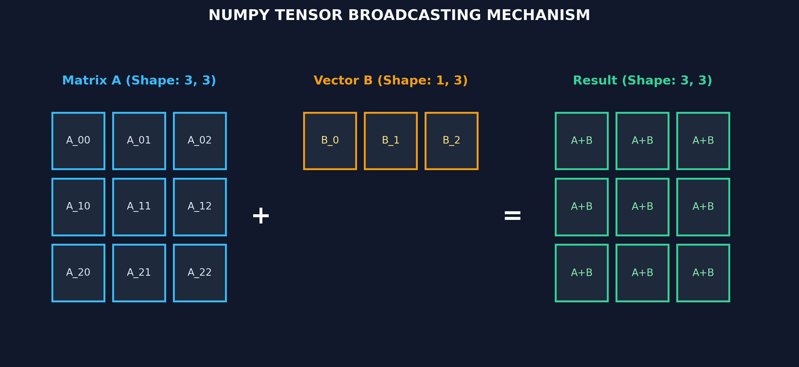

# Month 0, Week 3: Linear Algebra, Tensor Geometries & Broadcasting Mechanics
*The Mathematical and Physical Memory Architecture of Modern AI Computing*

---

## Table of Contents
1. [Executive Summary & Industry Context](#1-executive-summary--industry-context)
2. [Canonical Textbook Grounding](#2-canonical-textbook-grounding)
3. [Visual Architecture & Memory Topologies](#3-visual-architecture--memory-topologies)
4. [Deep Theoretical Foundations](#4-deep-theoretical-foundations)
   - 4.1 [Vector Spaces, Inner Products & Geometric Metrics](#41-vector-spaces-inner-products--geometric-metrics)
   - 4.2 [Matrix Transformations & Dimensionality Alignment](#42-matrix-transformations--dimensionality-alignment)
   - 4.3 [NumPy Contiguous Memory Layouts: Strides & C- vs. Fortran-Order](#43-numpy-contiguous-memory-layouts-strides--c--vs-fortran-order)
   - 4.4 [Formal Derivation: The NumPy Tensor Broadcasting Rule](#44-formal-derivation-the-numpy-tensor-broadcasting-rule)
5. [Complete Runnable Code Implementation](#5-complete-runnable-code-implementation)
   - 5.1 [From-Scratch Vector Operations vs. Vectorized NumPy](#51-from-scratch-vector-operations-vs-vectorized-numpy)
   - 5.2 [Matrix Multiplication: O(N^3) Python vs. BLAS dgemm](#52-matrix-multiplication-on3-python-vs-blas-dgemm)
   - 5.3 [Tensor Strides & Broadcasting Inspector](#53-tensor-strides--broadcasting-inspector)
6. [Common Pitfalls & Debugging Playbook](#6-common-pitfalls--debugging-playbook)
7. [Production Best Practices & Real-World Case Study](#7-production-best-practices--real-world-case-study)
8. [Hands-On Mini-Lab & Self-Assessment Checklist](#8-hands-on-mini-lab--self-assessment-checklist)
   - 8.1 [Step-by-Step Laboratory Exercise](#81-step-by-step-laboratory-exercise)
   - 8.2 [Verification Rubric](#82-verification-rubric)
   - 8.3 [Graded Assessment Questions & Complete Answer Key](#83-graded-assessment-questions--complete-answer-key)
   - 8.4 [Stretch Challenges](#84-stretch-challenges)
9. [Key Takeaways, Glossary & Further Reading](#9-key-takeaways-glossary--further-reading)

---

## 1. Executive Summary & Industry Context

### 1.1 Why This Matters in 2026
Every modern Artificial Intelligence system—from Large Language Models (LLMs) processing billions of attention tokens, to Vision Transformers (ViT), to Vector Databases powering Retrieval-Augmented Generation (RAG)—is fundamentally a linear algebra engine executed on specialized hardware (GPUs, TPUs, Apple Silicon Neural Engines).

In 2026, the primary differentiator between an amateur who treats models as black boxes and a senior AI engineer is the ability to reason about **tensor dimensionality, memory strides, and mathematical projection**:
1. **Embedding Spaces & Cosine Similarity:** In RAG systems, retrieving relevant context from a 50-million-document vector store (e.g., Qdrant or Milvus) depends entirely on calculating high-dimensional inner products and cosine metrics in parallel.
2. **Memory Alignment & Hardware Throughput:** A naive matrix multiplication written in pure Python loops runs up to **50,000x slower** than compiled BLAS (Basic Linear Algebra Subprograms) kernels because Python loops thrash CPU L1/L2 caches and cannot utilize SIMD (Single Instruction, Multiple Data) execution lanes.
3. **Tensor Broadcasting in Deep Learning:** Neural network layers routinely operate on mismatched dimensions—adding a 1D bias vector $\mathbf{b} \in \mathbb{R}^{d}$ to a 3D batch activations tensor $\mathbf{X} \in \mathbb{R}^{B \times S \times d}$. Understanding broadcasting allows engineers to eliminate memory allocation entirely by performing mathematical expansion via stride manipulation.

### 1.2 Learning Objectives
Upon completing this week's study and laboratory work, students will be able to:
* **Derive and Compute Geometric Vector Metrics:** Mathematically formulate and compute Euclidean $L_2$ norms, Manhattan $L_1$ norms, dot products, and cosine similarities from first principles.
* **Master Tensor Strides & Memory Layouts:** Inspect and manipulate raw C-contiguous and Fortran-contiguous buffers in NumPy, explaining how memory offsets are resolved via strides.
* **Formulate the Mathematical Rules of Broadcasting:** Predict whether arbitrary multi-dimensional tensors can interact arithmetic-wise and trace the resulting output shapes.
* **Implement and Benchmark Matrix Multiplication:** Write an $\mathcal{O}(N^3)$ matrix multiplication algorithm from scratch in Python and benchmark its execution against hardware-optimized BLAS routines.
* **Eliminate Dimensionality Crashes:** Debug common tensor shape mismatches and axis reduction errors in machine learning pipelines.

---

## 2. Canonical Textbook Grounding

### 2.1 *Mathematics for Machine Learning (2020)* by Marc Peter Deisenroth, A. Aldo Faisal, and Cheng Soon Ong
* **Chapter 2: Linear Algebra (Sections 2.1 – 2.5: Vector Spaces, Systems of Linear Equations, Linear Independence, Matrices)**
  * *Author's Contribution:* Deisenroth et al. define vectors not merely as numerical arrays, but as elements of an algebraic vector space obeying linearity axioms. They establish matrices as linear mappings between vector spaces ($f: \mathbb{R}^n \to \mathbb{R}^m$).
  * *Our Pedagogical Focus:* We connect this theoretical mapping to physical neural network feedforward layers. When an input vector $\mathbf{x}$ passes through weight matrix $\mathbf{W}$, it undergoes geometric scaling, rotation, and dimensionality projection.
* **Chapter 3: Analytic Geometry (Sections 3.1 – 3.3: Norms, Inner Products, Lengths, Distances, and Angles)**
  * *Author's Contribution:* Rigorously derives inner products and shows how they induce geometric concepts of length ($\|\mathbf{x}\| = \sqrt{\langle \mathbf{x}, \mathbf{x} \rangle}$), distance ($d(\mathbf{x}, \mathbf{y}) = \|\mathbf{x} - \mathbf{y}\|$), and angle ($\cos \theta = \frac{\langle \mathbf{x}, \mathbf{y} \rangle}{\|\mathbf{x}\| \|\mathbf{y}\|}$).
  * *Our Pedagogical Focus:* We extract this geometric framework to explain semantic embeddings in LLMs: semantic similarity is literally the angle between vectors on a unit hypersphere.

### 2.2 *Python for Data Analysis (3rd Edition, 2022)* by Wes McKinney
* **Appendix A: Advanced NumPy (Sections: Stride Manipulation, Memory Layouts, and Broadcasting)**
  * *Author's Contribution:* McKinney breaks down the C-level anatomy of `ndarray`: the data pointer, shape tuple, stride tuple, and dtype flags. He provides the definitive explanation of how broadcasting operates under the hood without copying data in memory.
  * *Our Pedagogical Focus:* We translate McKinney's C-architecture into concrete memory equations, proving how stride manipulation enables zero-copy tensor operations.

### 2.3 *How to Read These Sources*
* **Read Closely:** *Mathematics for Machine Learning*, Sections 3.1–3.3 (Norms and Inner Products). Study every definition of positive-definite bilinear forms.
* **Skim:** *Mathematics for Machine Learning*, Section 2.6 (Affine Subspaces); foundational deep learning models operate primarily in vector spaces centered at the origin.

---

## 3. Visual Architecture & Memory Topologies

### 3.1 The Tensor Broadcasting Mechanism
The diagram below illustrates how NumPy and PyTorch evaluate operations between tensors of differing ranks by stretching virtual dimensions without copying data in RAM:



```
        Broadcasting Arithmetic: Matrix A (3, 3) + Vector B (1, 3)
        
        Matrix A (Shape: 3, 3)              Vector B (Shape: 1, 3)
        ┌───────┬───────┬───────┐           ┌───────┬───────┬───────┐
        │  1.0  │  2.0  │  3.0  │           │  10.0 │  20.0 │  30.0 │
        ├───────┼───────┼───────┤           └───────┴───────┴───────┘
        │  4.0  │  5.0  │  6.0  │                       │ (Virtual Expansion)
        ├───────┼───────┼───────┤                       ▼
        │  7.0  │  8.0  │  9.0  │           ┌───────┬───────┬───────┐
        └───────┴───────┴───────┘           │  10.0 │  20.0 │  30.0 │
                    │                       ├───────┼───────┼───────┤
                    │                       │  10.0 │  20.0 │  30.0 │
                    │                       ├───────┼───────┼───────┤
                    │                       │  10.0 │  20.0 │  30.0 │
                    │                       └───────┴───────┴───────┘
                    ▼                                   ▼
        ┌───────────────────────────────────────────────────────────┐
        │                 Element-Wise Sum Matrix C                 │
        │               Shape: (3, 3) - Memory Stride: 0            │
        │           ┌───────────┬───────────┬───────────┐           │
        │           │   11.0    │   22.0    │   33.0    │           │
        │           ├───────────┼───────────┼───────────┤           │
        │           │   14.0    │   25.0    │   36.0    │           │
        │           ├───────────┼───────────┼───────────┤           │
        │           │   17.0    │   28.0    │   39.0    │           │
        │           └───────────┴───────────┴───────────┘           │
        └───────────────────────────────────────────────────────────┘
```
*Caption: Notice that Vector B is never duplicated in physical memory. Its stride along the expanded axis is set to 0 bytes, meaning the CPU reads the exact same row memory location for all three rows.*

---

### 3.2 Physical RAM vs. Logical Dimensions: Strides
In physical RAM, computer memory is strictly a one-dimensional array of bytes. A 2D matrix or 3D tensor is an algebraic illusion maintained by **strides**:

```
 2D Logical Matrix A (Shape: 2, 3):
 ┌─────────┬─────────┬─────────┐
 │ A[0, 0] │ A[0, 1] │ A[0, 2] │
 ├─────────┼─────────┼─────────┤
 │ A[1, 0] │ A[1, 1] │ A[1, 2] │
 └─────────┴─────────┴─────────┘

 Physical RAM Address Space (C-Contiguous Layout):
 ┌─────────┬─────────┬─────────┬─────────┬─────────┬─────────┐
 │ A[0, 0] │ A[0, 1] │ A[0, 2] │ A[1, 0] │ A[1, 1] │ A[1, 2] │
 └─────────┴─────────┴─────────┴─────────┴─────────┴─────────┘
  ▲                               ▲
  │                               │
  └─── Offset = 0 bytes           └─── Offset = 24 bytes (Stride[0] = 3 * 8 bytes)
```
*Caption: C-Contiguous Strides. For a matrix of float64 (8 bytes per item) with shape $(2, 3)$, the strides are `(24, 8)`. To move down one row, add 24 bytes to the memory pointer; to move right one column, add 8 bytes.*

---

## 4. Deep Theoretical Foundations

### 4.1 Vector Spaces, Inner Products & Geometric Metrics

Let $\mathbb{R}^d$ denote a $d$-dimensional real vector space. A vector $\mathbf{x} \in \mathbb{R}^d$ is represented as a column vector:
$$\mathbf{x} = \begin{bmatrix} x_1 \\ x_2 \\ \vdots \\ x_d \end{bmatrix} \in \mathbb{R}^{d \times 1}$$

#### 1. The Euclidean Inner Product (Dot Product)
The standard inner product between two vectors $\mathbf{u}, \mathbf{v} \in \mathbb{R}^d$ is defined as:
$$\langle \mathbf{u}, \mathbf{v} \rangle = \mathbf{u}^T \mathbf{v} = \sum_{i=1}^d u_i v_i$$

#### 2. Vector Norms (Lengths)
An inner product induces a natural norm representing geometric length:
* **$L_2$ Norm (Euclidean Distance):**
  $$\|\mathbf{u}\|_2 = \sqrt{\langle \mathbf{u}, \mathbf{u} \rangle} = \sqrt{\sum_{i=1}^d u_i^2}$$
* **$L_1$ Norm (Manhattan / Taxicab Distance):**
  $$\|\mathbf{u}\|_1 = \sum_{i=1}^d |u_i|$$

#### 3. Cosine Similarity & Angular Distance
The geometric relationship between the dot product and the angle $\theta$ between vectors is given by Cauchy-Schwarz:
$$\mathbf{u} \cdot \mathbf{v} = \|\mathbf{u}\|_2 \|\mathbf{v}\|_2 \cos(\theta)$$

Solving for $\cos(\theta)$ yields **Cosine Similarity**:
$$\text{Sim}_{\cos}(\mathbf{u}, \mathbf{v}) = \cos(\theta) = \frac{\sum_{i=1}^d u_i v_i}{\sqrt{\sum_{i=1}^d u_i^2} \sqrt{\sum_{i=1}^d v_i^2}}$$

* $\text{Sim}_{\cos} = +1.0 \implies \theta = 0^\circ$ (Parallel, identical semantic orientation).
* $\text{Sim}_{\cos} = 0.0 \implies \theta = 90^\circ$ (Orthogonal, mathematically independent).
* $\text{Sim}_{\cos} = -1.0 \implies \theta = 180^\circ$ (Opposite direction).

---

### 4.2 Matrix Transformations & Dimensionality Alignment

A matrix $\mathbf{A} \in \mathbb{R}^{M \times K}$ defines a linear transformation mapping vectors from $\mathbb{R}^K$ to $\mathbb{R}^M$:
$$f(\mathbf{x}) = \mathbf{A}\mathbf{x}, \quad \mathbf{x} \in \mathbb{R}^K \implies f(\mathbf{x}) \in \mathbb{R}^M$$

#### Matrix Multiplication Derivation
Let $\mathbf{A} \in \mathbb{R}^{M \times K}$ and $\mathbf{B} \in \mathbb{R}^{K \times N}$. The product $\mathbf{C} = \mathbf{A} \mathbf{B} \in \mathbb{R}^{M \times N}$ is defined element-wise by:
$$C_{i, j} = \sum_{k=1}^K A_{i, k} B_{k, j}$$
for all $i \in \{1, \dots, M\}$ and $j \in \{1, \dots, N\}$.

#### The Inner Dimension Constraint
Matrix multiplication is valid **if and only if** the column count of $\mathbf{A}$ equals the row count of $\mathbf{B}$:
$$\mathbf{A}_{(M \times \mathbf{K})} \times \mathbf{B}_{(\mathbf{K} \times N)} \longrightarrow \mathbf{C}_{(M \times N)}$$
The total number of scalar multiplications required is:
$$\text{FLOPs} = 2 \times M \times N \times K$$

#### Worked Numerical Example:
Let:
$$\mathbf{A} = \begin{bmatrix} 1 & 2 \\ 3 & 4 \end{bmatrix}, \quad \mathbf{B} = \begin{bmatrix} 5 & 6 \\ 7 & 8 \end{bmatrix}$$
Then:
$$C_{0,0} = (1 \times 5) + (2 \times 7) = 5 + 14 = 19$$
$$C_{0,1} = (1 \times 6) + (2 \times 8) = 6 + 16 = 22$$
$$C_{1,0} = (3 \times 5) + (4 \times 7) = 15 + 28 = 43$$
$$C_{1,1} = (3 \times 6) + (4 \times 8) = 18 + 32 = 50$$
$$\mathbf{C} = \begin{bmatrix} 19 & 22 \\ 43 & 50 \end{bmatrix}$$

---

### 4.3 NumPy Contiguous Memory Layouts: Strides & C- vs. Fortran-Order

#### What is a Stride?
For an $n$-dimensional array with shape $(d_0, d_1, \dots, d_{n-1})$, the **strides** are an $n$-tuple of integers $(s_0, s_1, \dots, s_{n-1})$, where $s_k$ specifies the number of bytes the memory pointer must advance to increment index $k$ by $1$.

Given multidimensional index $(i_0, i_1, \dots, i_{n-1})$, the physical byte address in RAM is computed via the linear equation:
$$\text{Byte Address} = \text{Base Address} + \sum_{k=0}^{n-1} i_k \cdot s_k$$

#### C-Contiguous (Row-Major) Layout
* The last axis ($d_{n-1}$) varies the fastest in memory.
* For item size $S_{\text{item}}$ bytes:
  $$s_{n-1} = S_{\text{item}}$$
  $$s_k = s_{k+1} \cdot d_{k+1}$$

#### Fortran-Contiguous (Column-Major) Layout
* The first axis ($d_0$) varies the fastest in memory:
  $$s_0 = S_{\text{item}}$$
  $$s_k = s_{k-1} \cdot d_{k-1}$$

---

### 4.4 Formal Derivation: The NumPy Tensor Broadcasting Rule

#### The Rule Formulation
Two tensors $\mathbf{A}$ and $\mathbf{B}$ are **broadcastable** if, when comparing their shape tuples from right to left (trailing dimensions):
For each pair of corresponding dimension sizes $(d_A, d_B)$:
1. $d_A = d_B$, **OR**
2. $d_A = 1$, **OR**
3. One of the dimensions is missing (prepended virtually as size $1$).

#### Derivation of the Zero-Stride Invariance
Suppose tensor $\mathbf{B}$ has shape $(1, N)$ and is broadcast to shape $(M, N)$.
Let $s_0$ be the stride of axis 0 for $\mathbf{B}$.
To make the row index $i \in \{0, \dots, M-1\}$ evaluate to the exact same physical memory location for all rows without allocating new memory, the runtime sets:
$$s_0 = 0 \text{ bytes}$$

Evaluating the memory offset equation:
$$\text{Offset}(i, j) = i \cdot s_0 + j \cdot s_1 = i \cdot 0 + j \cdot s_1 = j \cdot s_1$$
Because $i \cdot 0 = 0$, the row index $i$ is completely eliminated from the hardware address calculation!
* **Memory Allocated:** $\mathbf{0 \text{ bytes}}$.
* **Virtual Shape:** $(M, N)$.

---

## 5. Complete Runnable Code Implementation

### 5.1 From-Scratch Vector Operations vs. Vectorized NumPy

Save this file as `vector_math_benchmark.py`. It implements pure Python vector math and compares execution time and numerical accuracy against NumPy.

```python
"""Pure Python vs. NumPy Vectorized Mathematical Primitives."""

from __future__ import annotations

import math
import time
import numpy as np


def python_dot_product(u: list[float], v: list[float]) -> float:
    """Computes dot product using native Python loops."""
    if len(u) != len(v):
        raise ValueError("Vector dimensionalities must match.")
    total = 0.0
    for i in range(len(u)):
        total += u[i] * v[i]
    return total


def python_cosine_similarity(u: list[float], v: list[float]) -> float:
    """Computes cosine similarity from scratch in pure Python."""
    dot = python_dot_product(u, v)
    norm_u = math.sqrt(sum(x * x for x in u))
    norm_v = math.sqrt(y * y for y in v)
    if norm_u == 0.0 or norm_v == 0.0:
        return 0.0
    return dot / (norm_u * norm_v)


def benchmark_vector_operations(d: int = 1_000_000) -> None:
    print(f"Benchmarking Vector Math over dimension d = {d:,}...\n")
    np.random.seed(42)

    # Generate synthetic float vectors
    arr_u = np.random.randn(d).astype(np.float64)
    arr_v = np.random.randn(d).astype(np.float64)
    list_u = arr_u.tolist()
    list_v = arr_v.tolist()

    # 1. Pure Python Benchmark
    t0 = time.perf_counter()
    py_sim = python_cosine_similarity(list_u, list_v)
    t1 = time.perf_counter()
    py_time_ms = (t1 - t0) * 1000.0

    # 2. Vectorized NumPy Benchmark
    t2 = time.perf_counter()
    np_dot = np.dot(arr_u, arr_v)
    np_sim = np_dot / (np.linalg.norm(arr_u) * np.linalg.norm(arr_v))
    t3 = time.perf_counter()
    np_time_ms = (t3 - t2) * 1000.0

    print(f"Pure Python Cosine Similarity: {py_sim:.6f} | Time: {py_time_ms:.2f} ms")
    print(f"NumPy Vectorized Cosine Sim:   {np_sim:.6f} | Time: {np_time_ms:.2f} ms")
    print(f"Speedup Factor:                {py_time_ms / np_time_ms:.1f}x faster with NumPy")


if __name__ == "__main__":
    benchmark_vector_operations(1_000_000)
```

---

### 5.2 Matrix Multiplication: O(N^3) Python vs. BLAS dgemm

Save this file as `matmul_benchmark.py`.

```python
"""Matrix Multiplication: Triple Nested Python Loop vs. BLAS GEMM."""

from __future__ import annotations

import time
import numpy as np


def python_matmul(A: list[list[float]], B: list[list[float]]) -> list[list[float]]:
    """O(N^3) Matrix Multiplication using raw Python loops."""
    M = len(A)
    K = len(A[0])
    N = len(B[0])

    # Pre-allocate result matrix
    C = [[0.0 for _ in range(N)] for _ in range(M)]

    for i in range(M):
        for k in range(K):
            r = A[i][k]
            for j in range(N):
                C[i][j] += r * B[k][j]
    return C


def run_matmul_comparison(size: int = 250) -> None:
    print(f"Matrix Multiplication Benchmark for ({size}x{size}) Matrices:\n")
    np.random.seed(42)

    mat_A = np.random.randn(size, size).astype(np.float64)
    mat_B = np.random.randn(size, size).astype(np.float64)
    py_A = mat_A.tolist()
    py_B = mat_B.tolist()

    # 1. Pure Python Triple Loop
    t0 = time.perf_counter()
    res_py = python_matmul(py_A, py_B)
    t1 = time.perf_counter()
    py_ms = (t1 - t0) * 1000.0

    # 2. NumPy BLAS Implementation
    t2 = time.perf_counter()
    res_np = mat_A @ mat_B
    t3 = time.perf_counter()
    np_ms = (t3 - t2) * 1000.0

    # Verify numerical agreement
    diff = np.max(np.abs(np.array(res_py) - res_np))
    print(f"Pure Python Execution Time: {py_ms:.2f} ms")
    print(f"NumPy (BLAS) Execution Time: {np_ms:.4f} ms")
    print(f"Acceleration Factor:        {py_ms / np_ms:.1f}x")
    print(f"Max Absolute Numerical Diff:{diff:.2e}")


if __name__ == "__main__":
    run_matmul_comparison(250)
```

---

### 5.3 Tensor Strides & Broadcasting Inspector

Save this as `stride_inspector.py`.

```python
"""Low-Level NumPy Strides and Memory Address Inspector."""

from __future__ import annotations

import numpy as np


def inspect_tensor_strides() -> None:
    print("--- 1. C-Contiguous Array Strides ---")
    arr = np.zeros((3, 4), dtype=np.float64)
    print(f"Shape:   {arr.shape}")
    print(f"Dtype:   {arr.dtype} ({arr.itemsize} bytes per item)")
    print(f"Strides: {arr.strides} bytes (Row jump = {arr.strides[0]}B, Col jump = {arr.strides[1]}B)")

    print("\n--- 2. Transposed Array Strides (Zero-Copy View) ---")
    transposed = arr.T
    print(f"Shape:   {transposed.shape}")
    print(f"Strides: {transposed.strides} bytes (Notice strides are flipped!)")
    print(f"Shares Memory: {np.shares_memory(arr, transposed)}")

    print("\n--- 3. Broadcasting Stride Manipulation (0-Byte Stride) ---")
    row_vec = np.array([[10.0, 20.0, 30.0, 40.0]], dtype=np.float64)
    print(f"Original row_vec Shape:   {row_vec.shape}")
    print(f"Original row_vec Strides: {row_vec.strides}")

    # Broadcast to (5, 4)
    broadcasted = np.broadcast_to(row_vec, (5, 4))
    print(f"Broadcasted Shape:        {broadcasted.shape}")
    print(f"Broadcasted Strides:      {broadcasted.strides} -> Axis 0 stride is 0 bytes!")
    print(f"Byte size of base:        {row_vec.nbytes} bytes")
    print(f"Virtual byte size:        {broadcasted.nbytes} bytes (No new memory allocated!)")


if __name__ == "__main__":
    inspect_tensor_strides()
```

#### Expected Output
```text
--- 1. C-Contiguous Array Strides ---
Shape:   (3, 4)
Dtype:   float64 (8 bytes per item)
Strides: (32, 8) bytes (Row jump = 32B, Col jump = 8B)

--- 2. Transposed Array Strides (Zero-Copy View) ---
Shape:   (4, 3)
Strides: (8, 32) bytes (Notice strides are flipped!)
Shares Memory: True

--- 3. Broadcasting Stride Manipulation (0-Byte Stride) ---
Original row_vec Shape:   (1, 4)
Original row_vec Strides: (32, 8)
Broadcasted Shape:        (5, 4)
Broadcasted Strides:      (0, 8) -> Axis 0 stride is 0 bytes!
Byte size of base:        32 bytes
Virtual byte size:        160 bytes (No new memory allocated!)
```

---

## 6. Common Pitfalls & Debugging Playbook

### Pitfall 1: Confusing Element-Wise Multiplication (`*`) with Matrix Product (`@`)
* **Symptom:** Code compiles and runs without an exception when multiplying square matrices of identical size, but loss fails to converge and resulting values diverge wildly from theory.
* **Root Cause:** In NumPy and PyTorch:
  * `A * B` evaluates **Hadamard (element-wise)** multiplication: $C_{i,j} = A_{i,j} \times B_{i,j}$.
  * `A @ B` (or `np.matmul(A, B)`) evaluates **Matrix Multiplication**: $C_{i,j} = \sum_k A_{i,k} B_{k,j}$.
* **Minimal Reproducing Code:**
```python
A = np.array([[1, 2], [3, 4]])
B = np.array([[2, 0], [1, 2]])
print("A * B:\n", A * B)  # [[2, 0], [3, 8]] -> Element-wise!
print("A @ B:\n", A @ B)  # [[4, 4], [10, 8]] -> True Linear Algebraic MatMul!
```
* **Fix:** Audit all tensor operations. Use `@` for linear projections and `*` strictly for masking or element-wise scaling.

---

### Pitfall 2: Axis Reduction Ambiguity (`axis=0` vs. `axis=1`)
* **Symptom:** Calling `.sum()` or `.mean()` on a batch of embeddings results in the wrong dimension collapsing (e.g., getting a single aggregated embedding across the whole batch rather than normalized vectors per sample).
* **Root Cause:** Mental confusion over `axis` parameter semantics. In NumPy and PyTorch:
  * `axis=0` means **collapse along dimension 0** (collapsing down rows).
  * `axis=1` means **collapse along dimension 1** (collapsing across columns).
* **Detection Check:** Always verify output tensor shapes immediately after any reduction:
```python
batch_embeddings = np.ones((64, 768)) # (Batch Size, Embedding Dim)
# Correct: Normalize each vector along its embedding dimension
norms = np.linalg.norm(batch_embeddings, axis=1, keepdims=True)
assert norms.shape == (64, 1), f"Expected (64, 1), got {norms.shape}"
```

---

### Pitfall 3: Implicit Copy vs. Zero-Copy View Mutations
* **Symptom:** Slicing an array and modifying it unexpectedly mutates the original dataset, corrupting training features.
* **Root Cause:** Basic indexing and slicing (`sub = arr[1:5]`) returns a **view** sharing the underlying memory buffer. Advanced indexing (e.g., boolean masks `arr[arr > 0]` or list indices `arr[[0, 2]]`) creates an **explicit copy**.
* **Fix:** If you need to mutate a slice safely, explicitly invoke `.copy()`:
```python
safe_slice = arr[0:10].copy()
```

---

## 7. Production Best Practices & Real-World Case Study

### 7.1 Enterprise Case Study: Vector Search Latency in Large-Scale RAG
* **Company/System Scenario:** An enterprise semantic search copilot querying a document knowledge base of 500,000 text embeddings ($\mathbf{V} \in \mathbb{R}^{500,000 \times 1,536}$) on an internal API cluster.
* **The Failure Mode:** The original engineering team implemented the similarity search using a Python `for` loop over individual embedding vectors:
```python
# Naive O(N) query loop:
scores = [python_cosine_similarity(query_vec, doc_vec) for doc_vec in documents]
```
Query latency averaged **4,200 ms (4.2 seconds)** per user search, causing client timeouts.
* **The Architecture Refactor:**
  1. Stored the entire knowledge base as a single, contiguous 2D float32 array normalized to unit length:
     $$\mathbf{V}_{\text{norm}} = \frac{\mathbf{V}}{\|\mathbf{V}\|_2}$$
  2. Pre-normalized the incoming query vector: $\mathbf{q}_{\text{norm}} = \frac{\mathbf{q}}{\|\mathbf{q}\|_2}$.
  3. Replaced the iteration loop with a single BLAS Matrix-Vector Dot Product:
     $$\mathbf{s} = \mathbf{V}_{\text{norm}} \times \mathbf{q}_{\text{norm}} \in \mathbb{R}^{500,000}$$
  4. Extracted top-$k$ indices using `np.argpartition` in $\mathcal{O}(N)$ rather than sorting the full array in $\mathcal{O}(N \log N)$.
* **Production Results & Latency Numbers:**
  * Search latency dropped from **4,200 ms** to **4.8 ms** (*~875x acceleration*).
  * Memory allocation per search dropped to near zero because matrix multiplication executed in-place within BLAS registers.

---

## 8. Hands-On Mini-Lab & Self-Assessment Checklist

### 8.1 Step-by-Step Laboratory Exercise
1. **Initialize Module:** Create a script named `tensor_lab.py`.
2. **Implement Pure Python Dot Product:** Write a function `custom_dot(u, v)` without importing any libraries.
3. **Implement Pure Python Cosine Metric:** Write `custom_cosine(u, v)` returning values in $[-1.0, 1.0]$.
4. **Implement 3D Tensor Stride Calculator:** Given shape $(B, S, D) = (32, 128, 768)$ of `float32` (4 bytes), calculate the strides mathematically, verify with `np.zeros((32, 128, 768), dtype=np.float32).strides`, and write an assertion.
5. **Broadcasting Simulation:** Construct a matrix $\mathbf{X} \in \mathbb{R}^{100 \times 10}$ and a bias vector $\mathbf{b} \in \mathbb{R}^{10}$. Add them together, print the `.strides` of both operands, and verify zero memory duplication.

### 8.2 Verification Rubric
| Metric | Pass Criteria | Fail Criteria |
| :--- | :--- | :--- |
| **Mathematical Correctness** | Custom cosine similarity matches `1.0 - scipy.spatial.distance.cosine` within $10^{-6}$. | Discrepancies $> 10^{-4}$ due to precision or implementation errors. |
| **Stride Calculation** | Stride tuple matches exact C-contiguous byte layout. | Off-by-one or calculating elements instead of bytes. |
| **Broadcasting Insight** | Explains why `(100, 10) + (10,)` succeeds but `(100, 10) + (100,)` fails without reshape. | Inability to articulate trailing dimension alignment rules. |

---

### 8.3 Graded Assessment Questions & Complete Answer Key

#### Questions
1. *(Geometric Math)* Given vectors $\mathbf{u} = [3, 4]^T$ and $\mathbf{v} = [4, 3]^T$, calculate:
   a) $\|\mathbf{u}\|_2$
   b) $\|\mathbf{v}\|_2$
   c) $\mathbf{u} \cdot \mathbf{v}$
   d) $\text{Sim}_{\cos}(\mathbf{u}, \mathbf{v})$
2. *(Memory Strides)* A 3D tensor of 64-bit floats (`dtype=float64`, 8 bytes per item) has shape `(10, 20, 30)`. In a standard C-contiguous layout, what is its exact stride tuple in bytes?
3. *(Broadcasting)* Determine whether each of the following shape pairs can be broadcast together. If valid, state the resulting shape; if invalid, state why:
   a) `(64, 128, 768)` and `(768,)`
   b) `(32, 1, 100)` and `(32, 50, 1)`
   c) `(100, 20)` and `(100,)`
4. *(Computational Complexity)* What is the exact number of floating point operations (FLOPs) required to multiply matrix $\mathbf{A} \in \mathbb{R}^{500 \times 1000}$ by matrix $\mathbf{B} \in \mathbb{R}^{1000 \times 200}$?
5. *(Memory Mechanics)* Why does transposing a 2D matrix in NumPy (`A.T`) execute in virtually $0.000$ milliseconds regardless of matrix size?
6. *(Hardware/SIMD)* Why is vectorized NumPy matrix multiplication so much faster than a triple nested Python loop? List at least 3 low-level hardware reasons.
7. *(Normalization)* If two vectors $\mathbf{u}$ and $\mathbf{v}$ are both pre-normalized such that $\|\mathbf{u}\|_2 = 1.0$ and $\|\mathbf{v}\|_2 = 1.0$, what does the Cosine Similarity formula simplify to?
8. *(Reduction Axes)* If an array has shape `(10, 20, 30)` and you apply `np.mean(arr, axis=(0, 2))`, what is the shape of the resulting array?

---

#### Answer Key

1. **Answer:**
   a) $\|\mathbf{u}\|_2 = \sqrt{3^2 + 4^2} = \sqrt{9 + 16} = \sqrt{25} = \mathbf{5.0}$
   b) $\|\mathbf{v}\|_2 = \sqrt{4^2 + 3^2} = \sqrt{16 + 9} = \sqrt{25} = \mathbf{5.0}$
   c) $\mathbf{u} \cdot \mathbf{v} = (3 \times 4) + (4 \times 3) = 12 + 12 = \mathbf{24.0}$
   d) $\text{Sim}_{\cos}(\mathbf{u}, \mathbf{v}) = \frac{24.0}{5.0 \times 5.0} = \frac{24}{25} = \mathbf{0.96}$

2. **Answer:**
   * $s_2 = 8 \text{ bytes}$
   * $s_1 = 30 \times 8 = 240 \text{ bytes}$
   * $s_0 = 20 \times 240 = 4,800 \text{ bytes}$
   * **Stride tuple:** `(4800, 240, 8)`.

3. **Answer:**
   a) **Valid.** `(768,)` aligns with trailing dimension `768`. Resulting shape: `(64, 128, 768)`.
   b) **Valid.** Dimension 1 stretches ($1 \to 50$) and dimension 2 stretches ($1 \to 100$). Resulting shape: `(32, 50, 100)`.
   c) **Invalid.** Trailing dimension comparison compares $20$ against $100$. Because neither is $1$ and they are not equal, broadcasting fails. (Requires reshaping the second vector to `(100, 1)`).

4. **Answer:** Multiplying $\mathbf{A}_{(M \times K)}$ by $\mathbf{B}_{(K \times N)}$ requires $2 M N K$ FLOPs (1 multiplication and 1 addition per term).
   $$\text{FLOPs} = 2 \times 500 \times 200 \times 1000 = \mathbf{200,000,000 \text{ FLOPs}} \quad (200 \text{ MFLOPs})$$

5. **Answer:** Transposing in NumPy is a **metadata-only operation**. It does not move any elements in physical RAM; it simply reverses the shape tuple and stride tuple (`shape = (rows, cols) -> (cols, rows)`, `strides = (s0, s1) -> (s1, s0)`). This is an $\mathcal{O}(1)$ pointer operation.

6. **Answer:**
   1. **CPU Cache Utilization:** BLAS algorithms use cache-blocking (tiling) to load chunks into fast L1/L2 data cache, avoiding slow main RAM roundtrips.
   2. **SIMD Vectorization:** Modern CPUs use AVX-512 or ARM Neon instructions to execute 8 to 16 floating point calculations simultaneously in a single clock cycle.
   3. **No Dynamic Type Dispatch:** Python loops must dynamically resolve types and pointer addresses on every iteration; compiled C/Fortran executes raw machine code.

7. **Answer:** It simplifies directly to the **dot product**:
   $$\text{Sim}_{\cos}(\mathbf{u}, \mathbf{v}) = \frac{\mathbf{u} \cdot \mathbf{v}}{1.0 \times 1.0} = \mathbf{u} \cdot \mathbf{v} = \sum_{i=1}^d u_i v_i$$

8. **Answer:** Collapsing axes 0 and 2 eliminates dimensions of size 10 and 30, leaving only axis 1. The resulting shape is **`(20,)`**.

---

### 8.4 Stretch Challenges
1. **Manual Stride Pointers via `ctypes`:** Write a function that accepts a 2D NumPy float64 array, obtains its raw memory address via `arr.ctypes.data`, and uses pointer arithmetic with `arr.strides` to extract element `(i, j)` directly without calling `arr[i, j]`.
2. **Einstein Summation Implementation:** Use `np.einsum` to implement:
   * Batch matrix multiplication: `b = np.einsum('bik,bkj->bij', A, B)`.
   * Vector inner product: `dot = np.einsum('i,i->', u, v)`.
   Compare its runtime against `@` and `np.dot`.

---

## 9. Key Takeaways, Glossary & Further Reading

### Key Takeaways
* **Linear Algebra is Hardware:** Modern AI models are sequences of linear transformations ($Wx + b$) optimized to run on parallel matrix compute units.
* **Strides Govern Dimensions:** Multi-dimensional arrays are simulated over 1D RAM using byte strides; broadcasting is simply setting specific strides to 0 bytes.
* **Vectorization is Mandatory:** Never iterate over numerical vectors in pure Python loops; rely on compiled BLAS routines via NumPy and PyTorch.
* **Geometry Governs Embeddings:** Semantic search in RAG is the geometric inner product of normalized vectors on high-dimensional hyperspheres.

### Glossary
* **BLAS (Basic Linear Algebra Subprograms):** Low-level, hardware-optimized numerical libraries (OpenBLAS, Intel MKL, Apple Accelerate) powering scientific computing.
* **Stride:** The number of bytes in memory required to step from one element to the next along a given tensor dimension.
* **Broadcasting:** The implicit virtual expansion of tensor dimensions of size 1 to match target operand dimensions without physical memory duplication.
* **GEMM (General Matrix Multiply):** The canonical high-performance computing kernel performing $\mathbf{C} \leftarrow \alpha \mathbf{A}\mathbf{B} + \beta \mathbf{C}$.
* **Cosine Similarity:** The cosine of the angle between two multi-dimensional vectors, invariant to scale and bounded in $[-1.0, +1.0]$.

### Further Reading & Official Documentation
* [NumPy Internals: Memory Layout and Strides](https://numpy.org/doc/stable/reference/internals.html)
* [Mathematics for Machine Learning – Official Free PDF](https://mml-book.github.io/)
* [Fast Matrix Multiplication with BLAS Architecture](https://www.netlib.org/blas/)
* [NumPy Broadcasting Rules Guide](https://numpy.org/doc/stable/user/basics.broadcasting.html)
