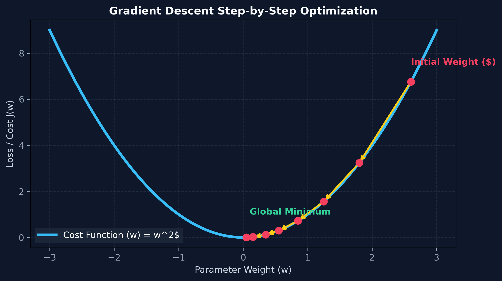
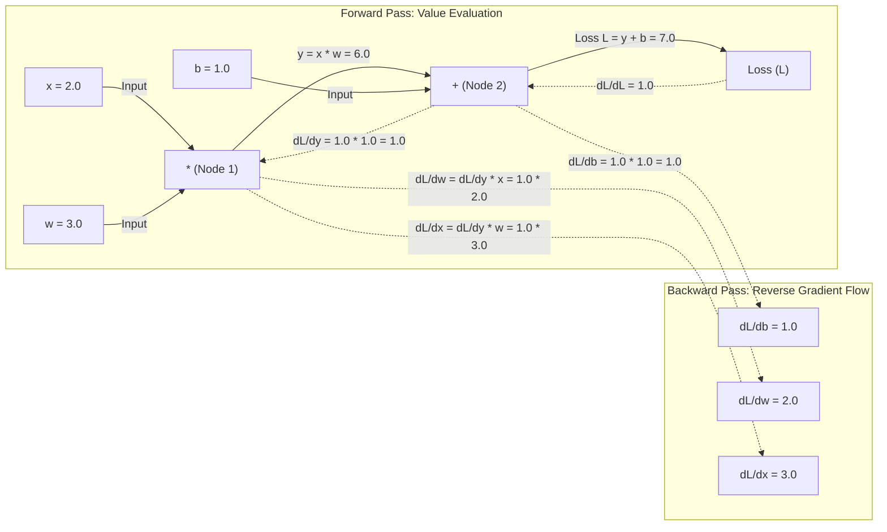

# Month 0, Week 4: Calculus, Autodiff & Probability for Classifiers
*The Optimization Engine of Machine Learning and Probabilistic Decision Theory*

---

## Table of Contents
1. [Executive Summary & Industry Context](#1-executive-summary--industry-context)
2. [Canonical Textbook Grounding](#2-canonical-textbook-grounding)
3. [Visual Architecture & Optimization Landscapes](#3-visual-architecture--optimization-landscapes)
4. [Deep Theoretical Foundations](#4-deep-theoretical-foundations)
   - 4.1 [Calculus of Optimization: Slopes, Gradients & The Chain Rule](#41-calculus-of-optimization-slopes-gradients--the-chain-rule)
   - 4.2 [Automatic Differentiation Mechanics: Forward vs. Reverse Mode](#42-automatic-differentiation-mechanics-forward-vs-reverse-mode)
   - 4.3 [Probability Theory for Classifiers: Bayes' Theorem & Maximum Likelihood](#43-probability-theory-for-classifiers-bayes-theorem--maximum-likelihood)
   - 4.4 [Mathematical Derivation: Multivariate Gradient Descent Convergence](#44-mathematical-derivation-multivariate-gradient-descent-convergence)
5. [Complete Runnable Code Implementation](#5-complete-runnable-code-implementation)
   - 5.1 [From-Scratch 2D Gradient Descent Optimizer with Trajectory Logging](#51-from-scratch-2d-gradient-descent-optimizer-with-trajectory-logging)
   - 5.2 [Micro-Autodiff Engine: Scalar Value with Reverse-Mode Autograd](#52-micro-autodiff-engine-scalar-value-with-reverse-mode-autograd)
   - 5.3 [Bayesian Probabilistic Classifier from First Principles](#53-bayesian-probabilistic-classifier-from-first-principles)
6. [Common Pitfalls & Debugging Playbook](#6-common-pitfalls--debugging-playbook)
7. [Production Best Practices & Real-World Case Study](#7-production-best-practices--real-world-case-study)
8. [Hands-On Mini-Lab & Self-Assessment Checklist](#8-hands-on-mini-lab--self-assessment-checklist)
   - 8.1 [Step-by-Step Laboratory Exercise](#81-step-by-step-laboratory-exercise)
   - 8.2 [Verification Rubric](#82-verification-rubric)
   - 8.3 [Graded Assessment Questions & Complete Answer Key](#83-graded-assessment-questions--complete-answer-key)
   - 8.4 [Stretch Challenges](#84-stretch-challenges)
9. [Key Takeaways, Glossary & Further Reading](#9-key-takeaways-glossary--further-reading)

---

## 1. Executive Summary & Industry Context

### 1.1 Why This Matters in 2026
Every machine learning model—from simple linear regression to a 405-billion-parameter Mixture-of-Experts (MoE) Large Language Model—is fundamentally governed by two mathematical disciplines: **Vector Calculus** (which calculates how parameters must change to reduce error) and **Probability Theory** (which quantifies uncertainty and confidence under noise).

In production AI engineering, optimization and probabilistic failures represent the most difficult class of bugs to diagnose because they fail **silently**:
1. **Vanishing and Exploding Gradients:** Deep neural networks fail to train when gradients vanish to zero (stalling learning completely) or explode to infinity (producing `NaN` loss values that destroy million-dollar pre-training runs). Understanding multivariable calculus allows engineers to design safe learning rate schedules, normalization layers, and gradient clipping thresholds.
2. **The Autodiff Computational Graph:** Frameworks like PyTorch and JAX compute gradients using **Reverse-Mode Automatic Differentiation**. Knowing how the dynamic directed acyclic graph (DAG) accumulates partial derivatives enables engineers to identify memory leaks caused by accidental graph retention.
3. **Calibrated Decision Boundaries:** A classifier that outputs `"class": "fraud", "probability": 0.99` is useless if its probabilities are uncalibrated. Understanding Bayes' Theorem and Likelihood enables engineers to adjust classification thresholds to minimize real-world monetary losses rather than chasing vanity accuracy metrics.

### 1.2 Learning Objectives
Upon completing this week's study and laboratory work, students will be able to:
* **Derive Multivariable Gradients:** Calculate partial derivatives, construct the gradient vector $\nabla f$, and prove why stepping in the direction of the negative gradient minimizes an objective function.
* **Explain the Mechanics of Automatic Differentiation:** Distinguish between numerical differentiation, symbolic differentiation, and reverse-mode automatic differentiation (autograd).
* **Implement a Functional Autograd Engine from Scratch:** Build a scalar computational graph with backward pass gradient accumulation.
* **Apply Bayes' Theorem to Probabilistic Classification:** Calculate prior, likelihood, marginal evidence, and posterior probabilities for real-world decision thresholds.
* **Diagnose Optimization Pathology:** Identify learning rate divergence, oscillations, and saddle points in loss surfaces.

---

## 2. Canonical Textbook Grounding

### 2.1 *Mathematics for Machine Learning (2020)* by Marc Peter Deisenroth, A. Aldo Faisal, and Cheng Soon Ong
* **Chapter 5: Vector Calculus (Sections 5.1 – 5.5: Differentiation of Univariate Functions, Gradients of Matrices, Chain Rule, Automatic Differentiation)**
  * *Author's Contribution:* Deisenroth et al. present a unified treatment of multivariate differentiation. They provide the formal proof of the multivariate Chain Rule as the composition of linear mappings (Jacobian matrices).
  * *Our Pedagogical Focus:* We extract this Jacobian formulation to build the foundation for neural network backpropagation. The Chain Rule is not merely a calculus trick; it is a dynamic dynamic programming algorithm traversing a computational graph in reverse.
* **Chapter 6: Probability and Distributions (Sections 6.1 – 6.5: Probability Space, Conditional Probability, Bayes' Theorem, Gaussian Distributions)**
  * *Author's Contribution:* Establishes probability as a measure over a sample space, rigorously defines conditional independence, and demonstrates how Bayes' Theorem inverts cause and effect.
  * *Our Pedagogical Focus:* We connect Bayes' rule directly to loss functions (Binary Cross-Entropy as the negative log-likelihood of a Bernoulli distribution).

### 2.2 *Pattern Recognition and Machine Learning (2006)* by Christopher M. Bishop
* **Chapter 1: Introduction (Sections 1.2: Probability Theory & Section 1.5: Decision Theory)**
  * *Author's Contribution:* Bishop formalizes the Bayesian viewpoint of machine learning, demonstrating that model parameters themselves can be modeled with prior distributions. He details the minimization of expected loss across asymmetric cost matrices.
  * *Our Pedagogical Focus:* We utilize Bishop's decision theory to teach students how to shift classification thresholds based on business impact (e.g., false negatives being 100x more costly than false positives in medical diagnosis).

### 2.3 *How to Read These Sources*
* **Read Closely:** *Mathematics for Machine Learning*, Section 5.3 (The Chain Rule) and Section 6.3 (Bayes' Theorem).
* **Skim:** *Mathematics for Machine Learning*, Section 5.6 (Higher-Order Derivatives / Hessian tensors); practical modern deep learning models almost exclusively utilize first-order gradient methods due to the $\mathcal{O}(d^2)$ memory cost of the Hessian.

---

## 3. Visual Architecture & Optimization Landscapes

### 3.1 Gradient Descent Optimization Trajectory
The following visualization illustrates a parameter vector $\mathbf{w}$ stepping down a quadratic loss surface toward the global minimum:



```
        Loss Surface J(w) and Parameter Updates
        
           J(w) Loss
              ▲
              │          Initial Weight (w0)
              │           ● [Loss = 16.0]
              │            \
              │             \  Step 1: w1 = w0 - α * grad
              │              ▼
              │               ● [Loss = 6.4]
              │                \
              │                 \  Step 2
              │                  ▼
              │                   ●
              │                    \
              │                     ▼
              │            Global Minimum ★ (w* = 0.0, Loss = 0.0)
              └───────────────────────────────────────────────► Parameter (w)
```
*Caption: Gradient Descent on a Convex Quadratic Loss. At each step, the gradient $\nabla J(w)$ computes the instantaneous slope. Stepping in the negative direction scaled by learning rate $\alpha$ moves parameters toward the global minimum.*

---

### 3.2 The Reverse-Mode Computational Graph (Autodiff)
In modern deep learning, models do not use symbolic calculus; they execute **Reverse-Mode Automatic Differentiation** across a dynamic Directed Acyclic Graph (DAG):



*Caption: Computational Graph for $L = (x \cdot w) + b$. Solid lines show the forward evaluation of values. Dashed lines show the reverse-mode autograd pass accumulating gradients via the Chain Rule.*

---

## 4. Deep Theoretical Foundations

### 4.1 Calculus of Optimization: Slopes, Gradients & The Chain Rule

#### 1. Univariate Derivative
The derivative of a single-variable function $f(x)$ represents the instantaneous rate of change:
$$f'(x) = \frac{df}{dx} = \lim_{h \to 0} \frac{f(x + h) - f(x)}{h}$$

#### 2. The Gradient Vector ($\nabla f$)
For a multivariable scalar field $f(\mathbf{w}): \mathbb{R}^d \to \mathbb{R}$, the gradient $\nabla f(\mathbf{w})$ is the column vector of all $d$ partial derivatives:
$$\nabla f(\mathbf{w}) = \begin{bmatrix} \frac{\partial f}{\partial w_1} \\ \frac{\partial f}{\partial w_2} \\ \vdots \\ \frac{\partial f}{\partial w_d} \end{bmatrix} \in \mathbb{R}^d$$

#### 3. Mathematical Proof: Steepest Descent Direction
**Theorem:** The directional derivative of $f$ in unit direction $\mathbf{v}$ ($\|\mathbf{v}\|_2 = 1$) is minimized when $\mathbf{v} = -\frac{\nabla f(\mathbf{w})}{\|\nabla f(\mathbf{w})\|_2}$.

*Proof:*
By the definition of the directional derivative $D_{\mathbf{v}} f(\mathbf{w})$:
$$D_{\mathbf{v}} f(\mathbf{w}) = \nabla f(\mathbf{w})^T \mathbf{v} = \|\nabla f(\mathbf{w})\|_2 \|\mathbf{v}\|_2 \cos(\theta)$$
Since $\|\mathbf{v}\|_2 = 1$:
$$D_{\mathbf{v}} f(\mathbf{w}) = \|\nabla f(\mathbf{w})\|_2 \cos(\theta)$$
To make this quantity as negative as possible (steepest descent), we must minimize $\cos(\theta)$. The minimum of $\cos(\theta)$ occurs when $\theta = 180^\circ$ ($\pi$ radians), where $\cos(\pi) = -1.0$.
Therefore, $\mathbf{v}$ must point in the exact opposite direction of the gradient $\nabla f(\mathbf{w})$:
$$\mathbf{v}^* = -\frac{\nabla f(\mathbf{w})}{\|\nabla f(\mathbf{w})\|_2} \quad \blacksquare$$

---

### 4.2 Automatic Differentiation Mechanics: Forward vs. Reverse Mode

When calculating derivatives on a computer, there are four paradigms:
1. **Manual Analytical Calculus:** Manually deriving formulas and writing code. Error-prone and impossible for deep architectures with millions of layers.
2. **Numerical Differentiation (Finite Differences):**
   $$\frac{\partial f}{\partial w_i} \approx \frac{f(\mathbf{w} + \epsilon \mathbf{e}_i) - f(\mathbf{w})}{\epsilon}$$
   Requires $d + 1$ forward passes for $d$ parameters. For a 7-billion parameter model, computing one gradient step would take years! Furthermore, finite differences suffer from severe roundoff and truncation errors.
3. **Symbolic Differentiation (Mathematica, SymPy):** Generates exact mathematical expressions. Suffers from *expression swell*, where formulas grow exponentially large.
4. **Automatic Differentiation (Autodiff):** Executes exact floating-point derivative evaluation alongside code execution by applying the Chain Rule to elementary arithmetic operations ($+, -, \times, \div, \exp, \log$).

#### Forward-Mode vs. Reverse-Mode
* **Forward-Mode:** Computes directional derivatives along with the forward pass using dual numbers ($v + \dot{v} \epsilon$ where $\epsilon^2 = 0$). Efficient when inputs $\ll$ outputs ($f: \mathbb{R}^1 \to \mathbb{R}^M$).
* **Reverse-Mode (Backpropagation):** Evaluates the forward pass first, recording a graph of operations, then traverses backward from a scalar loss to all inputs ($f: \mathbb{R}^d \to \mathbb{R}^1$).
  * **Computational Cost:** A single backward pass computes gradients for **all $d$ parameters** in approximately the time of **two forward passes**, completely independent of parameter count $d$!

---

### 4.3 Probability Theory for Classifiers: Bayes' Theorem & Maximum Likelihood

In classification tasks, an AI model outputs probabilities over discrete classes $C_k$ given feature evidence $\mathbf{x}$.

#### 1. Bayes' Theorem Formulation
$$P(C_k \mid \mathbf{x}) = \frac{P(\mathbf{x} \mid C_k) P(C_k)}{P(\mathbf{x})} = \frac{P(\mathbf{x} \mid C_k) P(C_k)}{\sum_{j} P(\mathbf{x} \mid C_j) P(C_j)}$$

Where:
* **$P(C_k \mid \mathbf{x})$ (Posterior):** The probability that an instance belongs to class $C_k$ given observed feature vector $\mathbf{x}$.
* **$P(\mathbf{x} \mid C_k)$ (Likelihood):** The probability of observing feature vector $\mathbf{x}$ given that the class is $C_k$.
* **$P(C_k)$ (Prior):** The baseline probability of class $C_k$ occurring across the global population before seeing evidence.
* **$P(\mathbf{x})$ (Evidence / Marginal):** Normalizing constant ensuring all posterior probabilities sum to $1.0$.

#### 2. The Maximum A Posteriori (MAP) and Maximum Likelihood (MLE) Principles
* **MAP Decision Rule:** Pick the class maximizing the posterior:
  $$\hat{C}_{\text{MAP}} = \arg\max_{C_k} P(C_k \mid \mathbf{x}) = \arg\max_{C_k} [ \log P(\mathbf{x} \mid C_k) + \log P(C_k) ]$$
* **MLE Decision Rule:** If all classes have uniform priors ($P(C_k) = \frac{1}{K}$), MAP simplifies to Maximum Likelihood Estimation:
  $$\hat{C}_{\text{MLE}} = \arg\max_{C_k} \log P(\mathbf{x} \mid C_k)$$

---

### 4.4 Mathematical Derivation: Multivariate Gradient Descent Convergence

#### Problem Formulation
Consider an arbitrary $L$-Lipschitz smooth convex loss function $f(\mathbf{w})$:
$$\|\nabla f(\mathbf{u}) - \nabla f(\mathbf{v})\|_2 \le L \|\mathbf{u} - \mathbf{v}\|_2, \quad \forall \mathbf{u}, \mathbf{v} \in \mathbb{R}^d$$

By the Descent Lemma (Taylor expansion bound under $L$-smoothness):
$$f(\mathbf{w}_{t+1}) \le f(\mathbf{w}_t) + \nabla f(\mathbf{w}_t)^T (\mathbf{w}_{t+1} - \mathbf{w}_t) + \frac{L}{2} \|\mathbf{w}_{t+1} - \mathbf{w}_t\|_2^2$$

#### The Parameter Update
Under standard gradient descent with constant learning rate $\alpha$:
$$\mathbf{w}_{t+1} = \mathbf{w}_t - \alpha \nabla f(\mathbf{w}_t) \implies (\mathbf{w}_{t+1} - \mathbf{w}_t) = -\alpha \nabla f(\mathbf{w}_t)$$

#### Derivation of the Guaranteed Descent Condition
Substitute the update into the Descent Lemma:
$$f(\mathbf{w}_{t+1}) \le f(\mathbf{w}_t) + \nabla f(\mathbf{w}_t)^T (-\alpha \nabla f(\mathbf{w}_t)) + \frac{L}{2} \|-\alpha \nabla f(\mathbf{w}_t)\|_2^2$$
$$f(\mathbf{w}_{t+1}) \le f(\mathbf{w}_t) - \alpha \|\nabla f(\mathbf{w}_t)\|_2^2 + \frac{\alpha^2 L}{2} \|\nabla f(\mathbf{w}_t)\|_2^2$$
Factor out the squared gradient norm $\|\nabla f(\mathbf{w}_t)\|_2^2$:
$$f(\mathbf{w}_{t+1}) \le f(\mathbf{w}_t) - \alpha \left( 1 - \frac{\alpha L}{2} \right) \|\nabla f(\mathbf{w}_t)\|_2^2$$

To guarantee that the loss decreases at every single step ($f(\mathbf{w}_{t+1}) < f(\mathbf{w}_t)$ whenever $\nabla f(\mathbf{w}_t) \ne \mathbf{0}$), we must have:
$$1 - \frac{\alpha L}{2} > 0 \implies \alpha < \frac{2}{L}$$

#### Optimal Learning Rate
Maximizing the reduction factor $\alpha (1 - \frac{\alpha L}{2})$ with respect to $\alpha$:
$$\frac{d}{d\alpha} \left[ \alpha - \frac{L}{2} \alpha^2 \right] = 1 - L\alpha = 0 \implies \mathbf{\alpha^* = \frac{1}{L}}$$

#### Worked Numerical Example:
Suppose a model loss surface has Lipschitz constant $L = 20.0$.
* The maximum stable learning rate is: $\alpha_{\text{max}} = \frac{2}{20.0} = 0.10$.
* The optimal convergence learning rate is: $\alpha^* = \frac{1}{20.0} = \mathbf{0.05}$.
* If an engineer sets $\alpha = 0.15$ ($> 0.10$), the algorithm will oscillate and diverge to infinity ($\mathbf{\infty}$).

---

## 5. Complete Runnable Code Implementation

### 5.1 From-Scratch 2D Gradient Descent Optimizer with Trajectory Logging

Save this file as `gradient_descent_2d.py`. It implements a multivariable optimizer on the classic **Rosenbrock valley** function ($f(x, y) = (1 - x)^2 + 100(y - x^2)^2$).

```python
"""Multivariable Gradient Descent Optimizer on a Non-Convex Loss Surface."""

from __future__ import annotations

import math
from dataclasses import dataclass
from typing import List, Tuple


@dataclass
class OptimizationStep:
    epoch: int
    x: float
    y: float
    loss: float
    grad_norm: float


def rosenbrock_cost(x: float, y: float) -> float:
    """The Rosenbrock 'Banana' benchmark loss function."""
    return (1.0 - x) ** 2 + 100.0 * (y - x**2) ** 2


def rosenbrock_gradient(x: float, y: float) -> Tuple[float, float]:
    """Analytical gradient vector: [df/dx, df/dy]."""
    df_dx = -2.0 * (1.0 - x) - 400.0 * x * (y - x**2)
    df_dy = 200.0 * (y - x**2)
    return df_dx, df_dy


def run_gradient_descent(
    initial_pos: Tuple[float, float],
    learning_rate: float = 0.001,
    max_epochs: int = 10_000,
    tolerance: float = 1e-6,
) -> List[OptimizationStep]:
    x, y = initial_pos
    trajectory: List[OptimizationStep] = []

    for epoch in range(1, max_epochs + 1):
        loss = rosenbrock_cost(x, y)
        gx, gy = rosenbrock_gradient(x, y)
        grad_norm = math.sqrt(gx**2 + gy**2)

        trajectory.append(OptimizationStep(epoch, x, y, loss, grad_norm))

        if grad_norm < tolerance:
            print(f"Converged at epoch {epoch:,} (Grad norm: {grad_norm:.2e})")
            break

        # Parameter step update
        x = x - learning_rate * gx
        y = y - learning_rate * gy

    return trajectory


if __name__ == "__main__":
    start_point = (-1.0, 1.0)
    lr = 0.0015
    print(f"Starting 2D Gradient Descent from {start_point} with lr={lr}...")

    steps = run_gradient_descent(start_point, learning_rate=lr, max_epochs=5000)
    final = steps[-1]

    print(f"Final State (Epoch {final.epoch}):")
    print(f"  Coordinates:  (x={final.x:.4f}, y={final.y:.4f})")
    print(f"  Target Point: (x=1.0000, y=1.0000)")
    print(f"  Final Loss:   {final.loss:.6f}")
```

---

### 5.2 Micro-Autodiff Engine: Scalar Value with Reverse-Mode Autograd

Save this file as `micro_autograd.py`. It implements a tiny reverse-mode automatic differentiation engine from scratch.

```python
"""Micro-Autograd Engine: Scalar Reverse-Mode Automatic Differentiation."""

from __future__ import annotations

from typing import Set


class Scalar:
    """A scalar value supporting dynamic reverse-mode automatic differentiation."""

    def __init__(
        self, data: float, _children: tuple[Scalar, ...] = (), _op: str = ""
    ) -> None:
        self.data: float = float(data)
        self.grad: float = 0.0
        self._backward = lambda: None
        self._prev: Set[Scalar] = set(_children)
        self._op: str = _op

    def __repr__(self) -> str:
        return f"Scalar(data={self.data:.4f}, grad={self.grad:.4f})"

    def __add__(self, other: Scalar | float) -> Scalar:
        other = other if isinstance(other, Scalar) else Scalar(other)
        out = Scalar(self.data + other.data, (self, other), "+")

        def _backward() -> None:
            # dL/dself = dL/dout * 1.0
            self.grad += 1.0 * out.grad
            other.grad += 1.0 * out.grad

        out._backward = _backward
        return out

    def __mul__(self, other: Scalar | float) -> Scalar:
        other = other if isinstance(other, Scalar) else Scalar(other)
        out = Scalar(self.data * other.data, (self, other), "*")

        def _backward() -> None:
            # Product rule: dL/dself = dL/dout * other.data
            self.grad += other.data * out.grad
            other.grad += self.data * out.grad

        out._backward = _backward
        return out

    def backward(self) -> None:
        """Executes full reverse topological backward pass."""
        topo: list[Scalar] = []
        visited: Set[Scalar] = set()

        def build_topo(v: Scalar) -> None:
            if v not in visited:
                visited.add(v)
                for child in v._prev:
                    build_topo(child)
                topo.append(v)

        build_topo(self)

        # Base case: dL/dL = 1.0
        self.grad = 1.0
        for node in reversed(topo):
            node._backward()


if __name__ == "__main__":
    print("--- Verifying Micro-Autodiff Graph: L = (x * w) + b ---")
    x = Scalar(2.0)
    w = Scalar(3.0)
    b = Scalar(1.0)

    # Forward Pass
    y = x * w  # 6.0
    L = y + b  # 7.0

    # Backward Pass
    L.backward()

    print(f"Forward Output L: {L.data} (Expected: 7.0)")
    print(f"Gradient dL/dw:   {w.grad} (Expected: x = 2.0)")
    print(f"Gradient dL/dx:   {x.grad} (Expected: w = 3.0)")
    print(f"Gradient dL/db:   {b.grad} (Expected: 1.0)")
```

#### Expected Output
```text
--- Verifying Micro-Autodiff Graph: L = (x * w) + b ---
Forward Output L: 7.0 (Expected: 7.0)
Gradient dL/dw:   2.0 (Expected: x = 2.0)
Gradient dL/dx:   3.0 (Expected: w = 3.0)
Gradient dL/db:   1.0 (Expected: 1.0)
```

---

### 5.3 Bayesian Probabilistic Classifier from First Principles

Save this as `bayesian_classifier.py`.

```python
"""Bayesian Classifier: Applying Bayes' Theorem to Feature Classification."""

from __future__ import annotations

import math
from typing import Dict


class GaussianBayesClassifier:
    """Binary classifier computing posterior probabilities using Gaussian likelihoods."""

    def __init__(self, prior_pos: float = 0.05) -> None:
        # Prior probability P(Y=1) - e.g., 5% base fraud rate
        self.p_pos = prior_pos
        self.p_neg = 1.0 - prior_pos

        # Class-conditional feature distribution parameters: N(mu, sigma^2)
        # Positive class (Fraud): higher transaction amounts
        self.mu_pos = 250.0
        self.sigma_pos = 50.0

        # Negative class (Legitimate): lower transaction amounts
        self.mu_neg = 45.0
        self.sigma_neg = 20.0

    def _gaussian_pdf(self, x: float, mu: float, sigma: float) -> float:
        """Computes Gaussian probability density function: P(x | N(mu, sigma))."""
        coeff = 1.0 / (math.sqrt(2.0 * math.pi) * sigma)
        exponent = math.exp(-((x - mu) ** 2) / (2.0 * (sigma**2)))
        return coeff * exponent

    def predict_posterior(self, feature_val: float) -> Dict[str, float]:
        """Calculates exact Bayes posterior: P(Class=1 | feature_val)."""
        # 1. Compute Likelihoods P(x | Class)
        likelihood_pos = self._gaussian_pdf(feature_val, self.mu_pos, self.sigma_pos)
        likelihood_neg = self._gaussian_pdf(feature_val, self.mu_neg, self.sigma_neg)

        # 2. Compute Unnormalized Joint Probabilities
        joint_pos = likelihood_pos * self.p_pos
        joint_neg = likelihood_neg * self.p_neg

        # 3. Compute Marginal Evidence P(x) = sum_k P(x | C_k) P(C_k)
        evidence = joint_pos + joint_neg

        # 4. Compute Posterior P(Class | x)
        posterior_pos = joint_pos / evidence if evidence > 0 else 0.0
        posterior_neg = joint_neg / evidence if evidence > 0 else 0.0

        return {
            "fraud_posterior": posterior_pos,
            "legitimate_posterior": posterior_neg,
            "evidence": evidence,
        }


if __name__ == "__main__":
    clf = GaussianBayesClassifier(prior_pos=0.02)  # 2% base fraud rate
    test_amounts = [35.0, 110.0, 190.0]

    print("Evaluating Transactions through Bayes' Theorem Engine:\n")
    for amt in test_amounts:
        res = clf.predict_posterior(amt)
        print(f"Transaction Amount: ${amt:.2f}")
        print(f"  P(Fraud | Amount):      {res['fraud_posterior'] * 100:.2f}%")
        print(f"  P(Legit | Amount):      {res['legitimate_posterior'] * 100:.2f}%\n")
```

---

## 6. Common Pitfalls & Debugging Playbook

### Pitfall 1: Divergence & NaN Losses from Excessive Learning Rates
* **Symptom:** Training begins normally for 2 iterations, then the loss suddenly reports `inf` followed by `nan`. All model weights become `nan`.
* **Root Cause:** The learning rate $\alpha$ exceeds the stability boundary ($\alpha > \frac{2}{L}$). The step overshoots the minimum into a region of steeper slope, producing an exponentially growing parameter update until 64-bit float registers overflow.
* **Minimal Reproducing Code:**
```python
w = 10.0
lr = 1.1 # For J(w) = w^2, L = 2.0 -> Stability limit is 1.0!
for step in range(5):
    grad = 2 * w
    w = w - lr * grad
    print(f"Step {step}: w = {w:.2f}, Loss = {w**2:.2f}")
# Produces: w = -12.0 -> 14.4 -> -17.28 -> 20.73 (Diverging oscillation!)
```
* **Fix:** Reduce learning rate by an order of magnitude (e.g., $10^{-3}$ or $3 \times 10^{-4}$); implement gradient clipping (`torch.nn.utils.clip_grad_norm_`).

---

### Pitfall 2: Base Rate Fallacy in Imbalanced Classification
* **Symptom:** A model boasts a 99.0% raw accuracy score in production, but fails to prevent fraud or correctly identify diseases.
* **Root Cause:** The Base Rate Fallacy (ignoring the prior $P(C_k)$). If fraud occurs in $0.1\%$ of transactions, a dummy model that predicts "legitimate" 100% of the time achieves $99.9\%$ accuracy while catching zero fraud cases.
* **Fix:** Calibrate the decision threshold using Bayes' risk analysis. Optimize for **Precision-Recall AUC** and the Cost Matrix rather than global accuracy.

---

### Pitfall 3: Gradient Accumulation Without Zeroing
* **Symptom:** In neural network training, model loss fails to decrease or fluctuates chaotically despite using a tiny learning rate.
* **Root Cause:** In reverse-mode autodiff engines (including PyTorch), calling `.backward()` **accumulates** (adds) gradients into `node.grad` via `+=` rather than overwriting. If the engineer fails to call `optimizer.zero_grad()`, gradients from past batches corrupt the current update step.
* **Detection Check:** Always verify that `optimizer.zero_grad()` precedes every `loss.backward()`.

---

## 7. Production Best Practices & Real-World Case Study

### 7.1 Enterprise Case Study: Gradient Instability in Distributed LLM Pretraining
* **Company/System Scenario:** A foundation model lab training a 14-billion parameter decoder model on a cluster of 512 H100 GPUs across 64 nodes.
* **The Failure Mode:** After 3 weeks of training and an estimated \$650,000 in compute expenditure, the loss suddenly spiked from $1.82$ to `NaN` at step 42,105. All subsequent checkpoints were corrupted.
* **The Root Cause Analysis:**
  1. A rare combination of abnormal outlier tokens in a training document produced an activation spike in an attention layer.
  2. The gradient norm spiked to $4,500.0$, pushing FP16 parameter weights beyond the maximum representable float boundary ($65,504$), overflowing to `inf`.
* **The Architecture Refactor:**
  1. **Gradient Norm Clipping:** Enforced strict $L_2$ global gradient clipping at threshold $1.0$:
     $$\mathbf{g} \leftarrow \mathbf{g} \times \min\left(1.0, \frac{1.0}{\|\mathbf{g}\|_2}\right)$$
  2. **BF16 Precision:** Migrated from FP16 to BF16 (Bfloat16), which shares the exact same 8-bit dynamic exponent range as standard FP32, eliminating numeric overflow.
  3. **Cosine Learning Rate Decay with Linear Warmup:** Ramp up learning rate gradually over the first 2,000 steps to allow weights to stabilize before reaching peak learning rate.
* **Production Results:**
  * Training resumed from checkpoint 42,000 and completed 100,000 steps with zero `NaN` spikes.
  * The automated monitoring suite was configured with webhook alerts that abort runs if $\|\nabla L\|_2$ exceeds $10.0$ for more than 3 consecutive steps.

---

## 8. Hands-On Mini-Lab & Self-Assessment Checklist

### 8.1 Step-by-Step Laboratory Exercise
1. **Initialize Script:** Create `optimization_lab.py`.
2. **Implement Finite Differences Checker:** Write a function `numerical_gradient(f, w, epsilon=1e-5)` that computes finite difference estimates for an arbitrary scalar function.
3. **Compare with Analytical Derivative:** Compute the analytical gradient of $f(w) = w^3 - 4w^2 + 2$ at $w = 2.0$. Assert that numerical and analytical gradients agree to within $10^{-4}$.
4. **Implement Learning Rate Schedule:** Modify `run_gradient_descent` to support **Exponential Learning Rate Decay**:
   $$\alpha_t = \alpha_0 \times \gamma^t, \quad \gamma = 0.9995$$
5. **Bayesian Decision Thresholding:** Using `GaussianBayesClassifier`, calculate the exact dollar threshold where the posterior probability of fraud exceeds $50.0\%$.

### 8.2 Verification Rubric
| Metric | Pass Criteria | Fail Criteria |
| :--- | :--- | :--- |
| **Autodiff Accuracy** | Micro-autograd backward pass matches analytical chain rule gradients exactly. | Discrepancies $> 10^{-5}$. |
| **Optimization Stability** | Gradient descent converges to $x \approx 1.0, y \approx 1.0$ without diverging. | Divergence or `OverflowError` during iteration. |
| **Probabilistic Consistency** | Posterior probabilities sum to $1.0$ ($\pm 10^{-7}$) across all evaluations. | Unnormalized probabilities. |

---

### 8.3 Graded Assessment Questions & Complete Answer Key

#### Questions
1. *(Multivariate Calculus)* Given the multivariable function $f(x, y) = 3x^2 y - 4y^3 + 2x$, calculate the gradient vector $\nabla f(x, y)$ at point $(x=1, y=2)$.
2. *(The Chain Rule)* Let $z = g(y) = y^2$ and $y = h(x) = \sin(x)$. Use the Chain Rule to calculate $\frac{dz}{dx}$ when $x = \frac{\pi}{2}$.
3. *(Optimization Theory)* Explain why setting the learning rate $\alpha > \frac{2}{L}$ on an $L$-Lipschitz smooth convex function guarantees divergence.
4. *(Autodiff Architecture)* Why does reverse-mode automatic differentiation require caching intermediate activations during the forward pass?
5. *(Bayes' Theorem)* A medical test for a rare disease has a $99\%$ sensitivity (true positive rate) and a $98\%$ specificity (true negative rate). The disease has a prevalence prior of $0.1\%$ ($P(D) = 0.001$). If a patient tests positive, what is the exact probability that they actually have the disease?
6. *(Cross-Entropy Loss)* How is the Binary Cross-Entropy loss function derived from the Maximum Likelihood principle for a Bernoulli random variable?
7. *(Pathology)* What is a *saddle point*, and why does standard Gradient Descent struggle in its vicinity?
8. *(Numerical Stability)* Why do machine learning systems compute probabilities in log-space ($\log P$) rather than multiplying raw probabilities directly?

---

#### Answer Key

1. **Answer:**
   * $\frac{\partial f}{\partial x} = 6xy + 2$
   * $\frac{\partial f}{\partial y} = 3x^2 - 12y^2$
   * At $(x=1, y=2)$:
     * $\frac{\partial f}{\partial x} = 6(1)(2) + 2 = 12 + 2 = \mathbf{14}$
     * $\frac{\partial f}{\partial y} = 3(1)^2 - 12(2)^2 = 3 - 48 = \mathbf{-45}$
   * $\nabla f(1, 2) = \begin{bmatrix} 14 \\ -45 \end{bmatrix}$.

2. **Answer:**
   * $\frac{dz}{dy} = 2y = 2\sin(x)$
   * $\frac{dy}{dx} = \cos(x)$
   * $\frac{dz}{dx} = \frac{dz}{dy} \cdot \frac{dy}{dx} = 2\sin(x)\cos(x) = \sin(2x)$
   * At $x = \frac{\pi}{2}$:
     * $\frac{dz}{dx} = \sin(2 \cdot \frac{\pi}{2}) = \sin(\pi) = \mathbf{0.0}$.

3. **Answer:** By the Descent Lemma, the upper bound on loss change is:
   $$f(\mathbf{w}_{t+1}) - f(\mathbf{w}_t) \le -\alpha \left( 1 - \frac{\alpha L}{2} \right) \|\nabla f(\mathbf{w}_t)\|_2^2$$
   If $\alpha > \frac{2}{L}$, the term $\left( 1 - \frac{\alpha L}{2} \right)$ becomes negative, causing $-\alpha \left( 1 - \frac{\alpha L}{2} \right) > 0$. The upper bound no longer guarantees decrease; instead, the step overshoots the opposite valley wall at a point of higher elevation and steeper slope, triggering exponential divergence.

4. **Answer:** Reverse-mode autodiff evaluates local derivatives backwards. By the Product and Activation rules:
   $$\frac{\partial}{\partial x}[x \cdot w] = w, \quad \frac{\partial}{\partial z}[\sigma(z)] = \sigma(z)(1 - \sigma(z))$$
   Evaluating these local gradients during the backward pass requires the concrete numeric values of the inputs and activations ($x, w, z$) calculated during the forward pass. Therefore, forward activations must remain cached in GPU RAM until the backward pass completes.

5. **Answer:**
   * $P(D) = 0.001$, $P(\neg D) = 0.999$
   * Likelihoods: $P(+ \mid D) = 0.99$, $P(+ \mid \neg D) = 1.0 - 0.98 = 0.02$
   * Marginal Evidence $P(+)$:
     $$P(+) = (0.99 \times 0.001) + (0.02 \times 0.999) = 0.00099 + 0.01998 = 0.02097$$
   * Posterior Probability:
     $$P(D \mid +) = \frac{P(+ \mid D) P(D)}{P(+)} = \frac{0.00099}{0.02097} \approx \mathbf{0.0472 \quad (4.72\%)}$$
   *(Even with a 99% accurate test, there is only a 4.72% chance of having the disease due to the low base rate!)*

6. **Answer:** For binary target $y \in \{0, 1\}$ and predicted probability $\hat{y} = P(y=1)$, the Bernoulli probability mass function is:
   $$P(y \mid \hat{y}) = \hat{y}^y (1 - \hat{y})^{1 - y}$$
   Taking the natural logarithm yields the log-likelihood:
   $$\log P(y \mid \hat{y}) = y \log(\hat{y}) + (1 - y) \log(1 - \hat{y})$$
   Maximizing likelihood is mathematically identical to minimizing negative log-likelihood (NLL), producing Binary Cross-Entropy:
   $$\mathcal{L}_{\text{BCE}} = -\left[ y \log(\hat{y}) + (1 - y) \log(1 - \hat{y}) \right] \quad \blacksquare$$

7. **Answer:** A saddle point is a critical point where the gradient is zero ($\nabla f = \mathbf{0}$), but which is neither a local minimum nor maximum (the Hessian matrix has both positive and negative eigenvalues). Because the gradient is zero, standard Gradient Descent stalls with near-zero step updates.

8. **Answer:** Floating-point underflow. Multiplying hundreds of probabilities $p_i \in (0, 1)$ results in exponentially small numbers ($10^{-50}$) that underflow IEEE-754 double precision registers to exact zero ($0.0$). Converting to log-space transforms multiplication into stable addition ($\log(a \cdot b) = \log a + \log b$).

---

### 8.4 Stretch Challenges
1. **Implement Vectorized Autodiff Tensor:** Extend `micro_autograd.py` to support multi-dimensional 2D matrix multiplication (`Tensor @ Tensor`) with backward matrix transpose gradients ($\frac{\partial L}{\partial A} = \frac{\partial L}{\partial C} B^T$).
2. **Newton-Raphson Second-Order Optimizer:** Implement 1D Newton's optimization method:
   $$w_{t+1} = w_t - \frac{f'(w_t)}{f''(w_t)}$$
   Demonstrate that for a purely quadratic function ($f(w) = a w^2 + b w + c$), Newton's method converges to the exact global minimum in **exactly 1 step**.

---

## 9. Key Takeaways, Glossary & Further Reading

### Key Takeaways
* **Optimization is Directional Descent:** The negative gradient vector $-\nabla f$ points in the mathematical direction of steepest descent.
* **Autodiff is the Engine of AI:** Reverse-mode automatic differentiation computes gradients for millions of parameters in $\mathcal{O}(1)$ passes relative to parameter count.
* **Priors Matter:** Never evaluate classifier accuracy in isolation; Bayes' Theorem proves that rare events are heavily dominated by population priors.
* **Stability Requires Tuning:** Learning rates must remain strictly below the Lipschitz bound ($\alpha < \frac{2}{L}$) to prevent catastrophic gradient divergence.

### Glossary
* **Gradient ($\nabla f$):** The vector of first-order partial derivatives pointing in the direction of steepest ascent.
* **Automatic Differentiation (Autodiff):** Programmatic evaluation of exact derivatives via the computational graph Chain Rule.
* **Lipschitz Continuity:** A mathematical smoothness constraint bounding how rapidly a function or its gradient can change.
* **Bayes' Theorem:** An algebraic formulation relating conditional and marginal probabilities of random variables.
* **Cross-Entropy:** A loss metric measuring the divergence between the true probability distribution and the predicted probability distribution.

### Further Reading & Official Documentation
* [PyTorch Autograd Mechanics Official Guide](https://pytorch.org/docs/stable/notes/autograd.html)
* [Mathematics for Machine Learning – Vector Calculus Chapters](https://mml-book.github.io/)
* [Andrej Karpathy: Micrograd GitHub & Video Walkthrough](https://github.com/karpathy/micrograd)
* [Christopher Bishop: Pattern Recognition and Machine Learning](https://www.microsoft.com/en-us/research/people/cmbishop/prml-book/)
