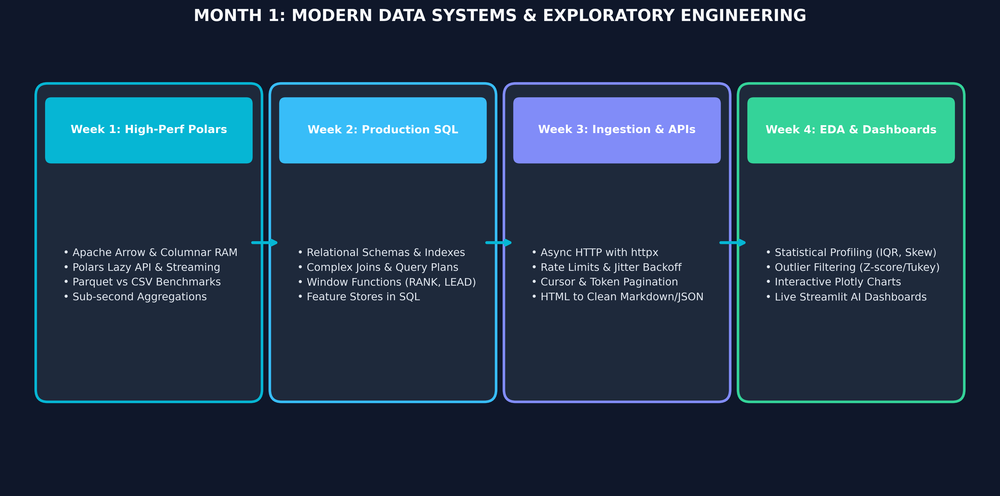

# Month 1: Modern Data Systems & Exploratory Engineering

## Overview & The Modern Data Paradigm
In real-world applied AI engineering, **80% of an engineer's time is spent acquiring, cleaning, partitioning, and transforming data**. Models cannot learn patterns that do not exist in the features, and production latency bottlenecks often trace back to inefficient data querying rather than neural network inference.

Month 1 equips students with modern high-performance data systems: moving past single-threaded pandas into **Apache Arrow and Polars**, writing production **PostgreSQL with analytical window functions**, building **asynchronous API ingestion pipelines**, and developing live interactive **Streamlit** dashboards.

---

## 🎯 Learning Objectives & Success Criteria
By the end of Month 1, students will:
* **Leverage Columnar Data Formats:** Understand Apache Arrow, compare Parquet against CSV, and execute lazy query evaluations in **Polars**.
* **Write Production SQL for Feature Stores:** Master relational schemas, indexes, execution plans (`EXPLAIN ANALYZE`), complex joins, and advanced window functions (`RANK`, `LEAD`, `LAG`).
* **Build Resilient Ingestion Pipelines:** Query hundreds of API endpoints concurrently using asynchronous HTTP (`httpx`), handle rate-limits with exponential backoff, and extract clean text from unstructured web HTML.
* **Master Exploratory Data Analysis & Live Dashboards:** Profile data distributions, identify outliers using statistical techniques (IQR / Z-score), and build interactive web dashboards with **Plotly** and **Streamlit**.

---

## 📚 Curriculum Breakdown

### [Week 1: High-Performance Data Processing with Polars & Parquet](Week_1/lecture_notes/Week_1_High_Performance_Data_Processing.md)
* **Textbook References:** *Python for Data Analysis (3rd Ed)* (Wes McKinney), Ch. 12; *Designing Data-Intensive Applications* (Martin Kleppmann), Ch. 3.
* **Topics:** Single-threaded pandas memory overhead vs Apache Arrow; In-memory columnar representation; Polars Lazy API (`lazy().filter().group_by().collect()`); Multi-threaded SIMD execution; Parquet format (snappy compression, dictionary encoding, column pruning).
* **Deliverable:** Ingest a multi-gigabyte dataset, perform complex aggregations, and benchmark execution time and memory usage against pandas.

### [Week 2: Production SQL & Relational Databases for AI Systems](Week_2/lecture_notes/Week_2_Production_SQL_for_AI.md)
* **Textbook References:** *Designing Data-Intensive Applications* (Martin Kleppmann), Ch. 3; *SQL in 10 Minutes* (Ben Forta).
* **Topics:** PostgreSQL schema modeling; Primary & Foreign keys; B-Tree indexes and query execution planning (`EXPLAIN ANALYZE`); Join types (`INNER`, `LEFT`, `CROSS`); Aggregations and analytical window functions (`ROW_NUMBER()`, `RANK()`, `LEAD()`, `LAG()`); Extracting feature tables directly from SQL.
* **Deliverable:** Construct a SQL script that processes customer event streams, calculates rolling 7-day transaction averages using window functions, and outputs ML training datasets.

### [Week 3: Data Ingestion, Asynchronous APIs & Structured Web Scraping](Week_3/lecture_notes/Week_3_Data_Ingestion_APIs_and_Scraping.md)
* **Textbook References:** *Architecture of Open Source Applications: Asynchronous Python*; Official `httpx` and `BeautifulSoup` documentation.
* **Topics:** Synchronous blocking vs Asynchronous non-blocking execution (`asyncio`, `httpx.AsyncClient`); Handling API rate limits with exponential backoff and jitter; Pagination protocols (Offset, Cursor, Token); Parsing unstructured HTML into structured records; Storing raw records in Parquet.
* **Deliverable:** Build an asynchronous data scraper fetching 100 API endpoints concurrently with automatic retry logic and saving results directly to Parquet.

### [Week 4: Exploratory Data Analysis & Interactive Dashboards](Week_4/lecture_notes/Week_4_EDA_and_Interactive_Dashboards.md)
* **Textbook References:** *Storytelling with Data* (Cole Nussbaumer Knaflic); Streamlit & Plotly Developer Guides.
* **Topics:** EDA philosophy; Five-number summary, IQR, skewness, kurtosis; Outlier detection (Z-score vs Tukey fences); Correlation matrices (Pearson vs Spearman rank); Interactive charts with Plotly; Developing live interactive web apps with Streamlit.
* **Deliverable:** Deploy an interactive Streamlit data profiling dashboard that allows non-technical users to upload CSVs, inspect interactive distributions, and flag anomalies.

---

## 🛠️ Month 1 Weekly Quick-Links
| Week | Lecture Notes | Exercises | Assignments | Cheatsheets |
| :--- | :--- | :--- | :--- | :--- |
| **Week 1** | [Notes](Week_1/lecture_notes/Week_1_High_Performance_Data_Processing.md) | [Exercises](Week_1/exercises/Week1_Exercises.md) | [Assignment](Week_1/assignments/Week1_Assignment.md) | [Cheatsheet](Week_1/cheatsheets/Week1_Cheatsheet.md) |
| **Week 2** | [Notes](Week_2/lecture_notes/Week_2_Production_SQL_for_AI.md) | [Exercises](Week_2/exercises/Week2_Exercises.md) | [Assignment](Week_2/assignments/Week2_Assignment.md) | [Cheatsheet](Week_2/cheatsheets/Week2_Cheatsheet.md) |
| **Week 3** | [Notes](Week_3/lecture_notes/Week_3_Data_Ingestion_APIs_and_Scraping.md) | [Exercises](Week_3/exercises/Week3_Exercises.md) | [Assignment](Week_3/assignments/Week3_Assignment.md) | [Cheatsheet](Week_3/cheatsheets/Week3_Cheatsheet.md) |
| **Week 4** | [Notes](Week_4/lecture_notes/Week_4_EDA_and_Interactive_Dashboards.md) | [Exercises](Week_4/exercises/Week4_Exercises.md) | [Assignment](Week_4/assignments/Week4_Assignment.md) | [Cheatsheet](Week_4/cheatsheets/Week4_Cheatsheet.md) |
