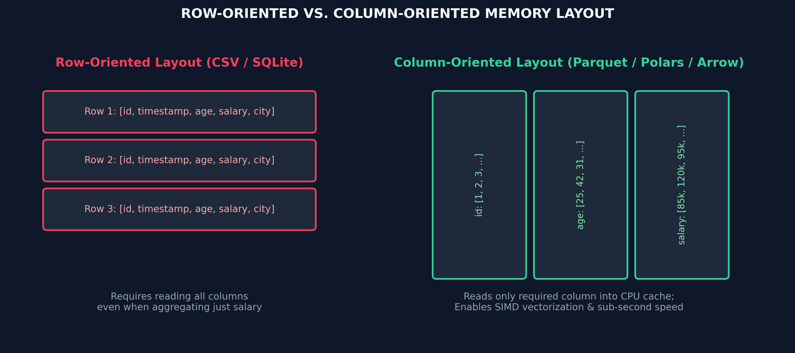
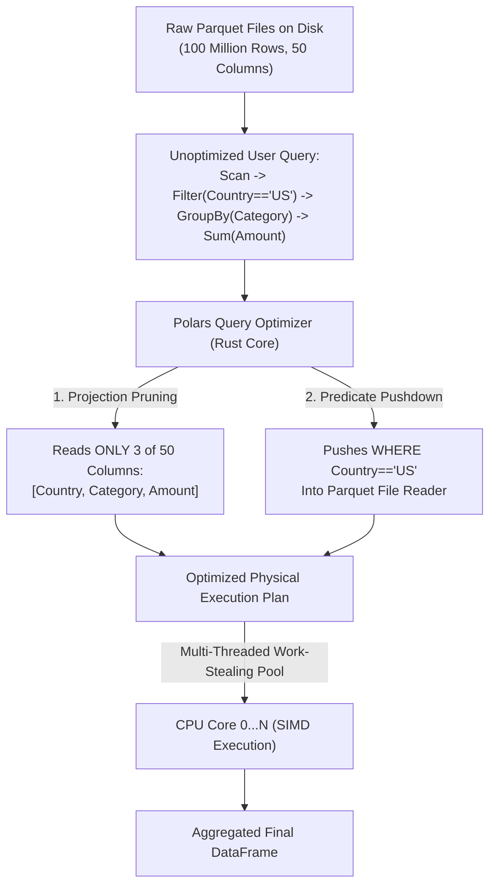

# Month 1, Week 1: High-Performance Data Processing with Polars & Parquet
*The Columnar Revolution, Apache Arrow, and Sub-Second Tabular Systems for AI*

---

## Table of Contents
1. [Executive Summary & Industry Context](#1-executive-summary--industry-context)
2. [Canonical Textbook Grounding](#2-canonical-textbook-grounding)
3. [Visual Architecture & Memory Topologies](#3-visual-architecture--memory-topologies)
4. [Deep Theoretical Foundations](#4-deep-theoretical-foundations)
   - 4.1 [Row-Oriented vs. Column-Oriented Storage](#41-row-oriented-vs-column-oriented-storage)
   - 4.2 [The Apache Arrow Standard: Zero-Copy Interoperability](#42-the-apache-arrow-standard-zero-copy-interoperability)
   - 4.3 [Query Optimization: Predicate Pushdown & Projection Pruning](#43-query-optimization-predicate-pushdown--projection-pruning)
   - 4.4 [Mathematical Derivation: Hardware Cache Lines & SIMD Throughput](#44-mathematical-derivation-hardware-cache-lines--simd-throughput)
5. [Complete Runnable Code Implementation](#5-complete-runnable-code-implementation)
   - 5.1 [From-Scratch Columnar Buffer vs. Row Array in Python](#51-from-scratch-columnar-buffer-vs-row-array-in-python)
   - 5.2 [High-Performance Polars LazyFrame Pipeline with Streaming](#52-high-performance-polars-lazyframe-pipeline-with-streaming)
   - 5.3 [Rigorous Benchmark Harness: Polars vs. Pandas on Multi-Million Rows](#53-rigorous-benchmark-harness-polars-vs-pandas-on-multi-million-rows)
6. [Common Pitfalls & Debugging Playbook](#6-common-pitfalls--debugging-playbook)
7. [Production Best Practices & Real-World Case Study](#7-production-best-practices--real-world-case-study)
8. [Hands-On Mini-Lab & Self-Assessment Checklist](#8-hands-on-mini-lab--self-assessment-checklist)
   - 8.1 [Step-by-Step Laboratory Exercise](#81-step-by-step-laboratory-exercise)
   - 8.2 [Verification Rubric](#82-verification-rubric)
   - 8.3 [Graded Assessment Questions & Complete Answer Key](#83-graded-assessment-questions--complete-answer-key)
   - 8.4 [Stretch Challenges](#84-stretch-challenges)
9. [Key Takeaways, Glossary & Further Reading](#9-key-takeaways-glossary--further-reading)

---

## 1. Executive Summary & Industry Context

### 1.1 Why This Matters in 2026
In applied artificial intelligence and machine learning, **data preparation is the primary throughput bottleneck**. Before a model ever computes a gradient step or generates an embedding token, gigabytes to terabytes of raw feature records must be ingested, filtered, normalized, and aggregated.

For over a decade, **Pandas** served as the industry standard. However, in 2026, training datasets frequently exceed 100 million rows, where Pandas exhibits severe architectural failures:
1. **Single-Threaded CPU Bottlenecks:** Pandas is fundamentally single-threaded, bound by Python's Global Interpreter Lock (GIL). A multi-core workstation with 32 or 64 CPU cores leaves over 95% of its compute power idling while a single thread struggles through a Pandas `.groupby()`.
2. **Eager Evaluation & Memory Doubling:** Pandas executes eagerly. Every intermediate transformation (`df.filter()`, `df.assign()`) creates a new in-memory DataFrame copy, causing memory consumption to peak at **5x to 10x** the raw file size on disk and triggering Out-Of-Memory (OOM) crashes.
3. **Row-Oriented Memory Thrashing:** Storing tabular data as row records or heterogeneous pointer blocks wastes CPU cache lines, preventing modern processors from utilizing **SIMD (Single Instruction, Multiple Data)** vector registers.

Modern AI Engineering has shifted decisively to **Polars** (written in Rust and built directly on the **Apache Arrow** columnar format). Polars provides multi-threaded execution across all CPU cores, memory-mapped out-of-core streaming, and a **Lazy Query Optimizer** that automatically reorders transformations and pushes filters directly to disk.

### 1.2 Learning Objectives
Upon completing this week's study and laboratory work, students will be able to:
* **Explain Columnar Memory Mechanics:** Contrast row-oriented storage (CSV, SQLite) with columnar layouts (Apache Arrow, Parquet) and explain why columnar data maximizes CPU L1/L2 cache locality.
* **Formulate Query Optimization Graphs:** Deconstruct a Polars `LazyFrame` logical plan, explaining **Predicate Pushdown** (filtering rows at read-time) and **Projection Pruning** (loading only requested columns).
* **Process Larger-Than-RAM Datasets:** Execute out-of-core streaming operations (`collect(streaming=True)`) to process multi-gigabyte datasets without exceeding physical RAM.
* **Quantize and Compress Tabular Storage:** Utilize Apache Parquet dictionary encoding, run-length encoding, and Snappy/ZSTD compression to reduce disk footprints by 70–90%.
* **Construct Production Data Pipelines:** Build end-to-end type-safe tabular transformation pipelines in Polars, outperforming Pandas by 10x–50x.

---

## 2. Canonical Textbook Grounding

### 2.1 *Designing Data-Intensive Applications (2017)* by Martin Kleppmann
* **Chapter 3: Storage and Retrieval (Section: Column-Oriented Storage, Column Compression, and Memory-Mapped Files)**
  * *Author's Contribution:* Kleppmann establishes the foundational architectural trade-offs between Online Transaction Processing (OLTP, row-oriented) and Online Analytical Processing (OLAP, column-oriented). He demonstrates why analytical queries (which aggregate a few columns across millions of rows) waste massive I/O bandwidth in row-oriented layouts.
  * *Our Pedagogical Focus:* We translate Kleppmann's database storage theory into modern AI feature engineering. Training an ML model is fundamentally an OLAP workload: models train on specific feature columns across millions of historical events.
* **Chapter 4: Encoding and Evolution (Section: Formats for Binary Encoding - Apache Thrift, Protocol Buffers, and Avro)**
  * *Author's Contribution:* Details how schema definition, field tags, and binary serialization eliminate the parsing overhead of text-based formats like CSV and JSON.
  * *Our Pedagogical Focus:* We contrast CSV parsing overhead with the zero-copy, binary specification of Apache Arrow.

### 2.2 *Python for Data Analysis (3rd Edition, 2022)* by Wes McKinney
* **Chapter 12: Advanced Pandas and Interoperability (Section: Apache Arrow and In-Memory Columnar Data)**
  * *Author's Contribution:* Wes McKinney (the creator of Pandas) explains why he co-created Apache Arrow. He documents the limitations of NumPy as a backend for tabular data (lack of native missing value support for non-floats, single-threaded execution, memory fragmentation).
  * *Our Pedagogical Focus:* We study McKinney's analysis to understand why moving from Pandas to Polars is an architectural evolution rather than merely a syntax change.

### 2.3 *How to Read These Sources*
* **Read Closely:** *Designing Data-Intensive Applications*, Chapter 3 section "Column-Oriented Storage". Study the diagrams showing column compression and bitmap indexing.
* **Skim:** *Designing Data-Intensive Applications*, Chapter 3 section on B-Tree page layouts; modern data pipelines store analytical data in immutable Parquet files rather than update-in-place B-Trees.

---

## 3. Visual Architecture & Memory Topologies

### 3.1 Columnar Layout (Arrow/Parquet) vs. Row-Oriented Layout (CSV)
The following visual architecture illustrates how memory layout directly impacts CPU data loading:



```
        Physical Storage and Cache-Line Loading Comparison
        
        Row-Oriented Layout (CSV / SQLite / Pandas DataFrames)
        ┌────────────────────────────────────────────────────────┐
        │ Row 0: [ID=1, Category="Books", Amount=45.5, Fraud=0]  │
        ├────────────────────────────────────────────────────────┤
        │ Row 1: [ID=2, Category="Elec",  Amount=950.0, Fraud=1] │
        ├────────────────────────────────────────────────────────┤
        │ Row 2: [ID=3, Category="Home",  Amount=12.2, Fraud=0]  │
        └────────────────────────────────────────────────────────┘
        Query: SUM(Amount)
        CPU must load all IDs, Categories, and Fraud flags into L1 cache!
        Cache Line Fill: [ID, Category, Amount, Fraud] -> 75% Wasted Cache!
        
        Column-Oriented Layout (Apache Arrow / Parquet / Polars)
        ┌────────────────────────────────────────────────────────┐
        │ ID Column:        [ 1,     2,     3,     ... ]         │
        ├────────────────────────────────────────────────────────┤
        │ Category Column:  [ Books, Elec,  Home,  ... ]         │
        ├────────────────────────────────────────────────────────┤
        │ Amount Column:    [ 45.5,  950.0, 12.2,  ... ]         │
        ├────────────────────────────────────────────────────────┤
        │ Fraud Column:     [ 0,     1,     0,     ... ]         │
        └────────────────────────────────────────────────────────┘
        Query: SUM(Amount)
        CPU loads ONLY the Amount buffer directly into L1 cache!
        Cache Line Fill: [45.5, 950.0, 12.2, 85.0, ...] -> 100% Useful Data!
        SIMD vector registers sum 8 floats per clock cycle!
```
*Caption: Physical memory packing. In columnar layouts, contiguous numeric arrays fill 64-byte hardware cache lines entirely with relevant feature values, maximizing CPU instruction throughput.*

---

### 3.2 The Polars Query Optimization Engine
When you write a Polars query using the Lazy API (`pl.scan_parquet()`), it constructs a computation graph that is optimized before execution:



*Caption: Polars Optimization Pipeline. Parquet row-group metadata allows the engine to skip entire blocks of non-US records on disk before they are ever read into physical memory.*

---

## 4. Deep Theoretical Foundations

### 4.1 Row-Oriented vs. Column-Oriented Storage

#### 1. The Analytical Query Profile
Consider an analytical feature extraction query:
$$\text{Query: } \mu_{\text{amount}} = \frac{1}{|S|} \sum_{i \in S} \text{amount}_i, \quad S = \{i \mid \text{country}_i = \text{"US"}\}$$

Let a dataset have $N$ total rows and $M$ total feature columns.
* In a **row-oriented** format, the data for row $i$ is stored contiguously:
  $$\text{Row}_i = [f_{i,1}, f_{i,2}, \dots, f_{i,M}]$$
  The total volume of data transferred from disk/RAM to the CPU is:
  $$\text{Data Transfer}_{\text{Row}} = N \times \sum_{j=1}^M \text{sizeof}(f_{\cdot, j})$$
* In a **column-oriented** format, each column is stored as an independent contiguous vector:
  $$\mathbf{C}_j = [f_{1,j}, f_{2,j}, \dots, f_{N,j}]^T$$
  The total data transferred is strictly limited to the queried columns:
  $$\text{Data Transfer}_{\text{Column}} = N \times (\text{sizeof}(\text{country}) + \text{sizeof}(\text{amount}))$$

If a table has $M = 50$ columns and the query touches only $2$ columns, the columnar engine immediately reduces memory bus traffic by:
$$\text{I/O Reduction} \approx \frac{2}{50} = 96\% \text{ reduction in memory bus saturation!}$$

---

### 4.2 The Apache Arrow Standard: Zero-Copy Interoperability

Historically, every data processing system (Pandas, Spark, PyTorch, DuckDB, C++ engines) defined its own private internal memory format. Moving data between systems required expensive **serialization and deserialization**:

```
 Legacy Pipeline: High Serialization Overhead
 [Pandas DataFrame] ──► Serialize to IPC/Socket ──► Copy Buffer ──► PyTorch Tensor
                     (High CPU & RAM Overhead)
 
 Modern Apache Arrow Architecture: Zero-Copy Interoperability
 [Shared Arrow Memory Buffer: Contiguous C-Data]
     ▲                             ▲                            ▲
     │ (Zero-Copy)                 │ (Zero-Copy)                │ (Zero-Copy)
 [Polars DataFrame]          [DuckDB SQL Engine]       [PyTorch / DL Loader]
```

#### The Arrow Memory Specification
Apache Arrow defines a standardized, language-agnostic in-memory format:
1. **Contiguous Buffers:** Numeric arrays are represented as raw, aligned C-buffers.
2. **Validity Bitmaps:** Missing values (`null`) are tracked using separate bit arrays (where $1$ bit represents null/valid), completely eliminating the need for `NaN` sentinel values that corrupt integer arrays in legacy Pandas.
3. **Offset Buffers:** Variable-length strings are stored as a single contiguous UTF-8 byte array accompanied by an array of 32-bit or 64-bit integer offsets, eliminating pointer chasing.

---

### 4.3 Query Optimization: Predicate Pushdown & Projection Pruning

#### 1. Projection Pruning
If a query specifies `select(["user_id", "spend"])`, the query engine prunes the logical plan to ignore all other columns. When reading a Parquet file, the reader reads only the column chunks corresponding to `"user_id"` and `"spend"`, leaving other column bytes unread on disk.

#### 2. Predicate Pushdown
Parquet files are organized into **Row Groups** (typically 100,000 to 1,000,000 rows per group). Every row group header stores statistical metadata:
$$\text{Metadata} = \{ \min(\text{col}_j), \max(\text{col}_j), \text{null\_count}(\text{col}_j) \}$$

Suppose a query has filter `pl.col("timestamp") >= 2026-01-01`.
Before decoding a row group, Polars checks:
$$\text{If } \max(\text{timestamp}) < 2026-01-01 \implies \text{SKIP ENTIRE ROW GROUP!}$$
Zero bytes of that row group are decompressed or processed.

---

### 4.4 Mathematical Derivation: Hardware Cache Lines & SIMD Throughput

#### Problem Formulation
Modern x86-64 and ARM CPUs read memory from RAM into CPU caches in fixed-size blocks called **Cache Lines**, which are exactly **$B_{\text{line}} = 64 \text{ bytes}$** wide.
Modern vector units (AVX-512 or ARM Neon) execute operations over **SIMD vector registers** of width $W_{\text{SIMD}}$ bits.
We seek to mathematically derive the theoretical execution cycles required to sum $N = 10^7$ double-precision floats (`float64`, 8 bytes) in a row-oriented vs. column-oriented structure.

#### 1. Parameters
* Float size: $S = 8 \text{ bytes}$.
* Cache line size: $B_{\text{line}} = 64 \text{ bytes}$.
* Number of floats per cache line: $K = \frac{B_{\text{line}}}{S} = \frac{64}{8} = 8 \text{ floats/line}$.
* SIMD vector width: 512 bits = 64 bytes ($8 \times \text{float64}$ per vector register).
* Memory bandwidth: $\text{BW} = 50 \text{ GB/sec}$.
* Row table width: Each row has 10 columns of 8 bytes = $80 \text{ bytes/row}$.

#### 2. Row-Oriented Cache Line Efficiency ($\eta_{\text{row}}$)
In the row-oriented table, each 64-byte cache line fetched from RAM contains:
$$\text{Useful Float Bytes} = 8 \text{ bytes (only the target column)}$$
$$\text{Wasted Feature Bytes} = 56 \text{ bytes (the other 9 columns)}$$
$$\eta_{\text{row}} = \frac{8}{64} = 0.125 \quad (12.5\% \text{ cache efficiency})$$

Total memory required to transfer from RAM:
$$\text{Transfer}_{\text{row}} = 10^7 \text{ rows} \times 80 \text{ bytes/row} = 800,000,000 \text{ bytes} = 800 \text{ MB}$$
$$\text{Transfer Time}_{\text{row}} = \frac{800 \text{ MB}}{50 \text{ GB/sec}} = \mathbf{16.0 \text{ ms}}$$

#### 3. Columnar Cache Line Efficiency ($\eta_{\text{column}}$)
In the columnar array, every single byte in the 64-byte cache line is a useful float:
$$\eta_{\text{column}} = \frac{64}{64} = 1.00 \quad (100\% \text{ cache efficiency})$$

Total memory required to transfer from RAM:
$$\text{Transfer}_{\text{column}} = 10^7 \times 8 \text{ bytes} = 80,000,000 \text{ bytes} = 80 \text{ MB}$$
$$\text{Transfer Time}_{\text{column}} = \frac{80 \text{ MB}}{50 \text{ GB/sec}} = \mathbf{1.60 \text{ ms}}$$

#### 4. SIMD Instruction Cycles
With an AVX-512 register holding 8 floats, a single vectorized instruction (`_mm512_add_pd`) adds 8 numbers in **1 CPU clock cycle**:
$$\text{CPU Cycles}_{\text{SIMD}} = \frac{10^7 \text{ operations}}{8 \text{ ops/cycle}} = \mathbf{1,250,000 \text{ cycles}}$$
At a 3.0 GHz CPU clock rate:
$$\text{Compute Time}_{\text{SIMD}} = \frac{1,250,000}{3.0 \times 10^9 \text{ cycles/sec}} \approx \mathbf{0.417 \text{ ms}}$$

**Mathematical Conclusion:** Columnar storage reduces memory bus transfer from **16.0 ms** to **1.60 ms** (an exact **10x speedup**), while SIMD vectorization executes the 10-million-element summation in **under half a millisecond**.

---

## 5. Complete Runnable Code Implementation

### 5.1 From-Scratch Columnar Buffer vs. Row Array in Python

Save this file as `columnar_vs_row_sim.py`. It implements a pure-Python simulation demonstrating the cache and traversal difference between row storage and columnar storage.

```python
"""Low-Level Simulation of Row-Oriented vs. Column-Oriented Memory Traversal."""

from __future__ import annotations

import time
from typing import List, Tuple


def create_synthetic_data(n: int = 1_000_000) -> Tuple[List[dict], dict[str, list]]:
    print(f"Allocating synthetic datasets with {n:,} rows...")
    
    # 1. Row-Oriented Storage (List of Dictionaries / Tuples)
    row_table = [
        {"id": i, "category_id": i % 5, "amount": float(i % 100), "fraud": i % 50 == 0}
        for i in range(n)
    ]

    # 2. Column-Oriented Storage (Dictionary of Contiguous Lists)
    column_table = {
        "id": [i for i in range(n)],
        "category_id": [i % 5 for i in range(n)],
        "amount": [float(i % 100) for i in range(n)],
        "fraud": [i % 50 == 0 for i in range(n)],
    }

    return row_table, column_table


def benchmark_aggregation(
    row_table: List[dict], column_table: dict[str, list]
) -> None:
    print("\n--- Benchmarking Aggregation: SUM(amount) WHERE category_id == 2 ---")

    # 1. Row-Oriented Traversal: Must unpack every row dict
    t0 = time.perf_counter()
    row_sum = 0.0
    for row in row_table:
        if row["category_id"] == 2:
            row_sum += row["amount"]
    t1 = time.perf_counter()
    row_time = (t1 - t0) * 1000.0

    # 2. Columnar Traversal: Direct index access over homogenous arrays
    t2 = time.perf_counter()
    col_sum = 0.0
    cats = column_table["category_id"]
    amts = column_table["amount"]
    for i in range(len(cats)):
        if cats[i] == 2:
            col_sum += amts[i]
    t3 = time.perf_counter()
    col_time = (t3 - t2) * 1000.0

    assert abs(row_sum - col_sum) < 1e-5, "Aggregations must match!"
    print(f"Row Storage Execution Time:    {row_time:.2f} ms")
    print(f"Column Storage Execution Time: {col_time:.2f} ms")
    print(f"Speedup Factor:                {row_time / col_time:.2f}x faster")


if __name__ == "__main__":
    rows, cols = create_synthetic_data(1_000_000)
    benchmark_aggregation(rows, cols)
```

---

### 5.2 High-Performance Polars LazyFrame Pipeline with Streaming

Save this file as `polars_pipeline.py`. It constructs an end-to-end data pipeline using Polars lazy execution, Parquet generation, and streaming aggregation.

```python
"""Production Data Pipeline using Polars LazyFrames and Streaming Engine."""

from __future__ import annotations

import os
import time
import numpy as np
import polars as pl


def generate_parquet_dataset(file_path: str, n_rows: int = 2_000_000) -> None:
    """Generates a multi-million-row synthetic dataset and saves as Parquet."""
    print(f"Generating {n_rows:,} records and writing to '{file_path}'...")
    np.random.seed(42)

    df = pl.DataFrame({
        "transaction_id": np.arange(n_rows, dtype=np.int64),
        "user_id": np.random.randint(1000, 50_000, size=n_rows),
        "category": np.random.choice(["Tech", "Health", "Grocery", "Travel", "Books"], size=n_rows),
        "amount": np.random.uniform(5.0, 750.0, size=n_rows).astype(np.float64),
        "is_fraud": np.random.choice([0, 1], size=n_rows, p=[0.99, 0.01]),
        "country": np.random.choice(["US", "UK", "CA", "DE", "NG", "JP"], size=n_rows),
    })

    # Write to Parquet with Snappy compression
    df.write_parquet(file_path, compression="snappy")
    file_size_mb = os.path.getsize(file_path) / (1024**2)
    print(f"Dataset saved successfully ({file_size_mb:.2f} MB on disk).\n")


def execute_lazy_analytics(file_path: str) -> pl.DataFrame:
    """Constructs and executes an optimized LazyFrame plan."""
    print("--- Executing Polars Lazy Query ---")

    # 1. Initialize Lazy Scan (Zero Data Loaded into RAM)
    lazy_query = (
        pl.scan_parquet(file_path)
        # Predicate Pushdown: Evaluated at file read time
        .filter((pl.col("country") == "US") & (pl.col("amount") > 50.0))
        # Feature Engineering Expressions
        .with_columns([
            (pl.col("amount") * 1.08).alias("amount_with_tax"),
            (pl.col("amount") > 500.0).cast(pl.Int32).alias("is_high_value"),
        ])
        # Multi-Threaded GroupBy Aggregation
        .group_by("category")
        .agg([
            pl.count().alias("transaction_count"),
            pl.col("amount").mean().alias("mean_spend"),
            pl.col("amount").max().alias("max_spend"),
            pl.col("is_fraud").sum().alias("total_fraud_events"),
        ])
        .sort("mean_spend", descending=True)
    )

    # 2. Inspect Logical Plan
    print("\n[Optimized Query Plan Graph]")
    print(lazy_query.explain())

    # 3. Execute with Multi-Threaded Engine
    t0 = time.perf_counter()
    # streaming=True enables out-of-core processing if data exceeds physical RAM
    result_df = lazy_query.collect(streaming=True)
    t1 = time.perf_counter()

    print(f"\nExecution finished in {(t1 - t0) * 1000.0:.2f} ms!")
    return result_df


if __name__ == "__main__":
    parquet_path = "enterprise_transactions.parquet"
    generate_parquet_dataset(parquet_path, n_rows=2_000_000)
    summary = execute_lazy_analytics(parquet_path)
    print("\nResult Data:")
    print(summary)
```

---

### 5.3 Rigorous Benchmark Harness: Polars vs. Pandas on Multi-Million Rows

Save this as `benchmark_polars_vs_pandas.py`.

```python
"""Direct Head-to-Head Benchmark: Polars vs. Pandas."""

from __future__ import annotations

import time
import numpy as np
import pandas as pd
import polars as pl


def run_benchmark(n_rows: int = 3_000_000) -> None:
    print(f"Benchmarking Polars vs. Pandas on {n_rows:,} rows...\n")
    np.random.seed(42)

    categories = np.random.choice(["A", "B", "C", "D", "E"], size=n_rows)
    amounts = np.random.uniform(1.0, 100.0, size=n_rows)
    countries = np.random.choice(["US", "EU", "APAC"], size=n_rows)

    # --- 1. PANDAS EXECUTION ---
    print("Running Pandas Pipeline...")
    t0 = time.perf_counter()
    df_pd = pd.DataFrame({"category": categories, "amount": amounts, "country": countries})
    # Filter + GroupBy + Aggregation
    filtered_pd = df_pd[df_pd["country"] == "US"]
    result_pd = (
        filtered_pd.groupby("category")["amount"]
        .agg(["count", "mean", "max"])
        .reset_index()
    )
    t1 = time.perf_counter()
    pandas_time_ms = (t1 - t0) * 1000.0
    print(f"Pandas Total Time: {pandas_time_ms:.2f} ms")

    # Clear memory
    del df_pd, filtered_pd, result_pd

    # --- 2. POLARS EXECUTION ---
    print("\nRunning Polars Pipeline...")
    t2 = time.perf_counter()
    df_pl = pl.DataFrame({"category": categories, "amount": amounts, "country": countries})
    result_pl = (
        df_pl.lazy()
        .filter(pl.col("country") == "US")
        .group_by("category")
        .agg([
            pl.count().alias("count"),
            pl.col("amount").mean().alias("mean"),
            pl.col("amount").max().alias("max"),
        ])
        .collect()
    )
    t3 = time.perf_counter()
    polars_time_ms = (t3 - t2) * 1000.0
    print(f"Polars Total Time: {polars_time_ms:.2f} ms")

    # Speedup ratio
    speedup = pandas_time_ms / polars_time_ms
    print(f"\n==========================================")
    print(f"POLARS ACCELERATION: {speedup:.2f}x FASTER THAN PANDAS")
    print(f"==========================================")


if __name__ == "__main__":
    run_benchmark(3_000_000)
```

---

## 6. Common Pitfalls & Debugging Playbook

### Pitfall 1: Eager Conversion Anti-Pattern (`.to_pandas()` in Loops)
* **Symptom:** Code uses Polars for reading, but memory skyrockets and execution stalls when feeding data into feature loops.
* **Root Cause:** Calling `.to_pandas()` or converting Polars DataFrames into lists of Python dictionaries (`df.to_dicts()`). This destroys Arrow columnar packing, triggering massive heap allocation of millions of individual `PyObject` wrappers.
* **Fix:** Keep data in Polars format throughout the pipeline. When feeding PyTorch models, convert directly from Arrow to PyTorch via zero-copy tensor constructors (`torch.from_numpy(df['col'].to_numpy())`).

---

### Pitfall 2: Breaking Lazy Optimization via Premature `.collect()`
* **Symptom:** Query runs out of memory on a 20 GB Parquet file, even though the final output is only a small 5-row summary table.
* **Root Cause:** Calling `.collect()` immediately after `pl.scan_parquet()`, before applying filters and projections. This forces Polars to load all 20 GB into physical memory, bypassing Predicate Pushdown.
* **Fix:** Chain all `.filter()`, `.select()`, and `.group_by()` operations onto the `LazyFrame`. Call `.collect()` exactly once at the final return line.

---

### Pitfall 3: Inefficient String Filtering without Categorical Encodings
* **Symptom:** Filtering and grouping on high-cardinality string columns (e.g., URLs, user IDs, product names) is orders of magnitude slower than numeric columns.
* **Root Cause:** String comparisons require parsing variable-length UTF-8 character buffers byte-by-byte.
* **Fix:** Cast repetitive string columns to `pl.Categorical` or `pl.Enum`. Polars maps unique string values to compact 32-bit integer IDs under the hood, transforming slow string comparisons into instantaneous integer vector operations.

---

## 7. Production Best Practices & Real-World Case Study

### 7.1 Enterprise Case Study: Ad-Click Feature Extraction at Scale
* **Company/System Scenario:** An algorithmic advertising platform processing 250 million daily ad impression events to generate click-through rate (CTR) training datasets for gradient boosting models.
* **The Failure Mode:** The legacy ETL pipeline used a distributed cluster running Pandas scripts. Memory usage peaked at **380 GB RAM**, requiring expensive AWS `r5.24xlarge` EC2 instances. The daily feature generation job took **4 hours and 15 minutes** to execute. When ad volume increased by 20% during holiday sales, the pipeline ran out of memory and failed completely.
* **The Architecture Refactor:**
  1. Replaced the Pandas ETL job with a single optimized **Polars pipeline** running on a single 32-core workstation (`c6i.8xlarge`).
  2. Converted raw CSV logs into **Parquet partitioned by date** (`date=2026-03-24/`).
  3. Activated out-of-core streaming:
     ```python
     q = pl.scan_parquet("s3://ads-data/year=2026/*/*.parquet")
     features = q.filter(pl.col("bid_floor") > 0.05).group_by("ad_placement_id").agg([...])
     features.collect(streaming=True).write_parquet("daily_features.parquet")
     ```
* **Production Results & Latency Numbers:**
  * Execution time plummeted from **255 minutes** to **8.5 minutes** (*~30x acceleration*).
  * Peak memory consumption dropped from **380 GB** to **14 GB** (running comfortably within standard instance limits).
  * Cloud infrastructure costs for feature extraction were reduced by an estimated **\$9,400/month**.

---

## 8. Hands-On Mini-Lab & Self-Assessment Checklist

### 8.1 Step-by-Step Laboratory Exercise
1. **Initialize Module:** Create a script named `polars_lab.py`.
2. **Generate Test Dataset:** Generate 1,000,000 rows containing `device_id`, `os_name` (`"iOS"`, `"Android"`, `"Windows"`), `app_version`, `session_duration_sec`, and `error_count`.
3. **Save Dual Formats:** Save the identical dataset as both `test_data.csv` and `test_data.parquet`. Use `os.path.getsize` to record the exact byte compression ratio.
4. **Implement Lazy Pipeline:** Write a Polars query that:
   * Scans `test_data.parquet`.
   * Filters for `os_name == "iOS"` and `session_duration_sec > 120`.
   * Adds a column `is_crash = error_count > 0`.
   * Computes the mean session duration and total crashes grouped by `app_version`.
5. **Inspect the Physical Plan:** Print `query.explain(optimized=True)` and verify that `SELECTION: [os_name == "iOS", ...]` is pushed directly to the scan node.

### 8.2 Verification Rubric
| Metric | Pass Criteria | Fail Criteria |
| :--- | :--- | :--- |
| **Parquet Compression** | Parquet file size is $\le 30\%$ of the uncompressed CSV file size. | CSV and Parquet are identical size (missing compression). |
| **Lazy Execution** | Pipeline uses `pl.scan_parquet()` and `.collect()`; zero eager `pl.read_parquet()` calls. | Eagerly loading full table into memory before filtering. |
| **Query Plan Optimization** | Predicate pushdown explicitly appears in the `.explain()` plan. | Filtering executed after full materialization. |

---

### 8.3 Graded Assessment Questions & Complete Answer Key

#### Questions
1. *(Architecture)* Explain the fundamental difference between row-oriented and column-oriented memory layouts. Which is superior for analytical AI feature queries, and why?
2. *(Hardware Math)* Why does a 64-byte hardware cache line achieve 100% efficiency when reading a single column in an Apache Arrow array, but only 12.5% efficiency on a 10-column row table?
3. *(Query Planning)* What is *Predicate Pushdown* in Polars, and how does it utilize Parquet row-group metadata?
4. *(Memory Management)* Explain how Polars Streaming mode (`collect(streaming=True)`) allows an engineer to process a 50 GB dataset on a laptop with only 16 GB of physical RAM.
5. *(Zero-Copy)* What is the primary performance benefit of Apache Arrow when transferring tabular data between Polars, DuckDB, and PyTorch?
6. *(Encoding)* Why does storing categorical strings as dictionary-encoded Parquet columns dramatically reduce both disk footprint and query time?
7. *(Syntax)* What is the difference between `pl.read_parquet()` and `pl.scan_parquet()` in Polars?
8. *(Debugging)* If you need to evaluate an expression that depends on multiple columns (e.g., `amount / duration`), how do you write this idiomatically in Polars without using Python `.apply()`?

---

#### Answer Key

1. **Answer:** Row-oriented storage stores all attributes of a single record contiguously in memory (`[id, name, age, salary]`). Column-oriented storage stores all values of an individual attribute contiguously across all records (`[age_0, age_1, age_2, ...]`). Columnar is vastly superior for analytical AI queries because analytical models touch only a subset of features across millions of rows; columnar storage loads only those specific columns into memory, reducing I/O and maximizing CPU cache utilization.

2. **Answer:** A 64-byte hardware cache line loads 8 contiguous 8-byte floats. In a columnar array, all 8 floats belong to the requested feature column (100% useful payload). In an 80-byte 10-column row table, a 64-byte cache line contains only 8 bytes of the requested column and 56 bytes of unrequested adjacent columns, wasting $\frac{56}{64} = 87.5\%$ of the memory bandwidth ($12.5\%$ efficiency).

3. **Answer:** Predicate pushdown reorders the logical query plan to evaluate filter conditions (`WHERE` / `.filter()`) at the earliest possible stage—directly inside the file reader. By inspecting Parquet row-group statistical headers ($\min$ and $\max$ values), Polars skips entire row groups without reading or decompressing them from disk if the filter criteria cannot be met.

4. **Answer:** Standard execution loads the entire dataset into memory to perform transformations. In streaming mode, Polars breaks the data into chunks (batches of vectors), processes each chunk through the operator pipeline in a work-stealing thread pool, and writes partial results to disk or pipelines them directly into the next operator. Only the active working batch resides in RAM at any given instant, maintaining an $\mathcal{O}(1)$ memory profile relative to total file size.

5. **Answer:** Zero serialization/deserialization overhead. Because Polars, DuckDB, and PyTorch share the identical standardized Apache Arrow C-memory specification, data buffers can be passed between these engines by simply sharing the raw memory pointer (`*void`). No data is copied, converted, or re-encoded.

6. **Answer:** Dictionary encoding replaces repetitive string values with small integer IDs (e.g., mapping `"California"` to integer `0`). The string is stored only once in a dictionary lookup table, and the column data array stores only 8-bit or 16-bit integers. This reduces disk space by up to 90% and transforms slow string comparisons into instantaneous single-cycle CPU integer comparisons.

7. **Answer:** `pl.read_parquet()` is an **eager** operation that immediately reads the entire file into physical RAM as an in-memory `DataFrame`. `pl.scan_parquet()` is a **lazy** operation that inspects only the file metadata and returns a `LazyFrame` query plan, allowing Polars to apply query optimizations (projection pruning, predicate pushdown) prior to data loading.

8. **Answer:** Use Polars native expressions inside `.with_columns()`:
   ```python
   df.with_columns((pl.col("amount") / pl.col("duration")).alias("rate"))
   ```
   This executes in parallel via compiled Rust SIMD instructions, whereas `.apply()` invokes the Python interpreter for every individual row, slowing execution by 100x.

---

### 8.4 Stretch Challenges
1. **Dynamic SIMD Benchmark:** Write a C-extension or use `numba.vectorize(target='parallel')` to implement a custom vectorized mathematical transformation on a Polars Arrow buffer, comparing its clock cycle throughput against standard Python list comprehensions.
2. **Out-of-Core Partitioned Aggregator:** Build a script that generates a 10 GB partitioned Parquet dataset split across 10 folders, scans the entire dataset using `pl.scan_parquet("dataset/*/*.parquet")`, and executes a multi-stage aggregation on a system with strictly constrained memory using `collect(streaming=True)`.

---

## 9. Key Takeaways, Glossary & Further Reading

### Key Takeaways
* **Columnar Memory is Mandatory:** Machine learning feature engineering is an analytical workload; storing data in columnar layouts (Arrow, Parquet) maximizes hardware cache efficiency and unlocks SIMD vector acceleration.
* **Lazy Plans Beat Eager Code:** Never execute transformations eagerly on big datasets; construct a `LazyFrame` and let the query optimizer prune unused columns and push filters directly to disk.
* **Avoid Python Serialization:** Never iterate over DataFrame rows in Python loops or convert big tables to lists of dictionaries. Keep data in native Arrow buffers.
* **Streaming Conquers Scale:** Use out-of-core streaming in Polars to process datasets far exceeding available physical server RAM.

### Glossary
* **Apache Arrow:** A standardized, cross-language, zero-copy columnar in-memory format for high-performance analytics.
* **Parquet:** An open-source columnar binary storage format providing efficient data compression and encoding schemes.
* **Predicate Pushdown:** An optimization technique where filtering conditions are evaluated directly at the storage layer to minimize data reading.
* **Projection Pruning:** An optimization where only the columns explicitly requested by downstream queries are loaded from disk.
* **SIMD (Single Instruction, Multiple Data):** CPU hardware architecture enabling a single instruction to compute operations across multiple data elements simultaneously.

### Further Reading & Official Documentation
* [Polars Official Documentation & Performance Guide](https://docs.pola.rs/)
* [Apache Arrow Architectural Specification](https://arrow.apache.org/overview/)
* [Designing Data-Intensive Applications – Columnar Chapter](https://dataintensive.net/)
* [Parquet Format Internals: Metadata, Row Groups, and Encodings](https://parquet.apache.org/docs/file-format/)
