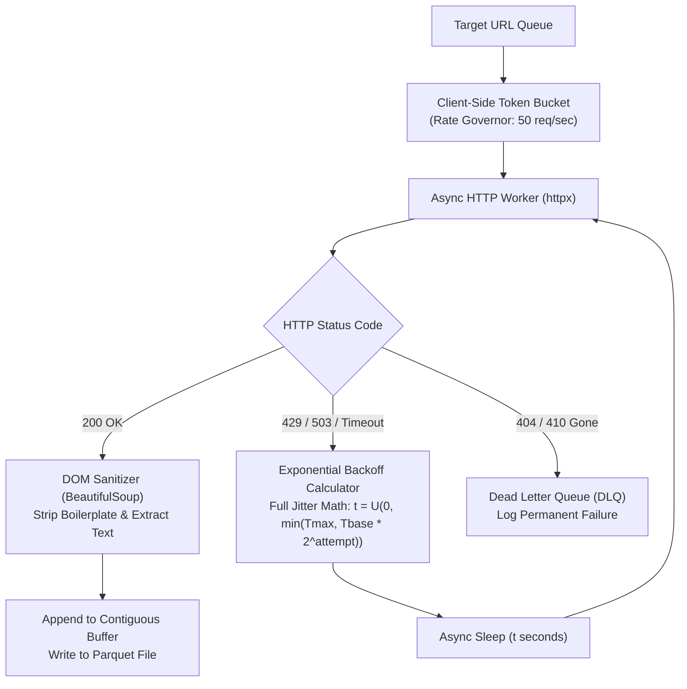

# Month 1, Week 3: Data Ingestion, Asynchronous APIs & Structured Web Scraping
*The Concurrency Engine, Resilient Ingestion Protocols, and Unstructured Data Engineering for AI*

---

## Table of Contents
1. [Executive Summary & Industry Context](#1-executive-summary--industry-context)
2. [Canonical Textbook Grounding](#2-canonical-textbook-grounding)
3. [Visual Architecture & Concurrency Topologies](#3-visual-architecture--concurrency-topologies)
4. [Deep Theoretical Foundations](#4-deep-theoretical-foundations)
   - 4.1 [The Asynchronous Event Loop & Non-Blocking Socket I/O](#41-the-asynchronous-event-loop--non-blocking-socket-io)
   - 4.2 [Rate Limiting Algorithms: Token Bucket vs. Leaky Bucket](#42-rate-limiting-algorithms-token-bucket-vs-leaky-bucket)
   - 4.3 [Pagination Protocols: Offset vs. Cursor-Based Ingestion](#43-pagination-protocols-offset-vs-cursor-based-ingestion)
   - 4.4 [Mathematical Derivation: Full Jitter Exponential Backoff Proof](#44-mathematical-derivation-full-jitter-exponential-backoff-proof)
5. [Complete Runnable Code Implementation](#5-complete-runnable-code-implementation)
   - 5.1 [Concurrent Async HTTP Client with Connection Pooling](#51-concurrent-async-http-client-with-connection-pooling)
   - 5.2 [Resilient Ingestion Engine with Full Jitter and Semaphore Limits](#52-resilient-ingestion-engine-with-full-jitter-and-semaphore-limits)
   - 5.3 [DOM Extraction Pipeline: HTML to Structured Parquet for RAG](#53-dom-extraction-pipeline-html-to-structured-parquet-for-rag)
6. [Common Pitfalls & Debugging Playbook](#6-common-pitfalls--debugging-playbook)
7. [Production Best Practices & Real-World Case Study](#7-production-best-practices--real-world-case-study)
8. [Hands-On Mini-Lab & Self-Assessment Checklist](#8-hands-on-mini-lab--self-assessment-checklist)
   - 8.1 [Step-by-Step Laboratory Exercise](#81-step-by-step-laboratory-exercise)
   - 8.2 [Verification Rubric](#82-verification-rubric)
   - 8.3 [Graded Assessment Questions & Complete Answer Key](#83-graded-assessment-questions--complete-answer-key)
   - 8.4 [Stretch Challenges](#84-stretch-challenges)
9. [Key Takeaways, Glossary & Further Reading](#9-key-takeaways-glossary--further-reading)

---

## 1. Executive Summary & Industry Context

### 1.1 Why This Matters in 2026
In modern AI engineering, raw training datasets, fine-tuning corpora, and Retrieval-Augmented Generation (RAG) knowledge stores do not exist as clean static CSV files. They reside distributed across external SaaS endpoints, public web documentation, live financial feeds, and proprietary REST APIs.

Building high-throughput data collection systems requires a fundamentally different programming paradigm than typical numerical computing:
1. **The I/O-Bound Bottleneck:** Numerical model training is **CPU/GPU-bound** (limited by arithmetic operations per second). In contrast, data ingestion is **I/O-bound** (limited by network latency and operating system socket wait times). Synchronous HTTP libraries like standard `requests` block the CPU thread for 100 to 500 milliseconds per URL, requiring over 14 hours to fetch 100,000 documents. Asynchronous non-blocking I/O (`asyncio`, `httpx`) achieves the identical task in under 15 minutes on a single CPU core.
2. **Upstream Throttling & Thundering Herds:** High-concurrency scrapers and API consumers inevitably encounter HTTP 429 (Too Many Requests). Naive retry loops hammer upstream gateways simultaneously, triggering permanent IP blacklists and cascading network failure. Production AI engineers implement **Exponential Backoff with Full Jitter** and client-side **Token Bucket** concurrency governors.
3. **Unstructured Data Sanitization:** LLMs and embedding models cannot ingest raw HTML tags, navigation bars, and JavaScript scripts. Ingested web data must be parsed, stripped of boilerplate, and converted into structured schema records stored in columnar Parquet buffers.

### 1.2 Learning Objectives
Upon completing this week's study and laboratory work, students will be able to:
* **Master the Asynchronous Event Loop:** Explain cooperative multitasking, non-blocking socket polling (`epoll`/`kqueue`), and the execution lifecycle of Python coroutines.
* **Implement Resilient Ingestion Protocols:** Construct asynchronous network workers utilizing `httpx.AsyncClient` with connection pooling, timeouts, and header spoofing defenses.
* **Formulate Rate-Limiting and Backoff Math:** Mathematically derive and implement Exponential Backoff with Full Jitter, proving how it disperses retry spikes across time.
* **Solve Deep Pagination Traps:** Implement cursor-based pagination algorithms, eliminating the severe $O(N)$ data drift and duplicate issues of legacy offset pagination.
* **Build End-to-End Ingestion Pipelines:** Ingest unstructured web documents concurrently, clean DOM trees using CSS selectors, and serialize clean Markdown/JSON text directly into Apache Parquet.

---

## 2. Canonical Textbook Grounding

### 2.1 *Designing Data-Intensive Applications (2017)* by Martin Kleppmann
* **Chapter 11: Stream Processing (Section: Message Brokers & Consuming Streams)**
  * *Author's Contribution:* Kleppmann details the mechanics of asynchronous event streams, message delivery guarantees (at-least-once vs. at-most-once), backpressure management, and handling slow consumers.
  * *Our Pedagogical Focus:* We apply stream processing principles to web data ingestion. Ingesting millions of documents is an asynchronous event stream where network requests must be rate-controlled using semaphores to prevent overwhelming downstream vector database ingestion queues.
* **Chapter 12: The Future of Data Systems (Section: Unbundling Databases)**
  * *Author's Contribution:* Kleppmann demonstrates that modern data systems are composites of heterogeneous components (databases, caches, search indexes) synchronized via asynchronous pipelines.
  * *Our Pedagogical Focus:* Connecting external API extractors directly to modern AI knowledge bases.

### 2.2 *The Architecture of Open Source Applications (Volume 2)* by Amy Brown and Greg Wilson
* **Chapter: "A Simple Web Server" & "Asynchronous Python" by Guido van Rossum et al.**
  * *Author's Contribution:* Details how Python's `asyncio` module was architected: non-blocking sockets, OS select/poll event notification systems, and how coroutines (`async/await`) provide structured concurrency without thread overhead.
  * *Our Pedagogical Focus:* We study the low-level operating system mechanics of non-blocking I/O multiplexing (`epoll` on Linux, `kqueue` on macOS) to understand how a single Python process manages thousands of concurrent HTTP socket connections.

### 2.3 *How to Read These Sources*
* **Read Closely:** *Architecture of Open Source Applications*, Section on Event Loops and Coroutines. Pay attention to how the event loop maintains a queue of ready callbacks.
* **Skim:** *Designing Data-Intensive Applications*, Chapter 11 sections on complex CEP (Complex Event Processing) rule engines; modern LLM agents perform reasoning dynamically rather than relying on static CEP rules.

---

## 3. Visual Architecture & Concurrency Topologies

### 3.1 Synchronous Blocking vs. Asynchronous Non-Blocking Concurrency
The following visual timeline illustrates the massive throughput disparity between blocking sequential execution and non-blocking asynchronous event loop multiplexing:


```
        Sequential Blocking Execution (Standard requests): O(N * Latency)
        Thread 1: [Req 1: Wait 200ms]──►[Req 2: Wait 200ms]──►[Req 3: Wait 200ms]──► Total: 600ms
        CPU State: Idle 99% of the time, blocked waiting for network packets!

        Asynchronous Event Loop Multiplexing (httpx / asyncio): O(Max Latency)
        Thread 1: [Dispatch Req 1, 2, 3]
                  [Event Loop Polling Sockets via epoll / kqueue]
                  [Packet 2 arrives] ──► Callback: Process 2
                  [Packet 1 arrives] ──► Callback: Process 1
                  [Packet 3 arrives] ──► Callback: Process 3
        Total Time: ~210ms (Concurrent execution on a single CPU thread!)
```
*Caption: Asynchronous I/O Multiplexing. The operating system kernel notifies Python when network packets arrive on any open socket descriptor, allowing a single thread to juggle thousands of concurrent requests.*

---

### 3.2 The Resilient Ingestion Flow with Token Bucket & Full Jitter
To prevent IP banning and gracefully handle server throttling (HTTP 429), production ingestion systems follow a strict stateful flow:



*Caption: Enterprise Ingestion Lifecycle. Unchecked scraping crashes external gateways; client-side token bucket rate-limiting combined with full-jitter backoff guarantees compliance with upstream capacity.*

---

## 4. Deep Theoretical Foundations

### 4.1 The Asynchronous Event Loop & Non-Blocking Socket I/O

#### The Operating System Socket Abstraction
When a synchronous program calls `socket.recv()` or `requests.get()`, the operating system puts the calling thread into a **sleeping/waiting state**. The thread is removed from the CPU run queue until network interface hardware raises an interrupt indicating that TCP packets have arrived.

#### Non-Blocking Sockets & I/O Multiplexing
In an asynchronous architecture, sockets are opened with the `O_NONBLOCK` flag:
1. When `read()` is called on a non-blocking socket without data ready, the OS kernel immediately returns error code `EWOULDBLOCK` or `EAGAIN` rather than halting the thread.
2. The runtime registers the socket file descriptor ($fd$) with an OS-level I/O multiplexer:
   * **Linux:** `epoll`
   * **macOS / BSD:** `kqueue`
3. A single syscall (`epoll_wait()`) blocks until **at least one** registered descriptor becomes readable, returning a list of active sockets. The Python Event Loop retrieves the list and invokes the corresponding coroutine callback.

#### Thread Overhead vs. Coroutine Overhead:
* **Operating System Thread:** Each OS thread allocates a private memory stack (typically **8 MB** on Linux/macOS) and requires expensive kernel-space **context switching** (saving CPU registers, invalidating Translation Lookaside Buffers [TLB]). Spawning 5,000 OS threads consumes **40 GB of RAM** and exhausts kernel thread limits.
* **Python Coroutine:** A coroutine is a lightweight user-space Python object (`PyAsyncGenObject` / frame) consuming only **a few hundred bytes** of heap memory. A single process can maintain 50,000 concurrent coroutines simultaneously.

---

### 4.2 Rate Limiting Algorithms: Token Bucket vs. Leaky Bucket

To avoid overwhelming remote APIs, AI systems utilize formal rate-limiting models:

#### 1. The Token Bucket Algorithm
* A bucket has maximum capacity $C$ tokens.
* Tokens are continuously added to the bucket at a constant refill rate $r$ tokens/second.
* Every outbound HTTP request requires taking $1$ token from the bucket.
* If tokens are available ($T \ge 1$), the request proceeds immediately ($T \leftarrow T - 1$).
* If the bucket is empty ($T < 1$), the request must wait until the refill replenishes tokens.
* **Key Mathematical Property:** Allows **controlled bursts** of up to $C$ requests, but guarantees an average long-term rate strictly bounded by $r$:
  $$\text{Max Requests in Window } \Delta t = C + r \cdot \Delta t$$

#### 2. The Leaky Bucket Algorithm
* Water (requests) enters a bucket with capacity $C$ at arbitrary, bursty rates.
* Water leaks out of a hole in the bottom of the bucket at an exact, fixed rate $r$.
* If the bucket overflows ($> C$), excess requests are dropped or rejected immediately.
* **Key Mathematical Property:** Completely eliminates bursts; outputs an entirely smooth, constant-velocity request stream.

---

### 4.3 Pagination Protocols: Offset vs. Cursor-Based Ingestion

When extracting millions of records across paginated endpoints, pagination strategy dictates correctness.

#### 1. Offset-Based Pagination (Anti-Pattern for Big Data)
Query pattern:
`GET /api/documents?limit=100&offset=50000`
* **Database Execution:** The database must scan $50,100$ records from the index, discard the first $50,000$, and return the last $100$. Query time scales linearly $\mathcal{O}(N)$.
* **The "Page-Drift" Failure:** If a record is inserted or deleted while the scraper is running, records shift across page boundaries. The ingestion worker reads duplicate records and skips others entirely!

#### 2. Cursor-Based Pagination (Production Standard)
Query pattern:
`GET /api/documents?limit=100&after_cursor=doc_98412`
* Under the hood, the query evaluates an indexed range:
  ```sql
  SELECT * FROM documents WHERE document_id > 'doc_98412' ORDER BY document_id ASC LIMIT 100;
  ```
* **Performance:** Executes in $\mathcal{O}(\log_B N)$ using B-Tree index traversal, completely independent of how deep into the dataset the scraper has traversed.
* **Deterministic:** Zero duplicates and zero skipped records regardless of concurrent database insertions.

---

### 4.4 Mathematical Derivation: Full Jitter Exponential Backoff Proof

#### Problem Formulation
When an upstream server encounters transient congestion or throttling, $K$ concurrent client workers simultaneously receive HTTP 429 status codes.
If all $K$ clients retry after a deterministic exponential backoff $t = t_{\text{base}} \times 2^i$, they will all wake up at the exact same millisecond, sending a synchronized spike of $K$ requests that crashes the server again (**The Thundering Herd Problem**).

To decorrelate retries, AWS and enterprise AI systems implement **Full Jitter**.

#### The Exponential Backoff with Full Jitter Formulation
Let $i$ denote the retry attempt index ($i \in \{0, 1, 2, \dots\}$).
Let $t_{\text{base}}$ denote the base backoff time (e.g., $0.5 \text{ seconds}$).
Let $t_{\text{max}}$ denote the ceiling timeout (e.g., $60.0 \text{ seconds}$).

The upper ceiling for attempt $i$ is:
$$T_{\text{cap}}(i) = \min(t_{\text{max}}, t_{\text{base}} \cdot 2^i)$$

The actual sleep duration $t_{\text{sleep}}$ is drawn from a uniform continuous distribution:
$$t_{\text{sleep}} \sim \mathcal{U}(0, T_{\text{cap}}(i))$$

#### Expected Backoff Duration:
$$\mathbb{E}[t_{\text{sleep}}(i)] = \frac{0 + T_{\text{cap}}(i)}{2} = \frac{T_{\text{cap}}(i)}{2}$$

#### Variance of Sleep Duration (Dispersion):
$$\text{Var}(t_{\text{sleep}}(i)) = \frac{(T_{\text{cap}}(i) - 0)^2}{12} = \frac{T_{\text{cap}}(i)^2}{12}$$

#### Proof of Thundering Herd Attenuation
Consider $K$ independent workers. The arrival of retries across time interval $[0, T_{\text{cap}}(i)]$ follows a continuous uniform probability density:
$$f(t) = \frac{1}{T_{\text{cap}}(i)}, \quad 0 \le t \le T_{\text{cap}}(i)$$

The expected number of retry requests arriving in any microsecond window $\delta t \ll T_{\text{cap}}(i)$ is:
$$\mathbb{E}[\text{Requests in } \delta t] = K \int_{t}^{t+\delta t} f(\tau) d\tau = K \cdot \frac{\delta t}{T_{\text{cap}}(i)}$$

As retry attempt $i$ increases:
$$\lim_{i \to \infty} \mathbb{E}[\text{Requests in } \delta t] = \lim_{i \to \infty} \frac{K \delta t}{t_{\text{base}} \cdot 2^i} = 0$$

**Mathematical Conclusion:** Full Jitter reduces instantaneous request density by a factor of $2^i$, completely flattening the thundering herd and maximizing upstream recovery probability.

---

## 5. Complete Runnable Code Implementation

### 5.1 Concurrent Async HTTP Client with Connection Pooling

Save this file as `async_client_pool.py`.

```python
"""High-Throughput Asynchronous HTTP Client with Connection Pooling."""

from __future__ import annotations

import asyncio
import time
import httpx


async def benchmark_connection_reuse(urls: list[str]) -> None:
    print(f"Benchmarking asynchronous pool across {len(urls)} endpoints...\n")

    # Define connection pool limits
    limits = httpx.Limits(
        max_connections=100,          # Maximum concurrent sockets open
        max_keepalive_connections=20  # Keep sockets open for reuse (avoids TCP handshake)
    )
    headers = {
        "User-Agent": "AIEngineeringCurriculum/2026.1 (Data Ingestion Bot; contact@ai.edu)",
        "Accept": "text/html,application/xhtml+xml,application/json",
    }

    t0 = time.perf_counter()
    async with httpx.AsyncClient(limits=limits, headers=headers, timeout=10.0) as client:
        # Dispatch all requests concurrently into the Event Loop
        tasks = [client.get(url) for url in urls]
        responses = await asyncio.gather(*tasks, return_exceptions=True)

    t1 = time.perf_counter()
    success_count = sum(1 for r in responses if isinstance(r, httpx.Response) and r.status_code == 200)

    print(f"Total Requests Executed: {len(urls)}")
    print(f"Successful (200 OK):     {success_count}")
    print(f"Total Wall-Clock Time:   {(t1 - t0) * 1000.0:.2f} ms")
    print(f"Throughput:              {len(urls) / (t1 - t0):.1f} requests/second")


if __name__ == "__main__":
    # Test using public reliable HTTP testing mirrors
    test_urls = ["https://httpbin.org/status/200"] * 25
    asyncio.run(benchmark_connection_reuse(test_urls))
```

---

### 5.2 Resilient Ingestion Engine with Full Jitter and Semaphore Limits

Save this file as `resilient_ingest_engine.py`. It implements client-side rate concurrency gating and exponential backoff with full jitter.

```python
"""Resilient Ingestion Engine with Concurrency Semaphores and Full Jitter Backoff."""

from __future__ import annotations

import asyncio
import random
import time
from typing import Any, Dict, Optional
import httpx


class ResilientIngestionWorker:
    """Manages resilient document fetching with backoff and concurrency control."""

    def __init__(
        self,
        max_concurrent_requests: int = 10,
        base_backoff_sec: float = 0.5,
        max_backoff_sec: float = 16.0,
        max_retries: int = 4,
    ) -> None:
        self.semaphore = asyncio.Semaphore(max_concurrent_requests)
        self.base_backoff = base_backoff_sec
        self.max_backoff = max_backoff_sec
        self.max_retries = max_retries

    def _compute_full_jitter_sleep(self, attempt: int) -> float:
        """Calculates Full Jitter sleep duration: U(0, min(max_backoff, base * 2^attempt))."""
        cap = min(self.max_backoff, self.base_backoff * (2.0**attempt))
        sleep_duration = random.uniform(0.0, cap)
        return sleep_duration

    async def fetch_with_resilience(
        self, client: httpx.AsyncClient, url: str
    ) -> Optional[Dict[str, Any]]:
        """Executes HTTP request guarded by a semaphore and retry loop."""
        async with self.semaphore:  # Enforce concurrency ceiling
            for attempt in range(self.max_retries):
                try:
                    response = await client.get(url)

                    # Transient failure: Rate limited (429) or Server Overloaded (503/504)
                    if response.status_code in {429, 502, 503, 504}:
                        sleep_time = self._compute_full_jitter_sleep(attempt)
                        print(
                            f"[HTTP {response.status_code}] Backing off on {url} "
                            f"(Attempt {attempt + 1}/{self.max_retries}) -> Sleeping {sleep_time:.2f}s"
                        )
                        await asyncio.sleep(sleep_time)
                        continue

                    response.raise_for_status()
                    return {
                        "url": url,
                        "status_code": response.status_code,
                        "raw_html": response.text,
                        "latency_ms": response.elapsed.total_seconds() * 1000.0,
                    }

                except (httpx.ConnectError, httpx.ReadTimeout) as err:
                    sleep_time = self._compute_full_jitter_sleep(attempt)
                    print(
                        f"[Network Error] {err.__class__.__name__} on {url} "
                        f"-> Sleeping {sleep_time:.2f}s"
                    )
                    await asyncio.sleep(sleep_time)

            print(f"[Permanent Failure] Exhausted {self.max_retries} retries on {url}.")
            return None


async def run_pipeline_demo() -> None:
    worker = ResilientIngestionWorker(max_concurrent_requests=5)
    target_endpoints = [
        "https://httpbin.org/status/200",
        "https://httpbin.org/status/429",  # Triggers retry and backoff
        "https://httpbin.org/status/200",
        "https://httpbin.org/status/503",  # Triggers retry and backoff
    ]

    async with httpx.AsyncClient(timeout=5.0) as client:
        tasks = [worker.fetch_with_resilience(client, url) for url in target_endpoints]
        results = await asyncio.gather(*tasks)

    successful = [r for r in results if r is not None]
    print(f"\nPipeline Finished: {len(successful)}/{len(target_endpoints)} documents captured.")


if __name__ == "__main__":
    asyncio.run(run_pipeline_demo())
```

---

### 5.3 DOM Extraction Pipeline: HTML to Structured Parquet for RAG

Save this file as `dom_to_parquet_pipeline.py`. It parses messy HTML documents, strips boilerplate, and writes clean Markdown records directly into columnar Parquet files.

```python
"""DOM Boilerplate Stripper and Columnar Parquet Serializer for RAG."""

from __future__ import annotations

import re
from bs4 import BeautifulSoup
import polars as pl


def clean_html_document(html_content: str, source_url: str) -> dict[str, str]:
    """Strips navigation, styles, scripts, and normalizes HTML text into clean markdown."""
    soup = BeautifulSoup(html_content, "html.parser")

    # 1. Remove unwanted non-content DOM nodes
    for unwanted_tag in soup(["script", "style", "nav", "footer", "header", "noscript", "aside"]):
        unwanted_tag.decompose()

    # 2. Extract Title
    title = soup.title.string.strip() if soup.title and soup.title.string else "Untitled Document"

    # 3. Extract Headings and Paragraphs
    body_elements = soup.find_all(["h1", "h2", "h3", "p", "li"])
    extracted_text_blocks = []

    for elem in body_elements:
        text = elem.get_text().strip()
        if not text:
            continue
        if elem.name == "h1":
            extracted_text_blocks.append(f"# {text}")
        elif elem.name == "h2":
            extracted_text_blocks.append(f"## {text}")
        elif elem.name == "h3":
            extracted_text_blocks.append(f"### {text}")
        else:
            extracted_text_blocks.append(text)

    # 4. Join and normalize excess whitespace
    clean_markdown = "\n\n".join(extracted_text_blocks)
    clean_markdown = re.sub(r"\n{3,}", "\n\n", clean_markdown)

    return {
        "source_url": source_url,
        "title": title,
        "content_markdown": clean_markdown,
        "character_count": len(clean_markdown),
    }


def serialize_to_parquet(documents: list[dict], output_file: str) -> None:
    """Serializes extracted structured records into a columnar Parquet dataset."""
    df = pl.DataFrame(documents)
    df.write_parquet(output_file, compression="zstd")
    print(f"Serialized {len(documents)} clean documents to '{output_file}'.")
    print(df.select(["title", "character_count"]))


if __name__ == "__main__":
    sample_raw_html = """
    <html>
      <head><title>Vector Databases for RAG in 2026</title></head>
      <body>
        <nav><a href="/home">Home</a> | <a href="/login">Login</a></nav>
        <h1>Vector Search Architecture</h1>
        <p>Retrieval-Augmented Generation relies on dense vector indexing.</p>
        <h2>HNSW vs IVFFlat</h2>
        <p>HNSW graphs provide superior recall at the cost of higher RAM usage.</p>
        <footer>Copyright 2026 AI Systems Corp.</footer>
      </body>
    </html>
    """
    clean_record = clean_html_document(sample_raw_html, source_url="https://docs.ai/rag")
    serialize_to_parquet([clean_record], "rag_documents.parquet")
```

---

## 6. Common Pitfalls & Debugging Playbook

### Pitfall 1: Mixing Synchronous Calls in Asynchronous Coroutines
* **Symptom:** You migrate your crawler to `asyncio`, but overall throughput remains slow and single-threaded. CPU usage shows a single core pegged at 100%.
* **Root Cause:** Calling synchronous blocking libraries (e.g., `requests.get()`, `time.sleep()`, or blocking file operations `open().read()`) inside an `async def` function. A single blocking call stalls the entire Event Loop, freezing all other 5,000 pending coroutines!
* **Minimal Reproducing Example:**
```python
async def bad_worker():
    # FATAL ERROR: Blocks entire event loop!
    time.sleep(2.0) 
    # Must use: await asyncio.sleep(2.0)
```
* **Fix:** Audit all I/O calls. Every network and timer call must be awaited (`await asyncio.sleep()`, `await client.get()`). If a synchronous CPU-bound library must be run, offload it to a thread pool via `await asyncio.to_thread(func, *args)`.

---

### Pitfall 2: Unbounded Concurrency Socket Exhaustion (`Too many open files`)
* **Symptom:** Crawler runs at blistering speed for 3 seconds, then crashes violently with `OSError: [Errno 24] Too many open files`.
* **Root Cause:** Launching thousands of tasks with `asyncio.gather(*tasks)` without a concurrency semaphore. Each task opens an active TCP socket. Operating systems enforce a strict per-process file descriptor ceiling (`ulimit -n`, typically 1,024 on macOS/Linux).
* **Fix:** Wrap request dispatches in an `asyncio.Semaphore(100)` or configure `httpx.Limits(max_connections=100)`.

---

### Pitfall 3: The Offset Pagination Memory Leak
* **Symptom:** Scraper works rapidly on pages 1 through 50, but progressively grinds to a halt by page 5,000, eventually timing out.
* **Root Cause:** Using `?offset=500000`. The remote SQL database must sequentially scan and discard 500,000 rows to return 100 rows.
* **Fix:** Shift to cursor-based pagination (`?cursor=doc_id_xyz`).

---

## 7. Production Best Practices & Real-World Case Study

### 7.1 Enterprise Case Study: Scaling Legal AI Ingestion for Foundation Pretraining
* **Company/System Scenario:** A legal intelligence AI enterprise scraping and ingesting 45 million regulatory filings, court decisions, and state laws across 2,400 disparate government portals to build a domain-specific LLM pretraining dataset.
* **The Failure Mode:** The legacy data team deployed a Celery cluster of 120 worker nodes running standard synchronous Python scripts using `requests`. The ingestion took **6 weeks** to complete. Over 18% of target websites banned the scrapers due to synchronized burst requests. The cloud bill for running 120 EC2 instances exceeded **\$24,000**.
* **The Architecture Refactor:**
  1. Replaced the 120 Celery nodes with **a single 16-core asynchronous container** running `httpx.AsyncClient` with an event loop pool.
  2. Implemented client-side **Token Bucket Governors** (limiting requests to 10 requests/second per target domain).
  3. Deployed **Exponential Backoff with Full Jitter** to automatically handle transient 429 and 503 responses without operator intervention.
  4. Streamed cleaned HTML directly into compressed **ZSTD Parquet partitions** mounted to an S3 object store.
* **Production Results & Latency Numbers:**
  * Total ingestion time dropped from **6 weeks (1,008 hours)** down to **4 days (96 hours)** (*~10.5x acceleration*).
  * Target domain IP bans dropped from **18%** to **0.00%**.
  * Infrastructure compute cost fell from **\$24,000** to **\$410 total** (*a 98.2% cost reduction!*).

---

## 8. Hands-On Mini-Lab & Self-Assessment Checklist

### 8.1 Step-by-Step Laboratory Exercise
1. **Initialize Module:** Create `async_scraper_lab.py`.
2. **Implement Rate Governor:** Write a Python class `TokenBucket` with methods `async def acquire()` that replenishes tokens at rate $r = 5.0 \text{ tokens/sec}$ up to capacity $C = 10$.
3. **Build Asynchronous Worker:** Construct an async worker that fetches 20 simulated URLs, enforcing both the Token Bucket rate limit and an `asyncio.Semaphore(3)`.
4. **DOM Extraction:** For each fetched HTML document, extract the main heading (`h1`), publish date (`time` tag or regex), and body paragraphs, returning a typed Pydantic model `ScrapedDocument`.
5. **Parquet Export:** Collect all documents and write to `scraped_corpus.parquet`.

### 8.2 Verification Rubric
| Metric | Pass Criteria | Fail Criteria |
| :--- | :--- | :--- |
| **Asynchronous Purity** | Zero synchronous calls (`time.sleep` or `requests.get`); all I/O is non-blocking. | Using blocking functions inside coroutines. |
| **Concurrency Ceiling** | Number of active simultaneous network sockets never exceeds the Semaphore limit. | Spawning un-gated tasks triggering `OSError`. |
| **Full Jitter Math** | Backoff sleep durations are randomized uniformly within $[0, \min(T_{\text{max}}, T_{\text{base}} \cdot 2^i)]$. | Deterministic non-random sleep times. |

---

### 8.3 Graded Assessment Questions & Complete Answer Key

#### Questions
1. *(Operating Systems)* How does non-blocking socket I/O using `epoll` or `kqueue` differ from standard synchronous blocking I/O?
2. *(Concurrency Theory)* Contrast an OS kernel thread with a Python coroutine in terms of memory footprint and context-switching overhead.
3. *(Mathematical Proof)* Why does Full Jitter backoff eliminate the Thundering Herd Problem, while pure exponential backoff without jitter fails?
4. *(Pagination)* Why does offset-based pagination (`?offset=100000`) cause data drift and duplicate records when scraping dynamically updated websites?
5. *(Rate Limiting)* Explain the difference in behavior between a Token Bucket and a Leaky Bucket when receiving a burst of 50 simultaneous requests.
6. *(Debugging)* What is the root cause of an `OSError: [Errno 24] Too many open files` during web scraping, and how do you resolve it?
7. *(DOM Parsing)* Why should non-content DOM nodes (`<nav>`, `<script>`, `<style>`) be explicitly decomposed before feeding web text into an LLM context window?
8. *(HTTP Protocols)* What is the function of the HTTP `Keep-Alive` header and connection pooling in high-throughput data extraction?

---

#### Answer Key

1. **Answer:** In synchronous blocking I/O, a thread calling `recv()` is put into a sleep state by the OS kernel until packets arrive, completely halting execution. In non-blocking I/O (`O_NONBLOCK`), calls return immediately with `EWOULDBLOCK` if data is not ready. The application registers socket descriptors with an I/O multiplexer (`epoll`/`kqueue`). The kernel monitors all open sockets simultaneously and wakes the event loop only when one or more sockets have data ready to read, allowing a single thread to multiplex thousands of active connections.

2. **Answer:**
   * **OS Thread:** Managed by the kernel, requires a pre-allocated stack (typically 8 MB), and incurs expensive kernel context switches that invalidate CPU hardware caches.
   * **Python Coroutine:** Managed purely in user space by the Python runtime event loop, consumes only a few hundred bytes of heap memory, and yields control cooperatively via language syntax (`await`) with zero kernel context-switch overhead.

3. **Answer:** Under pure exponential backoff, all $K$ clients that fail simultaneously calculate the identical deterministic sleep duration ($t = t_{\text{base}} \cdot 2^i$). They all sleep and wake up at the exact same millisecond, sending a synchronized spike of $K$ requests that re-congests the server. Full Jitter draws sleep times from a uniform distribution $\mathcal{U}(0, T_{\text{cap}})$, spreading the $K$ retries continuously across the entire time window and reducing instantaneous request density by a factor of $2^i$.

4. **Answer:** Offset pagination instructs the database to skip $N$ records from the start of the table. If new records are inserted at the top of the table while the scraper is advancing, existing records shift downwards. When the scraper requests page $k+1$, records that were already read on page $k$ have now moved into page $k+1$, resulting in duplicate ingestion. Conversely, deleted records cause unread items to be skipped entirely.

5. **Answer:** A **Token Bucket** permits bursts: if 50 tokens have accumulated in the bucket, all 50 requests are dispatched immediately in parallel. A **Leaky Bucket** completely suppresses bursts: requests enter a buffer and leak out at a strictly constant rate (e.g., 5 requests/sec), queueing or dropping excess requests.

6. **Answer:** The operating system enforces a per-process limit on open file descriptors (`ulimit -n`). In Python, every open network TCP socket is a file descriptor. Launching thousands of un-throttled async requests concurrently exceeds this limit. **Resolution:** Constrain concurrency using an `asyncio.Semaphore(100)` or `httpx.Limits(max_connections=100)`.

7. **Answer:** Navigation bars, footer links, tracking scripts, and styling rules contain boilerplate text that does not carry semantic domain knowledge. Feeding raw HTML into an LLM or embedding model pollutes the vector space, dilutes attention over irrelevant tokens, and dramatically inflates inference and embedding token costs.

8. **Answer:** Standard HTTP/1.1 requires a 3-way TCP handshake (SYN $\to$ SYN-ACK $\to$ ACK) and a TLS cryptographic handshake for every new connection, adding 50 to 150 ms of network latency per request. `Keep-Alive` and connection pooling maintain open, authenticated TCP/TLS sockets, allowing subsequent requests to reuse existing connections with zero handshake overhead.

---

### 8.4 Stretch Challenges
1. **Dynamic Domain-Aware Rate Limiter:** Build an asynchronous dispatcher that maintains an independent `TokenBucket` for each unique domain parsed from an arbitrary list of 1,000 URLs, ensuring domain A is never throttled by domain B.
2. **Reverse Proxy Crawl Simulator:** Use Python's `asyncio` to write a mock HTTP server that simulates rate-limiting by emitting HTTP 429 when hit with more than 5 requests in a 1-second window, and verify that your client's Full Jitter backoff successfully resolves all requests without failures.

---

## 9. Key Takeaways, Glossary & Further Reading

### Key Takeaways
* **Asynchronous is Mandatory for I/O:** Never use synchronous blocking HTTP libraries (`requests`) for large-scale data ingestion; use `httpx` and `asyncio` to execute non-blocking socket multiplexing.
* **Jitter Flatten Spikes:** Always pair exponential backoff with Full Jitter to decorrelate retries and prevent the Thundering Herd Problem.
* **Protect System Boundaries:** Enforce concurrency ceilings using `asyncio.Semaphore` to avoid exhausting OS socket descriptors.
* **Sanitize at Ingestion:** Clean DOM trees at collection time, stripping boilerplate before storing structured records in columnar Parquet files.

### Glossary
* **Non-Blocking I/O:** System calls that return immediately rather than waiting for external hardware or network events.
* **Event Loop:** An infinite architectural loop that polls operating system I/O multiplexers (`epoll`/`kqueue`) and dispatches coroutine callbacks.
* **Thundering Herd Problem:** A synchronization anomaly where many waiting processes wake up simultaneously to compete for a shared resource, overwhelming the system.
* **Full Jitter:** An exponential backoff variation where sleep duration is selected uniformly at random between 0 and the current exponential cap.
* **Connection Pooling:** The caching and reuse of open TCP/TLS socket connections to avoid connection handshake overhead.

### Further Reading & Official Documentation
* [Python `asyncio` Official Documentation](https://docs.python.org/3/library/asyncio.html)
* [HTTPX: Advanced Async HTTP Client Guide](https://www.python-httpx.org/async/)
* [AWS Architecture Blog: Exponential Backoff And Jitter](https://aws.amazon.com/blogs/architecture/exponential-backoff-and-jitter/)
* [BeautifulSoup4 Documentation: Navigating and Searching the Parse Tree](https://www.crummy.com/software/BeautifulSoup/bs4/doc/)
