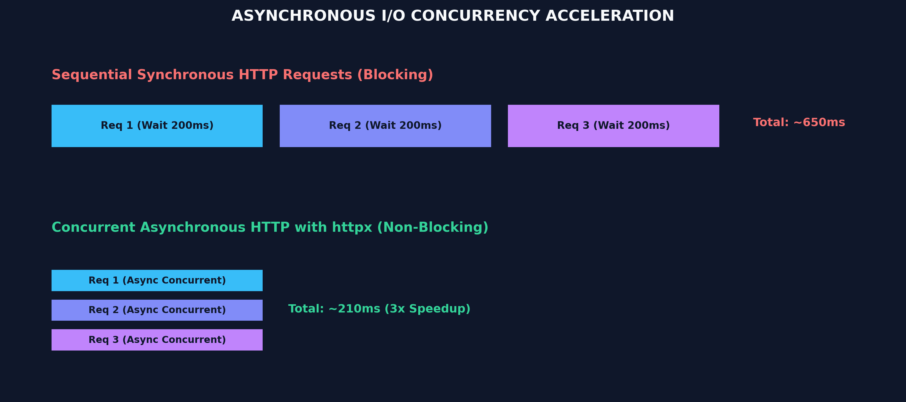

# Month 1, Week 3: Data Ingestion, Asynchronous APIs & Structured Web Scraping



## 1. Executive Summary & Industry Context
Machine learning algorithms and LLM applications rarely receive pre-packaged, clean CSV datasets in production. Datasets must be continuously acquired from external REST APIs, live streaming webhooks, and raw unstructured web pages.

Traditional Python scripts using synchronous HTTP libraries (like standard `requests`) block CPU execution while waiting for network responses. In contrast, **Asynchronous I/O (`asyncio` and `httpx`)** allows an AI engineer to query hundreds of endpoints concurrently on a single thread, achieving 10x–50x throughput acceleration while respecting upstream rate limits.

---

## 2. Canonical Textbook References
* **Architecture of Open Source Applications: Asynchronous Python** by Guido van Rossum et al.
* **Designing Data-Intensive Applications** by Martin Kleppmann, Chapter 11: *Stream Processing*.

---

## 3. Theoretical Foundations: Event Loops, Concurrency & Rate Limiting

### The Asynchronous Event Loop
Synchronous execution blocks the entire program during network I/O:
$$\text{Time}_{\text{Sync}} = \sum_{i=1}^N \text{Latency}_i$$

Asynchronous execution uses a non-blocking **Event Loop**: when a network request is dispatched with `await`, Python pauses that specific coroutine and immediately executes other tasks while waiting for network packets:
$$\text{Time}_{\text{Async}} \approx \max(\text{Latency}) + \epsilon$$

### Resilient API Ingestion: Exponential Backoff with Jitter
When hitting external APIs (e.g., GitHub, OpenAI, internal microservices), requests will eventually be throttled (HTTP 429 Too Many Requests). Naive retry loops exacerbate server congestion ("thundering herd problem").

The mathematical standard is **Exponential Backoff with Full Jitter**:
$$t_{\text{sleep}} = \text{random\_uniform}(0, \min(t_{\text{max}}, t_{\text{base}} \times 2^{\text{attempt}}))$$

---

## 4. Complete Step-by-Step Code Walkthrough

```python
import asyncio
import httpx
from bs4 import BeautifulSoup
from typing import List, Dict, Any
import random

# 1. Resilient Asynchronous Worker with Exponential Backoff
async def fetch_document(
    client: httpx.AsyncClient, 
    url: str, 
    max_retries: int = 3
) -> Dict[str, Any]:
    """Fetches a URL asynchronously with retry backoff and structured parsing."""
    for attempt in range(max_retries):
        try:
            response = await client.get(url, timeout=10.0)
            
            # Handle rate-limiting (HTTP 429) or server errors (5xx)
            if response.status_code == 429 or response.status_code >= 500:
                sleep_time = random.uniform(0.5, 2.0 ** attempt)
                print(f"[429/5xx] Throttled on {url}. Retrying in {sleep_time:.2f}s...")
                await asyncio.sleep(sleep_time)
                continue
                
            response.raise_for_status()
            
            # Parse unstructured HTML into structured text
            soup = BeautifulSoup(response.text, "html.parser")
            title = soup.title.string.strip() if soup.title else "No Title"
            
            # Clean paragraphs into normalized markdown text
            paragraphs = [p.get_text().strip() for p in soup.find_all("p") if p.get_text().strip()]
            clean_body = "\n\n".join(paragraphs)
            
            return {
                "url": url,
                "title": title,
                "content": clean_body,
                "status": "success"
            }
            
        except (httpx.RequestError, httpx.HTTPStatusError) as e:
            if attempt == max_retries - 1:
                return {"url": url, "error": str(e), "status": "failed"}
            await asyncio.sleep(1.0 * (2 ** attempt))

    return {"url": url, "error": "Max retries exceeded", "status": "failed"}

# 2. Main Concurrent Orchestrator
async def ingest_urls_concurrently(urls: List[str]) -> List[Dict[str, Any]]:
    # Set headers and connection limits
    limits = httpx.Limits(max_keepalive_connections=20, max_connections=50)
    headers = {"User-Agent": "AIEngineeringCurriculumBot/2026.1 (Educational)"}
    
    async with httpx.AsyncClient(limits=limits, headers=headers) as client:
        # Schedule all requests concurrently
        tasks = [fetch_document(client, url) for url in urls]
        results = await asyncio.gather(*tasks)
        return results

# Example Execution
if __name__ == "__main__":
    target_urls = [
        "https://httpbin.org/html",
        "https://httpbin.org/status/200",
        "https://httpbin.org/status/429", # Test backoff
    ]
    
    extracted_data = asyncio.run(ingest_urls_concurrently(target_urls))
    for item in extracted_data:
        print(f"\nResult: {item['url']} -> {item.get('status')} | Content Length: {len(item.get('content', ''))}")
```

---

## 5. Common Student Pitfalls & Debugging Strategies

1. **Calling Synchronous Code in Async Loops:**
   * *The Mistake:* Using `requests.get()` or `time.sleep()` inside an `async def` function. This blocks the entire Python thread, preventing any other coroutine from executing.
   * *The Fix:* Always use non-blocking equivalents: `await client.get()` and `await asyncio.sleep()`.
2. **Missing Concurrency Limits (DDoS Trap):**
   * *The Mistake:* Spawning 10,000 tasks at once with `asyncio.gather(*tasks)` without limiting concurrency, crashing your machine or triggering immediate IP bans.
   * *The Fix:* Constrain concurrency using `asyncio.Semaphore(50)` or `httpx.Limits(max_connections=50)`.
3. **Failing to Respect `robots.txt` & Terms of Service:**
   * *The Fix:* Always identify your crawler with a descriptive `User-Agent` and verify scraping permissions.

---

## 6. Production Best Practices & Real-World Case Study
In modern Retrieval-Augmented Generation (RAG) applications (e.g., building enterprise knowledge copilots):
* Raw HTML documentation is ingested asynchronously, cleaned with DOM parsers, converted to clean Markdown, and fed into embedding pipelines.
* Ingestion pipelines run as background workers with dead-letter queues (DLQs) to isolate bad URLs without halting the data collection.

---

## 7. Hands-on Mini-Lab & Self-Assessment Checklist
- [ ] Install dependencies: `uv pip install httpx beautifulsoup4`
- [ ] Write an async function that fetches 10 endpoints concurrently using `asyncio.gather()`.
- [ ] Implement exponential backoff that handles HTTP 429 status codes.
- [ ] Clean raw HTML paragraphs into structured text dictionaries with `url`, `title`, and `content`.
- [ ] Verify that total execution time is roughly equal to the slowest request rather than the sum of all requests.
