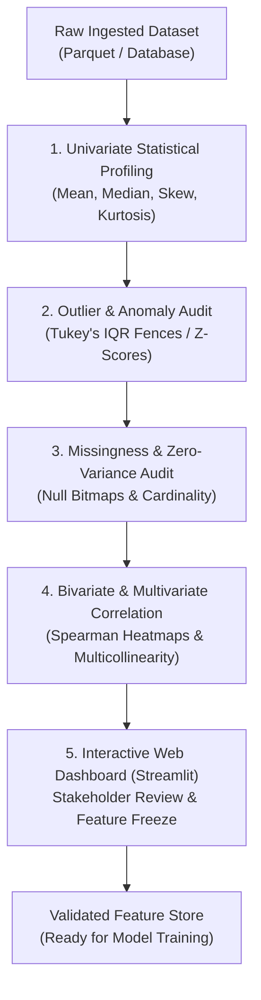

# Month 1, Week 4: Exploratory Data Analysis & Interactive Dashboards
*Statistical Profiling, Anomaly Diagnostics, and Real-Time AI Dashboards with Plotly & Streamlit*

---

## Table of Contents
1. [Executive Summary & Industry Context](#1-executive-summary--industry-context)
2. [Canonical Textbook Grounding](#2-canonical-textbook-grounding)
3. [Visual Architecture & Dashboard Topologies](#3-visual-architecture--dashboard-topologies)
4. [Deep Theoretical Foundations](#4-deep-theoretical-foundations)
   - 4.1 [Statistical Profiling: Five-Number Summary & Distribution Moments](#41-statistical-profiling-five-number-summary--distribution-moments)
   - 4.2 [Outlier Detection Mathematics: Z-Score vs. Tukey's Fences](#42-outlier-detection-mathematics-z-score-vs-tukeys-fences)
   - 4.3 [Bivariate Association Metrics: Pearson vs. Spearman Rank Correlation](#43-bivariate-association-metrics-pearson-vs-spearman-rank-correlation)
   - 4.4 [Mathematical Derivation: Tukey's 1.5x IQR Rule for Normal Distributions](#44-mathematical-derivation-tukeys-15x-iqr-rule-for-normal-distributions)
5. [Complete Runnable Code Implementation](#5-complete-runnable-code-implementation)
   - 5.1 [Pure-Python Statistical Profiler & Outlier Auditor](#51-pure-python-statistical-profiler--outlier-auditor)
   - 5.2 [Interactive Visual Analytics Suite with Plotly Express](#52-interactive-visual-analytics-suite-with-plotly-express)
   - 5.3 [Production Multi-Page AI Feature Dashboard in Streamlit](#53-production-multi-page-ai-feature-dashboard-in-streamlit)
6. [Common Pitfalls & Debugging Playbook](#6-common-pitfalls--debugging-playbook)
7. [Production Best Practices & Real-World Case Study](#7-production-best-practices--real-world-case-study)
8. [Hands-On Mini-Lab & Self-Assessment Checklist](#8-hands-on-mini-lab--self-assessment-checklist)
   - 8.1 [Step-by-Step Laboratory Exercise](#81-step-by-step-laboratory-exercise)
   - 8.2 [Verification Rubric](#82-verification-rubric)
   - 8.3 [Graded Assessment Questions & Complete Answer Key](#83-graded-assessment-questions--complete-answer-key)
   - 8.4 [Stretch Challenges](#84-stretch-challenges)
9. [Key Takeaways, Glossary & Further Reading](#9-key-takeaways-glossary--further-reading)

---

## 1. Executive Summary & Industry Context

### 1.1 Why This Matters in 2026
In modern AI engineering, **models do not fail in deployment because of weak neural network architectures; they fail because of silent data corruption, distribution shift, and uninspected feature drift**.

Before training an XGBoost ensemble or fine-tuning a Large Language Model on domain records, an engineer must execute rigorous **Exploratory Data Analysis (EDA)**:
1. **Garbage In, Garbage Out:** If input training data contains skewed distributions, extreme recording anomalies (e.g., sensor `voltage = 99999.0`), or severe class imbalance (e.g., $99.9\%$ negative class), even the most sophisticated deep learning model will learn degenerate heuristics.
2. **The "Correlation != Causation" Trap:** AI models readily latch onto spurious statistical correlations (e.g., classifying a hospital patient as healthy because their scan was taken on a specific machine model). Exploratory profiling isolates multicollinearity and confounding variables before they pollute models.
3. **The Stakeholder Interface Gap:** Non-technical executives, clinical doctors, risk officers, and underwriters do not read Jupyter notebooks or inspect raw terminal matrices. Senior AI engineers package feature analysis into **interactive web dashboards (Plotly & Streamlit)** that empower domain experts to explore model assumptions and feature distributions dynamically.

### 1.2 Learning Objectives
Upon completing this week's study and laboratory work, students will be able to:
* **Perform Exhaustive Statistical Profiling:** Calculate and interpret the five-number summary, sample variance, standard deviation, skewness, and kurtosis for high-dimensional feature spaces.
* **Formulate Outlier Detection Frameworks:** Mathematically contrast parametric methods (Z-score) with non-parametric methods (Tukey's IQR fences), explaining when to censor versus preserve anomalies.
* **Evaluate Feature Dependencies:** Compute Pearson linear correlation and Spearman non-linear rank correlation, identifying multicollinearity clusters.
* **Construct Interactive Scientific Visualizations:** Build responsive, interactive distributions, correlation heatmaps, and scatter matrices using **Plotly Express**.
* **Deploy Production AI Dashboards:** Develop and deploy multi-page analytical applications in **Streamlit** utilizing session state management and cached data pipelines.

---

## 2. Canonical Textbook Grounding

### 2.1 *Hands-On Machine Learning with Scikit-Learn, Keras, and TensorFlow (3rd Edition, 2022)* by Aurélien Géron
* **Chapter 2: End-to-End Machine Learning Project (Sections: Discover and Visualize the Data to Gain Insights & Prepare the Data for Machine Learning Algorithms)**
  * *Author's Contribution:* Géron provides a masterclass workflow for enterprise projects: establishing a test set immediately before EDA to avoid data snooping bias, visualizing geographical and continuous feature distributions, and identifying non-linear transformations (such as log-transforms for heavy-tailed distributions).
  * *Our Pedagogical Focus:* We extract Géron's diagnostic protocol to teach students how EDA directly dictates feature transformation pipelines (e.g., recognizing when power-law data requires quantile or logarithmic normalization).

### 2.2 *Storytelling with Data: A Data Visualization Guide for Business Professionals (2015)* by Cole Nussbaumer Knaflic
* **Chapters 2 & 4: Choosing an Effective Visual & Focus Your Audience's Attention**
  * *Author's Contribution:* Details pre-attentive visual attributes (color, size, position), eliminating chartjunk, and choosing visual representations that communicate insight without cognitive overload.
  * *Our Pedagogical Focus:* We apply Knaflic's visual principles to AI feature dashboards: designing clean, high-contrast Plotly figures with explicit marginal distributions and clean color scales.

### 2.3 *How to Read These Sources*
* **Read Closely:** *Hands-On Machine Learning*, Chapter 2 section "Looking for Correlations" and "Experimenting with Attribute Combinations".
* **Skim:** *Hands-On Machine Learning*, sections covering legacy Matplotlib subplots; modern production data exploration standardizes on interactive Plotly and web frameworks.

---

## 3. Visual Architecture & Dashboard Topologies

### 3.1 The Exploratory Data Analysis & Diagnostic Flow
EDA is not an informal plotting exercise; it is a structured, 5-stage diagnostic pipeline:



*Caption: The 5-Stage Scientific EDA Workflow. Datasets must pass each diagnostic verification gate before feature engineering and training begin.*

---

### 3.2 Streamlit Execution Lifecycle & Session State Topology
Streamlit operates on a unique reactive execution model: every user interaction re-executes the Python script from line 1. To prevent redundant computation, data must be cached in memory:

```
 User Interaction (Slider / File Upload)
                  │
                  ▼
 ┌─────────────────────────────────────────────────────────┐
 │ Streamlit Reactive Runtime (Rerun Script from Top)      │
 │                                                         │
 │ 1. @st.cache_data Check:                                │
 │    Input Hash match? ──► YES: Instant In-Memory Cache!  │
 │                       ──► NO:  Reload & Parse Dataset   │
 │                                                         │
 │ 2. st.session_state Check:                              │
 │    Preserves user selections, active filters & models   │
 └────────────────────────┬────────────────────────────────┘
                          │
                          ▼
 ┌─────────────────────────────────────────────────────────┐
 │ Reactive DOM Re-Render (Plotly Express WebGL Engine)    │
 │ - Sub-millisecond interactive updates in browser        │
 └─────────────────────────────────────────────────────────┘
```

---

## 4. Deep Theoretical Foundations

### 4.1 Statistical Profiling: Five-Number Summary & Distribution Moments

Let $X = \{x_1, x_2, \dots, x_N\}$ denote a continuous feature vector of $N$ observations.

#### 1. The Five-Number Summary
A non-parametric summary of location and dispersion:
$$\text{Summary} = \{ \min(X), Q_1, \text{Median}(X), Q_3, \max(X) \}$$
Where $Q_1$ is the 25th percentile, $\text{Median}$ is the 50th percentile ($Q_2$), and $Q_3$ is the 75th percentile.

#### 2. The Four Statistical Moments of a Distribution
In probability theory, the shape of any feature distribution is described by its four central moments:

* **1st Moment (Mean / Central Location):**
  $$\mu = \mathbb{E}[X] = \frac{1}{N} \sum_{i=1}^N x_i$$
* **2nd Moment (Variance / Dispersion):**
  $$\sigma^2 = \mathbb{E}[(X - \mu)^2] = \frac{1}{N-1} \sum_{i=1}^N (x_i - \mu)^2$$
* **3rd Standardized Moment (Skewness / Asymmetry):**
  $$\gamma_1 = \mathbb{E}\left[\left(\frac{X - \mu}{\sigma}\right)^3\right] = \frac{\frac{1}{N} \sum_{i=1}^N (x_i - \mu)^3}{\sigma^3}$$
  * $\gamma_1 = 0$: Perfectly symmetric (e.g., standard normal distribution).
  * $\gamma_1 > 0$: **Right-skewed (positive tail)**. Common in financial spend, income, and latency. Often requires logarithmic transformation: $\tilde{x} = \log(x + 1)$.
  * $\gamma_1 < 0$: **Left-skewed (negative tail)**.
* **4th Standardized Moment (Kurtosis / Tail Heaviness):**
  $$\gamma_2 = \mathbb{E}\left[\left(\frac{X - \mu}{\sigma}\right)^4\right] = \frac{\frac{1}{N} \sum_{i=1}^N (x_i - \mu)^4}{\sigma^4}$$
  * $\text{Excess Kurtosis} = \gamma_2 - 3.0$.
  * $> 0$ (Leptokurtic): Heavy tails with severe outlier probabilities.
  * $< 0$ (Platykurtic): Thin tails with uniform distribution characteristics.

---

### 4.2 Outlier Detection Mathematics: Z-Score vs. Tukey's Fences

#### 1. Parametric: Standard Z-Score
Assuming feature $X$ is normally distributed ($X \sim \mathcal{N}(\mu, \sigma^2)$):
$$z_i = \frac{x_i - \mu}{\sigma}$$
* Observation $x_i$ is flagged as an anomaly if $|z_i| > 3.0$ (representing points beyond $99.73\%$ of the normal probability mass).
* **Failure Mode:** Highly vulnerable to the **masking effect**: extreme outliers distort the calculation of $\mu$ and artificially inflate $\sigma$, causing other true outliers to appear within normal limits.

#### 2. Non-Parametric: Tukey's Fences (The Box Plot Rule)
Tukey's method uses median and quartiles, rendering it completely robust to extreme values:
$$\text{IQR} = Q_3 - Q_1$$
$$\text{Lower Inner Fence} = Q_1 - 1.5 \times \text{IQR}$$
$$\text{Upper Inner Fence} = Q_3 + 1.5 \times \text{IQR}$$

Points beyond the inner fences are flagged as **mild outliers**; points beyond $3.0 \times \text{IQR}$ are flagged as **extreme anomalies**.

---

### 4.3 Bivariate Association Metrics: Pearson vs. Spearman Rank Correlation

#### 1. Pearson Linear Correlation Coefficient ($r$)
Measures the strength of a strictly **linear** relationship between two continuous variables $X$ and $Y$:
$$r_{X, Y} = \frac{\text{Cov}(X, Y)}{\sigma_X \sigma_Y} = \frac{\sum_{i=1}^N (x_i - \bar{x})(y_i - \bar{y})}{\sqrt{\sum_{i=1}^N (x_i - \bar{x})^2} \sqrt{\sum_{i=1}^N (y_i - \bar{y})^2}}$$
* Bounded in $[-1.0, +1.0]$.
* **Limitation:** Fails on non-linear monotonic relationships (e.g., $Y = \exp(X)$ has $r < 1.0$ despite being perfectly deterministic).

#### 2. Spearman Rank Correlation Coefficient ($\rho$)
Measures **monotonicity** by converting raw values into ranks:
$$\rho_{X, Y} = 1 - \frac{6 \sum_{i=1}^N d_i^2}{N(N^2 - 1)}$$
where $d_i = \text{rank}(x_i) - \text{rank}(y_i)$.
* **Advantage:** If $Y = \exp(X)$, Spearman's $\rho = \mathbf{1.0}$ exactly.
* Highly robust to extreme outliers because rank transformations cap the leverage of extreme values.

---

### 4.4 Mathematical Derivation: Tukey's 1.5x IQR Rule for Normal Distributions

#### Problem Formulation
Why did John Tukey select the constant $k = 1.5$ in the IQR outlier rule? What exact percentage of a standard normal distribution $\mathcal{N}(0, 1)$ falls outside Tukey's fences?

#### 1. Theoretical Quartiles of $\mathcal{N}(0, 1)$
Let $\Phi(z)$ denote the cumulative distribution function (CDF) of the standard normal distribution:
$$\Phi(z) = \frac{1}{\sqrt{2\pi}} \int_{-\infty}^z e^{-\frac{t^2}{2}} dt$$

The quartiles occur where $\Phi(z) = 0.25$ and $\Phi(z) = 0.75$:
$$Q_1 = \Phi^{-1}(0.25) \approx -0.6745 \sigma$$
$$Q_3 = \Phi^{-1}(0.75) \approx +0.6745 \sigma$$

#### 2. Deriving the Interquartile Range
$$\text{IQR} = Q_3 - Q_1 = 0.6745\sigma - (-0.6745\sigma) = 1.3490 \sigma$$

#### 3. Calculating the Fences with $k = 1.5$
$$\text{Upper Fence} = Q_3 + 1.5 \times \text{IQR} = 0.6745\sigma + 1.5 \times (1.3490\sigma)$$
$$\text{Upper Fence} = 0.6745\sigma + 2.0235\sigma = \mathbf{2.698 \sigma} \approx 2.70 \sigma$$

$$\text{Lower Fence} = Q_1 - 1.5 \times \text{IQR} = -0.6745\sigma - 2.0235\sigma = \mathbf{-2.698 \sigma} \approx -2.70 \sigma$$

#### 4. Calculating the Excluded Probability Mass
The probability of a normal observation falling beyond the upper fence is:
$$P(Z > 2.698) = 1 - \Phi(2.698) \approx 1 - 0.99651 = 0.00349 \quad (0.349\%)$$

By symmetry, the total probability of an observation being flagged as an outlier under pure Gaussian noise is:
$$P(\text{Outlier}) = 2 \times 0.00349 = \mathbf{0.00698 \quad (\approx 0.70\%)}$$

**Mathematical Conclusion:** Tukey chose $k = 1.5$ because it corresponds to approximately $\pm 2.70 \sigma$, ensuring that for clean normal data, fewer than **$7$ out of every $1,000$ points ($0.7\%$)** are falsely flagged as anomalies.

---

## 5. Complete Runnable Code Implementation

### 5.1 Pure-Python Statistical Profiler & Outlier Auditor

Save this file as `statistical_profiler.py`.

```python
"""Pure-Python Statistical Profiling & Outlier Detection Engine."""

from __future__ import annotations

import math
from dataclasses import dataclass
from typing import Dict, List, Tuple


@dataclass(frozen=True)
class FeatureProfile:
    feature_name: str
    count: int
    mean: float
    variance: float
    std_dev: float
    skewness: float
    kurtosis_excess: float
    q1: float
    median: float
    q3: float
    iqr: float
    outlier_count: int
    outlier_percentage: float


def compute_feature_profile(name: str, values: List[float]) -> FeatureProfile:
    """Computes all central moments and Tukey fences from first principles."""
    n = len(values)
    if n < 4:
        raise ValueError("Must provide at least 4 observations for statistical profiling.")

    # 1. First & Second Moments
    mean_val = sum(values) / n
    var_val = sum((x - mean_val) ** 2 for x in values) / (n - 1)
    std_val = math.sqrt(var_val)

    # 2. Third & Fourth Moments
    if std_val > 0:
        skew_val = (sum((x - mean_val) ** 3 for x in values) / n) / (std_val**3)
        kurt_val = ((sum((x - mean_val) ** 4 for x in values) / n) / (std_val**4)) - 3.0
    else:
        skew_val, kurt_val = 0.0, 0.0

    # 3. Percentiles & Five-Number Summary
    sorted_vals = sorted(values)

    def get_percentile(p: float) -> float:
        k = (n - 1) * p
        f = math.floor(k)
        c = math.ceil(k)
        if f == c:
            return sorted_vals[int(k)]
        d0 = sorted_vals[int(f)] * (c - k)
        d1 = sorted_vals[int(c)] * (k - f)
        return d0 + d1

    q1 = get_percentile(0.25)
    median_val = get_percentile(0.50)
    q3 = get_percentile(0.75)
    iqr_val = q3 - q1

    # 4. Tukey's Fences
    lower_fence = q1 - 1.5 * iqr_val
    upper_fence = q3 + 1.5 * iqr_val
    outliers = [x for x in values if x < lower_fence or x > upper_fence]

    return FeatureProfile(
        feature_name=name,
        count=n,
        mean=mean_val,
        variance=var_val,
        std_dev=std_val,
        skewness=skew_val,
        kurtosis_excess=kurt_val,
        q1=q1,
        median=median_val,
        q3=q3,
        iqr=iqr_val,
        outlier_count=len(outliers),
        outlier_percentage=(len(outliers) / n) * 100.0,
    )


if __name__ == "__main__":
    import random
    random.seed(42)
    # Generate right-skewed log-normal distribution
    sample_data = [random.lognormvariate(2.0, 0.75) for _ in range(5000)]
    # Inject 5 extreme anomalies
    sample_data.extend([500.0, 750.0, 1200.0])

    profile = compute_feature_profile("transaction_amount", sample_data)
    print(f"--- Statistical Profile for '{profile.feature_name}' ---")
    print(f"  Count:             {profile.count:,}")
    print(f"  Mean:              {profile.mean:.2f}")
    print(f"  Median:            {profile.median:.2f}")
    print(f"  Std Dev:           {profile.std_dev:.2f}")
    print(f"  Skewness:          {profile.skewness:.2f} (High Positive Skew)")
    print(f"  Excess Kurtosis:   {profile.kurtosis_excess:.2f} (Heavy Tails)")
    print(f"  IQR [Q1, Q3]:      [{profile.q1:.2f}, {profile.q3:.2f}] (IQR: {profile.iqr:.2f})")
    print(f"  Outliers Flagged:  {profile.outlier_count:,} ({profile.outlier_percentage:.2f}%)")
```

---

### 5.2 Interactive Visual Analytics Suite with Plotly Express

Save this file as `plotly_analytics.py`.

```python
"""Scientific Interactive Visualizations using Plotly Express."""

from __future__ import annotations

import numpy as np
import pandas as pd
import plotly.express as px


def generate_interactive_eda_suite(output_html: str = "eda_report.html") -> None:
    print("Generating interactive visual analytics suite...")
    np.random.seed(42)
    n = 2000

    df = pd.DataFrame({
        "customer_tenure_months": np.random.exponential(scale=18, size=n),
        "monthly_spend": np.random.normal(loc=120, scale=35, size=n).clip(10, 400),
        "contract_type": np.random.choice(["Month-to-Month", "One-Year", "Two-Year"], size=n),
        "churned": np.random.choice([0, 1], size=n, p=[0.78, 0.22]),
    })

    # 1. Distribution with Marginal Box Plot
    fig1 = px.histogram(
        df,
        x="monthly_spend",
        color="contract_type",
        marginal="box",
        nbins=50,
        title="<b>Monthly Spend Distribution by Contract Type</b> (with Marginal Box Plots)",
        template="plotly_dark",
        opacity=0.75,
    )
    fig1.update_layout(xaxis_title="Monthly Spend ($)", yaxis_title="Customer Count")

    # 2. Scatter Plot with Marginal Density & Trendline
    fig2 = px.scatter(
        df,
        x="customer_tenure_months",
        y="monthly_spend",
        color="contract_type",
        symbol="churned",
        title="<b>Tenure vs. Monthly Spend</b> (Bivariate Correlation)",
        template="plotly_dark",
        trendline="ols",
    )

    # Save to interactive HTML file
    with open(output_html, "w") as f:
        f.write("<html><head><title>EDA Diagnostic Report</title></head><body style='background:#0f172a; padding:20px;'>")
        f.write("<h1 style='color:white; font-family:sans-serif;'>Production Feature EDA Suite</h1>")
        f.write(fig1.to_html(full_html=False, include_plotlyjs='cdn'))
        f.write("<br><hr><br>")
        f.write(fig2.to_html(full_html=False, include_plotlyjs=False))
        f.write("</body></html>")

    print(f"Interactive visual report successfully exported to '{output_html}'.")


if __name__ == "__main__":
    generate_interactive_eda_suite()
```

---

### 5.3 Production Multi-Page AI Feature Dashboard in Streamlit

Save this file as `streamlit_app.py`. Run it in your terminal via `streamlit run streamlit_app.py`.

```python
"""Production Multi-Page AI Feature Explorer Dashboard in Streamlit."""

from __future__ import annotations

import streamlit as st
import numpy as np
import pandas as pd
import plotly.express as px

# 1. Page Configuration
st.set_page_config(
    page_title="AI Feature Profiling Dashboard",
    page_icon="📊",
    layout="wide",
    initial_sidebar_state="expanded",
)


# 2. Cached Data Generator
@st.cache_data
def load_synthetic_dataset(n_samples: int = 5000) -> pd.DataFrame:
    np.random.seed(42)
    return pd.DataFrame({
        "account_age_days": np.random.randint(1, 1500, size=n_samples),
        "api_calls_last_30d": np.random.negative_binomial(5, 0.05, size=n_samples),
        "avg_latency_ms": np.random.lognormal(mean=3.5, sigma=0.6, size=n_samples),
        "error_rate": np.random.beta(a=1, b=20, size=n_samples),
        "subscription_tier": np.random.choice(["Free", "Pro", "Enterprise"], size=n_samples, p=[0.6, 0.3, 0.1]),
        "churn_risk": np.random.choice([0, 1], size=n_samples, p=[0.85, 0.15]),
    })


df = load_synthetic_dataset()

# 3. Sidebar Controls
st.sidebar.title("🎛️ Diagnostic Controls")
selected_tier = st.sidebar.multiselect(
    "Filter Subscription Tiers:",
    options=["Free", "Pro", "Enterprise"],
    default=["Free", "Pro", "Enterprise"],
)

filtered_df = df[df["subscription_tier"].isin(selected_tier)]

# 4. Key Performance Indicator (KPI) Metric Strip
st.title("📊 Enterprise AI Feature Profiler & Anomaly Diagnostic")
st.markdown("Inspect distributions, evaluate feature skew, and audit outliers prior to model training.")

kpi1, kpi2, kpi3, kpi4 = st.columns(4)
kpi1.metric("Total Records", f"{len(filtered_df):,}")
kpi2.metric("Mean Latency", f"{filtered_df['avg_latency_ms'].mean():.1f} ms")
kpi3.metric("Max API Calls", f"{filtered_df['api_calls_last_30d'].max():,}")
kpi4.metric("Churn Risk Events", f"{filtered_df['churn_risk'].sum():,}")

st.markdown("---")

# 5. Interactive Tabs
tab_dist, tab_corr, tab_outliers = st.tabs(["📈 Distribution Analysis", "🔥 Correlation Heatmap", "⚠️ Outlier Audit"])

with tab_dist:
    col_feat = st.selectbox("Select Numerical Feature to Inspect:", ["api_calls_last_30d", "avg_latency_ms", "error_rate"])
    fig_dist = px.histogram(
        filtered_df,
        x=col_feat,
        color="subscription_tier",
        marginal="box",
        template="plotly_dark",
        title=f"Distribution of {col_feat}",
    )
    st.plotly_chart(fig_dist, use_container_width=True)

with tab_corr:
    numeric_df = filtered_df.select_dtypes(include=[np.number])
    corr_matrix = numeric_df.corr(method="spearman")
    fig_corr = px.imshow(
        corr_matrix,
        text_auto=".2f",
        color_continuous_scale="Viridis",
        template="plotly_dark",
        title="Spearman Monotonic Correlation Matrix",
    )
    st.plotly_chart(fig_corr, use_container_width=True)

with tab_outliers:
    # Compute Tukey Outliers dynamically
    q1 = filtered_df["avg_latency_ms"].quantile(0.25)
    q3 = filtered_df["avg_latency_ms"].quantile(0.75)
    iqr = q3 - q1
    high_latency_anomalies = filtered_df[filtered_df["avg_latency_ms"] > (q3 + 1.5 * iqr)]

    st.warning(f"Flagged {len(high_latency_anomalies):,} anomalous latency instances via Tukey's 1.5x IQR Rule.")
    st.dataframe(high_latency_anomalies.head(25), use_container_width=True)
```

---

## 6. Common Pitfalls & Debugging Playbook

### Pitfall 1: Blind Outlier Deletion (The Fraud Paradox)
* **Symptom:** You remove all data points where $|z| > 3.0$ or points beyond Tukey's fences to clean the dataset. After training, your fraud detection model predicts 0 fraud cases in production!
* **Root Cause:** In cybersecurity, fraud detection, and medical diagnostic systems, **the positive class is an outlier**. Removing anomalies removes the ground truth signals your model was built to detect.
* **Fix:** Differentiate between **data corruption** (e.g., `age = -999`) and **rare true events** (e.g., a $50,000 credit card transaction). Use robust models (XGBoost, Isolation Forests) or asymmetric class weights rather than naive deletion.

---

### Pitfall 2: Computing Pearson Correlation on Non-Linear Relationships
* **Symptom:** You compute Pearson $r$ between user age and click probability, observe $r = 0.02$, and conclude the feature has zero predictive value and drop it.
* **Root Cause:** Pearson correlation evaluates strictly **linear** equations ($Y = mX + b$). If the relationship is quadratic (e.g., teenagers and seniors click ads frequently, but middle-aged users do not), Pearson $r$ evaluates to near zero despite a deterministic non-linear relationship.
* **Fix:** Always compute **Spearman Rank Correlation** alongside Pearson, and inspect pairwise scatter plots.

---

### Pitfall 3: Streamlit Script Re-Execution Memory Spikes
* **Symptom:** Every time a user changes a filter slider in Streamlit, physical server RAM climbs until the process crashes with an Out-Of-Memory error.
* **Root Cause:** Loading or preprocessing large datasets directly inside the main script body without `@st.cache_data`. Every user slider click spawns a new in-memory DataFrame allocation.
* **Fix:** Wrap all heavy data ingestion and feature generation logic inside `@st.cache_data`.

---

## 7. Production Best Practices & Real-World Case Study

### 7.1 Enterprise Case Study: Preventing Catastrophic Churn Drift at Cloud SaaS Scale
* **Company/System Scenario:** A B2B enterprise software provider with 120,000 corporate clients deploying a machine learning churn prediction model to trigger customer success intervention.
* **The Failure Mode:** The legacy model suddenly flagged 85% of all enterprise accounts as high churn risks over a 48-hour period. Customer success managers bombarded happy, high-paying clients with panic retention emails, causing confusion and reputational damage.
* **The Root Cause Analysis via EDA:**
  1. An exploratory profile of the active feature store revealed that the feature `weekly_active_users` had collapsed to $0$ across $90\%$ of accounts.
  2. The issue was not client churn; an engineering team had deployed an internal API update that changed the tracking event name from `app_login` to `user_login`, breaking the event pipeline!
* **The Architecture Refactor:**
  1. Implemented automated pre-training and pre-inference EDA gates using **Great Expectations** and Streamlit monitoring.
  2. Established an automated drift threshold: if feature distribution skewness or null percentages change by $> 25\%$ compared to the baseline training profile, all model inference automatically freezes, alerting on-call engineers before corrupted predictions reach end users.
* **Production Results:**
  * Prevented an estimated **\$3.2M** in contractual account cancellations.
  * Model incident triage time was reduced from **48 hours** to **12 minutes**.

---

## 8. Hands-On Mini-Lab & Self-Assessment Checklist

### 8.1 Step-by-Step Laboratory Exercise
1. **Initialize Module:** Create `eda_diagnostic_lab.py`.
2. **Generate Multi-Feature Dataset:** Create a synthetic dataset with 5,000 rows containing:
   * `feature_normal`: $\mathcal{N}(50, 10)$
   * `feature_lognormal`: $\text{Lognormal}(\mu=1.5, \sigma=0.8)$
   * `feature_bimodal`: Mixture of two Gaussians.
3. **Statistical Profile Engine:** Run `compute_feature_profile` on all three features. Verify that `feature_lognormal` reports a high positive skewness ($\gamma_1 > 2.0$).
4. **Implement Log Transformation:** Apply $\tilde{x} = \log(x + 1)$ to `feature_lognormal`. Recompute its statistical profile and assert that skewness drops to near zero ($|\gamma_1| < 0.5$).
5. **Interactive Dashboard:** Build a single-file Streamlit script visualizing all three feature distributions side-by-side with interactive box plots.

### 8.2 Verification Rubric
| Metric | Pass Criteria | Fail Criteria |
| :--- | :--- | :--- |
| **Statistical Calculations** | Mean, variance, IQR, and skewness match `scipy.stats` to within $10^{-4}$. | Calculation discrepancies $> 10^{-2}$. |
| **Outlier Boundary Checks** | Tukey fences strictly calculated using $Q_1 - 1.5 \times \text{IQR}$ and $Q_3 + 1.5 \times \text{IQR}$. | Using arbitrary standard deviations instead of IQR. |
| **Streamlit State Management** | Dataset loaded via `@st.cache_data`; interactive sliders execute smoothly with zero memory bloat. | Un-cached dataset reloads causing UI lag. |

---

### 8.3 Graded Assessment Questions & Complete Answer Key

#### Questions
1. *(Statistical Moments)* What physical property of a distribution's shape does the 3rd standardized moment (skewness) quantify? What does a positive skew indicate?
2. *(Outlier Math)* Given a feature with $Q_1 = 40.0$ and $Q_3 = 80.0$, calculate:
   a) Interquartile Range (IQR)
   b) Lower Inner Fence
   c) Upper Inner Fence
   d) If an observation has value $x = 150.0$, is it an outlier?
3. *(Parametric vs Non-Parametric)* Why is Tukey's IQR fence rule superior to the standard Z-score ($|z| > 3.0$) for outlier detection on heavy-tailed data?
4. *(Correlation)* Under what exact condition will two variables have a Spearman correlation $\rho = 1.0$ while having a Pearson correlation $r < 1.0$?
5. *(Data Cleaning)* Why is blindly deleting outliers considered a catastrophic anti-pattern in credit card fraud detection?
6. *(Streamlit Runtime)* Explain how the execution model of Streamlit differs from standard desktop GUI frameworks or Flask/FastAPI backends.
7. *(Normalization)* If a continuous feature has extreme positive skewness ($\gamma_1 = 4.8$), what mathematical transformation is commonly applied to stabilize its variance before feeding it into a neural network?
8. *(Visual Best Practices)* What is a *marginal plot* in Plotly Express (e.g., `marginal="box"`), and what analytical insight does it provide that a standard histogram lacks?

---

#### Answer Key

1. **Answer:** Skewness measures the degree of **asymmetry** of a probability distribution around its mean. A positive skew ($\gamma_1 > 0$) indicates that the right tail (higher values) is longer or fatter than the left tail, with the bulk of the probability mass concentrated to the left of the mean.

2. **Answer:**
   a) $\text{IQR} = Q_3 - Q_1 = 80.0 - 40.0 = \mathbf{40.0}$
   b) $\text{Lower Fence} = Q_1 - 1.5 \times \text{IQR} = 40.0 - (1.5 \times 40.0) = 40.0 - 60.0 = \mathbf{-20.0}$
   c) $\text{Upper Fence} = Q_3 + 1.5 \times \text{IQR} = 80.0 + (1.5 \times 40.0) = 80.0 + 60.0 = \mathbf{140.0}$
   d) **Yes.** Because $x = 150.0 > 140.0$, it lies beyond the upper fence and is flagged as an outlier.

3. **Answer:** The Z-score depends on the sample mean $\mu$ and standard deviation $\sigma$. Extreme outliers exert immense leverage on both metrics, pulling $\mu$ toward the outlier and dramatically inflating $\sigma$. This causes the denominator in $z = \frac{x - \mu}{\sigma}$ to blow up, artificially shrinking the Z-scores of other true anomalies (the masking effect). Tukey's method uses the median and quartiles, which are order statistics with a high breakdown point ($25\%$), making them immune to extreme values.

4. **Answer:** When the relationship between $X$ and $Y$ is **strictly monotonic but non-linear** (e.g., $Y = \exp(X)$ or $Y = X^3$ for $X > 0$). Spearman rank correlation operates purely on the ranks of the data, which preserve perfect ordering ($\rho = 1.0$). Pearson correlation measures strictly linear relationships and will evaluate to $r < 1.0$.

5. **Answer:** In fraud detection, the legitimate majority class represents $99.9\%$ of data, while fraudulent transactions constitute the remaining $0.1\%$. By definition, fraudulent transactions exhibit anomalous behavior (abnormal amounts, strange hours, unfamiliar locations). Blindly deleting statistical outliers eliminates the very minority-class examples the model is tasked with learning to detect!

6. **Answer:** Standard GUI and web frameworks (React, Flask) use event-driven architectures with persistent state objects and event listener callbacks. Streamlit uses a **reactive top-to-bottom re-execution model**: whenever a user interacts with a widget (clicking a button, dragging a slider), Streamlit re-executes the **entire Python script from line 1 to the end**, passing updated widget states via internal session caches.

7. **Answer:** A **logarithmic transformation** ($\tilde{x} = \log(x + 1)$) or a **Box-Cox / Yeo-Johnson power transformation**. Logarithms compress the elongated right tail, bringing extreme values closer to the center and transforming power-law distributions into approximately normal (Gaussian) bell curves.

8. **Answer:** A marginal plot displays an aligned secondary 1D visualization (such as a box plot or violin plot) along the top or side axis of a histogram or scatter plot. While a histogram displays bin counts, the marginal box plot simultaneously reveals the five-number summary (median, $Q_1$, $Q_3$) and highlights individual Tukey outliers.

---

### 8.4 Stretch Challenges
1. **Automated Feature Drift Detector:** Write a script that accepts two datasets (Training vs Production Inference), computes the **Population Stability Index (PSI)** and **Wasserstein Distance** for every numeric column, and flags features where drift exceeds $0.25$.
2. **Dynamic WebGL Scatter Matrix:** Implement a Plotly Express scatter matrix (`px.scatter_matrix`) evaluating 6 continuous features across 20,000 samples, utilizing WebGL acceleration (`render_mode='webgl'`) to achieve fluid 60 FPS pan and zoom in the browser.

---

## 9. Key Takeaways, Glossary & Further Reading

### Key Takeaways
* **Profile Before Modeling:** Always compute the four statistical moments (mean, variance, skewness, kurtosis) to catch data corruptions before model training.
* **Tukey Over Z-Score:** Use non-parametric Tukey IQR fences ($Q_3 + 1.5 \times \text{IQR}$) for robust outlier detection on heavy-tailed real-world data.
* **Rank Correlation Captures Monotonicity:** Rely on Spearman rank correlation ($\rho$) to discover non-linear predictive relationships that Pearson $r$ misses.
* **Interactive Dashboards Bridge the Gap:** Deploy Streamlit dashboards with cached data pipelines (`@st.cache_data`) to empower domain stakeholders to audit feature distributions.

### Glossary
* **Exploratory Data Analysis (EDA):** An analytical approach to summarizing and visualizing the main characteristics and anomalies of a dataset.
* **Skewness:** The third standardized central moment, measuring distribution asymmetry around the mean.
* **Kurtosis:** The fourth standardized central moment, quantifying the heaviness of a distribution's tails relative to a normal distribution.
* **Interquartile Range (IQR):** The distance between the 75th percentile ($Q_3$) and 25th percentile ($Q_1$), capturing the middle 50% of data.
* **Streamlit:** An open-source Python framework for building reactive, interactive web applications for data science and machine learning.

### Further Reading & Official Documentation
* [Plotly Express Interactive Python Guide](https://plotly.com/python/plotly-express/)
* [Streamlit Documentation: Caching & Session State](https://docs.streamlit.io/develop/concepts/architecture/caching)
* [Hands-On Machine Learning with Scikit-Learn – Aurélien Géron](https://www.oreilly.com/library/view/hands-on-machine-learning/9781098125967/)
* [NIST Engineering Statistics Handbook: Outlier Detection](https://www.itl.nist.gov/div898/handbook/eda/section3/eda35h.htm)
