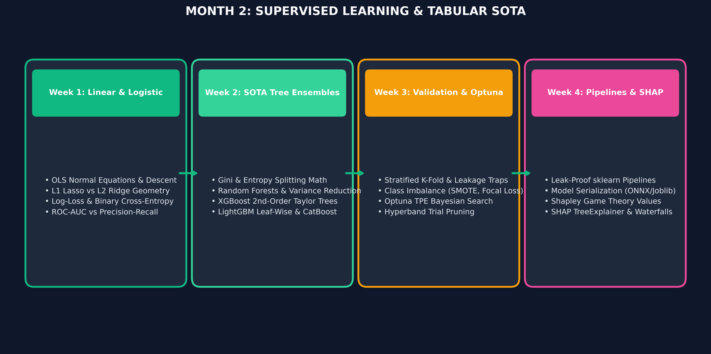

# Month 2: Classical Machine Learning & Tabular Intelligence (2026 Edition)

```
================================================================================
MODULE OVERVIEW: MONTH 2
FOCUS:           PRODUCTION TABULAR INTELLIGENCE & EXPLAINABLE ML
TOOLS:           SCIKIT-LEARN, LIGHTGBM, XGBOOST, CATBOOST, OPTUNA, SHAP, ONNX
TARGET LEVEL:    SENIOR AI ENGINEER & PRODUCTION ARCHITECT
================================================================================
```



## Curriculum Architecture


---

## Weekly Masterclass Index

| Week | Lecture Note & Masterclass | Core Theoretical Focus | Modern Toolchain | Key Architecture / Visual |
| :--- | :--- | :--- | :--- | :--- |
| **Week 1** | [Linear Models, Convexity & Regularization](Week_1/lecture_notes/Week1_Linear_Regression_Lecture.md) | OLS Normal Equations, Lipschitz Continuity, L1 Lasso Subgradient vs L2 Ridge Shrinkage, Newton-Raphson | `numpy`, `scipy`, `scikit-learn` | [L1 vs L2 Norm Geometry](../docs/images/l1_lasso_vs_l2_ridge.png) |
| **Week 2** | [Tree Algorithms & Gradient Boosting Systems](Week_2/lecture_notes/Week2_Tree_Algorithms_and_Gradient_Boosting.md) | Shannon Entropy, Gini Impurity, 2nd-Order Taylor Expansion, LightGBM GOSS/EFB, CatBoost Ordered Target Encoding | `lightgbm`, `xgboost`, `catboost` | [Level vs Leaf Tree Growth](../docs/images/level_vs_leaf_tree_growth.png) |
| **Week 3** | [Validation Protocols, Severe Imbalance & Optuna](Week_3/lecture_notes/Week3_Validation_Imbalance_and_Optuna.md) | Purged Group TimeSeries CV, Focal Loss & Class Weights, PR-AUC vs ROC-AUC, Tree-Structured Parzen Estimators (TPE) | `optuna`, `imbalanced-learn`, `scikit-learn` | [Optuna TPE Density Ratios](../docs/images/optuna_tpe_density.png) |
| **Week 4** | [Production Pipelines, Serialization & SHAP](Week_4/lecture_notes/Week4_Production_Pipelines_and_SHAP.md) | Leak-Proof Pipelines, Empirical Bayes Target Encoding, Cooperative Game Theory Axioms, Exact $O(TLD^2)$ TreeSHAP | `scikit-learn`, `onnxruntime`, `shap` | [SHAP Values Waterfall](../docs/images/shap_values_waterfall.png) |

---

## Practical Engineering Artifacts

Each week includes:
1. **Mathematical Derivations**: Step-by-step proofs with defined symbols and worked numerical examples.
2. **From-Scratch Engines**: Core algorithms implemented in pure Python/NumPy before using production libraries.
3. **Enterprise Playbooks**: Production latency budgets, containerized deployment patterns, and failure mode checklists.
4. **Graded Assessments**: 8–10 rigorous questions with complete answer keys and real-world coding challenges.
