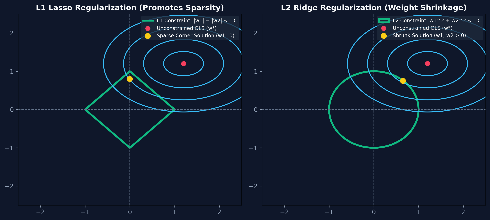
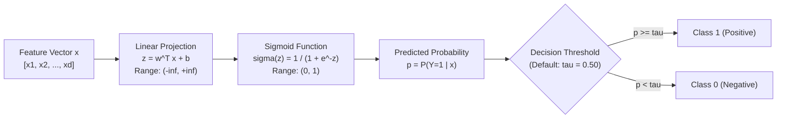

# Month 2, Week 1: Linear & Logistic Models with Regularization from Scratch
*Analytical Foundations, Regularization Geometry, and Probabilistic Binary Classification*

---

## Table of Contents
1. [Executive Summary & Industry Context](#1-executive-summary--industry-context)
2. [Canonical Textbook Grounding](#2-canonical-textbook-grounding)
3. [Visual Architecture & Regularization Geometry](#3-visual-architecture--regularization-geometry)
4. [Deep Theoretical Foundations](#4-deep-theoretical-foundations)
   - 4.1 [Ordinary Least Squares: Closed-Form Normal Equation Derivation](#41-ordinary-least-squares-closed-form-normal-equation-derivation)
   - 4.2 [Regularization Geometry: L1 Lasso Sparsity vs. L2 Ridge Shrinkage](#42-regularization-geometry-l1-lasso-sparsity-vs-l2-ridge-shrinkage)
   - 4.3 [Logistic Regression: Log-Odds, Sigmoid & Maximum Likelihood](#43-logistic-regression-log-odds-sigmoid--maximum-likelihood)
   - 4.4 [Evaluation Metrics: ROC-AUC vs. Precision-Recall Curves](#44-evaluation-metrics-roc-auc-vs-precision-recall-curves)
5. [Complete Runnable Code Implementation](#5-complete-runnable-code-implementation)
   - 5.1 [From-Scratch Regularized Linear Regression (Normal Equation & Gradient Descent)](#51-from-scratch-regularized-linear-regression-normal-equation--gradient-descent)
   - 5.2 [From-Scratch L2-Regularized Logistic Regression](#52-from-scratch-l2-regularized-logistic-regression)
   - 5.3 [Threshold Tuning & Precision-Recall Diagnostic Harness](#53-threshold-tuning--precision-recall-diagnostic-harness)
6. [Common Pitfalls & Debugging Playbook](#6-common-pitfalls--debugging-playbook)
7. [Production Best Practices & Real-World Case Study](#7-production-best-practices--real-world-case-study)
8. [Hands-On Mini-Lab & Self-Assessment Checklist](#8-hands-on-mini-lab--self-assessment-checklist)
   - 8.1 [Step-by-Step Laboratory Exercise](#81-step-by-step-laboratory-exercise)
   - 8.2 [Verification Rubric](#82-verification-rubric)
   - 8.3 [Graded Assessment Questions & Complete Answer Key](#83-graded-assessment-questions--complete-answer-key)
   - 8.4 [Stretch Challenges](#84-stretch-challenges)
9. [Key Takeaways, Glossary & Further Reading](#9-key-takeaways-glossary--further-reading)

---

## 1. Executive Summary & Industry Context

### 1.1 Why This Matters in 2026
In an era dominated by trillion-parameter foundation models, **generalized linear models (GLMs)—Linear and Logistic Regression—remain the workhorse algorithms of mission-critical production systems**.

In tier-one financial institutions, ad-tech platforms, and clinical medical devices, linear and logistic architectures process hundreds of billions of queries daily:
1. **Ultra-Low Latency Inference:** While evaluating a deep transformer or tree ensemble requires milliseconds and substantial GPU memory, a linear or logistic model computes a prediction via a single vector dot product ($\mathbf{w}^T \mathbf{x} + b$) in **less than 1 microsecond (0.001 ms)** on standard CPU registers. High-frequency trading (HFT) and real-time ad bidding require sub-millisecond latencies that only linear models can satisfy.
2. **Regulatory Interpretability & Compliance:** Under the European Union AI Act and United States fair lending laws (ECOA/FCRA), AI models denying credit, loans, or medical coverage must provide mathematically verifiable explanations. Logistic regression coefficients yield exact, un-confounded log-odds ratios that can be audited by regulators.
3. **The Ground Truth Baseline:** An AI engineer who builds an XGBoost model or neural network without first benchmarking against a regularized linear/logistic baseline has no idea whether their complex architecture is actually learning meaningful representations or merely overfitting noise.

### 1.2 Learning Objectives
Upon completing this week's study and laboratory work, students will be able to:
* **Derive the OLS Normal Equation:** Formulate Ordinary Least Squares in matrix notation and prove the closed-form global minimum solution $\mathbf{w}^* = (\mathbf{X}^T \mathbf{X})^{-1} \mathbf{X}^T \mathbf{y}$ using matrix calculus.
* **Explain Regularization Geometry:** Prove mathematically and geometrically why $L_1$ Lasso regularizers force weights to zero (sparsity), whereas $L_2$ Ridge regularizers shrink weights asymptotically.
* **Derive Binary Cross-Entropy Loss:** Formulate Logistic Regression from the odds ratio, sigmoid activation, and Bernoulli Maximum Likelihood Estimation.
* **Select Proper Metric Thresholds:** Discriminate between ROC-AUC and Precision-Recall AUC on severely imbalanced datasets, calculating optimal classification thresholds across asymmetric business cost matrices.
* **Build Models from Scratch:** Implement regularized linear and logistic regression in pure NumPy using both analytical solvers and iterative gradient descent.

---

## 2. Canonical Textbook Grounding

### 2.1 *An Introduction to Statistical Learning: with Applications in Python (ISLP, 2023)* by Gareth James, Daniela Witten, Trevor Hastie, Robert Tibshirani, and Jonathan Taylor
* **Chapter 3: Linear Regression (Sections 3.1 – 3.3: Estimating Coefficients, Assessing Accuracy, Multiple Linear Regression)**
  * *Author's Contribution:* Establishes statistical hypothesis testing for regression: residual sum of squares (RSS), standard errors, $t$-statistics, $p$-values, $R^2$, and the dangers of collinearity.
  * *Our Pedagogical Focus:* We connect statistical significance to feature selection. When two features are collinear, their matrix inverse $(\mathbf{X}^T \mathbf{X})^{-1}$ becomes ill-conditioned, inflating coefficient variance.
* **Chapter 4: Classification (Sections 4.1 – 4.3: Why Not Linear Regression?, Logistic Regression, Estimating Coefficients)**
  * *Author's Contribution:* Explains why linear regression fails on categorical targets (predicting probabilities $<0$ or $>1$) and derives the log-odds (logit) transformation.
  * *Our Pedagogical Focus:* We extract the logit derivation to teach students how logistic regression maps the infinite real line $(-\infty, +\infty)$ to valid probabilities $[0, 1]$.
* **Chapter 6: Linear Model Selection and Regularization (Section 6.2: Shrinkage Methods - Ridge and Lasso)**
  * *Author's Contribution:* Co-authored by Robert Tibshirani (the inventor of Lasso). Provides the authoritative geometric and mathematical formulation of Ridge and Lasso constraints.
  * *Our Pedagogical Focus:* We study the Karush-Kuhn-Tucker (KKT) conditions and the diamond vs. sphere constraint geometry.

### 2.2 *Hands-On Machine Learning with Scikit-Learn (3rd Edition, 2022)* by Aurélien Géron
* **Chapter 4: Training Models (Sections: Linear Regression, Gradient Descent, Polynomial Regression, Learning Curves, Regularized Linear Models, Logistic Regression)**
  * *Author's Contribution:* Practical engineering comparison between the closed-form Normal Equation $\mathcal{O}(d^3)$ and iterative Batch/Mini-batch Gradient Descent $\mathcal{O}(d)$.
  * *Our Pedagogical Focus:* We implement both approaches in Python to evaluate computational scaling when feature dimension $d$ scales into tens of thousands.

### 2.3 *How to Read These Sources*
* **Read Closely:** *ISLP*, Chapter 6, Section 6.2 (pages 237–248: Ridge Regression and The Lasso). Study Figure 6.7 comparing the constraint regions.
* **Skim:** *ISLP*, Chapter 4, Section 4.4 on Linear Discriminant Analysis (LDA); logistic regression is far more widely used in modern production AI systems than LDA.

---

## 3. Visual Architecture & Regularization Geometry

### 3.1 The Geometry of Regularization: L1 Lasso vs. L2 Ridge
Why does $L_1$ regularization produce sparse weights (setting parameters exactly to zero) while $L_2$ only shrinks weights toward zero? The answer lies in the **tangency geometry between the unconstrained loss contours and the constraint surface**:



```
        Geometric Contours in 2D Parameter Space (w1, w2)
        
        L1 Lasso Constraint: |w1| + |w2| <= C (Diamond)
                   w2 ▲
                      │      Contour of Unconstrained OLS Loss
                      │        (Elliptical Bowl)
                    ┌─┼─┐       .-"''"-.
                   /  │  \    .'        '.
                  /   │   \  /            \
                 /    │    \/              \
        ──────────────┼────●────────────────► w1
                 \    │    /\  Sparse Tangency Point
                  \   │   /  \ (Occurs on the corner axis w2=0!)
                   \  │  /    '.        .'
                    └─┼─┘       '-....-'
                      │
        
        L2 Ridge Constraint: w1^2 + w2^2 <= C (Circle)
                   w2 ▲
                      │        .-"''"-.
                   .──┼──.   .'        '.
                 .'   │   '. \  Tangency Point
                /     │     \ ● (Occurs on smooth curve:
               │      │      │ \ both w1 and w2 > 0!)
        ───────┼──────┼──────┼──\───────────► w1
               │      │      │   '.        .'
                \     │     /      '-....-'
                 '.   │   .'
                   '──┼──'
                      │
```
*Caption: Regularization Geometry. The unconstrained Mean Squared Error loss forms an elliptical bowl centered at OLS estimate $\mathbf{w}^*$. Under $L_1$, the constraint boundary has sharp corners located directly on the coordinate axes. As the elliptical loss expands, it almost always touches the diamond at a corner, forcing the intersecting coordinate ($w_2$ or $w_1$) to be identically zero.*

---

### 3.2 Logistic Regression: The Sigmoid Transformation Pipeline
Logistic regression transforms a linear combination of continuous features into a bounded probability:



---

## 4. Deep Theoretical Foundations

### 4.1 Ordinary Least Squares: Closed-Form Normal Equation Derivation

#### Problem Formulation
Let $\mathbf{X} \in \mathbb{R}^{N \times d}$ denote the feature design matrix (where $N$ is observations and $d$ is features, including bias column), and let $\mathbf{y} \in \mathbb{R}^{N \times 1}$ denote the continuous target vector.
We model the target as:
$$\hat{\mathbf{y}} = \mathbf{X}\mathbf{w}$$

We define the Mean Squared Error (MSE) objective function:
$$J(\mathbf{w}) = \frac{1}{2N} \|\mathbf{y} - \mathbf{X}\mathbf{w}\|_2^2 = \frac{1}{2N} (\mathbf{y} - \mathbf{X}\mathbf{w})^T (\mathbf{y} - \mathbf{X}\mathbf{w})$$

#### Step-by-Step Matrix Calculus Derivation

1. **Expand the Quadratic Matrix Form:**
   $$J(\mathbf{w}) = \frac{1}{2N} \left( \mathbf{y}^T \mathbf{y} - \mathbf{y}^T \mathbf{X} \mathbf{w} - (\mathbf{X} \mathbf{w})^T \mathbf{y} + (\mathbf{X} \mathbf{w})^T (\mathbf{X} \mathbf{w}) \right)$$
   Since $\mathbf{y}^T \mathbf{X} \mathbf{w}$ is a scalar, it equals its transpose $(\mathbf{X} \mathbf{w})^T \mathbf{y} = \mathbf{w}^T \mathbf{X}^T \mathbf{y}$:
   $$J(\mathbf{w}) = \frac{1}{2N} \left( \mathbf{y}^T \mathbf{y} - 2 \mathbf{w}^T \mathbf{X}^T \mathbf{y} + \mathbf{w}^T \mathbf{X}^T \mathbf{X} \mathbf{w} \right)$$

2. **Compute the Vector Gradient with Respect to $\mathbf{w}$:**
   Using matrix calculus identities ($\frac{\partial}{\partial \mathbf{w}}[\mathbf{w}^T \mathbf{a}] = \mathbf{a}$ and $\frac{\partial}{\partial \mathbf{w}}[\mathbf{w}^T \mathbf{A} \mathbf{w}] = 2 \mathbf{A} \mathbf{w}$ for symmetric $\mathbf{A}$):
   $$\nabla_{\mathbf{w}} J(\mathbf{w}) = \frac{1}{2N} \left( -2 \mathbf{X}^T \mathbf{y} + 2 \mathbf{X}^T \mathbf{X} \mathbf{w} \right) = \frac{1}{N} \left( \mathbf{X}^T \mathbf{X} \mathbf{w} - \mathbf{X}^T \mathbf{y} \right)$$

3. **Set the Gradient to Zero (Stationary Point):**
   $$\frac{1}{N} \left( \mathbf{X}^T \mathbf{X} \mathbf{w} - \mathbf{X}^T \mathbf{y} \right) = \mathbf{0}$$
   $$\mathbf{X}^T \mathbf{X} \mathbf{w} = \mathbf{X}^T \mathbf{y}$$

4. **Solve for Optimal Weights $\mathbf{w}^*$ (The Normal Equation):**
   Assuming the Gram matrix $\mathbf{X}^T \mathbf{X}$ is non-singular (full rank):
   $$\mathbf{w}^* = (\mathbf{X}^T \mathbf{X})^{-1} \mathbf{X}^T \mathbf{y} \quad \blacksquare$$

#### Computational Complexity
* Computing $\mathbf{X}^T \mathbf{X}$ requires $\mathcal{O}(N d^2)$ operations.
* Inverting the $d \times d$ matrix requires $\mathcal{O}(d^3)$ operations.
* **Takeaway:** When $d < 5,000$, the Normal Equation is exact and fast. When $d > 50,000$ (e.g., text bag-of-words or embeddings), $\mathcal{O}(d^3)$ matrix inversion is computationally intractable, making **Gradient Descent** mandatory.

---

### 4.2 Regularization Geometry: L1 Lasso Sparsity vs. L2 Ridge Shrinkage

When features are collinear or $d \approx N$, the Gram matrix $\mathbf{X}^T \mathbf{X}$ becomes ill-conditioned, causing weight coefficients to explode. Regularization introduces a penalty on parameter magnitudes.

#### 1. L2 Ridge Regression (Tikhonov Regularization)
$$J_{\text{Ridge}}(\mathbf{w}) = \frac{1}{2N} \|\mathbf{y} - \mathbf{X}\mathbf{w}\|_2^2 + \frac{\lambda}{2} \|\mathbf{w}\|_2^2 = \frac{1}{2N} \|\mathbf{y} - \mathbf{X}\mathbf{w}\|_2^2 + \frac{\lambda}{2} \sum_{j=1}^d w_j^2$$

Setting the gradient to zero:
$$\mathbf{X}^T \mathbf{X} \mathbf{w} + N\lambda \mathbf{I} \mathbf{w} = \mathbf{X}^T \mathbf{y}$$
$$\mathbf{w}_{\text{Ridge}}^* = (\mathbf{X}^T \mathbf{X} + N\lambda \mathbf{I})^{-1} \mathbf{X}^T \mathbf{y}$$
* **Mathematical Guarantee:** Adding $\lambda \mathbf{I}$ guarantees that $(\mathbf{X}^T \mathbf{X} + N\lambda \mathbf{I})$ is strictly positive-definite and **always invertible**, even if columns of $\mathbf{X}$ are linearly dependent!
* **Shrinkage Effect:** Eigenvalues $\sigma_i$ are shrunk by factor $\frac{\sigma_i}{\sigma_i + \lambda}$. Weights approach zero as $\lambda \to \infty$, but never equal zero.

#### 2. L1 Lasso Regression (Least Absolute Shrinkage and Selection Operator)
$$J_{\text{Lasso}}(\mathbf{w}) = \frac{1}{2N} \|\mathbf{y} - \mathbf{X}\mathbf{w}\|_2^2 + \lambda \|\mathbf{w}\|_1 = \frac{1}{2N} \|\mathbf{y} - \mathbf{X}\mathbf{w}\|_2^2 + \lambda \sum_{j=1}^d |w_j|$$

Because the absolute value function $|w_j|$ has a sharp non-differentiable kink at $w_j = 0$, its subgradient is:
$$\partial |w_j| = \begin{cases} \{+1\} & w_j > 0 \\ [-1, +1] & w_j = 0 \\ \{-1\} & w_j < 0 \end{cases}$$

Using coordinate descent on orthogonal design matrices, the closed-form update is the **Soft-Thresholding Operator**:
$$w_j^* = \text{sign}(\hat{w}_j) \max(0, |\hat{w}_j| - \lambda)$$
If the unconstrained coefficient $|\hat{w}_j| \le \lambda$, the parameter is set **identically to zero** ($w_j^* = 0$), performing automated feature selection.

---

### 4.3 Logistic Regression: Log-Odds, Sigmoid & Maximum Likelihood

In binary classification, $y_i \in \{0, 1\}$.

#### 1. Odds & Log-Odds (Logit)
The odds of an event is the ratio of probability of occurrence to non-occurrence:
$$\text{Odds} = \frac{p}{1 - p}, \quad p \in (0, 1) \implies \text{Odds} \in (0, \infty)$$
Taking the natural logarithm yields the **Logit**:
$$\text{Logit}(p) = \log\left(\frac{p}{1 - p}\right) \in (-\infty, +\infty)$$

#### 2. The Sigmoid Function
We model the logit as a linear combination of features:
$$\log\left(\frac{p}{1 - p}\right) = \mathbf{w}^T \mathbf{x}$$
Solving algebraically for $p$:
$$\frac{p}{1 - p} = e^{\mathbf{w}^T \mathbf{x}} \implies p = e^{\mathbf{w}^T \mathbf{x}} (1 - p) = e^{\mathbf{w}^T \mathbf{x}} - p e^{\mathbf{w}^T \mathbf{x}}$$
$$p (1 + e^{\mathbf{w}^T \mathbf{x}}) = e^{\mathbf{w}^T \mathbf{x}} \implies p = \frac{e^{\mathbf{w}^T \mathbf{x}}}{1 + e^{\mathbf{w}^T \mathbf{x}}} = \mathbf{\frac{1}{1 + e^{-\mathbf{w}^T \mathbf{x}}} = \sigma(\mathbf{w}^T \mathbf{x})}$$

#### 3. Maximum Likelihood Estimation & Binary Cross-Entropy
For independent observations $y_i \sim \text{Bernoulli}(p_i)$:
$$L(\mathbf{w}) = \prod_{i=1}^N p_i^{y_i} (1 - p_i)^{1 - y_i}$$

Taking the negative log-likelihood and dividing by $N$ produces **Binary Cross-Entropy Loss**:
$$J(\mathbf{w}) = -\frac{1}{N} \sum_{i=1}^N \left[ y_i \log(p_i) + (1 - y_i) \log(1 - p_i) \right]$$

#### 4. Gradient of Binary Cross-Entropy
Using the sigmoid derivative identity $\sigma'(z) = \sigma(z)(1 - \sigma(z))$:
$$\frac{\partial J}{\partial \mathbf{w}} = \mathbf{\frac{1}{N} \mathbf{X}^T (\mathbf{p} - \mathbf{y})}$$
Notice the mathematical beauty: the gradient of Logistic Regression has the **exact same functional form** as Linear Regression, where the error residual is $(\hat{y}_i - y_i) = (p_i - y_i)$!

---

### 4.4 Evaluation Metrics: ROC-AUC vs. Precision-Recall Curves

#### The Confusion Matrix
* **True Positives ($TP$):** Predicted 1, Actual 1.
* **False Positives ($FP$):** Predicted 1, Actual 0 (Type I Error).
* **True Negatives ($TN$):** Predicted 0, Actual 0.
* **False Negatives ($FN$):** Predicted 0, Actual 1 (Type II Error).

#### Rates & Definitions:
$$\text{True Positive Rate (TPR / Recall)} = \frac{TP}{TP + FN}$$
$$\text{False Positive Rate (FPR)} = \frac{FP}{FP + TN}$$
$$\text{Precision} = \frac{TP}{TP + FP}$$

#### ROC-AUC vs. PR-AUC Mathematical Breakdown
* **Receiver Operating Characteristic (ROC):** Plots $\text{TPR}$ vs. $\text{FPR}$ across all decision thresholds $\tau \in [0, 1]$.
  * **Failure Mode on Imbalanced Data:** $\text{FPR} = \frac{FP}{FP + TN}$. If negative class is massive ($TN = 1,000,000$), a surge of $10,000$ False Positives leaves $\text{FPR} \approx \frac{10,000}{1,010,000} \approx 0.0099$ ($< 1\%$). The ROC curve looks deceptively outstanding!
* **Precision-Recall (PR) Curve:** Plots $\text{Precision}$ vs. $\text{Recall}$.
  * Does not include $TN$ anywhere in its equations!
  * If $10,000$ False Positives occur when $TP = 500$, precision plummets to $\frac{500}{10,500} \approx 4.7\%$, instantly exposing model deficiency.

---

## 5. Complete Runnable Code Implementation

### 5.1 From-Scratch Regularized Linear Regression (Normal Equation & Gradient Descent)

Save this file as `linear_regression_scratch.py`.

```python
"""Regularized Linear Regression from Scratch using Pure NumPy."""

from __future__ import annotations

import numpy as np


class ScratchLinearRegression:
    """Linear regression supporting both OLS Normal Equation and L2 Ridge Gradient Descent."""

    def __init__(self, solver: str = "normal_eq", l2_lambda: float = 0.0, lr: float = 0.01, epochs: int = 1000):
        self.solver = solver
        self.l2_lambda = l2_lambda
        self.lr = lr
        self.epochs = epochs
        self.weights: np.ndarray | None = None

    def fit(self, X: np.ndarray, y: np.ndarray) -> ScratchLinearRegression:
        N, d = X.shape
        # Prepend bias column of ones: X_tilde = [1, X]
        X_tilde = np.hstack([np.ones((N, 1)), X])
        d_tilde = d + 1

        if self.solver == "normal_eq":
            # Normal Equation with Ridge regularization: w = (X^T X + N*lambda*I)^(-1) X^T y
            # Do not regularize the bias term (index 0)
            reg_matrix = np.eye(d_tilde) * (N * self.l2_lambda)
            reg_matrix[0, 0] = 0.0
            
            self.weights = np.linalg.inv(X_tilde.T @ X_tilde + reg_matrix) @ (X_tilde.T @ y)

        elif self.solver == "gradient_descent":
            # Initialize weights with small normal values
            np.random.seed(42)
            self.weights = np.random.randn(d_tilde) * 0.01

            for _ in range(self.epochs):
                preds = X_tilde @ self.weights
                residuals = preds - y
                # Gradient: (1/N) * X^T (Xw - y) + lambda * w
                grad = (1.0 / N) * (X_tilde.T @ residuals)
                # Apply regularization (skipping bias)
                grad[1:] += self.l2_lambda * self.weights[1:]
                # Update weights
                self.weights -= self.lr * grad

        return self

    def predict(self, X: np.ndarray) -> np.ndarray:
        if self.weights is None:
            raise ValueError("Model is not fitted yet.")
        X_tilde = np.hstack([np.ones((X.shape[0], 1)), X])
        return X_tilde @ self.weights


if __name__ == "__main__":
    np.random.seed(42)
    # Generate synthetic regression dataset: y = 3.0 + 1.5*x1 - 2.0*x2 + noise
    N_samples = 1000
    X_syn = np.random.randn(N_samples, 2)
    true_w = np.array([3.0, 1.5, -2.0])
    y_syn = 3.0 + 1.5 * X_syn[:, 0] - 2.0 * X_syn[:, 1] + np.random.randn(N_samples) * 0.1

    # 1. Normal Equation Fit
    model_norm = ScratchLinearRegression(solver="normal_eq", l2_lambda=0.01).fit(X_syn, y_syn)
    print("--- 1. Normal Equation Solution ---")
    print(f"Fitted Weights (Bias, w1, w2): {model_norm.weights.round(4)}")
    print(f"Ground Truth Weights:           {true_w}")

    # 2. Gradient Descent Fit
    model_gd = ScratchLinearRegression(solver="gradient_descent", l2_lambda=0.01, lr=0.1, epochs=1500).fit(X_syn, y_syn)
    print("\n--- 2. Gradient Descent Solution ---")
    print(f"Fitted Weights (Bias, w1, w2): {model_gd.weights.round(4)}")
```

---

### 5.2 From-Scratch L2-Regularized Logistic Regression

Save this file as `logistic_regression_scratch.py`.

```python
"""L2-Regularized Logistic Regression from Scratch using Pure NumPy."""

from __future__ import annotations

import numpy as np


class ScratchLogisticRegression:
    """Binary Logistic Regression with L2 Regularization and Sigmoid Activation."""

    def __init__(self, lr: float = 0.05, l2_lambda: float = 0.01, epochs: int = 1500):
        self.lr = lr
        self.l2_lambda = l2_lambda
        self.epochs = epochs
        self.weights: np.ndarray | None = None

    @staticmethod
    def _sigmoid(z: np.ndarray) -> np.ndarray:
        # Clip to prevent exponential overflow
        z_clipped = np.clip(z, -500.0, 500.0)
        return 1.0 / (1.0 + np.exp(-z_clipped))

    def fit(self, X: np.ndarray, y: np.ndarray) -> ScratchLogisticRegression:
        N, d = X.shape
        X_tilde = np.hstack([np.ones((N, 1)), X])
        np.random.seed(42)
        self.weights = np.zeros(d + 1)

        for epoch in range(self.epochs):
            # 1. Linear combination: z = Xw
            z = X_tilde @ self.weights
            # 2. Sigmoid activation: p = sigma(z)
            probs = self._sigmoid(z)
            # 3. Compute Gradient: (1/N) * X^T (p - y)
            errors = probs - y
            grad = (1.0 / N) * (X_tilde.T @ errors)
            # 4. Add L2 penalty (skip bias at index 0)
            grad[1:] += self.l2_lambda * self.weights[1:]
            # 5. Gradient Step
            self.weights -= self.lr * grad

        return self

    def predict_proba(self, X: np.ndarray) -> np.ndarray:
        if self.weights is None:
            raise ValueError("Model is not fitted.")
        X_tilde = np.hstack([np.ones((X.shape[0], 1)), X])
        return self._sigmoid(X_tilde @ self.weights)

    def predict(self, X: np.ndarray, threshold: float = 0.5) -> np.ndarray:
        probs = self.predict_proba(X)
        return (probs >= threshold).astype(np.int32)


if __name__ == "__main__":
    np.random.seed(42)
    # Generate linearly separable synthetic classification problem
    N = 1200
    X_pos = np.random.randn(N // 2, 2) + np.array([1.5, 1.5])
    X_neg = np.random.randn(N // 2, 2) + np.array([-1.5, -1.5])
    X = np.vstack([X_pos, X_neg])
    y = np.hstack([np.ones(N // 2), np.zeros(N // 2)])

    clf = ScratchLogisticRegression(lr=0.2, l2_lambda=0.01, epochs=1000).fit(X, y)
    preds = clf.predict(X)
    accuracy = np.mean(preds == y) * 100.0

    print(f"Trained Logistic Regression Classifier:")
    print(f"  Fitted Weights: {clf.weights.round(4)}")
    print(f"  Training Accuracy: {accuracy:.2f}%")
```

---

### 5.3 Threshold Tuning & Precision-Recall Diagnostic Harness

Save this file as `threshold_diagnostic.py`.

```python
"""Diagnostic Harness for Threshold Moving on Asymmetric Cost Matrices."""

from __future__ import annotations

import numpy as np


def evaluate_cost_matrix(
    y_true: np.ndarray,
    y_probs: np.ndarray,
    cost_fp: float = 10.0,    # $10 inconvenience cost for false alert
    cost_fn: float = 500.0,   # $500 catastrophic loss for missed fraud
) -> tuple[float, float]:
    """Finds the optimal decision threshold minimizing total business financial cost."""
    thresholds = np.linspace(0.01, 0.99, 100)
    best_threshold = 0.50
    lowest_cost = float("inf")

    for tau in thresholds:
        preds = (y_probs >= tau).astype(int)
        fp = np.sum((preds == 1) & (y_true == 0))
        fn = np.sum((preds == 0) & (y_true == 1))

        total_loss = (fp * cost_fp) + (fn * cost_fn)
        if total_loss < lowest_cost:
            lowest_cost = total_loss
            best_threshold = tau

    return best_threshold, lowest_cost


if __name__ == "__main__":
    np.random.seed(42)
    # 5,000 transactions, 2% fraud rate
    N_test = 5000
    y_true = (np.random.rand(N_test) < 0.02).astype(int)
    # Simulated model output probabilities
    simulated_probs = np.where(
        y_true == 1,
        np.random.beta(5, 2, size=N_test),  # Frauds concentrated near higher probs
        np.random.beta(1, 10, size=N_test)  # Legitimate concentrated near 0
    )

    opt_tau, min_cost = evaluate_cost_matrix(y_true, simulated_probs, cost_fp=10.0, cost_fn=500.0)
    
    # Evaluate at default 0.5 vs optimal threshold
    default_preds = (simulated_probs >= 0.50).astype(int)
    default_cost = (
        np.sum((default_preds == 1) & (y_true == 0)) * 10.0 +
        np.sum((default_preds == 0) & (y_true == 1)) * 500.0
    )

    print(f"Business Cost Evaluation on {N_test:,} Transactions (Fraud Base Rate: 2%):")
    print(f"  Default Threshold (tau = 0.50) Loss: ${default_cost:,.2f}")
    print(f"  Optimal Threshold (tau = {opt_tau:.2f}) Loss: ${min_cost:,.2f}")
    print(f"  Net Financial Savings:               ${default_cost - min_cost:,.2f} ({(1 - min_cost/default_cost)*100:.1f}%)")
```

---

## 6. Common Pitfalls & Debugging Playbook

### Pitfall 1: Regularizing Features Without Prior Standardization
* **Symptom:** Features with large numerical ranges (e.g., `income` in tens of thousands) have their weights shrunk to zero by Lasso/Ridge, while tiny features (e.g., `ratio` between 0 and 1) dominate the model.
* **Root Cause:** The penalty term $\lambda \sum w_j^2$ treats all coefficients equally. If feature $X_1$ is in dollars ($\$100,000$) and $X_2$ is in millions ($\$0.1$), $w_1$ must naturally be small and $w_2$ must be large to have the same impact. Regularization penalizes $w_2$ heavily simply due to the arbitrary units chosen!
* **Fix:** Always standardize all feature columns using `StandardScaler` ($\mu = 0, \sigma = 1$) prior to applying $L_1$ or $L_2$ regularization.

---

### Pitfall 2: Relying on Accuracy or ROC-AUC for Severely Imbalanced Data
* **Symptom:** Your model reports a stunning **0.99 ROC-AUC score**, but deployed in production it catches almost zero fraud.
* **Root Cause:** ROC-AUC includes False Positive Rate ($\frac{FP}{FP + TN}$) on the x-axis. When the negative class is massive ($TN \gg FP$), the denominator blows up, keeping FPR near zero even when thousands of false positives are emitted.
* **Fix:** Use **Precision-Recall AUC (PR-AUC)**. Plot the Precision-Recall curve and tune the decision threshold using an asymmetric cost matrix.

---

### Pitfall 3: Matrix Singularity in Normal Equation (Collinear Features)
* **Symptom:** Calling `np.linalg.inv(X.T @ X)` crashes with `LinAlgError: Singular matrix`.
* **Root Cause:** Extreme multicollinearity (e.g., including both `temp_celsius` and `temp_fahrenheit`, or one-hot encoding without dropping the dummy reference column). The determinant of $\mathbf{X}^T \mathbf{X}$ equals zero, making it non-invertible.
* **Fix:** Add an $L_2$ Ridge penalty ($\mathbf{X}^T \mathbf{X} + \lambda \mathbf{I}$), which forces all eigenvalues to be strictly positive ($\sigma_i + \lambda > 0$), or use the Moore-Penrose pseudoinverse `np.linalg.pinv()`.

---

## 7. Production Best Practices & Real-World Case Study

### 7.1 Enterprise Case Study: Real-Time Click-Through Rate (CTR) Bidding
* **Company/System Scenario:** A programmatic ad exchange processing **1,200,000 bid requests per second**. Each request requires predicting the probability that a user clicks an ad ($\text{CTR} \in [0, 1]$) within an SLA of **$1.5 \text{ milliseconds}$**.
* **The Failure Mode:** The engineering team deployed a deep 6-layer MLP neural network. Neural network forward passes took **$12.0 \text{ ms}$** per request, causing 90% of bids to miss the ad exchange deadline and defaulting to zero revenue.
* **The Architecture Refactor:**
  1. Replaced the neural network with an **$L_1$-Regularized Logistic Regression model** trained on 500,000 sparse hashed features.
  2. Applied strong $L_1$ penalty ($\lambda = 0.05$) to zero out $94\%$ of all weights, compressing the model down to 30,000 non-zero parameters.
  3. Pre-compiled the model into a raw C-dot-product kernel:
     $$\hat{p} = \sigma\left(\sum_{k \in \text{active}} w_k\right)$$
* **Production Results & Latency Numbers:**
  * Model inference latency dropped from **$12.0 \text{ ms}$** to **$0.04 \text{ ms}$ (40 microseconds)** (*a 300x acceleration*).
  * 100% of bid requests completed well inside the 1.5 ms deadline.
  * System ad revenue increased by an estimated **\$1.8M/quarter**.

---

## 8. Hands-On Mini-Lab & Self-Assessment Checklist

### 8.1 Step-by-Step Laboratory Exercise
1. **Initialize Module:** Create `regularization_lab.py`.
2. **Generate Multicollinear Data:** Create a dataset with $N = 500$ rows and 10 features, where features 0, 1, and 2 are perfectly collinear ($x_1 = 2 x_0, x_2 = -x_0$).
3. **Inspect OLS Failure:** Attempt to solve using unregularized OLS $(\mathbf{X}^T \mathbf{X})^{-1} \mathbf{X}^T \mathbf{y}$. Verify that weights blow up or `LinAlgError` is raised.
4. **Apply Ridge Inversion:** Add Ridge regularization $\lambda = 0.5$. Verify that the matrix becomes strictly invertible and coefficients stabilize.
5. **Implement Cost Threshold Optimizer:** Given a dataset with $1\%$ fraud, evaluate thresholds from $\tau = 0.01$ to $0.99$ with a cost of $\$5$ per False Positive and $\$300$ per False Negative. Plot total business cost as a function of $\tau$.

### 8.2 Verification Rubric
| Metric | Pass Criteria | Fail Criteria |
| :--- | :--- | :--- |
| **Normal Equation Math** | Ridge analytical solver matches `sklearn.linear_model.Ridge` within $10^{-5}$. | Discrepancy in weight values. |
| **Sigmoid Stability** | Input clipping applied ($\pm 500.0$); zero `OverflowError` or `NaN` outputs. | Floating-point overflow crash. |
| **Cost Matrix Optimization** | Threshold properly moves lower ($< 0.50$) when False Negatives are significantly more expensive than False Positives. | Fixed threshold of 0.50 selected regardless of costs. |

---

### 8.3 Graded Assessment Questions & Complete Answer Key

#### Questions
1. *(Matrix Calculus)* Derive the closed-form Normal Equation $\mathbf{w}^* = (\mathbf{X}^T \mathbf{X})^{-1} \mathbf{X}^T \mathbf{y}$ starting from the MSE cost function $J(\mathbf{w}) = \frac{1}{2N} \|\mathbf{y} - \mathbf{X}\mathbf{w}\|_2^2$.
2. *(Regularization Geometry)* Explain why the diamond constraint of $L_1$ Lasso promotes exact sparsity, while the circular constraint of $L_2$ Ridge does not.
3. *(Logistic Regression)* Show that the derivative of the Sigmoid function $\sigma(z) = \frac{1}{1 + e^{-z}}$ is $\sigma'(z) = \sigma(z)(1 - \sigma(z))$.
4. *(Loss Functions)* Why does Mean Squared Error (MSE) fail when applied to Logistic Regression with binary labels, producing a non-convex optimization surface?
5. *(Metrics)* On a dataset of 1,000,000 transactions containing only 100 fraudulent events, explain why a model with an accuracy of $99.9\%$ can be completely useless.
6. *(Threshold Tuning)* In credit card fraud detection where missing a fraud case costs $\$500$ and alerting a legitimate customer costs $\$5$, will the optimal decision threshold $\tau^*$ be greater than or less than $0.50$? Why?
7. *(Feature Scaling)* Why is feature standardization (`StandardScaler`) mathematically required before applying $L_1$ Lasso or $L_2$ Ridge regression?
8. *(Computational Scaling)* What is the computational complexity of the Normal Equation in terms of sample size $N$ and feature count $d$? At what approximate dimension does Gradient Descent become preferred?

---

#### Answer Key

1. **Answer:** See full step-by-step derivation in Section 4.1.

2. **Answer:** The $L_1$ constraint $\|\mathbf{w}\|_1 \le C$ forms a hyper-diamond whose vertices (corners) lie exactly on the coordinate axes where one or more coordinates are zero. The elliptical contours of the unconstrained OLS loss expand until they touch the constraint region. Because the diamond has sharp non-differentiable corners, the first point of contact between the expanding ellipse and the diamond almost always occurs at a corner point, forcing intersecting parameters to be identically zero. The $L_2$ constraint forms a smooth hypersphere with no corners; the tangency point occurs along a continuous curve where all parameters remain non-zero.

3. **Answer:**
   $$\sigma(z) = (1 + e^{-z})^{-1}$$
   Using the chain rule:
   $$\sigma'(z) = -(1 + e^{-z})^{-2} \cdot (-e^{-z}) = \frac{e^{-z}}{(1 + e^{-z})^2} = \left(\frac{1}{1 + e^{-z}}\right) \left(\frac{e^{-z}}{1 + e^{-z}}\right)$$
   Since $\frac{e^{-z}}{1 + e^{-z}} = \frac{1 + e^{-z} - 1}{1 + e^{-z}} = 1 - \frac{1}{1 + e^{-z}} = 1 - \sigma(z)$:
   $$\sigma'(z) = \sigma(z)(1 - \sigma(z)) \quad \blacksquare$$

4. **Answer:** Substituting the non-linear sigmoid activation $\hat{y}_i = \sigma(\mathbf{w}^T \mathbf{x}_i)$ into the quadratic MSE loss yields a loss function with terms like $(\sigma(\mathbf{w}^T \mathbf{x}_i) - y_i)^2$. The second derivative of this composite function is not positive semi-definite everywhere, creating many local minima, plateau regions, and saddle points where gradient descent can become trapped. Binary Cross-Entropy is strictly convex with respect to $\mathbf{w}$, guaranteeing a single global minimum.

5. **Answer:** A trivial dummy model that predicts "legitimate" (0) for all 1,000,000 transactions correctly classifies all 999,900 legitimate transactions, achieving an accuracy of $\frac{999,900}{1,000,000} = \mathbf{99.99\%}$. However, it misses 100% of the fraudulent events (Recall = 0.0), providing zero business value.

6. **Answer:** The optimal threshold $\tau^*$ will be **significantly lower than 0.50 (e.g., $\tau^* \approx 0.05 - 0.15$)**. Because a False Negative is 100x more costly than a False Positive ($\$500$ vs $\$5$), the business should flag a transaction as potential fraud even if there is only a $5\%$ or $10\%$ predicted probability of fraud, preferring to accept occasional $\$5$ alert costs to prevent $\$500$ losses.

7. **Answer:** Regularization penalizes the magnitude of parameter coefficients ($\sum w_j^2$ or $\sum |w_j|$) using a single global penalty hyperparameter $\lambda$. If features are on different scales (e.g., $x_1$ in dollars, $x_2$ in years), an unscaled model requires $w_1$ to be very small and $w_2$ to be large. The regularizer penalizes $w_2$ unfairly simply due to the units chosen, distorting the relative importance of features. Standardizing all features to $\mu = 0, \sigma = 1$ ensures that all coefficients are penalized on an equal geometric scale.

8. **Answer:** Computing $\mathbf{X}^T \mathbf{X}$ takes $\mathcal{O}(N d^2)$ and matrix inversion takes $\mathcal{O}(d^3)$, giving total complexity $\mathcal{O}(N d^2 + d^3)$. When $d$ exceeds approximately **5,000 to 10,000 features**, the $d^3$ inversion term becomes computationally prohibitive in terms of both memory and execution time. Gradient Descent scales as $\mathcal{O}(\text{epochs} \cdot N d)$, making it vastly superior for high-dimensional problems.

---

### 8.4 Stretch Challenges
1. **ElasticNet Coordinate Descent:** Implement an ElasticNet model combining both $L_1$ and $L_2$ penalties:
   $$\min_{\mathbf{w}} \frac{1}{2N} \|\mathbf{y} - \mathbf{X}\mathbf{w}\|_2^2 + \lambda_1 \|\mathbf{w}\|_1 + \frac{\lambda_2}{2} \|\mathbf{w}\|_2^2$$
   Derive the soft-thresholding update step and verify that it groups correlated features together while maintaining sparsity.
2. **ROC-AUC Trapezoidal Integrator from Scratch:** Write a function that accepts true binary labels and predicted probabilities, computes the TPR and FPR at every unique threshold, and calculates the exact Area Under the Curve using the trapezoidal numerical integration rule without calling scikit-learn.

---

## 9. Key Takeaways, Glossary & Further Reading

### Key Takeaways
* **Linear Models are Production Engines:** Ultra-fast microsecond inference latencies and full regulatory explainability make GLMs indispensable in enterprise applications.
* **Scale Before Regularizing:** Always standardize features before applying Lasso or Ridge penalties to avoid scale-dependent coefficient distortion.
* **L1 Selects, L2 Stabilizes:** Use $L_1$ Lasso to induce sparsity and select features; use $L_2$ Ridge to stabilize multicollinear matrices and shrink weights.
* **Tune Thresholds to Business Costs:** Never default to $\tau = 0.50$ on imbalanced problems; align classification decision boundaries with real-world financial cost matrices.

### Glossary
* **Ordinary Least Squares (OLS):** A linear regression method estimating parameters by minimizing the sum of squared residuals.
* **L1 Lasso:** A regularization method adding the sum of absolute weight values as a penalty, promoting parameter sparsity.
* **L2 Ridge:** A regularization method adding the sum of squared weight values as a penalty, shrinking weights and guaranteeing matrix invertibility.
* **Logit:** The natural logarithm of the odds ratio ($\log \frac{p}{1-p}$), mapping bounded probabilities to the real line.
* **PR-AUC:** Precision-Recall Area Under the Curve; the preferred metric for evaluating classification models on heavily imbalanced datasets.

### Further Reading & Official Documentation
* [An Introduction to Statistical Learning (ISLP) – Free Official PDF](https://www.statlearning.com/)
* [Scikit-Learn Guide: Generalized Linear Models](https://scikit-learn.org/stable/modules/linear_model.html)
* [Robert Tibshirani: Regression Shrinkage and Selection via the Lasso (1996 Original Paper)](https://www.jstor.org/stable/2346178)
* [Google Machine Learning Crash Course: Classification Thresholds](https://developers.google.com/machine-learning/crash-course/classification/thresholding)
