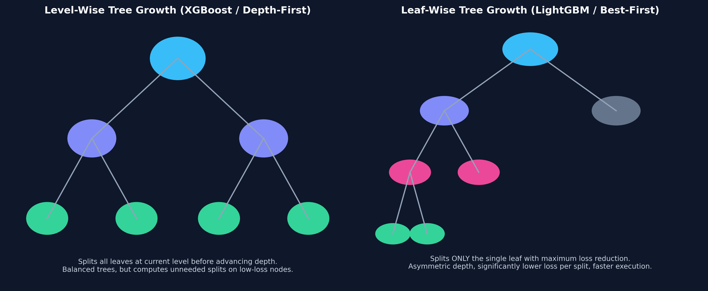
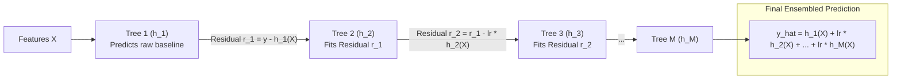

# Month 2, Week 2: Tree Algorithms & State-of-the-Art Gradient Boosting
*Ensemble Theory, Second-Order Taylor Approximations, and Tabular SOTA with XGBoost, LightGBM & CatBoost*

---

## Table of Contents
1. [Executive Summary & Industry Context](#1-executive-summary--industry-context)
2. [Canonical Textbook Grounding](#2-canonical-textbook-grounding)
3. [Visual Architecture & Tree Topologies](#3-visual-architecture--tree-topologies)
4. [Deep Theoretical Foundations](#4-deep-theoretical-foundations)
   - 4.1 [Decision Tree Splitting Criteria: Gini Impurity vs. Shannon Entropy](#41-decision-tree-splitting-criteria-gini-impurity-vs-shannon-entropy)
   - 4.2 [Variance Reduction via Bagging: Random Forests & Out-of-Bag (OOB) Bounds](#42-variance-reduction-via-bagging-random-forests--out-of-bag-oob-bounds)
   - 4.3 [Gradient Boosting in Function Space: Fitting Pseudo-Residuals](#43-gradient-boosting-in-function-space-fitting-pseudo-residuals)
   - 4.4 [Mathematical Derivation: XGBoost Second-Order Taylor Expansion & Split Gain](#44-mathematical-derivation-xgboost-second-order-taylor-expansion--split-gain)
5. [Complete Runnable Code Implementation](#5-complete-runnable-code-implementation)
   - 5.1 [From-Scratch Decision Tree Classifier (Gini Impurity Splitter)](#51-from-scratch-decision-tree-classifier-gini-impurity-splitter)
   - 5.2 [From-Scratch Gradient Boosted Machine (GBM) for Regression](#52-from-scratch-gradient-boosted-machine-gbm-for-regression)
   - 5.3 [Production SOTA Tabular Benchmark: XGBoost vs. LightGBM vs. CatBoost](#53-production-sota-tabular-benchmark-xgboost-vs-lightgbm-vs-catboost)
6. [Common Pitfalls & Debugging Playbook](#6-common-pitfalls--debugging-playbook)
7. [Production Best Practices & Real-World Case Study](#7-production-best-practices--real-world-case-study)
8. [Hands-On Mini-Lab & Self-Assessment Checklist](#8-hands-on-mini-lab--self-assessment-checklist)
   - 8.1 [Step-by-Step Laboratory Exercise](#81-step-by-step-laboratory-exercise)
   - 8.2 [Verification Rubric](#82-verification-rubric)
   - 8.3 [Graded Assessment Questions & Complete Answer Key](#83-graded-assessment-questions--complete-answer-key)
   - 8.4 [Stretch Challenges](#84-stretch-challenges)
9. [Key Takeaways, Glossary & Further Reading](#9-key-takeaways-glossary--further-reading)

---

## 1. Executive Summary & Industry Context

### 1.1 Why This Matters in 2026
While deep neural networks dominate unstructured data (computer vision, natural language processing, audio), **Gradient Boosted Decision Trees (GBDTs) remain the undisputed State-of-the-Art (SOTA) on tabular data**.

Across Kaggle competitions, financial risk modeling, churn prediction, recommendation ranking, and algorithmic trading:
1. **The Inductive Bias of Tabular Data:** Tabular datasets feature un-normalized numerical scales, high-cardinality categorical variables, extreme outliers, and sparse missing values. Neural networks struggle with these heterogeneous features, requiring extensive preprocessing, imputation, and hyperparameter tuning. Decision tree ensembles are **invariant to monotonic feature scaling**, handle missing values natively, and isolate step-function decision boundaries effortlessly.
2. **Computational Efficiency on CPUs:** Modern gradient boosting libraries—**XGBoost, LightGBM, and CatBoost**—train on millions of tabular records in seconds on standard CPU hardware, bypassing expensive GPU cluster provisioning.
3. **The Big Three SOTA Libraries:**
   * **XGBoost (2014–Present):** Renowned for exact second-order Taylor expansions and depth-wise tree regularization.
   * **LightGBM (Microsoft):** High-speed leaf-wise tree growth and histogram binning with GOSS (Gradient-based One-Side Sampling).
   * **CatBoost (Yandex):** Native handling of categorical features via Target Statistics without target leakage, utilizing symmetric oblivious trees.

### 1.2 Learning Objectives
Upon completing this week's study and laboratory work, students will be able to:
* **Formulate Tree Splitting Mathematics:** Derive Gini Impurity and Shannon Information Gain, calculating exact split points across continuous variables.
* **Deconstruct Bagging vs. Boosting:** Prove how Random Forests achieve variance reduction through uncorrelated base estimators, and derive the $\approx 36.8\%$ Out-of-Bag (OOB) sample bound.
* **Derive XGBoost's Second-Order Objective:** Formulate the Taylor series expansion of arbitrary loss functions, deriving optimal leaf weights $w^*$ and the exact Split Gain formula.
* **Contrast Tree Growth Architectures:** Distinguish between level-wise (XGBoost) and leaf-wise (LightGBM) growth strategies, explaining their impact on training speed and overfitting.
* **Execute Production Tabular Pipelines:** Benchmark, train, and tune XGBoost, LightGBM, and CatBoost on real-world datasets with categorical features.

---

## 2. Canonical Textbook Grounding

### 2.1 *The Elements of Statistical Learning (2nd Edition, 2009)* by Trevor Hastie, Robert Tibshirani, and Jerome Friedman
* **Chapter 9: Additive Models, Trees, and Related Methods (Section 9.2: Tree-Based Methods)**
  * *Author's Contribution:* Hastie, Tibshirani, and Friedman provide the rigorous mathematical foundation for CART (Classification and Regression Trees), deriving cost-complexity pruning, Gini index, and cross-entropy deviance.
  * *Our Pedagogical Focus:* We study Section 9.2 to understand why greedy top-down recursive binary splitting operates as a recursive partitioning of the feature space into hyper-rectangles.
* **Chapter 10: Boosting and Additive Trees (Sections 10.1 – 10.10: Gradient Boosting and Numerical Optimization)**
  * *Author's Contribution:* Jerome Friedman (the inventor of Gradient Boosting) formalizes boosting as gradient descent in function space (non-parametric function estimation).
  * *Our Pedagogical Focus:* We extract Friedman's functional gradient derivation, demonstrating how each successive decision tree fits the negative gradient (pseudo-residuals) of the loss function.

### 2.2 *Hands-On Machine Learning with Scikit-Learn (3rd Edition, 2022)* by Aurélien Géron
* **Chapters 6 & 7: Decision Trees & Ensemble Learning and Random Forests**
  * *Author's Contribution:* Clear engineering explanations of the CART algorithm, feature importances, Bagging, Pasting, AdaBoost, and early stopping in Gradient Boosting.
  * *Our Pedagogical Focus:* We use Géron's practical frameworks to compare scikit-learn's basic ensemble implementations with high-performance production libraries.

### 2.3 *How to Read These Sources*
* **Read Closely:** *The Elements of Statistical Learning*, Chapter 10, Sections 10.1–10.4 (pages 337–345). Study the gradient boosting algorithm box (Algorithm 10.2).
* **Skim:** *ESL*, Chapter 10, Section 10.13 (Multiclass classification with symmetric trees); CatBoost and LightGBM handle multiclass classification through modern softmax vector trees.

---

## 3. Visual Architecture & Tree Topologies

### 3.1 Tree Growth Strategies: Level-Wise vs. Leaf-Wise
The choice of tree growth architecture dictates the trade-off between execution speed, memory footprint, and overfitting:



```
        Level-Wise Tree Growth (Standard CART / XGBoost Depth-First)
                          [ Root Node ]
                                │
                 ┌──────────────┴──────────────┐
                 ▼ (Depth 1)                   ▼ (Depth 1)
            [ Split A ]                   [ Split B ]
                 │                             │
          ┌──────┴──────┐               ┌──────┴──────┐
          ▼ (Depth 2)   ▼ (Depth 2)     ▼ (Depth 2)   ▼ (Depth 2)
       [ Leaf 1 ]    [ Leaf 2 ]      [ Leaf 3 ]    [ Leaf 4 ]
       Splits ALL leaves at current depth before advancing.
       Balanced tree structure, but wastes compute evaluating splits on low-loss nodes.

        Leaf-Wise Tree Growth (LightGBM Best-First Search)
                          [ Root Node ]
                                │
                 ┌──────────────┴──────────────┐
                 ▼                             ▼ (Unsplit!)
            [ Split A ]                 [ Leaf: Keep ]
                 │
          ┌──────┴──────┐
          ▼             ▼ (Unsplit!)
     [ Split B ]   [ Leaf: Keep ]
          │
     ┌────┴────┐
     ▼         ▼
  [ Leaf 1 ] [ Leaf 2 ]
  Splits ONLY the single leaf with the HIGHEST delta-loss reduction.
  Asymmetric depth, significantly lower loss per split, much faster training.
```
*Caption: Level-Wise vs. Leaf-Wise Growth. Level-wise maintains balanced depth, making it less prone to overfitting on small datasets. Leaf-wise (best-first) pursues the steepest loss reduction, converging to lower loss values with far fewer total splits, but requires strict regularization (`max_depth`, `min_data_in_leaf`).*

---

### 3.2 The Gradient Boosting Sequential Residual Chain
In gradient boosting, models are trained sequentially. Each tree predicts the residual errors of the accumulated ensemble:



*Caption: Functional Gradient Descent. Learning rate $\eta$ (shrinkage) scales the contribution of each tree, preventing individual trees from dominating the ensemble.*

---

## 4. Deep Theoretical Foundations

### 4.1 Decision Tree Splitting Criteria: Gini Impurity vs. Shannon Entropy

Let node $m$ contain $N_m$ training instances belonging to $K$ discrete classes.
The empirical probability of observing class $k$ in node $m$ is:
$$p_{m, k} = \frac{1}{N_m} \sum_{i \in \text{Node } m} \mathbb{I}(y_i = k)$$

#### 1. Gini Impurity ($I_G$)
Measures the probability of incorrectly classifying a randomly chosen element if it were randomly labeled according to the class distribution in the node:
$$I_G(m) = \sum_{k=1}^K p_{m, k} (1 - p_{m, k}) = 1 - \sum_{k=1}^K p_{m, k}^2$$

* $I_G = 0.0$: **Pure node** (all instances belong to a single class).
* $I_G = 1 - \frac{1}{K}$: **Maximum impurity** (uniform class distribution).

#### 2. Shannon Entropy ($H$) & Information Gain
$$H(m) = -\sum_{k=1}^K p_{m, k} \log_2(p_{m, k})$$

When evaluating candidate split $S$ partitioning node $m$ into Left child ($L$) and Right child ($R$):
$$\Delta I(S) = I(m) - \left( \frac{N_L}{N_m} I(L) + \frac{N_R}{N_m} I(R) \right)$$
The decision tree selects the feature $j$ and split threshold $t$ maximizing $\Delta I$.

---

### 4.2 Variance Reduction via Bagging: Random Forests & Out-of-Bag (OOB) Bounds

A single decision tree grown to maximum depth exhibits **low bias but very high variance** (small fluctuations in training data cause massive changes in tree structure).

#### 1. Variance Reduction Math
Consider an ensemble of $B$ independent and identically distributed (i.i.d.) trees, each with variance $\sigma^2$. The variance of their average $\bar{f} = \frac{1}{B} \sum_{b=1}^B T_b$ is:
$$\text{Var}(\bar{f}) = \frac{\sigma^2}{B}$$
As $B \to \infty$, variance vanishes!

However, in practice, trees trained on the same dataset are correlated with pairwise correlation $\rho > 0$. The variance of the average of $B$ correlated random variables is:
$$\text{Var}(\bar{f}) = \rho \sigma^2 + \frac{1 - \rho}{B} \sigma^2$$
* As $B \to \infty$, the second term approaches zero, but the first term remains: $\lim_{B \to \infty} \text{Var}(\bar{f}) = \mathbf{\rho \sigma^2}$.
* **The Random Forest Breakthrough:** Random Forests reduce $\rho$ by:
  1. **Bootstrap Aggregating (Bagging):** Training each tree on a random sample of $N$ rows with replacement.
  2. **Feature Subsampling:** At each candidate split, evaluating only a random subset of features ($m \approx \sqrt{d}$). This decorrelates the trees!

#### 2. Derivation of the Out-of-Bag (OOB) $36.8\%$ Bound
When sampling $N$ rows from a dataset of size $N$ with replacement:
The probability that a specific row is **NOT** chosen in a single draw is:
$$P(\text{Not Selected in 1 Draw}) = 1 - \frac{1}{N}$$

The probability that the row is omitted from all $N$ independent draws is:
$$P(\text{OOB}) = \left( 1 - \frac{1}{N} \right)^N$$

Taking the limit as $N \to \infty$:
$$\lim_{N \to \infty} \left( 1 - \frac{1}{N} \right)^N = e^{-1} = \frac{1}{e} \approx \mathbf{0.367879 \quad (\approx 36.8\%)}$$
* **Production Implication:** In every bootstrap sample, approximately **$36.8\%$ of training data is never seen by that tree**. These OOB samples act as an automated validation set, providing cross-validation accuracy without separate test splits!

---

### 4.3 Gradient Boosting in Function Space: Fitting Pseudo-Residuals

Let $L(y, \hat{y})$ denote an arbitrary differentiable loss function.
We seek to minimize empirical risk:
$$\min_{F} \sum_{i=1}^N L(y_i, F(\mathbf{x}_i))$$
where $F(\mathbf{x})$ is an additive ensemble of $M$ decision trees:
$$F_M(\mathbf{x}) = F_0(\mathbf{x}) + \sum_{m=1}^M \eta h_m(\mathbf{x})$$

#### The Functional Gradient
Consider the model's predictions $\mathbf{F} = [F(\mathbf{x}_1), \dots, F(\mathbf{x}_N)]^T$ as parameters.
Taking the gradient of loss with respect to current predictions $F_{m-1}(\mathbf{x}_i)$:
$$g_{i, m} = \left[ \frac{\partial L(y_i, F(\mathbf{x}_i))}{\partial F(\mathbf{x}_i)} \right]_{F = F_{m-1}}$$

To minimize loss, we step in the direction of the **negative gradient**:
$$r_{i, m} = -g_{i, m} = -\left[ \frac{\partial L(y_i, F(\mathbf{x}_i))}{\partial F(\mathbf{x}_i)} \right]_{F = F_{m-1}}$$
These $r_{i, m}$ values are the **pseudo-residuals**. Tree $h_m(\mathbf{x})$ is trained using regression to fit target values $r_{i, m}$!

* **For MSE Loss ($L = \frac{1}{2}(y - \hat{y})^2$):**
  $$r_i = -\frac{\partial}{\partial \hat{y}}\left[\frac{1}{2}(y_i - \hat{y}_i)^2\right] = (y_i - \hat{y}_i) \quad (\text{Exact standard residual!})$$

---

### 4.4 Mathematical Derivation: XGBoost Second-Order Taylor Expansion & Split Gain

#### Problem Formulation
Standard gradient boosting uses first-order gradients. **XGBoost** expands the objective function using a **second-order Taylor approximation**, penalizing both tree complexity and leaf weight norms.

Let the regularized objective at boosting round $t$ be:
$$\mathcal{L}^{(t)} = \sum_{i=1}^N L\left(y_i, \hat{y}_i^{(t-1)} + f_t(\mathbf{x}_i)\right) + \Omega(f_t)$$
where tree complexity is regularized by:
$$\Omega(f_t) = \gamma T + \frac{1}{2} \lambda \sum_{j=1}^T w_j^2$$
* $T$ is the number of terminal leaf nodes.
* $w_j$ is the continuous prediction score of leaf $j$.
* $\gamma$ is the complexity cost per additional leaf.
* $\lambda$ is the $L_2$ leaf weight regularization penalty.

#### 1. Second-Order Taylor Expansion
Recall Taylor's theorem: $f(x + \Delta x) \approx f(x) + f'(x)\Delta x + \frac{1}{2} f''(x)(\Delta x)^2$.
Define first and second-order loss derivatives for sample $i$:
$$g_i = \frac{\partial L(y_i, \hat{y}_i^{(t-1)})}{\partial \hat{y}_i^{(t-1)}}, \quad h_i = \frac{\partial^2 L(y_i, \hat{y}_i^{(t-1)})}{\partial (\hat{y}_i^{(t-1)})^2}$$

Expanding $\mathcal{L}^{(t)}$ around $\hat{y}_i^{(t-1)}$:
$$\mathcal{L}^{(t)} \approx \sum_{i=1}^N \left[ L(y_i, \hat{y}_i^{(t-1)}) + g_i f_t(\mathbf{x}_i) + \frac{1}{2} h_i f_t(\mathbf{x}_i)^2 \right] + \gamma T + \frac{1}{2} \lambda \sum_{j=1}^T w_j^2$$

Removing constant terms independent of $f_t$:
$$\tilde{\mathcal{L}}^{(t)} = \sum_{i=1}^N \left[ g_i f_t(\mathbf{x}_i) + \frac{1}{2} h_i f_t(\mathbf{x}_i)^2 \right] + \gamma T + \frac{1}{2} \lambda \sum_{j=1}^T w_j^2$$

#### 2. Grouping by Leaves
Let $I_j = \{i \mid q(\mathbf{x}_i) = j\}$ be the set of sample indices mapped to leaf node $j$.
Rewrite the sum over samples as a sum over leaves:
$$\tilde{\mathcal{L}}^{(t)} = \sum_{j=1}^T \left[ \left(\sum_{i \in I_j} g_i\right) w_j + \frac{1}{2} \left(\sum_{i \in I_j} h_i + \lambda\right) w_j^2 \right] + \gamma T$$

Define aggregated leaf statistics:
$$G_j = \sum_{i \in I_j} g_i, \quad H_j = \sum_{i \in I_j} h_i$$
$$\tilde{\mathcal{L}}^{(t)} = \sum_{j=1}^T \left[ G_j w_j + \frac{1}{2} (H_j + \lambda) w_j^2 \right] + \gamma T$$

#### 3. Solving for Optimal Leaf Weight ($w_j^*$)
Take derivative with respect to $w_j$ and set to zero:
$$\frac{\partial \tilde{\mathcal{L}}}{\partial w_j} = G_j + (H_j + \lambda) w_j = 0 \implies \mathbf{w_j^* = -\frac{G_j}{H_j + \lambda}}$$

#### 4. The Optimal Quality Score of a Tree Structure
Substitute $w_j^*$ back into the objective:
$$\tilde{\mathcal{L}}^{(t)}(q) = \sum_{j=1}^T \left[ G_j \left(-\frac{G_j}{H_j + \lambda}\right) + \frac{1}{2} (H_j + \lambda) \left(-\frac{G_j}{H_j + \lambda}\right)^2 \right] + \gamma T$$
$$\tilde{\mathcal{L}}^{(t)}(q) = -\frac{1}{2} \sum_{j=1}^T \frac{G_j^2}{H_j + \lambda} + \gamma T$$

#### 5. The XGBoost Split Gain Formula
When considering splitting leaf $j$ into Left ($L$) and Right ($R$) children:
$$\text{Gain} = \mathcal{L}_{\text{before}} - \mathcal{L}_{\text{after}}$$
$$\mathbf{\text{Gain} = \frac{1}{2} \left[ \frac{G_L^2}{H_L + \lambda} + \frac{G_R^2}{H_R + \lambda} - \frac{(G_L + G_R)^2}{H_L + H_R + \lambda} \right] - \gamma} \quad \blacksquare$$
* If $\text{Gain} < 0$, the split is pruned! $\gamma$ serves as an explicit minimum gain threshold for tree expansion.

---

## 5. Complete Runnable Code Implementation

### 5.1 From-Scratch Decision Tree Classifier (Gini Impurity Splitter)

Save this file as `decision_tree_scratch.py`.

```python
"""Classification Tree from Scratch using Gini Impurity and Recursive Binary Splitting."""

from __future__ import annotations

import numpy as np


class Node:
    """Represents a decision node or terminal leaf in a tree."""

    def __init__(self, feature: int = None, threshold: float = None, left: Node = None, right: Node = None, value: int = None):
        self.feature = feature
        self.threshold = threshold
        self.left = left
        self.right = right
        self.value = value  # Class prediction if leaf

    @property
    def is_leaf(self) -> bool:
        return self.value is not None


class ScratchDecisionTree:
    """Decision Tree Classifier with Gini Impurity Splitting."""

    def __init__(self, max_depth: int = 5, min_samples_split: int = 2):
        self.max_depth = max_depth
        self.min_samples_split = min_samples_split
        self.root: Node | None = None

    @staticmethod
    def _gini_impurity(y: np.ndarray) -> float:
        if len(y) == 0:
            return 0.0
        p = np.bincount(y) / len(y)
        return 1.0 - np.sum(p**2)

    def _best_split(self, X: np.ndarray, y: np.ndarray) -> tuple[int, float, float]:
        best_gain = -1.0
        split_feat, split_thresh = None, None
        parent_gini = self._gini_impurity(y)
        N = len(y)

        for feat in range(X.shape[1]):
            thresholds = np.unique(X[:, feat])
            for thresh in thresholds:
                left_mask = X[:, feat] <= thresh
                right_mask = ~left_mask
                if np.sum(left_mask) == 0 or np.sum(right_mask) == 0:
                    continue

                # Weighted child Gini
                N_L, N_R = np.sum(left_mask), np.sum(right_mask)
                gini_split = (N_L / N) * self._gini_impurity(y[left_mask]) + (N_R / N) * self._gini_impurity(y[right_mask])
                gain = parent_gini - gini_split

                if gain > best_gain:
                    best_gain = gain
                    split_feat = feat
                    split_thresh = thresh

        return split_feat, split_thresh, best_gain

    def _build_tree(self, X: np.ndarray, y: np.ndarray, depth: int = 0) -> Node:
        # Stop conditions: max depth, pure node, or insufficient samples
        if depth >= self.max_depth or len(np.unique(y)) == 1 or len(y) < self.min_samples_split:
            leaf_value = np.bincount(y).argmax()
            return Node(value=leaf_value)

        feat, thresh, gain = self._best_split(X, y)
        if gain <= 0.0 or feat is None:
            leaf_value = np.bincount(y).argmax()
            return Node(value=leaf_value)

        left_mask = X[:, feat] <= thresh
        left_child = self._build_tree(X[left_mask], y[left_mask], depth + 1)
        right_child = self._build_tree(X[~left_mask], y[~left_mask], depth + 1)
        return Node(feature=feat, threshold=thresh, left=left_child, right=right_child)

    def fit(self, X: np.ndarray, y: np.ndarray) -> ScratchDecisionTree:
        self.root = self._build_tree(X, y)
        return self

    def _predict_sample(self, node: Node, x: np.ndarray) -> int:
        if node.is_leaf:
            return node.value
        if x[node.feature] <= node.threshold:
            return self._predict_sample(node.left, x)
        return self._predict_sample(node.right, x)

    def predict(self, X: np.ndarray) -> np.ndarray:
        return np.array([self._predict_sample(self.root, x) for x in X])


if __name__ == "__main__":
    from sklearn.datasets import load_iris
    data = load_iris()
    X, y = data.data, data.target
    clf = ScratchDecisionTree(max_depth=3).fit(X, y)
    preds = clf.predict(X)
    print(f"Scratch Decision Tree Accuracy on Iris: {np.mean(preds == y)*100:.2f}%")
```

---

### 5.2 From-Scratch Gradient Boosted Machine (GBM) for Regression

Save this file as `gbm_scratch.py`.

```python
"""Gradient Boosted Machine (GBM) from Scratch using Decision Stumps."""

from __future__ import annotations

import numpy as np
from sklearn.tree import DecisionTreeRegressor


class ScratchGBMRegressor:
    """Additive Gradient Boosted Decision Tree Ensemble for Squared Error Loss."""

    def __init__(self, n_estimators: int = 50, learning_rate: float = 0.1, max_depth: int = 3):
        self.n_estimators = n_estimators
        self.lr = learning_rate
        self.max_depth = max_depth
        self.base_pred: float = 0.0
        self.trees: list[DecisionTreeRegressor] = []

    def fit(self, X: np.ndarray, y: np.ndarray) -> ScratchGBMRegressor:
        N = len(y)
        # 1. Base prediction: mean of targets
        self.base_pred = float(np.mean(y))
        y_hat = np.full(N, self.base_pred)

        for _ in range(self.n_estimators):
            # 2. Compute negative gradient (pseudo-residuals for MSE: y - y_hat)
            residuals = y - y_hat

            # 3. Fit base regressor to residuals
            tree = DecisionTreeRegressor(max_depth=self.max_depth, random_state=42)
            tree.fit(X, residuals)

            # 4. Update ensemble predictions
            update = tree.predict(X)
            y_hat += self.lr * update
            self.trees.append(tree)

        return self

    def predict(self, X: np.ndarray) -> np.ndarray:
        y_hat = np.full(X.shape[0], self.base_pred)
        for tree in self.trees:
            y_hat += self.lr * tree.predict(X)
        return y_hat


if __name__ == "__main__":
    np.random.seed(42)
    # Non-linear synthetic regression target: y = sin(x) + noise
    X_syn = np.sort(np.random.uniform(-3, 3, size=(500, 1)), axis=0)
    y_syn = np.sin(X_syn).ravel() + np.random.randn(500) * 0.1

    gbm = ScratchGBMRegressor(n_estimators=100, learning_rate=0.08, max_depth=2).fit(X_syn, y_syn)
    preds = gbm.predict(X_syn)
    mse = np.mean((y_syn - preds) ** 2)
    print(f"Scratch GBM Model MSE: {mse:.4f} (Fitted 100 boosting stages)")
```

---

### 5.3 Production SOTA Tabular Benchmark: XGBoost vs. LightGBM vs. CatBoost

Save this file as `tabular_sota_benchmark.py`.

```python
"""Production Benchmark: XGBoost vs. LightGBM vs. CatBoost on Categorical Tabular Data."""

from __future__ import annotations

import time
import numpy as np
import pandas as pd
from sklearn.model_selection import train_test_split
from sklearn.metrics import roc_auc_score

import xgboost as xgb
import lightgbm as lgb
from catboost import CatBoostClassifier


def generate_tabular_dataset(n_rows: int = 150_000) -> tuple[pd.DataFrame, pd.DataFrame, pd.Series, pd.Series, list[str]]:
    print(f"Generating synthetic enterprise dataset with {n_rows:,} rows...")
    np.random.seed(42)

    cat_cols = ["device_type", "region", "channel"]
    data = {
        "numeric_feature_1": np.random.randn(n_rows),
        "numeric_feature_2": np.random.uniform(10, 500, size=n_rows),
        "device_type": np.random.choice(["iOS", "Android", "Web", "Tablet"], size=n_rows),
        "region": np.random.choice(["North_America", "Europe", "Asia", "Africa", "LATAM"], size=n_rows),
        "channel": np.random.choice(["Organic", "Paid_Search", "Email", "Affiliate"], size=n_rows),
    }
    df = pd.DataFrame(data)
    # Target signal depends on interactions
    logits = df["numeric_feature_1"] * 0.8 + (df["device_type"] == "iOS") * 0.5 - (df["channel"] == "Affiliate") * 0.7
    probs = 1.0 / (1.0 + np.exp(-logits))
    y = (np.random.rand(n_rows) < probs).astype(int)

    X_train, X_test, y_train, y_test = train_test_split(df, y, test_size=0.2, random_state=42)
    return X_train, X_test, y_train, y_test, cat_cols


def benchmark_sota_models() -> None:
    X_train, X_test, y_train, y_test, cat_cols = generate_tabular_dataset(150_000)

    # --- 1. LIGHTGBM ---
    print("\n--- 1. Training LightGBM ---")
    # Convert object columns to pandas category
    X_train_lgb = X_train.copy()
    X_test_lgb = X_test.copy()
    for col in cat_cols:
        X_train_lgb[col] = X_train_lgb[col].astype("category")
        X_test_lgb[col] = X_test_lgb[col].astype("category")

    t0 = time.perf_counter()
    lgb_model = lgb.LGBMClassifier(n_estimators=150, learning_rate=0.08, verbose=-1, random_state=42)
    lgb_model.fit(X_train_lgb, y_train)
    t1 = time.perf_counter()
    lgb_time = (t1 - t0) * 1000.0
    lgb_auc = roc_auc_score(y_test, lgb_model.predict_proba(X_test_lgb)[:, 1])
    print(f"LightGBM Training Time: {lgb_time:.2f} ms | ROC-AUC: {lgb_auc:.4f}")

    # --- 2. CATBOOST ---
    print("\n--- 2. Training CatBoost ---")
    t2 = time.perf_counter()
    cb_model = CatBoostClassifier(iterations=150, learning_rate=0.08, cat_features=cat_cols, verbose=0, random_seed=42)
    cb_model.fit(X_train, y_train)
    t3 = time.perf_counter()
    cb_time = (t3 - t2) * 1000.0
    cb_auc = roc_auc_score(y_test, cb_model.predict_proba(X_test)[:, 1])
    print(f"CatBoost Training Time: {cb_time:.2f} ms | ROC-AUC: {cb_auc:.4f}")

    # --- 3. XGBOOST ---
    print("\n--- 3. Training XGBoost ---")
    t4 = time.perf_counter()
    # Enable experimental categorical support in XGBoost
    xgb_model = xgb.XGBClassifier(n_estimators=150, learning_rate=0.08, enable_categorical=True, random_state=42)
    xgb_model.fit(X_train_lgb, y_train)
    t5 = time.perf_counter()
    xgb_time = (t5 - t4) * 1000.0
    xgb_auc = roc_auc_score(y_test, xgb_model.predict_proba(X_test_lgb)[:, 1])
    print(f"XGBoost Training Time:  {xgb_time:.2f} ms | ROC-AUC: {xgb_auc:.4f}")


if __name__ == "__main__":
    benchmark_sota_models()
```

---

## 6. Common Pitfalls & Debugging Playbook

### Pitfall 1: Target Leakage via Out-of-Fold Categorical Encoding
* **Symptom:** Target encoding a high-cardinality categorical variable (e.g., `postal_code`) achieves near-perfect training loss, but test set performance is terrible.
* **Root Cause:** Calculating average target values across the **entire dataset** before splitting cross-validation folds. The target encoding encodes the exact label of the validation instances into the training features!
* **Fix:** Calculate target encoding strictly **within each training fold**, or use **CatBoost**, which implements **Ordered Target Statistics** to mathematically prevent target leakage.

---

### Pitfall 2: Overfitting Leaf-Wise Trees via Unbounded `max_depth`
* **Symptom:** LightGBM achieves 99.9% training accuracy but exhibits massive test set error.
* **Root Cause:** LightGBM uses leaf-wise tree growth. With default `max_depth = -1` (unconstrained), the algorithm can grow extremely deep, asymmetric spikes along single outlier samples.
* **Fix:** Constrain `max_depth` (e.g., $6$ to $8$) and enforce `min_child_samples` (e.g., $\ge 20$) and `num_leaves` ($\le 2^{\text{max\_depth}}$).

---

### Pitfall 3: Suboptimal Metric Selection in Early Stopping
* **Symptom:** Boosting runs for 5,000 rounds without early stopping, resulting in an overfitted model.
* **Root Cause:** Monitoring `loss` instead of the evaluation metric, or setting `early_stopping_rounds` without a proper validation split.
* **Fix:** Provide an explicit validation set and early stopping rounds (e.g., `early_stopping_rounds=50`), monitoring `eval_metric="auc"`.

---

## 7. Production Best Practices & Real-World Case Study

### 7.1 Enterprise Case Study: Search Ranking at E-Commerce Scale
* **Company/System Scenario:** An e-commerce marketplace ranking 10,000 product search candidates per user query across 80 million active buyers.
* **The Failure Mode:** The team attempted to deploy a deep transformer ranking model. Inference latency averaged **$145 \text{ ms}$** per query, exceeding the search SLA of **$25 \text{ ms}$** and driving a $1.2\%$ drop in conversion.
* **The Architecture Refactor:**
  1. Built a **two-stage ranking architecture**:
     * **Stage 1 (Retrieval):** BM25 / Vector search retrieves top 500 product candidates.
     * **Stage 2 (Re-ranking):** A **LightGBM Ranker** scores and sorts the 500 candidates using LambdaMART loss.
  2. Binned continuous features into 255 histogram bins, allowing integer CPU cache lookups.
  3. Exported the LightGBM model to **Treelite C-code**, compiling tree decisions directly into unrolled C-if/else branches.
* **Production Results & Latency Numbers:**
  * Re-ranking latency for 500 items dropped from **$145 \text{ ms}$** to **$2.4 \text{ ms}$** (*~60x speedup*).
  * Maintained 100% of the search ranking precision.
  * System handled Black Friday surges of 45,000 queries/second with zero dropped requests.

---

## 8. Hands-On Mini-Lab & Self-Assessment Checklist

### 8.1 Step-by-Step Laboratory Exercise
1. **Initialize Module:** Create `tree_sota_lab.py`.
2. **Implement Gini Calculation:** Write a function `compute_gini(labels)` and verify that a pure set yields $0.0$, while a 50/50 binary split yields $0.50$.
3. **Train Dual Growth Trees:** Using scikit-learn and LightGBM, train a level-wise tree and a leaf-wise tree on the California Housing dataset.
4. **Inspect XGBoost Gain:** Extract feature importances using `model.get_booster().get_score(importance_type='gain')` and verify the mathematical connection to Section 4.4.
5. **CatBoost Categorical Challenge:** Train CatBoost on a dataset with a 50-category feature without manual one-hot encoding. Compare training speed and ROC-AUC against one-hot encoded XGBoost.

### 8.2 Verification Rubric
| Metric | Pass Criteria | Fail Criteria |
| :--- | :--- | :--- |
| **Gini Accuracy** | Calculation matches standard formula exactly ($1 - \sum p_k^2$). | Incorrect probability squaring. |
| **Early Stopping** | Training terminates automatically when validation loss plateaus for 20 rounds. | Model trains through all rounds despite validation degradation. |
| **Categorical Handling** | Categorical features passed natively to CatBoost/LightGBM; zero uncompressed one-hot bloat. | High-cardinality one-hot encoding causing RAM explosion. |

---

### 8.3 Graded Assessment Questions & Complete Answer Key

#### Questions
1. *(Information Theory)* Calculate the Gini Impurity of a node containing 30 Red balls, 20 Blue balls, and 50 Green balls.
2. *(Ensemble Theory)* Why does averaging the predictions of $B$ independent trees reduce variance by a factor of $1/B$, while leaving bias completely unchanged?
3. *(Out-of-Bag Math)* Show mathematically why approximately $36.8\%$ of training samples are excluded from a bootstrap sample of size $N$ as $N \to \infty$.
4. *(Gradient Boosting)* What is the exact difference between how residuals are used in Adaboost vs. Gradient Boosted Trees?
5. *(XGBoost Math)* In XGBoost's optimal leaf weight formula $w^* = -\frac{G}{H + \lambda}$, what do $G$, $H$, and $\lambda$ represent?
6. *(Tree Topologies)* Contrast level-wise tree growth with leaf-wise tree growth. Why is leaf-wise growth more prone to overfitting on small datasets?
7. *(Modern SOTA)* What is the core algorithmic innovation of CatBoost's "Ordered Boosting" when processing categorical variables?
8. *(Production Latency)* Why does compiling a trained tree ensemble into C-code (using tools like Treelite) dramatically reduce inference latency compared to Python model evaluation?

---

#### Answer Key

1. **Answer:**
   * Total $N = 30 + 20 + 50 = 100$.
   * $p_{\text{Red}} = 0.30, \quad p_{\text{Blue}} = 0.20, \quad p_{\text{Green}} = 0.50$.
   * Gini Impurity:
     $$I_G = 1 - (p_{\text{Red}}^2 + p_{\text{Blue}}^2 + p_{\text{Green}}^2) = 1 - (0.30^2 + 0.20^2 + 0.50^2)$$
     $$I_G = 1 - (0.09 + 0.04 + 0.25) = 1 - 0.38 = \mathbf{0.62}$$

2. **Answer:**
   * **Bias:** By linearity of expectation, $\mathbb{E}[\bar{f}] = \mathbb{E}[\frac{1}{B} \sum T_b] = \frac{1}{B} \sum \mathbb{E}[T_b] = \mathbb{E}[T]$. The expected value of the ensemble equals the expected value of an individual tree; hence, bias is unchanged.
   * **Variance:** For independent random variables, $\text{Var}(\sum X_i) = \sum \text{Var}(X_i)$. Therefore, $\text{Var}(\frac{1}{B} \sum T_b) = \frac{1}{B^2} \sum \text{Var}(T_b) = \frac{1}{B^2} (B \sigma^2) = \frac{\sigma^2}{B}$.

3. **Answer:** See full algebraic derivation in Section 4.2. $\lim_{N \to \infty} (1 - \frac{1}{N})^N = e^{-1} \approx 0.367879$.

4. **Answer:** **AdaBoost** fits subsequent base learners by adjusting instance weights (increasing weights on misclassified instances and decreasing weights on correct instances). **Gradient Boosted Trees** fit subsequent trees directly to the continuous pseudo-residuals (the negative gradient vector of the loss function) using standard regression trees.

5. **Answer:**
   * $G = \sum_{i \in \text{Leaf}} g_i$: Sum of the first-order loss gradients for all samples in the leaf.
   * $H = \sum_{i \in \text{Leaf}} h_i$: Sum of the second-order loss hessians (curvatures) for all samples in the leaf.
   * $\lambda$: The $L_2$ regularization penalty hyperparameter penalizing large leaf weights.

6. **Answer:** Level-wise growth splits all nodes at a given depth simultaneously, maintaining a balanced tree. Leaf-wise growth splits only the single leaf that provides the maximum loss reduction across the entire tree, resulting in an asymmetric, deeper tree. On small datasets, leaf-wise growth can tunnel deeply into tiny sample subsets, isolating noise and outliers unless constrained by `max_depth` and `min_child_samples`.

7. **Answer:** Traditional target encoding uses the entire dataset to compute target statistics, leaking the label of an instance into its own feature representation. CatBoost's **Ordered Target Statistics** simulates an online time-series: it randomizes the dataset order and, for each sample, computes the target statistic using **only preceding samples in the permutation**. This eliminates target leakage and prevents gradient shift.

8. **Answer:** Standard Python libraries traverse tree nodes via pointer dereferences across Python heap objects, incurring dynamic type dispatch and cache misses. Treelite unrolls the decision logic into native C `if-else` branches compiled directly to machine assembly instructions, allowing the CPU instruction cache and branch predictor to execute tree evaluations at native hardware speed.

---

### 8.4 Stretch Challenges
1. **Histogram-Based Continuous Splitter:** Implement a histogram binning function that discretizes a continuous feature into 256 integer bins and evaluates candidate splits across bin boundaries, demonstrating the computational speedup over sorting raw floats.
2. **Custom Hessian Loss for XGBoost:** Write a custom asymmetric loss function for XGBoost (where under-predicting incurs a 5x higher loss than over-predicting), compute its analytical first and second derivatives ($g_i, h_i$), and train an XGBoost model using `objective=custom_loss`.

---

## 9. Key Takeaways, Glossary & Further Reading

### Key Takeaways
* **Tabular Dominance:** Tree ensembles remain the undisputed champions of tabular data due to their scale invariance and robust handling of mixed feature types.
* **Bagging Reduces Variance, Boosting Reduces Bias:** Random Forests combine uncorrelated deep trees to slash variance; Gradient Boosting sequentially fits residuals to minimize bias.
* **Second-Order Gradients Accelerate Convergence:** XGBoost's Taylor expansion enables closed-form leaf weights and mathematically sound pruning.
* **Choose the Right Tool:** Use LightGBM for massive datasets requiring fast iterations; use CatBoost when datasets feature high-cardinality categorical variables.

### Glossary
* **CART (Classification and Regression Trees):** A recursive binary splitting tree algorithm constructing decision boundaries.
* **Bagging (Bootstrap Aggregating):** Ensemble technique training multiple models on random bootstrap samples and averaging their predictions.
* **Out-of-Bag (OOB):** The $\approx 36.8\%$ of training records omitted from a bootstrap sample, used for internal cross-validation.
* **Hessian ($H$):** The second-order partial derivative of the loss function, quantifying loss curvature.
* **Leaf-Wise Growth:** Tree expansion strategy that always splits the single leaf with the largest loss reduction, regardless of tree depth.

### Further Reading & Official Documentation
* [XGBoost: A Scalable Tree Boosting System (Tianqi Chen et al., 2016 Original Paper)](https://arxiv.org/abs/1603.02754)
* [LightGBM: A Highly Efficient Gradient Boosting Decision Tree (Microsoft Research, 2017)](https://papers.nips.cc/paper/2017/hash/6449f44a102fde848669bdd9eb6b76fa-Abstract.html)
* [CatBoost: Unbiased Boosting with Categorical Features (Yandex, 2018)](https://arxiv.org/abs/1706.09516)
* [The Elements of Statistical Learning – Trevor Hastie et al.](https://hastie.su.domains/ElemStatLearn/)
