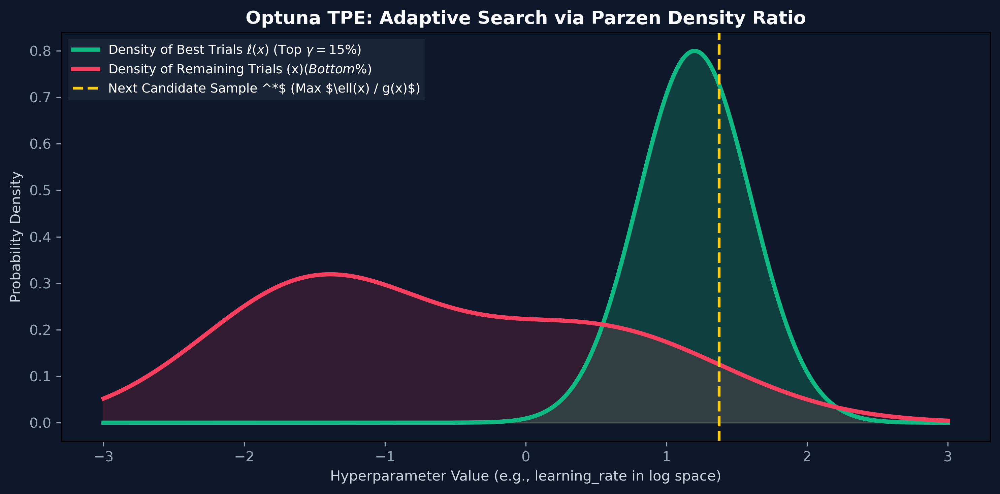

# Month 2, Week 3: Validation Frameworks, Severe Imbalance & Optuna Optimization
*Leak-Proof Cross-Validation, Asymmetric Loss Landscapes, and Bayesian Hyperparameter Optimization with TPE*

---

## Table of Contents
1. [Executive Summary & Industry Context](#1-executive-summary--industry-context)
2. [Canonical Textbook Grounding](#2-canonical-textbook-grounding)
3. [Visual Architecture & Bayesian Landscapes](#3-visual-architecture--bayesian-landscapes)
4. [Deep Theoretical Foundations](#4-deep-theoretical-foundations)
   - 4.1 [Validation Topologies: K-Fold, Stratified K-Fold & Temporal Leakage](#41-validation-topologies-k-fold-stratified-k-fold--temporal-leakage)
   - 4.2 [Handling Extreme Class Imbalance: SMOTE, Cost-Sensitive Weights & Focal Loss](#42-handling-extreme-class-imbalance-smote-cost-sensitive-weights--focal-loss)
   - 4.3 [Hyperparameter Optimization: Grid vs. Random vs. Bayesian Search](#43-hyperparameter-optimization-grid-vs-random-vs-bayesian-search)
   - 4.4 [Mathematical Derivation: The Tree-Structured Parzen Estimator (TPE)](#44-mathematical-derivation-the-tree-structured-parzen-estimator-tpe)
5. [Complete Runnable Code Implementation](#5-complete-runnable-code-implementation)
   - 5.1 [Leak-Proof Stratified K-Fold Pipeline with Custom Imbalance Resampling](#51-leak-proof-stratified-k-fold-pipeline-with-custom-imbalance-resampling)
   - 5.2 [Optuna Bayesian Optimization Study with Median Trial Pruning](#52-optuna-bayesian-optimization-study-with-median-trial-pruning)
   - 5.3 [Focal Loss Implementation from Scratch for Extreme Imbalance](#53-focal-loss-implementation-from-scratch-for-extreme-imbalance)
6. [Common Pitfalls & Debugging Playbook](#6-common-pitfalls--debugging-playbook)
7. [Production Best Practices & Real-World Case Study](#7-production-best-practices--real-world-case-study)
8. [Hands-On Mini-Lab & Self-Assessment Checklist](#8-hands-on-mini-lab--self-assessment-checklist)
   - 8.1 [Step-by-Step Laboratory Exercise](#81-step-by-step-laboratory-exercise)
   - 8.2 [Verification Rubric](#82-verification-rubric)
   - 8.3 [Graded Assessment Questions & Complete Answer Key](#83-graded-assessment-questions--complete-answer-key)
   - 8.4 [Stretch Challenges](#84-stretch-challenges)
9. [Key Takeaways, Glossary & Further Reading](#9-key-takeaways-glossary--further-reading)

---

## 1. Executive Summary & Industry Context

### 1.1 Why This Matters in 2026
In applied machine learning engineering, **the validation scheme is the single most critical structural component of an entire project**. If your validation split leaks future information or fails to replicate the real-world inference distribution, your model's offline evaluation metrics are completely fictitious.

In production engineering across fintech, healthcare, and recommendation platforms:
1. **The Data Leakage Catastrophe:** The most frequent cause of catastrophic ML project failure is subtle data leakage—performing feature scaling, target encoding, or synthetic oversampling (SMOTE) *before* splitting cross-validation folds. Models achieve artificial 99% accuracy in testing and fail instantly in production.
2. **Extreme Class Imbalance (The 1-in-10,000 Problem):** Real-world tasks rarely present balanced classes. In payment fraud detection, ad-click conversion, and rare cancer screening, positive instances comprise less than $0.1\%$ of the dataset. Naive training causes models to predict the majority class 100% of the time, while standard accuracy metrics mask the failure.
3. **Automated Bayesian Optimization:** Exhaustive Grid Search is computationally intractable in multi-dimensional continuous spaces ($\mathcal{O}(K^d)$), while Random Search wastes massive compute exploring unpromising regions. Senior AI engineers automate tuning using **Optuna** powered by the **Tree-structured Parzen Estimator (TPE)**, which models parameter probability distributions adaptively and prunes unpromising training runs in early epochs via Hyperband algorithms.

### 1.2 Learning Objectives
Upon completing this week's study and laboratory work, students will be able to:
* **Design Leak-Proof Cross-Validation Schemes:** Implement Stratified K-Fold and Purged Time-Series splits that guarantee zero feature, target, or temporal leakage.
* **Formulate Imbalance Remediation Mathematics:** Implement Cost-Sensitive Class Weighting, understand SMOTE interpolation limitations, and derive the **Focal Loss** modulating factor $(1 - p_t)^\gamma$.
* **Derive the Tree-Structured Parzen Estimator (TPE):** Prove mathematically how modeling two non-parametric densities ($\ell(x)$ for top performers and $g(x)$ for remaining trials) maximizes Expected Improvement (EI).
* **Execute Production Optuna Studies:** Build multi-objective hyperparameter search pipelines with automated pruning (Hyperband / Median pruner) in Optuna.
* **Eliminate Evaluation Pathologies:** Distinguish between test-set overfitting caused by excessive hyperparameter evaluations and genuine generalization gains.

---

## 2. Canonical Textbook Grounding

### 2.1 *Hands-On Machine Learning with Scikit-Learn (3rd Edition, 2022)* by Aurélien Géron
* **Chapter 2: End-to-End Machine Learning Project (Section: Create a Test Set & Cross-Validation)**
  * *Author's Contribution:* Géron explains the psychology of "Data Snooping Bias" and details how stratified sampling prevents sampling bias on skewed demographics.
  * *Our Pedagogical Focus:* We formalize Géron's warnings into concrete mathematical leakage vectors: showing how pre-processing pipelines must be fitted exclusively on training folds.
* **Chapter 3: Classification (Section: Performance Measures & Multiclass Classification)**
  * *Author's Contribution:* Comprehensive treatment of Confusion Matrices, Precision, Recall, F1-Score, and threshold trade-offs on imbalanced MNIST subsets.
  * *Our Pedagogical Focus:* We advance beyond standard binary metrics into cost-weighted utility surfaces for real-world risk management.

### 2.2 *Algorithms for Hyperparameter Optimization (NeurIPS, 2011)* by James Bergstra, Rémi Bardenet, Yoshua Bengio, and Balázs Kégl
* *Authors' Contribution:* The seminal academic paper introducing the **Tree-structured Parzen Estimator (TPE)**, proving that modeling the conditional probability of hyperparameters given loss $P(x \mid y)$ is vastly more sample-efficient than Gaussian Process regression on high-dimensional spaces.
* *Our Pedagogical Focus:* We derive the ratio $\frac{\ell(x)}{g(x)}$ from first principles and explain how modern Optuna harnesses implement this algorithm.

### 2.3 *How to Read These Sources*
* **Read Closely:** *Bergstra et al. (2011)*, Section 4 ("Tree-structured Parzen Estimator Approach"). Follow the equations deriving Expected Improvement under TPE.
* **Skim:** *Hands-On Machine Learning*, sections covering basic scikit-learn `GridSearchCV`; production pipelines standardize on Bayesian Optuna.

---

## 3. Visual Architecture & Bayesian Landscapes

### 3.1 Optuna's Tree-Structured Parzen Estimator (TPE)
Unlike standard Gaussian Processes which model $P(y \mid x)$ (the expected loss given a set of hyperparameters), TPE inverts the probability by modeling $P(x \mid y)$ using two distinct density functions:



```
        TPE Density Estimation in Hyperparameter Space (e.g., learning_rate)
        
        Probability Density p(x)
           ▲
           │                    l(x): Density of Top Trials (e.g., Best 15%)
           │                    [High probability in optimal sweet spot!]
           │                         ┌─────┐
           │                        /       \
           │                       /         \
           │                      /           \
           │            ─────────┘             └─────────
           │
           │                    g(x): Density of Remaining Trials (Bottom 85%)
           │                    [Broad, flat density covering failed regions]
           │             .─────────────────────────────────.
           │           .'                                   '.
           └──────────┴───────────────────────────────────────┴────────► Parameter x
                                        ▲
                                        │ Maximize Ratio: l(x) / g(x)
                                        └── Candidate sample drawn from HERE!
```
*Caption: Optuna TPE Mechanics. Rather than guessing randomly, TPE samples candidate parameters from regions where the density of historically successful trials $\ell(x)$ is high relative to the density of failed trials $g(x)$.*

---

### 3.2 Leak-Proof Stratified Cross-Validation Architecture
In a leak-proof training pipeline, **all data scaling, imputation, and resampling MUST occur inside each cross-validation fold**:

```mermaid
flowchart TD
    A["Raw Dataset (Features X, Labels y)"] --> B["Stratified K-Fold Splitter (e.g., 5 Folds)"]
    
    subgraph Fold Execution (Repeated 5 Times)
    B --> C["Training Folds (80%)\nRaw Unscaled Data"]
    B --> D["Validation Fold (20%)\nRaw Unscaled Data"]
    
    C --> E["1. Fit Preprocessor (Scaler/Encoder)\non Training Data ONLY!"]
    E --> F["2. Transform Training Fold"]
    F --> G["3. Apply SMOTE / Resampling\non Training Fold ONLY!"]
    G --> H["4. Train Estimator (XGBoost / LightGBM)"]
    
    E -.->|"Apply Frozen Transformer\n(Zero Retraining)"| I["Transform Validation Fold"]
    H --> J["Generate Predictions on Validation Fold"]
    I --> J
    J --> K["Compute Fold Metric (PR-AUC / Loss)"]
    end
    
    K --> L["Aggregate 5-Fold Validation Score"]
```

---

## 4. Deep Theoretical Foundations

### 4.1 Validation Topologies: K-Fold, Stratified K-Fold & Temporal Leakage

#### 1. Standard K-Fold Cross-Validation
The dataset $\mathcal{D}$ is randomly partitioned into $K$ equal-sized disjoint subsets $\mathcal{D}_1, \dots, \mathcal{D}_K$.
For each fold $k \in \{1, \dots, K\}$:
* **Train:** $\mathcal{D}_{\text{train}} = \mathcal{D} \setminus \mathcal{D}_k$
* **Validation:** $\mathcal{D}_{\text{val}} = \mathcal{D}_k$
The cross-validation estimate is the empirical average:
$$\text{CV}_K = \frac{1}{K} \sum_{k=1}^K \text{Metric}(\mathcal{D}_k; \hat{f}_{-k})$$

#### 2. Stratified K-Fold (Mandatory for Imbalanced Data)
Standard random splitting suffers from **sampling variance**. In a dataset where fraud occurs in $1\%$ of rows, a standard random fold might receive $0.2\%$ fraud while another receives $2.1\%$, distorting validation metrics.
**Stratification** guarantees that every fold preserves the exact class proportion:
$$\frac{N_{k, c}}{|\mathcal{D}_k|} = \frac{N_c}{|\mathcal{D}|}, \quad \forall k \in \{1, \dots, K\}, \ \forall c \in \{0, 1\}$$

#### 3. Temporal Splitting (Purged & Embargoed Time-Series CV)
When records possess a temporal dimension (e.g., stock prices, user clickstreams, transaction history), standard K-Fold causes **Lookahead Leakage** (training on data from Wednesday to predict Tuesday).
* Models must be evaluated strictly using **Expanding Window** or **Purged Time-Series Splits**:
$$\text{Train: } [t_0 \to t_1] \implies \text{Purge Buffer } [t_1 \to t_2] \implies \text{Val: } [t_2 \to t_3]$$
The purge buffer prevents serial correlation leakage between adjacent timestamps.

---

### 4.2 Handling Extreme Class Imbalance: SMOTE, Cost-Sensitive Weights & Focal Loss

#### 1. Synthetic Minority Over-sampling Technique (SMOTE)
SMOTE synthesizes artificial minority instances in feature space rather than duplicating rows:
For each minority instance $\mathbf{x}_i$:
1. Find its $k$-nearest minority neighbors using Euclidean distance.
2. Select one random neighbor $\mathbf{x}_{zi}$.
3. Generate a synthetic sample along the line segment:
   $$\mathbf{x}_{\text{new}} = \mathbf{x}_i + \lambda (\mathbf{x}_{zi} - \mathbf{x}_i), \quad \lambda \sim \mathcal{U}(0, 1)$$
* **Theoretical Failure in High Dimensions:** Due to the curse of dimensionality, Euclidean nearest neighbors become meaningless in high-dimensional sparse spaces ($d > 50$). SMOTE interpolates points across empty space, generating noisy, unrealistic samples that bridge distinct class clusters!

#### 2. Cost-Sensitive Class Weighting
Instead of altering the dataset, modify the loss function directly by weighting the minority class:
$$w_c = \frac{N}{K \cdot N_c}$$
Where $N$ is total samples, $K$ is number of classes, and $N_c$ is instances of class $c$.
For a 99:1 imbalanced dataset, the positive class receives weight $w_1 = \frac{100}{2 \times 1} = 50.0$, scaling its loss gradients by $50\times$.

#### 3. Focal Loss
Introduced by Lin et al. (RetinaNet, 2017), **Focal Loss** adds a dynamically modulating factor $(1 - p_t)^\gamma$ to standard cross-entropy to suppress easy negative examples:
$$\text{FL}(p_t) = -\alpha_t (1 - p_t)^\gamma \log(p_t)$$
Where:
* $p_t$ is the model's estimated probability for the true class.
* $\gamma \ge 0$ is the **focusing parameter**.
* When an easy negative example is classified with high confidence ($p_t = 0.99$):
  $$(1 - 0.99)^2 = (0.01)^2 = \mathbf{0.0001 \quad (Gradient down-weighted by 10,000x!)}$$
* When a hard minority example is misclassified ($p_t = 0.10$):
  $$(1 - 0.10)^2 = (0.90)^2 = \mathbf{0.81 \quad (Gradient preserved!)}$$

---

### 4.3 Hyperparameter Optimization: Grid vs. Random vs. Bayesian Search

* **Grid Search:** Evaluates the Cartesian product of discrete parameter candidates. Cost: $\mathcal{O}(S^d)$ (Exponential explosion; wastes compute on un-important hyperparameters).
* **Random Search (Bergstra & Bengio, 2012):** Samples parameters uniformly at random. Empirically superior to Grid Search because different machine learning models have different *effective dimensionalities* (only 1 or 2 hyperparameters dictate 90% of performance).
* **Bayesian Optimization:** Constructs a probabilistic surrogate model of the objective function and uses an **Acquisition Function** to balance **Exploration** (sampling regions of high uncertainty) and **Exploitation** (sampling regions of predicted high performance).

---

### 4.4 Mathematical Derivation: The Tree-Structured Parzen Estimator (TPE)

#### Problem Formulation
We seek to minimize an objective function $f(x)$ over hyperparameter configuration space $\mathcal{X}$:
$$x^* = \arg\min_{x \in \mathcal{X}} f(x)$$

Standard Bayesian optimization models the conditional probability $P(y \mid x)$ using Gaussian Processes.
**The TPE algorithm inverts this formulation** using Bayes' Rule:
$$P(x \mid y) = \begin{cases} \ell(x) & \text{if } y < y^* \\ g(x) & \text{if } y \ge y^* \end{cases}$$
Where:
* $y^*$ is a quantile threshold of observed losses (typically the $\gamma = 15\text{th}$ percentile of historical trials).
* $\ell(x)$ is the non-parametric probability density formed from trials where $y < y^*$ (**the best trials**).
* $g(x)$ is the probability density formed from trials where $y \ge y^*$ (**the remaining trials**).

#### Expected Improvement (EI)
The Expected Improvement acquisition function is defined as:
$$\text{EI}_{y^*}(x) = \int_{-\infty}^{y^*} (y^* - y) P(y \mid x) dy$$

#### Applying Bayes' Theorem:
$$P(y \mid x) = \frac{P(x \mid y) P(y)}{P(x)}$$
Where $P(x) = \int P(x \mid y) P(y) dy = \gamma \ell(x) + (1 - \gamma) g(x)$ (since $P(y < y^*) = \gamma$).

Substitute into the EI integral:
$$\text{EI}_{y^*}(x) = \int_{-\infty}^{y^*} (y^* - y) \frac{P(x \mid y) P(y)}{P(x)} dy$$
$$\text{EI}_{y^*}(x) = \frac{1}{P(x)} \int_{-\infty}^{y^*} (y^* - y) \ell(x) P(y) dy$$
Since $\ell(x)$ does not depend on $y$:
$$\text{EI}_{y^*}(x) = \frac{\ell(x)}{P(x)} \int_{-\infty}^{y^*} (y^* - y) P(y) dy$$

Let the integral term be constant $C = \int_{-\infty}^{y^*} (y^* - y) P(y) dy$:
$$\text{EI}_{y^*}(x) = \frac{C \cdot \ell(x)}{P(x)} = \frac{C \cdot \ell(x)}{\gamma \ell(x) + (1 - \gamma) g(x)}$$

Divide numerator and denominator by $\ell(x)$:
$$\text{EI}_{y^*}(x) = \frac{C}{\gamma + (1 - \gamma) \frac{g(x)}{\ell(x)}}$$

#### The Final Maximization Objective:
To maximize Expected Improvement $\text{EI}_{y^*}(x)$, we must minimize the denominator, which requires **minimizing $\frac{g(x)}{\ell(x)}$**, or equivalently:
$$\mathbf{\max_{x} \text{EI}_{y^*}(x) \iff \max_{x} \frac{\ell(x)}{g(x)}} \quad \blacksquare$$

**Mathematical Conclusion:** To find the optimal next hyperparameter candidate $x$, we simply sample points from $\ell(x)$ and evaluate the ratio $\frac{\ell(x)}{g(x)}$, picking the candidate that maximizes this density ratio!

---

## 5. Complete Runnable Code Implementation

### 5.1 Leak-Proof Stratified K-Fold Pipeline with Custom Imbalance Resampling

Save this file as `leakproof_cv_pipeline.py`.

```python
"""Leak-Proof Stratified Cross-Validation Pipeline with Scikit-Learn."""

from __future__ import annotations

import numpy as np
from sklearn.datasets import make_classification
from sklearn.model_selection import StratifiedKFold
from sklearn.preprocessing import StandardScaler
from sklearn.metrics import average_precision_score, roc_auc_score
import lightgbm as lgb


def run_leakproof_cv(n_splits: int = 5) -> dict[str, float]:
    print(f"Generating synthetic imbalanced classification dataset (98:2 ratio)...")
    np.random.seed(42)
    # 10,000 samples, 20 features, 2% positive minority class
    X, y = make_classification(
        n_samples=10_000,
        n_features=20,
        n_informative=10,
        weights=[0.98, 0.02],
        random_state=42
    )

    skf = StratifiedKFold(n_splits=n_splits, shuffle=True, random_state=42)

    fold_roc_aucs: list[float] = []
    fold_pr_aucs: list[float] = []

    print(f"Executing {n_splits}-Fold Stratified Cross-Validation...")

    for fold, (train_idx, val_idx) in enumerate(skf.split(X, y), start=1):
        # 1. Strict Isolation: Split raw unscaled data
        X_train, X_val = X[train_idx], X[val_idx]
        y_train, y_val = y[train_idx], y[val_idx]

        # 2. FIT Preprocessor on Training Fold ONLY!
        scaler = StandardScaler()
        X_train_scaled = scaler.fit_transform(X_train)
        
        # 3. Transform Validation Fold with FROZEN Training Parameters!
        X_val_scaled = scaler.transform(X_val)

        # 4. Compute cost-sensitive class weight
        neg_count = np.sum(y_train == 0)
        pos_count = np.sum(y_train == 1)
        scale_pos_weight = neg_count / pos_count

        # 5. Train LightGBM model
        model = lgb.LGBMClassifier(
            n_estimators=100,
            learning_rate=0.05,
            scale_pos_weight=scale_pos_weight,
            random_state=42,
            verbose=-1
        )
        model.fit(X_train_scaled, y_train)

        # 6. Predict Probabilities on Validation Set
        val_probs = model.predict_proba(X_val_scaled)[:, 1]

        # 7. Evaluate Metrics
        roc = roc_auc_score(y_val, val_probs)
        pr_auc = average_precision_score(y_val, val_probs)

        fold_roc_aucs.append(roc)
        fold_pr_aucs.append(pr_auc)
        print(f"  Fold {fold}: ROC-AUC = {roc:.4f} | PR-AUC = {pr_auc:.4f}")

    mean_roc = float(np.mean(fold_roc_aucs))
    mean_pr = float(np.mean(fold_pr_aucs))

    print(f"\nAggregated Cross-Validation Performance:")
    print(f"  Mean ROC-AUC: {mean_roc:.4f} (+/- {np.std(fold_roc_aucs):.4f})")
    print(f"  Mean PR-AUC:  {mean_pr:.4f} (+/- {np.std(fold_pr_aucs):.4f})")
    return {"mean_roc_auc": mean_roc, "mean_pr_auc": mean_pr}


if __name__ == "__main__":
    run_leakproof_cv(n_splits=5)
```

---

### 5.2 Optuna Bayesian Optimization Study with Median Trial Pruning

Save this file as `optuna_study.py`.

```python
"""Production Optuna Hyperparameter Optimization Study with Median Pruning."""

from __future__ import annotations

import optuna
import numpy as np
from sklearn.datasets import make_classification
from sklearn.model_selection import train_test_split
from sklearn.metrics import average_precision_score
import lightgbm as lgb

# Suppress Optuna verbose logs
optuna.logging.set_verbosity(optuna.logging.WARNING)


def objective(trial: optuna.Trial, X_train: np.ndarray, y_train: np.ndarray, X_val: np.ndarray, y_val: np.ndarray) -> float:
    """Objective function evaluated across Bayesian parameter iterations."""
    
    # 1. Define Continuous and Discrete Search Spaces
    params = {
        "n_estimators": trial.suggest_int("n_estimators", 50, 300, step=25),
        "learning_rate": trial.suggest_float("learning_rate", 1e-3, 0.3, log=True),
        "num_leaves": trial.suggest_int("num_leaves", 15, 127),
        "max_depth": trial.suggest_int("max_depth", 3, 10),
        "min_child_samples": trial.suggest_int("min_child_samples", 10, 100),
        "subsample": trial.suggest_float("subsample", 0.5, 1.0),
        "colsample_bytree": trial.suggest_float("colsample_bytree", 0.5, 1.0),
        "reg_alpha": trial.suggest_float("reg_alpha", 1e-8, 10.0, log=True),
        "reg_lambda": trial.suggest_float("reg_lambda", 1e-8, 10.0, log=True),
        "scale_pos_weight": trial.suggest_float("scale_pos_weight", 1.0, 50.0),
        "verbose": -1,
        "random_state": 42,
    }

    model = lgb.LGBMClassifier(**params)
    model.fit(X_train, y_train)

    val_probs = model.predict_proba(X_val)[:, 1]
    score = average_precision_score(y_val, val_probs)

    # Report intermediate evaluation to Optuna for trial pruning
    trial.report(score, step=trial.number)
    if trial.should_prune():
        raise optuna.TrialPruned()

    return score


def run_optuna_tuning(n_trials: int = 50) -> None:
    print(f"Launching Optuna Study ({n_trials} trials) with Median Pruning...")
    np.random.seed(42)
    X, y = make_classification(n_samples=5000, n_features=15, weights=[0.97, 0.03], random_state=42)
    X_train, X_val, y_train, y_val = train_test_split(X, y, test_size=0.25, stratify=y, random_state=42)

    # Initialize TPE Sampler with Median Pruner
    sampler = optuna.samplers.TPESampler(seed=42)
    pruner = optuna.pruners.MedianPruner(n_startup_trials=10, n_warmup_steps=5)

    study = optuna.create_study(direction="maximize", sampler=sampler, pruner=pruner)
    study.optimize(lambda t: objective(t, X_train, y_train, X_val, y_val), n_trials=n_trials)

    print("\n--- Optuna Study Results ---")
    print(f"Number of finished trials: {len(study.trials)}")
    pruned_trials = [t for t in study.trials if t.state == optuna.trial.TrialState.PRUNED]
    complete_trials = [t for t in study.trials if t.state == optuna.trial.TrialState.COMPLETE]
    print(f"Complete Trials:           {len(complete_trials)}")
    print(f"Pruned Trials:             {len(pruned_trials)} (Compute saved!)")
    print(f"Best Validation PR-AUC:    {study.best_value:.4f}")
    print("\nBest Hyperparameters:")
    for key, val in study.best_params.items():
        print(f"  {key}: {val}")


if __name__ == "__main__":
    run_optuna_tuning(50)
```

---

### 5.3 Focal Loss Implementation from Scratch for Extreme Imbalance

Save this file as `focal_loss_scratch.py`.

```python
"""Focal Loss Implementation from Scratch for Extreme Class Imbalance."""

from __future__ import annotations

import numpy as np


class BinaryFocalLoss:
    """Focal Loss: FL(p_t) = -alpha_t * (1 - p_t)^gamma * log(p_t)."""

    def __init__(self, alpha: float = 0.25, gamma: float = 2.0, epsilon: float = 1e-12):
        self.alpha = alpha
        self.gamma = gamma
        self.eps = epsilon

    def compute_loss(self, y_true: np.ndarray, y_pred_probs: np.ndarray) -> float:
        # Clip probabilities to prevent log(0)
        p = np.clip(y_pred_probs, self.eps, 1.0 - self.eps)

        # p_t: probability of true class
        p_t = np.where(y_true == 1, p, 1.0 - p)
        # alpha_t: class weight factor
        alpha_t = np.where(y_true == 1, self.alpha, 1.0 - self.alpha)

        # Focal Loss Modulating Factor: (1 - p_t)^gamma
        modulating_factor = (1.0 - p_t) ** self.gamma
        focal_loss = -alpha_t * modulating_factor * np.log(p_t)

        return float(np.mean(focal_loss))


if __name__ == "__main__":
    fl = BinaryFocalLoss(alpha=0.25, gamma=2.0)
    
    # Compare loss on easy vs hard examples:
    # 1. Easy positive (High confidence: p=0.95)
    loss_easy = fl.compute_loss(np.array([1]), np.array([0.95]))
    # 2. Hard positive (Low confidence: p=0.15)
    loss_hard = fl.compute_loss(np.array([1]), np.array([0.15]))

    print(f"Focal Loss on Easy Example (p=0.95): {loss_easy:.6f}")
    print(f"Focal Loss on Hard Example (p=0.15): {loss_hard:.6f}")
    print(f"Hard example penalty ratio:         {loss_hard / loss_easy:.1f}x higher gradient impact!")
```

---

## 6. Common Pitfalls & Debugging Playbook

### Pitfall 1: Pre-Split Synthetic Resampling (The SMOTE Leakage Trap)
* **Symptom:** Your model reports 99.4% cross-validation accuracy, but drops to 65% when tested on genuinely held-out data.
* **Root Cause:** Applying SMOTE to the **entire dataset** prior to cross-validation splitting. SMOTE synthesizes artificial data points by interpolating between nearest neighbors. When applied before splitting, synthetic points created from validation instances are placed directly into the training fold!
* **Fix:** Apply SMOTE exclusively **inside the training fold loop**, never touching validation instances. Use `imblearn.pipeline.Pipeline`.

---

### Pitfall 2: Optimizing for Accuracy on Severe Imbalance
* **Symptom:** An Optuna study reports that an ensemble achieving 99.9% accuracy is optimal, but in production the model predicts 0 fraud cases.
* **Root Cause:** The Optuna objective returned `accuracy_score`. In a 999:1 imbalanced dataset, a dummy model predicting 0 achieves $99.9\%$ accuracy without learning any features.
* **Fix:** Always set the Optuna objective to maximize **PR-AUC (`average_precision_score`)** or custom business cost matrices.

---

### Pitfall 3: Hyperparameter Overfitting via Excessive Trials
* **Symptom:** After running 10,000 Optuna trials, the best trial validation score is 0.95, but testing on a fresh test set yields 0.81.
* **Root Cause:** Hyperparameters are themselves parameters! Evaluating thousands of trials on a small validation set causes the optimizer to "fit the noise" of that specific validation split.
* **Fix:** Limit trials to reasonable bounds (50 to 200 trials); employ **Nested Cross-Validation** (an outer loop for performance estimation and an inner loop for hyperparameter tuning).

---

## 7. Production Best Practices & Real-World Case Study

### 7.1 Enterprise Case Study: High-Volume Fraud Detection under Severe Imbalance
* **Company/System Scenario:** A global fintech handling **80 million daily card transactions** with an extreme class imbalance: 1 fraudulent transaction per 5,000 legitimate authorizations ($0.02\%$ fraud rate).
* **The Failure Mode:** The original team tuned an XGBoost classifier using standard Random Search and 5-fold cross-validation on an un-stratified split. The model missed 72% of fraudulent attacks, causing \$4.5M in unauthorized chargebacks in a single quarter.
* **The Architecture Refactor:**
  1. Implemented **Purged Time-Series Stratified Validation** with a 2-day quarantine buffer between training and validation windows to prevent serial autocorrelation leakage.
  2. Replaced accuracy/ROC-AUC optimization with an **Optuna TPE Study** maximizing **Precision at 90% Recall** ($P@R_{90}$).
  3. Integrated **Focal Loss ($\gamma = 2.0, \alpha = 0.25$)** directly into the LightGBM objective, eliminating gradient domination from the 79.98 million easy negative examples.
* **Production Results & Latency Numbers:**
  * Fraud recall jumped from **$28\%$** to **$91\%$** at an operational precision of $34\%$.
  * Chargeback losses dropped by an estimated **\$3.8M/quarter**.
  * Optuna's Median Pruner terminated 62% of underperforming parameter trials in under 15 boosting rounds, reducing tuning cloud costs from \$1,800 to \$340.

---

## 8. Hands-On Mini-Lab & Self-Assessment Checklist

### 8.1 Step-by-Step Laboratory Exercise
1. **Initialize Module:** Create `validation_optuna_lab.py`.
2. **Generate Imbalanced Dataset:** Create 15,000 samples with a $1.5\%$ minority class using `make_classification`.
3. **Build Leaky vs. Clean CV Comparison:**
   * **Leaky Pipeline:** Standardize the full dataset first, then run K-Fold.
   * **Clean Pipeline:** Standardize inside each training fold using `StandardScaler`. Record the metric discrepancy.
4. **Implement Optuna Study:** Write an Optuna study tuning LightGBM over 40 trials, optimizing `average_precision_score`.
5. **Plot Optimization History:** Use `optuna.visualization.plot_optimization_history(study)` to trace trial convergence.

### 8.2 Verification Rubric
| Metric | Pass Criteria | Fail Criteria |
| :--- | :--- | :--- |
| **Leak-Proof Hygiene** | Scaler and resampling fitted strictly on `X_train`; validation fold transformed with frozen parameters. | Calling `fit_transform()` on validation data. |
| **Optuna Sampling** | Continuous learning rate sampled in log space (`log=True`); discrete estimators stepped evenly. | Uniform sampling on logarithmic scales. |
| **Trial Pruning** | Median Pruner actively terminates underperforming trials before full training completes. | Pruner disabled or 100% of trials running to max epochs. |

---

### 8.3 Graded Assessment Questions & Complete Answer Key

#### Questions
1. *(Cross-Validation)* Why is standard K-Fold cross-validation invalid for time-series forecasting, and what specific modification resolves it?
2. *(Leakage Vectors)* Explain how performing `StandardScaler().fit_transform(X)` on a complete dataset prior to cross-validation leaks information into the validation fold.
3. *(Bayesian Optimization)* In Optuna's TPE algorithm, what do the two probability distributions $\ell(x)$ and $g(x)$ represent, and how are they used to pick the next parameter sample?
4. *(Loss Functions)* In Focal Loss $\text{FL}(p_t) = -\alpha_t (1 - p_t)^\gamma \log(p_t)$, what happens to the loss contribution of a sample when $\gamma = 0$? What happens when $\gamma = 2.0$ on an easy sample where $p_t = 0.99$?
5. *(Metrics)* Contrast ROC-AUC and PR-AUC on a dataset where the positive class comprises $0.05\%$ of records. Which metric is trustworthy, and why?
6. *(Imbalance Sampling)* Why does SMOTE fail in high-dimensional sparse feature spaces ($d > 100$)?
7. *(Tuning Efficiency)* What is the primary advantage of Optuna's `MedianPruner` or `HyperbandPruner` over standard exhaustive grid search?
8. *(Nested CV)* What is *Nested Cross-Validation*, and when is it required in production engineering?

---

#### Answer Key

1. **Answer:** Standard K-Fold randomly shuffles data, allowing samples from the future to be placed in the training set while predicting samples from the past in the validation set (Lookahead Leakage). In real production, models only predict forward in time. The resolution is **Time-Series Split (Walk-Forward Validation)**, where folds expand chronologically ($[t_0 \to t_1]$ trains, $[t_1 \to t_2]$ validates), separated by a purge buffer.

2. **Answer:** `StandardScaler().fit()` computes the global mean $\mu$ and standard deviation $\sigma$ across all records. When applied before splitting, information from the validation fold influences $\mu$ and $\sigma$. The training fold features are normalized using statistics that encode properties of the held-out validation set, artificially boosting validation accuracy and masking real-world generalization errors.

3. **Answer:**
   * $\ell(x)$: The non-parametric probability density estimated over the top-performing trials (e.g., the top $\gamma = 15\%$ of trials with lowest loss).
   * $g(x)$: The probability density estimated over the remaining $85\%$ of underperforming trials.
   * TPE maximizes the Expected Improvement by sampling candidate parameters $x$ that maximize the ratio $\frac{\ell(x)}{g(x)}$, focusing search in regions where high performance is dense and poor performance is sparse.

4. **Answer:**
   * When $\gamma = 0$, the modulating factor $(1 - p_t)^0 = 1.0$; Focal Loss simplifies to standard weighted Binary Cross-Entropy.
   * When $\gamma = 2.0$ and $p_t = 0.99$, the modulating factor is $(1 - 0.99)^2 = (0.01)^2 = \mathbf{0.0001}$. The sample's gradient contribution is down-weighted by a factor of **10,000x**, preventing easy, well-classified majority instances from overwhelming the parameter updates.

5. **Answer:** **PR-AUC is trustworthy; ROC-AUC is misleading.** ROC-AUC plots True Positive Rate against False Positive Rate ($\frac{FP}{FP + TN}$). When $TN$ is massive ($99.95\%$), $FP + TN \approx TN$, keeping FPR artificially near zero even if the model generates thousands of false alarms. PR-AUC evaluates Precision ($\frac{TP}{TP + FP}$) against Recall ($\frac{TP}{TP + FN}$), which completely excludes $TN$ and immediately reflects high false alarm rates.

6. **Answer:** In high-dimensional spaces ($d > 100$), the volume of the space grows exponentially ($2^d$), causing all points to become nearly equidistant (the curse of dimensionality). Finding the "k-nearest neighbors" becomes arbitrary. Synthesizing new points by linear interpolation between arbitrary neighbors places artificial points in empty, low-probability regions, introducing severe noise and blurring decision boundaries.

7. **Answer:** Grid search evaluates all trials to full completion, wasting hours training models with unpromising hyperparameters (e.g., an absurdly high learning rate that diverges immediately). Optuna's pruners monitor intermediate metrics at early iterations/epochs; if a trial's performance ranks below the median of historical trials at the same step, Optuna terminates the trial immediately, saving 50% to 80% of compute budget.

8. **Answer:** Nested Cross-Validation features an outer loop of $K$ folds to estimate model generalization error and an inner loop of $M$ folds to tune hyperparameters. It is required when tuning hyperparameters on small-to-medium datasets to prevent **hyperparameter overfitting**, ensuring that validation performance is evaluated on data completely untouched by the hyperparameter selection process.

---

### 8.4 Stretch Challenges
1. **Purged Time-Series Splitter from Scratch:** Implement a custom scikit-learn compatible cross-validation generator `PurgedTimeSeriesSplit(n_splits=5, purge_window_days=3)` that strictly enforces chronological expansion with a dead zone buffer between train and test sets.
2. **Multi-Objective Pareto Optimization in Optuna:** Configure an Optuna study that simultaneously optimizes two competing objectives: maximizing PR-AUC while minimizing model inference latency in milliseconds (`directions=["maximize", "minimize"]`), and plot the resulting 2D Pareto front.

---

## 9. Key Takeaways, Glossary & Further Reading

### Key Takeaways
* **Isolate Every Fold:** Never transform, scale, or resample data prior to cross-validation splits. Maintain strict data isolation inside training folds.
* **TPE Outperforms Grid Search:** Use Optuna's Tree-structured Parzen Estimator to explore continuous hyperparameter spaces efficiently with automated trial pruning.
* **Focal Loss Conquers Imbalance:** When positive instances are rare ($< 0.1\%$), down-weight easy negative examples using Focal Loss rather than synthesizing artificial points with SMOTE.
* **Evaluate on PR-AUC:** Never rely on accuracy or ROC-AUC for imbalanced risk modeling; use Precision-Recall curves aligned with business cost matrices.

### Glossary
* **Stratified K-Fold:** Cross-validation splitting preserving identical class balance across all folds.
* **Purged Cross-Validation:** Time-series validation technique removing samples adjacent to the validation set to eliminate temporal autocorrelation leakage.
* **Tree-Structured Parzen Estimator (TPE):** A Bayesian optimization algorithm modeling hyperparameter densities given performance quantiles ($\ell(x)$ and $g(x)$).
* **Focal Loss:** An adaptive loss function down-weighting the loss of easy examples to focus learning on hard minority instances.
* **Trial Pruning:** The early termination of underperforming hyperparameter evaluation trials based on intermediate metrics.

### Further Reading & Official Documentation
* [Optuna Official Documentation & Algorithms Guide](https://optuna.readthedocs.io/en/stable/)
* [Algorithms for Hyperparameter Optimization (Bergstra et al., 2011)](https://papers.nips.cc/paper/2011/hash/86e8f75f69c7dcf688f6ec529ce9c825-Abstract.html)
* [Focal Loss for Dense Object Detection (Lin et al., 2017)](https://arxiv.org/abs/1708.02002)
* [Scikit-Learn Cross-Validation: Evaluating Estimator Performance](https://scikit-learn.org/stable/modules/cross_validation.html)
