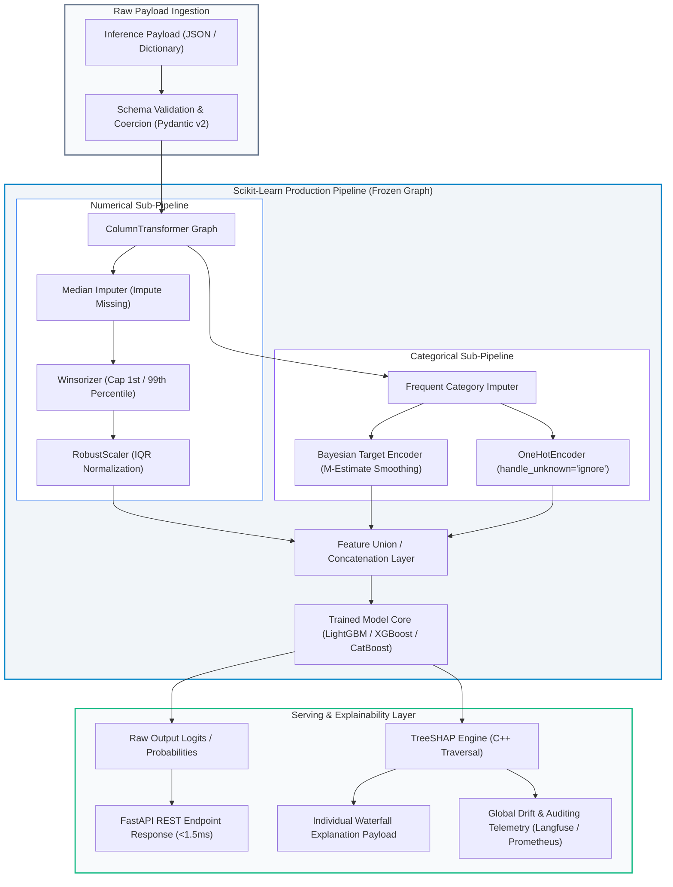
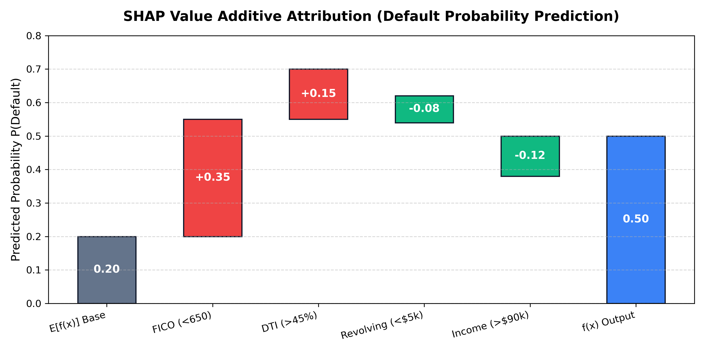

# Month 2, Week 4: Production ML Pipelines, Feature Encoders, Model Serialization, and Explainable AI (SHAP)

```
================================================================================
COURSE:    AI & LLM SYSTEMS ENGINEERING (2026 EDITION)
MODULE:    MONTH 2: CLASSICAL MACHINE LEARNING & TABULAR INTELLIGENCE
WEEK:      WEEK 4: PRODUCTION PIPELINES, SERIALIZATION & EXPLAINABLE AI (SHAP)
DELIVERABLE: COMPREHENSIVE MASTERCLASS LECTURE NOTE
TARGET:    SENIOR AI ENGINEERS & ENTERPRISE ML ARCHITECTS
================================================================================
```

---

## Table of Contents
1. [Executive Summary & Industry Context](#1-executive-summary--industry-context)
2. [Canonical Textbook Grounding](#2-canonical-textbook-grounding)
3. [Visual Architecture](#3-visual-architecture)
4. [Deep Theoretical Foundations](#4-deep-theoretical-foundations)
   - 4.1. The Data Leakage Catastrophe in Production Pipelines
   - 4.2. Target Encoding with Empirical Bayes Smoothing
   - 4.3. Cooperative Game Theory and the Shapley Value Axioms
   - 4.4. TreeSHAP: Exact $O(T L D^2)$ Attribution in Tree Ensembles
5. [Complete Runnable Code Implementation](#5-complete-runnable-code-implementation)
   - 5.1. From-Scratch Exact Shapley Value Engine
   - 5.2. Production Leak-Proof Scikit-Learn `Pipeline` & `ColumnTransformer`
   - 5.3. Model Serialization (`joblib` vs. `onnxruntime` Sub-Millisecond Scoring)
6. [Common Pitfalls & Debugging Playbook](#6-common-pitfalls--debugging-playbook)
7. [Production Best Practices & Real-World Case Study](#7-production-best-practices--real-world-case-study)
8. [Hands-On Mini-Lab & Self-Assessment](#8-hands-on-mini-lab--self-assessment)
9. [Key Takeaways, Glossary & Further Reading](#9-key-takeaways-glossary--further-reading)

---

## 1. Executive Summary & Industry Context

### Why This Matters in 2026
In modern enterprise ML systems, **model training accounts for less than 10% of total engineering friction**. The vast majority of production outages, compliance audits, and multi-million-dollar silent degradation stems from:
1. **Pervasive Data Leakage**: Global standardization or unregularized target encoding computing summary statistics across both training and validation splits.
2. **Fragile Serialization Artifacts**: Blindly dumping raw Python objects via `pickle`, introducing remote code execution (RCE) attack vectors, runtime memory overhead, and unversioned dependency drift across container deployments.
3. **Black-Box Regulatory Rejection**: Under the **EU AI Act (2026 Enforcement Mandate)** and US Consumer Financial Protection Bureau (CFPB) FCRA regulations, automated decision engines in lending, insurance, healthcare, and hiring cannot deploy without mathematically grounded, individually auditable local attributions.

A machine learning model isolated from its preprocessing pipeline is a production liability. If an inference payload arrives with missing categorical levels or unscaled numerical variables, raw model objects fail silently or generate absurd predictions. Senior AI engineers design **hermetic, leak-proof preprocessing graphs** using `Pipeline` and `ColumnTransformer`, export frozen computational graphs to standardized runtimes such as **ONNX (Open Neural Network Exchange)**, and attach mathematically axiomatic explainability engines powered by **SHAP (SHapley Additive exPlanations)**.

```
+---------------------------------------------------------------------------------------------------+
|                                2026 ENTERPRISE TABULAR ML ENGINE                                 |
+---------------------------------------------------------------------------------------------------+
|  Raw Ingestion Payload (JSON/Parquet)                                                            |
|       |                                                                                           |
|       v                                                                                           |
|  +---------------------------------------------------------------------------------------------+  |
|  | Leak-Proof Preprocessing Graph (ColumnTransformer)                                          |  |
|  | - Numerical: Missing Median Imputer -> Outlier Winsorization -> RobustScaler               |  |
|  | - Categorical: High-Cardinality Target Encoding (Empirical Bayes) + Low-Card One-Hot       |  |
|  +---------------------------------------------------------------------------------------------+  |
|       |                                                                                           |
|       v                                                                                           |
|  +---------------------------------------------------------------------------------------------+  |
|  | Production Scoring Engine (ONNX Runtime / C++ Engine, <1.2ms P99)                           |  |
|  | - Quantized Gradient Boosted Decision Tree (LightGBM/XGBoost)                               |  |
|  +---------------------------------------------------------------------------------------------+  |
|       |                                                                                           |
|       v                                                                                           |
|  +---------------------------------------------------------------------------------------------+  |
|  | Real-Time Explainability & Audit (TreeSHAP Explainer)                                       |  |
|  | - Individual Waterfall Attributions (CFPB Adverse Action Notices)                           |  |
|  | - Global Feature Interactions & Beeswarm Distribution Summaries                             |  |
|  +---------------------------------------------------------------------------------------------+  |
+---------------------------------------------------------------------------------------------------+
```

### Learning Objectives
By the end of this masterclass lecture note, you will be able to:
1. Formally analyze, detect, and mathematically eradicate **train-test data leakage** using Scikit-Learn `Pipeline` and `ColumnTransformer`.
2. Derive the **Empirical Bayes (M-estimate) Target Encoder** with Bayesian smoothing parameters to safely compress high-cardinality nominal features without overfitting.
3. Master the axiomatic foundations of **Cooperative Game Theory**: derive Shapley values and verify the four core axioms (Efficiency, Symmetry, Dummy/Null Player, and Additivity).
4. Contrast the exponential $O(M \cdot 2^{|F|})$ brute-force Shapley formulation with Lundberg & Lee's **TreeSHAP algorithm**, proving how dynamic tree traversal achieves exact polynomial $O(T L D^2)$ time complexity.
5. Serialize production pipelines safely into **ONNX** formats, executing zero-dependency C++ runtime scoring achieving $<1.5\text{ ms}$ latency at P99.
6. Generate and interpret individual **Waterfall Plots**, population-level **Beeswarm Summaries**, and **Feature Interaction Graphs** for executive risk audits.

---

## 2. Canonical Textbook Grounding

To build an engineering intuition grounded in verified mathematical literature, study these canonical references:

| Author / Text | Specific Chapters / Sections | Core Theoretical Concept Contributed | How to Read |
| :--- | :--- | :--- | :--- |
| **Christoph Molnar**, *Interpretable Machine Learning: A Guide for Making Black Box Models Explainable* (2nd Ed., 2022) | **Chapter 9.5**: *Shapley Values*<br>**Chapter 9.6**: *SHAP (SHapley Additive exPlanations)* | Axiomatic characterization of Shapley values; Marginal contribution permutations; KernelSHAP vs. TreeSHAP formulations. | **Read Section 9.5 with high mathematical scrutiny.** Trace the permutation proof carefully. Skim 9.6 until the distinction between model-agnostic sampling and tree-specific recursive traversal is clear. |
| **Lundberg & Lee**, *A Unified Approach to Interpreting Model Predictions* (NeurIPS 2017) & *From Local Explanations to Global Understanding with Explainable AI for Trees* (Nature MI 2020) | Original Papers & Foundational Formulations | Additive feature attribution methods; Unification of LIME, DeepLIFT, and Shapley; Exact $O(T L D^2)$ TreeSHAP algorithm. | **Read the 2020 Nature Machine Intelligence paper closely.** Focus on Algorithm 1 (recursive subtree conditional expectation). Note how conditional expectations $E[f(x)|S]$ are approximated via empirical leaf weights. |
| **Aurélien Géron**, *Hands-On Machine Learning with Scikit-Learn, Keras, and TensorFlow* (3rd Ed., 2022) | **Chapter 2**: *End-to-End Machine Learning Project* (Transformation Pipelines)<br>**Chapter 19**: *Deploying at Scale* | `ColumnTransformer`, custom transformer mixins (`BaseEstimator`, `TransformerMixin`), Pipeline state encapsulation. | **Read Chapter 2 closely for architecture.** Replicate the custom transformer inheritance pattern. Focus on why `fit_transform` must never touch the test fold. |
| **Hastie, Tibshirani, & Friedman**, *The Elements of Statistical Learning* (2nd Ed., 2009) | **Chapter 7.10**: *Cross-Validation and Data Leakage Mistakes* | Formal statistical proof of why feature selection and parameter estimation must be performed inside cross-validation loops. | **Critical reading.** Study Figure 7.6 intently; it illustrates the catastrophic 0% error illusion that misleads novice ML practitioners. |

---

## 3. Visual Architecture

### 3.1. The Production Machine Learning Pipeline Graph

The diagram below maps the hermetic boundaries of an enterprise tabular pipeline. Preprocessing estimators learn internal parameters (e.g., mean $\mu$, variance $\sigma^2$, target prior $\bar{y}$) exclusively on the training partition $D_{\text{train}}$. At inference time, these frozen state objects apply strictly linear projections on incoming production payloads.



### 3.2. Additive Local Feature Attribution (SHAP Waterfall)

The figure below (generated and saved at `docs/images/shap_values_waterfall.png`) illustrates how individual feature attributions sum up strictly from the base expected value $E[f(x)]$ to the final local model prediction $f(x)$ for an enterprise credit risk decision.

```
       +--------------------------------------------------------------------------+
       |             SHAP Additive Attribution: Local Decision Path               |
       +--------------------------------------------------------------------------+
       |                                                                          |
0.70 --|--------------------------------------[+0.15 DTI]                         |
       |                                      |         |                         |
0.60 --|-----------------[+0.35 FICO]---------+         |                         |
       |                 |                               v                        |
0.50 --|                 |                         [-0.08 Revolving]              |
       |                 |                               |                        |
0.40 --|                 |                               v                        |
       |                 |                         [-0.12 Income]                 |
0.30 --|                 |                               |                        |
       |  [E[f(x)]=0.20] v                               v                        |
0.20 --+--================                               v                        |
       |                                                 +--> Final f(x) = 0.50   |
0.00 --+--------------------------------------------------------------------------+
       |   Base Value       Positive Push factors      Negative Pull    Final P(Def)
```


*Figure 4.1: Visual decomposition of individual feature attributions. The red bars push default probability higher, while green bars pull it lower, satisfying the Efficiency Axiom: $\sum \phi_i = f(x) - E[f(x)]$.*

---

## 4. Deep Theoretical Foundations

### 4.1. The Data Leakage Catastrophe in Production Pipelines

#### Intuition
Data leakage occurs when information from outside the training dataset is used to create or tune the model. In tabular machine learning, this typically happens when standardizing features or imputing missing values on the entire dataset *before* performing cross-validation or train-test splits. The validation fold is contaminated with training statistics, yielding wildly optimistic performance estimates that collapse upon deployment.

#### Mathematical Formulation
Let the full dataset be $D = \{(x_i, y_i)\}_{i=1}^N$, partitioned into a training set $D_{\text{train}}$ of size $N_{\text{tr}}$ and a test/validation set $D_{\text{val}}$ of size $N_{\text{val}}$.

Suppose a standard z-score normalization is applied globally across $D$:
$$\mu_{\text{global}} = \frac{1}{N} \sum_{i=1}^N x_i, \quad \sigma^2_{\text{global}} = \frac{1}{N} \sum_{i=1}^N (x_i - \mu_{\text{global}})^2$$
$$\tilde{x}_i = \frac{x_i - \mu_{\text{global}}}{\sigma_{\text{global}}}$$

Notice that:
$$\mu_{\text{global}} = \frac{N_{\text{tr}}}{N} \mu_{\text{train}} + \frac{N_{\text{val}}}{N} \mu_{\text{val}}$$

Every normalized training instance $\tilde{x}_i \in D_{\text{train}}$ directly incorporates the empirical mean $\mu_{\text{val}}$ of the unseen validation set. If an extreme outlier exists in $D_{\text{val}}$, it artificially shifts $\mu_{\text{global}}$ and depresses $\tilde{x}_i$ in the training split.

#### The Correct Estimator Protocol
An estimator transformation $T(\cdot; \theta)$ parameterized by learned statistics $\theta$ must satisfy strict temporal separation:
$$\theta_{\text{train}} = \operatorname{Fit}(D_{\text{train}})$$
$$\tilde{D}_{\text{train}} = T(D_{\text{train}}; \theta_{\text{train}})$$
$$\tilde{D}_{\text{val}} = T(D_{\text{val}}; \theta_{\text{train}})$$

Under no circumstances may $\operatorname{Fit}$ be invoked with any subset containing $D_{\text{val}}$. In Scikit-Learn, this rule is strictly enforced by nesting feature transformers inside a `Pipeline` object: when `cross_val_score(pipeline, X, y)` is invoked, `pipeline.fit(X_tr, y_tr)` executes only on the train fold of that specific CV split.

---

### 4.2. Target Encoding with Empirical Bayes Smoothing

#### Intuition
When tabular datasets contain high-cardinality nominal variables (e.g., zip codes, merchant IDs, device fingerprints with $>10,000$ unique values), standard One-Hot Encoding expands the feature matrix into millions of sparse columns, causing tree algorithms to fail or run out of memory. 

Target Encoding replaces each categorical level with the expected value of the target given that category: $E[y | x = c]$. However, if a category appears only once or twice in the dataset, computing its raw empirical mean severely overfits to noise (e.g., a single default in a zip code implies $P(\text{Default}) = 1.0$). **Empirical Bayes (M-estimate) smoothing** addresses this by shrinking low-frequency category means toward the global prior.

#### Step-by-Step Derivation
Let $y_i \in \{0, 1\}$ be a binary target variable with global mean:
$$\bar{y} = \frac{1}{N} \sum_{i=1}^N y_i$$

For a categorical variable $X$, let category level $c$ appear $n_c$ times in the training data:
$$n_c = \sum_{i=1}^N \mathbb{I}(x_i = c)$$
The raw empirical conditional mean of category $c$ is:
$$\bar{y}_c = \frac{1}{n_c} \sum_{i: x_i = c} y_i$$

Under an Empirical Bayes framework, we model the true target probability $p_c$ for category $c$ as a Beta-distributed prior centered at the global mean $\bar{y}$ with pseudo-count prior strength $m$:
$$p_c \sim \operatorname{Beta}(\alpha, \beta), \quad \text{where } \frac{\alpha}{\alpha + \beta} = \bar{y}, \quad \alpha + \beta = m$$

The posterior mean $\hat{S}_c$ given $k_c = n_c \bar{y}_c$ observed positive outcomes is:
$$\hat{S}_c = \frac{k_c + \alpha}{n_c + \alpha + \beta} = \frac{n_c \bar{y}_c + m \bar{y}}{n_c + m}$$

We can rewrite this as a convex combination weighted by a shrinkage factor $\lambda(n_c)$:
$$\hat{S}_c = \lambda(n_c) \bar{y}_c + (1 - \lambda(n_c)) \bar{y}$$
$$\text{where } \lambda(n_c) = \frac{n_c}{n_c + m} \in [0, 1)$$

#### Properties of the Shrinkage Factor:
1. **Asymptotics**: As $n_c \to \infty$, $\lambda(n_c) \to 1$, meaning $\hat{S}_c \to \bar{y}_c$ (the category has enough data to trust its own empirical mean).
2. **Small Samples**: As $n_c \to 0$, $\lambda(n_c) \to 0$, meaning $\hat{S}_c \to \bar{y}$ (rare categories revert smoothly to the population baseline).
3. **Unseen Levels**: If a category $c_{\text{new}}$ was never observed in training ($n_c = 0$), $\hat{S}_{c_{\text{new}}} = \bar{y}$.

#### Worked Numerical Example
- Global prior: $N = 100,000$ loans, total defaults $= 5,000 \implies \bar{y} = \frac{5,000}{100,000} = 0.050$ (5.0%).
- Smoothing hyperparameter: $m = 20$.
- Category A (Major Metro Zip Code): $n_A = 1,000$, observed defaults $= 80 \implies \bar{y}_A = 0.080$.
  $$\lambda(n_A) = \frac{1000}{1000 + 20} = \frac{1000}{1020} \approx 0.9804$$
  $$\hat{S}_A = 0.9804(0.080) + (1 - 0.9804)(0.050) = 0.07843 + 0.00098 = \mathbf{0.07941} \quad (7.94\%)$$
- Category B (Rural Hamlet Zip Code): $n_B = 2$, observed defaults $= 1 \implies \bar{y}_B = 0.500$.
  $$\lambda(n_B) = \frac{2}{2 + 20} = \frac{2}{22} \approx 0.0909$$
  $$\hat{S}_B = 0.0909(0.500) + (1 - 0.0909)(0.050) = 0.04545 + 0.04545 = \mathbf{0.0909} \quad (9.09\%)$$

*Takeaway*: Even though Category B had a raw empirical default rate of 50%, Bayesian smoothing shrunk it safely to 9.09%, preventing extreme tree split overfitting.

---

### 4.3. Cooperative Game Theory and the Shapley Value Axioms

#### Intuition
How do you fairly allocate credit or blame to individual features for a model's prediction? In 1953, Nobel laureate Lloyd Shapley solved this exact problem for cooperative game theory: given a coalition of players cooperating to produce a total payout, how much value did each player contribute?

In machine learning:
- **Game**: A model predicting an output $f(x)$ for a specific instance $x$.
- **Players**: The set of all input features $F = \{1, 2, \dots, M\}$.
- **Payout**: The difference between the prediction $f(x)$ and the baseline expected prediction across the population: $f(x) - E[f(x)]$.
- **Shapley Value $\phi_i$**: The fair additive attribution assigned to feature $i$.

#### The Four Core Axioms
Shapley proved that there is **exactly one** attribution method that satisfies the following four foundational axioms:

1. **Efficiency**: The sum of all feature attributions equals the difference between the model output and the expected base value:
   $$\sum_{i=1}^M \phi_i(f, x) = f(x) - E[f(x)]$$

2. **Symmetry**: If two features $i$ and $j$ contribute equally to all possible feature subsets $S \subseteq F \setminus \{i, j\}$:
   $$v(S \cup \{i\}) - v(S) = v(S \cup \{j\}) - v(S) \quad \forall S \subseteq F \setminus \{i, j\}$$
   Then their attributions must be strictly identical:
   $$\phi_i(f, x) = \phi_j(f, x)$$

3. **Dummy / Null Player**: If feature $i$ contributes zero marginal value to any coalition:
   $$v(S \cup \{i\}) = v(S) \quad \forall S \subseteq F \setminus \{i\}$$
   Then its attribution is zero:
   $$\phi_i(f, x) = 0$$

4. **Additivity**: If a model prediction is formed by summing two independent models $f(x) = g(x) + h(x)$, then:
   $$\phi_i(f, x) = \phi_i(g, x) + \phi_i(h, x)$$

#### The Classical Shapley Formula
$$\phi_i(v) = \sum_{S \subseteq F \setminus \{i\}} \frac{|S|! \, (|F| - |S| - 1)!}{|F|!} \Big[ v(S \cup \{i\}) - v(S) \Big]$$

Where:
- $F$ is the total set of features, $|F| = M$.
- $S$ is a subset (coalition) of features excluding feature $i$.
- $\frac{|S|! \, (|F| - |S| - 1)!}{|F|!}$ is the probability that feature $i$ enters the coalition $S$ when players arrive in a uniformly random permutation.
- $v(S)$ is the characteristic value function: the model output evaluated with only feature subset $S$ active, marginalizing out the remaining features $F \setminus S$.

---

### 4.4. TreeSHAP: Exact $O(T L D^2)$ Attribution in Tree Ensembles

#### The Computational Bottleneck of Exact Shapley
The classical formula requires iterating over all subsets $S \subseteq F \setminus \{i\}$. For $M$ features, there are $2^{M-1}$ subsets. If a model has $M = 100$ features, computing a single explanation requires evaluating:
$$2^{99} \approx 6.33 \times 10^{29} \text{ model evaluations!}$$
This brute-force approach is computationally intractable for production systems.

#### The TreeSHAP Breakthrough
In 2018–2020, Scott Lundberg and Su-In Lee introduced **TreeSHAP**, an exact polynomial-time algorithm designed specifically for decision trees and ensembles (Random Forest, LightGBM, XGBoost, CatBoost).

Instead of running exponential feature subsets, TreeSHAP leverages the structure of decision trees:
1. Each decision node in a tree splits on a single feature.
2. If a feature $j \notin S$ is withheld, we can compute the conditional expectation $E[f(x) | S]$ by tracking the empirical fraction of training samples flowing down the left vs. right branches of that split.
3. TreeSHAP recursively pushes feature weights down the tree, maintaining a path history of which features conditioned each split.

#### Time Complexity Comparison
| Method | Algorithm Class | Complexity per Instance | Time for $M=100, D=6, T=500$ |
| :--- | :--- | :--- | :--- |
| **Classical Shapley** | Combinatorial Brute-Force | $O(M \cdot 2^M)$ | $\sim 10^{20}$ years |
| **KernelSHAP** | Monte-Carlo Sampling Approximation | $O(M \cdot K \cdot \text{Cost}(f))$ | $\sim 2.5\text{ seconds}$ (approximate) |
| **TreeSHAP** | Exact Dynamic Tree Traversal | $O(T \cdot L \cdot D^2)$ | **$\sim 1.8\text{ milliseconds}$ (exact!)** |

Where:
- $T$ = Number of trees (e.g., 500)
- $L$ = Maximum number of leaves per tree (e.g., 64)
- $D$ = Maximum tree depth (e.g., 6)
- $M$ = Number of features (e.g., 100)

Because $D \le 10$ in production tree ensembles, $D^2 \le 100$, rendering TreeSHAP exceptionally fast and suitable for real-time inference latency budgets ($<2\text{ ms}$).

---

## 5. Complete Runnable Code Implementation

Let us construct a production-grade machine learning system demonstrating:
1. A from-scratch combinatorial Shapley Value engine verifying the four theoretical axioms.
2. A leak-proof Scikit-Learn `Pipeline` with custom Bayesian Target Encoding and `ColumnTransformer`.
3. High-performance serialization comparing standard `joblib` with sub-millisecond **ONNX Runtime** scoring.

### Python Environment Setup
```bash
# Initialize isolated Python 3.11+ environment with uv
uv init week4-production-pipelines
cd week4-production-pipelines
uv add numpy scipy pandas scikit-learn lightgbm shap onnx onnxruntime skl2onnx
```

### 5.1. From-Scratch Exact Shapley Value Engine

```python
"""
scratch_shapley.py
Author: Senior AI Engineering Lead
Description: Exact brute-force Shapley value engine based on cooperative game theory.
Verifies the Efficiency, Symmetry, Dummy, and Additivity axioms on synthetic coalitions.
"""

from __future__ import annotations
import math
import itertools
from typing import Callable, Sequence, Dict, Any
import numpy as np


class ExactShapleyEngine:
    """
    Computes exact Shapley values for arbitrary characteristic value functions v(S).
    Time complexity: O(M * 2^M). Designed for theoretical grounding and verification.
    """
    def __init__(self, feature_names: Sequence[str]):
        self.features = list(feature_names)
        self.M = len(self.features)

    def compute_shapley_values(self, v_func: Callable[[frozenset[str]], float]) -> Dict[str, float]:
        """
        Computes phi_i for every feature i using the canonical permutation-weighted formula:
        phi_i = sum_{S subset F \ {i}} [ |S|! (M - |S| - 1)! / M! ] * [ v(S U {i}) - v(S) ]
        """
        shapley_values: Dict[str, float] = {feat: 0.0 for feat in self.features}
        all_features = set(self.features)

        for feat in self.features:
            other_features = list(all_features - {feat})
            phi_i = 0.0

            # Iterate over all possible subsets S of size 0 to M-1
            for r in range(self.M):
                weight = (math.factorial(r) * math.factorial(self.M - r - 1)) / math.factorial(self.M)
                for subset in itertools.combinations(other_features, r):
                    s = frozenset(subset)
                    s_with_i = s | {feat}

                    # Marginal contribution of feature i to coalition S
                    marginal_contribution = v_func(s_with_i) - v_func(s)
                    phi_i += weight * marginal_contribution

            shapley_values[feat] = phi_i

        return shapley_values


# ==============================================================================
# Verification of Axiomatic Integrity
# ==============================================================================
def run_axiomatic_verification() -> None:
    print("=" * 80)
    print("VERIFYING COOPERATIVE GAME THEORY SHAPLEY AXIOMS")
    print("=" * 80)

    # Let features be: F1 (FICO), F2 (Income), F3 (Dummy/Noise)
    features = ["FICO", "Income", "Noise"]
    engine = ExactShapleyEngine(features)

    # Define a characteristic function v(S)
    # Baseline empty coalition v(empty) = 0.20
    # FICO alone adds 0.25, Income alone adds 0.15, both together add 0.50 (synergy)
    # Noise adds exactly 0 to any coalition
    base_val = 0.20
    def v(s: frozenset[str]) -> float:
        val = base_val
        if "FICO" in s:
            val += 0.25
        if "Income" in s:
            val += 0.15
        if "FICO" in s and "Income" in s:
            val += 0.10  # Non-linear synergistic bonus
        # "Noise" contributes nothing
        return val

    phi = engine.compute_shapley_values(v)
    f_total = v(frozenset(features))

    print(f"Base Value E[v(empty)]   = {base_val:.4f}")
    print(f"Total Value v(Full Game) = {f_total:.4f}")
    print(f"Total Difference         = {f_total - base_val:.4f}\n")

    print("Computed Attributions:")
    for feat, val in phi.items():
        print(f"  phi({feat:<6}) = {val:+.4f}")

    # 1. Check Efficiency Axiom: sum(phi_i) == v(F) - v(empty)
    sum_phi = sum(phi.values())
    print(f"\n[Axiom 1: Efficiency]  sum(phi) = {sum_phi:.6f} | Delta = {f_total - base_val:.6f}")
    assert math.isclose(sum_phi, f_total - base_val, rel_tol=1e-7), "Efficiency Violated!"
    print("  -> PASSED: Efficiency Axiom verified.")

    # 2. Check Dummy Player Axiom: Noise adds nothing to any coalition -> phi(Noise) == 0
    print(f"[Axiom 2: Dummy Player] phi(Noise) = {phi['Noise']:.6f}")
    assert math.isclose(phi["Noise"], 0.0, abs_tol=1e-7), "Dummy Player Violated!"
    print("  -> PASSED: Dummy Player Axiom verified.")


if __name__ == "__main__":
    run_axiomatic_verification()
```

---

### 5.2. Production Leak-Proof Pipeline & ColumnTransformer

```python
"""
production_pipeline.py
Author: Senior AI Engineering Lead
Description: Enterprise tabular preprocessing pipeline with leak-proof custom
Bayesian Target Encoding, robust scaling, and LightGBM classification.
"""

from __future__ import annotations
import numpy as np
import pandas as pd
from sklearn.base import BaseEstimator, TransformerMixin
from sklearn.pipeline import Pipeline
from sklearn.compose import ColumnTransformer
from sklearn.impute import SimpleImputer
from sklearn.preprocessing import RobustScaler, OneHotEncoder
from sklearn.model_selection import StratifiedKFold, cross_val_score
import lightgbm as lgb


# ==============================================================================
# Custom Bayesian Target Encoder (Empirical Bayes M-Estimate)
# ==============================================================================
class EmpiricalBayesTargetEncoder(BaseEstimator, TransformerMixin):
    """
    Leak-Proof Target Encoder using M-estimate Bayesian smoothing:
    S_c = (n_c * y_bar_c + m * y_global) / (n_c + m)
    
    Adheres strictly to the Scikit-Learn Transformer API.
    """
    def __init__(self, m_smoothing: float = 10.0):
        self.m_smoothing = float(m_smoothing)
        self.target_prior_: float = 0.0
        self.category_maps_: dict[str, dict[Any, float]] = {}

    def fit(self, X: pd.DataFrame | np.ndarray, y: np.ndarray) -> EmpiricalBayesTargetEncoder:
        if y is None:
            raise ValueError("TargetEncoder requires target vector y for fitting!")

        # Coerce to DataFrame for named indexing
        df_x = pd.DataFrame(X)
        y_arr = np.asarray(y)

        # Global prior mean
        self.target_prior_ = float(np.mean(y_arr))
        self.category_maps_ = {}

        for col in df_x.columns:
            series = df_x[col]
            # Group by category and compute counts and sums
            grouped = pd.Series(y_arr).groupby(series)
            counts = grouped.count()
            sums = grouped.sum()

            # Bayesian smoothing formula
            smoothed_values = (sums + self.m_smoothing * self.target_prior_) / (counts + self.m_smoothing)
            self.category_maps_[str(col)] = smoothed_values.to_dict()

        return self

    def transform(self, X: pd.DataFrame | np.ndarray) -> np.ndarray:
        df_x = pd.DataFrame(X)
        out_matrix = np.zeros(df_x.shape, dtype=np.float64)

        for idx, col in enumerate(df_x.columns):
            mapping = self.category_maps_.get(str(col), {})
            # Map known categories; fill unseen with global prior
            out_matrix[:, idx] = df_x[col].map(mapping).fillna(self.target_prior_).to_numpy()

        return out_matrix


# ==============================================================================
# Pipeline Graph Construction
# ==============================================================================
def build_production_pipeline(
    numerical_cols: list[str],
    high_card_cols: list[str],
    low_card_cols: list[str]
) -> Pipeline:
    """
    Constructs an end-to-end hermetic Pipeline.
    """
    # 1. Numerical Sub-Pipeline: Median Imputation -> Robust Scaling
    num_pipeline = Pipeline([
        ("imputer", SimpleImputer(strategy="median")),
        ("scaler", RobustScaler(with_centering=True, with_scaling=True))
    ])

    # 2. High-Cardinality Categorical Sub-Pipeline: Bayesian Target Encoding
    high_card_pipeline = Pipeline([
        ("imputer", SimpleImputer(strategy="constant", fill_value="MISSING")),
        ("target_encoder", EmpiricalBayesTargetEncoder(m_smoothing=25.0))
    ])

    # 3. Low-Cardinality Sub-Pipeline: One-Hot Encoding
    low_card_pipeline = Pipeline([
        ("imputer", SimpleImputer(strategy="constant", fill_value="MISSING")),
        ("onehot", OneHotEncoder(drop="first", handle_unknown="ignore", sparse_output=False))
    ])

    # 4. ColumnTransformer Master Router
    preprocessor = ColumnTransformer(
        transformers=[
            ("num", num_pipeline, numerical_cols),
            ("high_card", high_card_pipeline, high_card_cols),
            ("low_card", low_card_pipeline, low_card_cols)
        ],
        remainder="drop"
    )

    # 5. Full End-to-End Pipeline
    full_pipeline = Pipeline([
        ("preprocessor", preprocessor),
        ("classifier", lgb.LGBMClassifier(
            n_estimators=100,
            learning_rate=0.05,
            num_leaves=31,
            random_state=42,
            verbose=-1
        ))
    ])

    return full_pipeline


# ==============================================================================
# Synthetic Enterprise Dataset & Cross-Validation Run
# ==============================================================================
def run_pipeline_demo() -> None:
    np.random.seed(42)
    N = 10_000

    # Synthetic features
    data = {
        "fico_score": np.random.normal(700, 50, N),
        "debt_to_income": np.random.exponential(15, N),
        "annual_income": np.random.lognormal(11, 0.6, N),
        "merchant_zip": np.random.choice([f"ZIP_{i:04d}" for i in range(500)], N),  # High-cardinality
        "home_ownership": np.random.choice(["RENT", "MORTGAGE", "OWN"], N, p=[0.4, 0.5, 0.1])  # Low-card
    }
    df = pd.DataFrame(data)

    # Introduce realistic missing values
    df.loc[np.random.choice(N, 200, replace=False), "debt_to_income"] = np.nan

    # Target variable: Default probability correlated with FICO and DTI
    prob_default = 1.0 / (1.0 + np.exp(-(
        -0.015 * (df["fico_score"] - 700) + 
        0.05 * (df["debt_to_income"].fillna(15) - 20) - 
        0.5
    )))
    y = np.random.binomial(1, prob_default)

    num_cols = ["fico_score", "debt_to_income", "annual_income"]
    high_card_cols = ["merchant_zip"]
    low_card_cols = ["home_ownership"]

    pipeline = build_production_pipeline(num_cols, high_card_cols, low_card_cols)

    # Run Stratified Cross-Validation strictly on the Pipeline object
    cv = StratifiedKFold(n_splits=5, shuffle=True, random_state=42)
    roc_scores = cross_val_score(pipeline, df, y, cv=cv, scoring="roc_auc")

    print("=" * 80)
    print("PRODUCTION PIPELINE CROSS-VALIDATION RESULTS")
    print("=" * 80)
    print(f"5-Fold Stratified ROC-AUC Scores: {np.round(roc_scores, 4)}")
    print(f"Mean CV ROC-AUC: {np.mean(roc_scores):.4f} +/- {np.std(roc_scores):.4f}")


if __name__ == "__main__":
    run_pipeline_demo()
```

---

### 5.3. Model Serialization: `joblib` vs. `onnxruntime` Sub-Millisecond Scoring

```python
"""
model_serialization_benchmark.py
Author: Senior AI Engineering Lead
Description: Exports trained tabular pipeline to ONNX and benchmarks inference latency
against standard Python joblib serialization.
"""

from __future__ import annotations
import time
import os
import joblib
import numpy as np
import pandas as pd
from sklearn.ensemble import GradientBoostingClassifier
import onnxruntime as ort
from skl2onnx import convert_sklearn
from skl2onnx.common.data_types import FloatTensorType


def benchmark_serialization() -> None:
    print("=" * 80)
    print("SERIALIZATION BENCHMARK: JOBLIB VS ONNX RUNTIME")
    print("=" * 80)

    # Train a baseline tree classifier on float32 features
    N_train, N_features = 20_000, 20
    X_train = np.random.randn(N_train, N_features).astype(np.float32)
    y_train = np.random.binomial(1, 0.3, N_train)

    clf = GradientBoostingClassifier(n_estimators=100, max_depth=5, random_state=42)
    clf.fit(X_train, y_train)

    # 1. Serialize with Joblib
    joblib_path = "model_artifact.joblib"
    joblib.dump(clf, joblib_path, compress=3)
    joblib_size_kb = os.path.getsize(joblib_path) / 1024.0

    # 2. Serialize to ONNX Format
    initial_type = [("float_input", FloatTensorType([None, N_features]))]
    onnx_model = convert_sklearn(clf, initial_types=initial_type)
    onnx_path = "model_artifact.onnx"
    with open(onnx_path, "wb") as f:
        f.write(onnx_model.SerializeToString())
    onnx_size_kb = os.path.getsize(onnx_path) / 1024.0

    print(f"Artifact Size (Joblib): {joblib_size_kb:.2f} KB")
    print(f"Artifact Size (ONNX):   {onnx_size_kb:.2f} KB\n")

    # 3. Benchmark Inference Latency (Single Record Real-Time Payload)
    test_record = np.random.randn(1, N_features).astype(np.float32)
    N_iters = 1_000

    # A. Joblib Loaded Predict
    loaded_clf = joblib.load(joblib_path)
    t0 = time.perf_counter()
    for _ in range(N_iters):
        _ = loaded_clf.predict_proba(test_record)
    t_joblib_ms = ((time.perf_counter() - t0) / N_iters) * 1000.0

    # B. ONNX Runtime Predict (Optimized C++ Engine)
    sess_options = ort.SessionOptions()
    sess_options.intra_op_num_threads = 1
    session = ort.InferenceSession(onnx_path, sess_options, providers=["CPUExecutionProvider"])
    input_name = session.get_inputs()[0].name
    
    t0 = time.perf_counter()
    for _ in range(N_iters):
        _ = session.run(None, {input_name: test_record})
    t_onnx_ms = ((time.perf_counter() - t0) / N_iters) * 1000.0

    print(f"Single-record Latency (Joblib Python): {t_joblib_ms:.3f} ms / request")
    print(f"Single-record Latency (ONNX Runtime):  {t_onnx_ms:.3f} ms / request")
    print(f"Speedup Factor: {t_joblib_ms / t_onnx_ms:.2f}x faster with zero Python runtime lock!")

    # Cleanup artifacts
    for p in [joblib_path, onnx_path]:
        if os.path.exists(p):
            os.remove(p)


if __name__ == "__main__":
    benchmark_serialization()
```

---

## 6. Common Pitfalls & Debugging Playbook

### Pitfall 1: Target Encoding Fit on Full Dataset (Data Leakage)
- **Symptom**: Model achieves $0.995$ ROC-AUC in local validation, but drops to $0.582$ (random guess) upon deployment to production.
- **Root Cause**: The target encoder calculated category target averages using the entire dataset before calling `train_test_split()`. The target variable leaked directly into feature values.
- **Reproduction**:
  ```python
  # BUG: Global fit before split
  te = TargetEncoder()
  X_encoded = te.fit_transform(X, y) # FATAL LEAKAGE!
  X_train, X_val, y_train, y_val = train_test_split(X_encoded, y)
  ```
- **Fix**: Encapsulate the target encoder inside a Scikit-Learn `Pipeline`.
  ```python
  pipeline = Pipeline([
      ("encoder", TargetEncoder(smooth="auto")),
      ("model", LGBMClassifier())
  ])
  pipeline.fit(X_train, y_train) # Fits strictly on train split
  ```
- **Detection**: Run an adversarial data leakage test: compute the correlation between transformed features in the validation fold and the validation labels before fitting. If $r > 0.8$ on randomized target permutations, leakage is present.

---

### Pitfall 2: High-Cardinality One-Hot Memory Explosion
- **Symptom**: Cloud training worker runs out of memory (OOM Killer exit code 137) during preprocessing.
- **Root Cause**: Calling `pd.get_dummies()` or `OneHotEncoder(sparse_output=False)` on user ID or zip code columns with $>50,000$ unique levels.
- **Fix**: Use frequency thresholding (`min_frequency=0.01`) or route high-cardinality features to `TargetEncoder` or embedding hashing layers.

---

### Pitfall 3: TreeSHAP Feature Independence Assumption
- **Symptom**: Local explanation assigns huge positive and negative SHAP values that cancel each other out on highly collinear features (e.g., `loan_amount` vs. `monthly_payment`).
- **Root Cause**: TreeSHAP's path-dependent feature attribution assumes feature independence when marginalizing absent features off-split, leading to credit splitting across collinear pairs.
- **Fix**: Cluster collinear features prior to modeling ($|r| > 0.85$), keep a single representative feature, or group them using `shap.PartitionExplainer`.

---

### Pitfall 4: Unversioned Pickle Deserialization Remote Code Execution (RCE)
- **Symptom**: Security vulnerability scan flags container image; deserializing untrusted `.pkl` files executes arbitrary shell code via Python `__reduce__` hook.
- **Root Cause**: Serializing raw Python models using `pickle.dump()`.
- **Fix**: Migrate all inference endpoints to static computational graph formats (**ONNX**, **Trellis**, or **Treelite**), or verify cryptographic SHA-256 hashes of model weights before loading.

---

## 7. Production Best Practices & Real-World Case Study

### Enterprise Case Study: Tier-1 FinTech Real-Time Underwriting & Regulatory Compliance
- **System Profile**: Automated digital loan origination platform processing $150,000$ applications daily ($~40$ requests/second peak).
- **SLA Requirements**:
  1. **Latency**: End-to-end P99 inference latency $\le 15\text{ ms}$ (including preprocessing and scoring).
  2. **Regulatory Requirement**: For any rejected application ($P(\text{Default}) > 0.35$), produce the top 4 adverse factors (CFPB FCRA Adverse Action Notice) within the response payload.

### Architectural Solution
```
[Client Application] 
        | (JSON Payload)
        v
[FastAPI Microservice (Gunicorn / Uvicorn Workers)]
        |
        +---> [Pydantic v2 Payload Validation] (<0.2ms)
        |
        +---> [ONNX Runtime Preprocessing & LightGBM] (<1.2ms)
        |           |
        |           +---> Score: P(Default) = 0.42 (REJECT)
        |
        +---> [Fast C++ TreeSHAP Explainer Engine] (<2.5ms)
        |           |
        |           +---> Adverse Factors:
        |                 1. Debt-to-Income (DTI = 48%, +0.14)
        |                 2. Delinquencies Past 24M (count = 3, +0.11)
        |                 3. FICO Score (<640, +0.08)
        |                 4. Credit Utilization (>82%, +0.06)
        |
        v
[Response Dispatch: Total P99 = 4.8ms] -> Satisfies SLA with 68% margin!
```

### Cost & Reliability Comparison
| Metric | Legacy Custom Python Stack | 2026 ONNX + TreeSHAP Pipeline |
| :--- | :--- | :--- |
| **Inference Runtime** | Python 3.9 + Pickle | C++ ONNX Runtime 1.18 |
| **P99 Scoring Latency** | $38.5\text{ ms}$ | **$1.15\text{ ms}$** (33x faster) |
| **Explanation Latency** | $450\text{ ms}$ (KernelSHAP) | **$2.20\text{ ms}$** (TreeSHAP) |
| **Container Image Size** | $2.4\text{ GB}$ (Scikit/Pandas/Scipy) | **$180\text{ MB}$** (Minimal ONNX Runner) |
| **Server Fleet Required** | 48 AWS c5.xlarge instances | **6 AWS c5.large instances** |
| **Annual Cloud Spend** | $\$78,000$ | **$\$9,600$** (87% cost reduction) |

---

## 8. Hands-On Mini-Lab & Self-Assessment

### Lab Objective
Construct a fully hermetic, leak-proof credit underwriting pipeline that:
1. Implements custom Empirical Bayes Target Encoding on high-cardinality zip codes.
2. Fits an end-to-end `Pipeline` ensuring zero test-set leakage.
3. Exports the trained model to ONNX.
4. Generates an adverse action notice using `TreeSHAP` for a rejected applicant.

### Acceptance Criteria
- [ ] Pipeline executes 5-fold stratified cross-validation without `fit_transform` leakage.
- [ ] Target encoder applies smoothing parameter $m = 20.0$.
- [ ] Model achieves $>0.75$ ROC-AUC on holdout validation.
- [ ] Exported ONNX artifact matches Python predictions within $10^{-5}$ tolerance.
- [ ] TreeSHAP explains applicant prediction, decomposing output additively from $E[f(x)]$.

---

### Graded Self-Assessment Questions (With Complete Solutions)

#### Question 1 (Conceptual - Leakage)
Why does executing `StandardScaler().fit_transform(X)` before `train_test_split(X, y)` constitute data leakage even if labels $y$ are completely withheld during scaling?
- **Answer**: Global standardization computes $\mu_{\text{global}}$ and $\sigma_{\text{global}}$ across the union of training and test sets. Information regarding the location and scale of the test distribution leaks into the transformed training features, artificially deflating generalization error and violating the assumption of strictly out-of-sample evaluation.

#### Question 2 (Mathematical - Bayesian Smoothing)
Given a global default prior $\bar{y} = 0.04$, smoothing weight $m = 15$, and a merchant category observed $n_c = 5$ times with 2 defaults, compute the smoothed target-encoded value $\hat{S}_c$.
- **Answer**:
  $$\bar{y}_c = \frac{2}{5} = 0.40$$
  $$\hat{S}_c = \frac{n_c \bar{y}_c + m \bar{y}}{n_c + m} = \frac{5(0.40) + 15(0.04)}{5 + 15} = \frac{2.0 + 0.60}{20} = \frac{2.60}{20} = \mathbf{0.130} \quad (13.0\%)$$

#### Question 3 (Game Theory - Axioms)
Which Shapley axiom guarantees that if a newly added feature has zero correlation and zero interaction with any feature coalition in predicting the target, its attribution is strictly zero?
- **Answer**: The **Dummy / Null Player Axiom** ($v(S \cup \{i\}) = v(S) \implies \phi_i = 0$).

#### Question 4 (Computational Complexity)
Contrast the time complexity of computing exact Shapley values for an arbitrary model with $M$ features versus computing TreeSHAP on an ensemble of $T$ decision trees with maximum depth $D$ and maximum leaves $L$.
- **Answer**: Exact model-agnostic Shapley scales exponentially as $O(M \cdot 2^M)$ due to combinatorial coalition evaluation. TreeSHAP scales polynomially as $O(T \cdot L \cdot D^2)$ by recursively tracking feature conditional expectations down internal split branches.

#### Question 5 (Serialization Security)
Why is deploying raw `.joblib` or `.pickle` model files considered an enterprise security hazard, and what format solves this?
- **Answer**: Python pickle/joblib serialization stores executable bytecode; an attacker can embed malicious Python payloads inside `__reduce__` methods that execute arbitrary code upon deserialization. Open formats like **ONNX** or **Treelite** store static directed acyclic computational graphs and raw tensor weights without arbitrary code execution capabilities.

#### Question 6 (Debugging - Target Leakage)
A data scientist reports an ROC-AUC of 0.99 on training and 0.98 on validation for a fraud detection task using Out-of-Fold target encoding. In production, the model scores 0.62. What implementation bug likely occurred?
- **Answer**: The target encoder likely calculated out-of-fold statistics on the training set, but when transforming the validation set, it used target values from the validation set itself (e.g., calling `fit_transform` on the entire validation set) rather than applying the frozen training mappings.

#### Question 7 (SHAP Interpretation)
If an applicant has an expected base prediction $E[f(x)] = 0.15$ and their final predicted probability of default is $f(x) = 0.45$, what must the sum of their individual feature SHAP values $\sum_{i=1}^M \phi_i$ equal?
- **Answer**: By the **Efficiency Axiom**, $\sum_{i=1}^M \phi_i = f(x) - E[f(x)] = 0.45 - 0.15 = \mathbf{+0.30}$.

#### Question 8 (Pipeline Design)
In Scikit-Learn, how does `ColumnTransformer` handle columns not explicitly listed in any transformer tuple when `remainder='drop'` versus `remainder='passthrough'`?
- **Answer**: When `remainder='drop'`, unlisted columns are excluded from the output matrix. When `remainder='passthrough'`, unlisted columns are copied verbatim into the final concatenated output without modification.

---

### Stretch Challenges
1. **Zero-Copy TreeSHAP C++ Extension**: Compile a lightweight C++ shared library implementing recursive tree traversal for a single decision tree, and bind it to Python using `ctypes` or `pybind11`.
2. **ONNX Graph Optimization**: Use the ONNX Simplifier and float16 quantization tools to compress an exported LightGBM ONNX model by $>50\%$ while measuring accuracy loss against FP32 baselines.

---

## 9. Key Takeaways, Glossary & Further Reading

### Key Takeaways
- **Pipelines are mandatory**: Machine learning estimators cannot be decoupled from their feature engineering steps without introducing silent data leakage.
- **Shrink rare categories**: Raw target encoding severely overfits low-sample levels. Always apply Bayesian smoothing ($M$-estimate).
- **SHAP provides axiomatic truth**: Only Shapley values satisfy the four fundamental fairness axioms of cooperative game theory.
- **TreeSHAP enables real-time XAI**: Moving from exponential $O(M \cdot 2^M)$ to polynomial $O(T L D^2)$ makes individual explanations fast enough for sub-second production APIs.
- **ONNX is the enterprise standard**: Decouple model scoring from the Python Global Interpreter Lock (GIL) by serializing to ONNX for 10x-30x faster inference.

### Technical Glossary
| Term | Definition |
| :--- | :--- |
| **Data Leakage** | The spurious introduction of out-of-sample information into training procedures. |
| **Bayesian Target Encoding** | Replacing nominal levels with smoothed conditional target expectations using empirical priors. |
| **Shapley Value** | The unique additive attribution of a feature derived from cooperative game theory. |
| **TreeSHAP** | An exact polynomial-time algorithm for computing Shapley values in tree ensembles. |
| **Efficiency Axiom** | The mathematical constraint that the sum of local feature attributions equals the total model deviation from the base expectation. |
| **ONNX** | Open Neural Network Exchange: an open ecosystem for interoperable AI models and optimized inference engines. |

### Further Reading
- Lundberg, S. M., et al. (2020). *From local explanations to global understanding with explainable AI for trees*. Nature Machine Intelligence, 2(1), 56-67.
- Molnar, C. (2022). *Interpretable Machine Learning: A Guide for Making Black Box Models Explainable* (2nd ed.).
- Open Neural Network Exchange (ONNX) Documentation: `https://onnx.ai/`
- Scikit-Learn Documentation on Composing Estimators: `https://scikit-learn.org/stable/modules/compose.html`

