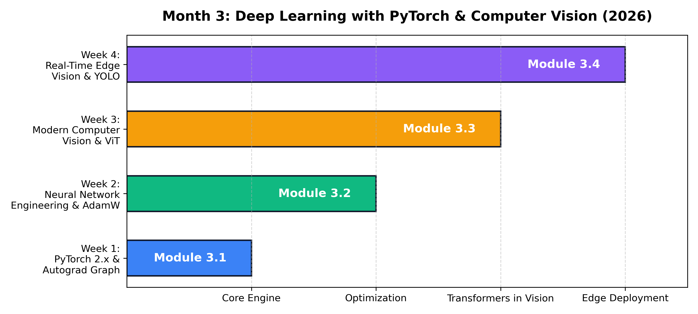

# Month 3: Modern Deep Learning & Computer Vision (2026 Edition)

```
================================================================================
MODULE OVERVIEW: MONTH 3
FOCUS:           PYTORCH 2.X ARCHITECTURE, NEURAL ENGINEERING & MODERN VISION
TOOLS:           PYTORCH 2.X, TORCHVISION, TIMM, ONNX, TENSORRT, ULTRALYTICS
TARGET LEVEL:    SENIOR AI ENGINEER & EMBEDDED VISION ARCHITECT
================================================================================
```



## Curriculum Architecture


---

## Weekly Masterclass Index

| Week | Lecture Note & Masterclass | Core Theoretical Focus | Modern Toolchain | Key Architecture / Visual |
| :--- | :--- | :--- | :--- | :--- |
| **Week 1** | [PyTorch 2.x Architecture, Autograd & Acceleration](Week_1/lecture_notes/Week1_PyTorch_Foundations_and_Autograd.md) | Strides & Memory Layout, Reverse-Mode VJP Derivation, Dynamic DAG Tape, `torch.compile` & TorchInductor | `torch`, `torchvision`, `numpy` | [Autograd Dynamic DAG](../docs/images/pytorch_autograd_graph.png) |
| **Week 2** | [Neural Network Engineering, Normalization & AdamW](Week_2/lecture_notes/Week2_Neural_Network_Engineering.md) | Variance Preservation (He vs Xavier), Normalization Dynamics (BatchNorm, LayerNorm, RMSNorm), AdamW Decoupled Decay | `torch`, `torch.optim` | [Normalization Schemes](../docs/images/normalization_paradigms.png) |
| **Week 3** | [2D Convolutions, ConvNeXt & Vision Transformers](Week_3/lecture_notes/Week3_Modern_Computer_Vision_and_ViT.md) | Effective Receptive Fields (2D Gaussian), Depthwise Separable Convolutions, ConvNeXt Roadmap, ViT Patch Attention | `torch`, `torchvision`, `timm` | [ViT Patch Projection Pipeline](../docs/images/vit_patch_projection.png) |
| **Week 4** | [Real-Time Edge Vision, YOLO & Hardware Optimization](Week_4/lecture_notes/Week4_Real_Time_Vision_and_YOLO.md) | Bounding Box Geometry, CIoU Loss Derivation, Anchor-Free Decoupled Heads, Vectorized NMS, INT8 TensorRT PTQ | `torch`, `torchvision`, `onnxruntime`, `cv2` | [IoU & Greedy NMS Geometry](../docs/images/iou_nms_geometry.png) |

---

## Practical Engineering Artifacts

Each week includes:
1. **Mathematical Derivations**: Step-by-step proofs with defined symbols and worked numerical examples.
2. **From-Scratch Engines**: Core algorithms implemented in pure Python/NumPy before using production libraries.
3. **Enterprise Playbooks**: Production latency budgets, containerized deployment patterns, and failure mode checklists.
4. **Graded Assessments**: 8–10 rigorous questions with complete answer keys and real-world coding challenges.
