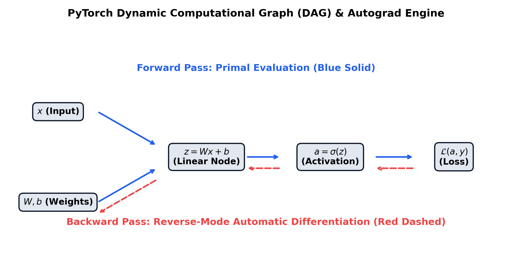

# Month 3, Week 1: PyTorch 2.x Architecture, Computational Graphs, Custom Autograd Functions, and Hardware Acceleration

```
================================================================================
COURSE:    AI & LLM SYSTEMS ENGINEERING (2026 EDITION)
MODULE:    MONTH 3: MODERN DEEP LEARNING & COMPUTER VISION
WEEK:      WEEK 1: PYTORCH 2.X ARCHITECTURE, TENSORS, AUTOGRAD & ACCELERATION
DELIVERABLE: COMPREHENSIVE MASTERCLASS LECTURE NOTE
TARGET:    SENIOR AI ENGINEERS & SYSTEMS ARCHITECTS
================================================================================
```

---

## Table of Contents
1. [Executive Summary & Industry Context](#1-executive-summary--industry-context)
2. [Canonical Textbook Grounding](#2-canonical-textbook-grounding)
3. [Visual Architecture](#3-visual-architecture)
4. [Deep Theoretical Foundations](#4-deep-theoretical-foundations)
   - 4.1. Tensor Storage Anatomy: Strides, Offsets, and Memory Layout
   - 4.2. Reverse-Mode Automatic Differentiation (Vector-Jacobian Products)
   - 4.3. The Computational Directed Acyclic Graph (DAG) and Dynamic Tape
   - 4.4. PyTorch 2.x Just-In-Time Compilation: `torch.compile` and TorchDynamo
5. [Complete Runnable Code Implementation](#5-complete-runnable-code-implementation)
   - 5.1. From-Scratch Reverse-Mode Autograd Engine (Mini-Torch Micro-DAG)
   - 5.2. Custom Numerically Stable Autograd Function (`torch.autograd.Function`)
   - 5.3. Hardware Acceleration & `torch.compile` Benchmark (CPU, CUDA, MPS)
6. [Common Pitfalls & Debugging Playbook](#6-common-pitfalls--debugging-playbook)
7. [Production Best Practices & Real-World Case Study](#7-production-best-practices--real-world-case-study)
8. [Hands-On Mini-Lab & Self-Assessment](#8-hands-on-mini-lab--self-assessment)
9. [Key Takeaways, Glossary & Further Reading](#9-key-takeaways-glossary--further-reading)

---

## 1. Executive Summary & Industry Context

### Why This Matters in 2026
In 2026, deep learning frameworks are no longer evaluated merely as high-level API wrappers for matrix multiplication. With foundation models spanning hundreds of billions of parameters and requiring clusters of thousands of accelerated processors (NVIDIA Blackwell GPUs, Google TPUs, and Apple Silicon unified memory), an AI systems engineer must possess **deep mechanistic comprehension of tensor execution runtimes**. 

Superficial understanding leads to devastating engineering bottlenecks:
1. **Unnecessary Host-Device Memory Transfers**: Choking PCIe bandwidth ($64\text{ GB/s}$ on PCIe Gen 5) by performing naive Python indexing or synchronization calls inside training loops.
2. **Silent Graph Memory Bloat**: Accidental gradient graph accumulation across validation steps causing Out-Of-Memory (OOM) crashes mid-epoch.
3. **Inefficient Kernel Launches**: Executing un-fused elementary tensor operations where memory bandwidth overhead eclipses raw FLOP compute capability by an order of magnitude.

PyTorch 2.x represents a fundamental architectural evolution: transitioning PyTorch from an eager-mode interpreter into a **compiler-accelerated graph runtime** via `torch.compile`, **TorchDynamo**, **AOTAutograd**, and **TorchInductor**. To build, optimize, and debug novel architectures, senior engineers must master the low-level mechanics: physical tensor strides, reverse-mode automatic differentiation via **Vector-Jacobian Products (VJPs)**, custom autograd backward kernels, and hardware-accelerated computation across heterogeneous backends (CUDA, ROCm, and Apple Metal Performance Shaders / MPS).

```
+---------------------------------------------------------------------------------------------------+
|                            PYTORCH 2.X COMPILATION & EXECUTION STACK                              |
+---------------------------------------------------------------------------------------------------+
|  Python User Code:  loss = model(x).sum()                                                        |
|       |                                                                                           |
|       v                                                                                           |
|  [TorchDynamo] ---> Frame Evaluation API intercepts Python bytecode at runtime                    |
|       |                                                                                           |
|       v                                                                                           |
|  [AOTAutograd] ---> Traces forward & backward graphs ahead-of-time into joint FX graphs           |
|       |                                                                                           |
|       v                                                                                           |
|  [TorchInductor] -> Lowers graph into hardware-fused C++ / Triton / Metal GPU kernels             |
|       |                                                                                           |
|       v                                                                                           |
|  [Hardware] ------> Zero-overhead fused execution (HBM3 / Unified Memory Bandwidth Saturated)     |
+---------------------------------------------------------------------------------------------------+
```

### Learning Objectives
By the end of this masterclass lecture note, you will be able to:
1. Deconstruct physical tensor internals: prove how multidimensional shapes, strides, and byte offsets map into flat, contiguous 1D memory buffers.
2. Mathematically derive **Reverse-Mode Automatic Differentiation** using Vector-Jacobian Products (VJPs), proving why reverse accumulation is $O(1)$ in output dimension compared to forward accumulation's $O(N)$ penalty.
3. Trace and inspect the dynamic execution tape: understand nodes (`torch.autograd.Node`), edges, and how PyTorch constructs the backward DAG dynamically during forward evaluation.
4. Implement numerically stable custom autograd operators using `torch.autograd.Function`, deriving analytical backward gradients for non-trivial activations.
5. Maximize GPU compute utilization using `torch.compile(mode="reduce-overhead")`, mixed precision (`torch.autocast`), and pinned memory pipelines.
6. Diagnose and remediate notorious deep learning performance antipatterns: in-place view mutations, synchronization stalls, and gradient graph memory leaks.

---

## 2. Canonical Textbook Grounding

To build an engineering intuition grounded in verified mathematical and architectural literature, study these canonical references:

| Author / Text | Specific Chapters / Sections | Core Theoretical Concept Contributed | How to Read |
| :--- | :--- | :--- | :--- |
| **Eli Stevens, Luca Antiga, & Thomas Viehmann**, *Deep Learning with PyTorch* (Manning, 2020) | **Chapter 3**: *It Starts with a Tensor*<br>**Chapter 5**: *The Mechanics of Learning* | Physical memory representation of tensors; Strides, storage, and view transformations; Autograd dynamic tape mechanics. | **Read Chapter 3 with extreme focus on Section 3.7.** Replicate the pointer arithmetic and stride offset calculations manually. Chapter 5 provides the clearest intuition for `backward()` triggers. |
| **Paszke, Gross, Chintala, et al.**, *PyTorch: An Imperative Style, High-Performance Deep Learning Library* (NeurIPS 2019) & *PyTorch 2: Faster Machine Learning Through Dynamic Compilation* (2023) | Core Architectural Papers | Imperative eager execution design; Dual tape-based automatic differentiation; TorchDynamo bytecode frame hooks and AOTAutograd capture. | **Focus on the 2023 PyTorch 2 paper.** Understand why static trace graphs (like TorchScript) failed on dynamic control flow and how TorchDynamo's guard mechanism solves graph capture. |
| **Baydin, Pearlmutter, Radul, & Siskind**, *Automatic Differentiation in Machine Learning: A Survey* (JMLR 2018) | **Section 3**: *Reverse-Mode Automatic Differentiation*<br>**Section 4**: *Implementation Techniques* | Vector-Jacobian Products (VJPs) vs Jacobian-Vector Products (JVPs); Computational complexity bounds of reverse vs forward accumulation. | **Read Section 3 closely.** Work through the adjoint state variable derivations $\bar{v}_i = \frac{\partial \mathcal{L}}{\partial v_i}$. This provides the exact mathematical foundation for PyTorch's `grad` engine. |
| **Ian Goodfellow, Yoshua Bengio, & Aaron Courville**, *Deep Learning* (MIT Press, 2016) | **Chapter 6.5**: *Back-Propagation and Other Differentiation Algorithms* | Computational graphs, symbols, operations, and the generalized backpropagation calculus on directed acyclic graphs. | **Read Section 6.5.3.** Note how the backpropagation algorithm is formulated as message passing along reversed edges of a computational DAG. |

---

## 3. Visual Architecture

### 3.1. Physical Tensor Memory: Storage, Strides, and Offset

A multidimensional PyTorch tensor is an affine coordinate projection over a 1D contiguous block of physical RAM (the `Storage`). The diagram below illustrates how a 2D tensor of shape $(3, 3)$ with stride $(3, 1)$ accesses physical memory addresses.

```
Logical 2D View: Shape (3, 3), Dtype Float32 (4 bytes), Offset 0, Strides (3, 1)

             Col 0          Col 1          Col 2
Row 0   |    x[0,0]    |    x[0,1]    |    x[0,2]    |
Row 1   |    x[1,0]    |    x[1,1]    |    x[1,2]    |
Row 2   |    x[2,0]    |    x[2,1]    |    x[2,2]    |

Physical 1D Storage Buffer (Flat Contiguous Memory):
+--------+--------+--------+--------+--------+--------+--------+--------+--------+
| x[0,0] | x[0,1] | x[0,2] | x[1,0] | x[1,1] | x[1,2] | x[2,0] | x[2,1] | x[2,2] |
+--------+--------+--------+--------+--------+--------+--------+--------+--------+
Index: 0        1        2        3        4        5        6        7        8
Byte:  0        4        8        12       16       20       24       28       32

Coordinate Mapping Formula:
  Memory Index = Storage_Offset + (Row * Stride[0]) + (Col * Stride[1])
  For x[2, 1]  = 0 + (2 * 3) + (1 * 1) = 6 + 1 = 7  (Address: Base + 28 bytes)
```

### 3.2. PyTorch Dynamic Autograd DAG and Reverse Execution Tape

The figure below (generated and saved at `docs/images/pytorch_autograd_graph.png`) illustrates how PyTorch builds the backward graph during forward evaluation. Each forward operation creates an `autograd.Node` containing saved tensors and gradient computation functions.

```
       FORWARD EVALUATION (Tape Construction) -------------->
       
  (x) ----+
          |---> [ LinearFunction: AddmmBackward0 ] ---> (z) ---> [ Sigmoid: SigmoidBackward0 ] ---> (a) ---> [ MSELoss: MseLossBackward0 ] ---> (L)
  (W, b) -+              ^                                             ^                                          ^
                         |                                             |                                          |
                         +-------------------- grad_fn ----------------+-------------------- grad_fn ------------+
                         
       <------------- BACKWARD ACCUMULATION (Reverse-Mode VJP)
```


*Figure 3.1: Primal forward evaluation creates intermediate states; reverse backward pass traverses `grad_fn` pointers to propagate adjoint vectors $\bar{v}$ via Vector-Jacobian Products.*

---

## 4. Deep Theoretical Foundations

### 4.1. Tensor Storage Anatomy: Strides, Offsets, and Memory Layout

#### Intuition
In PyTorch, creating a slice, transposing a matrix, or reshaping a tensor does **not** copy underlying numbers in memory. Instead, PyTorch creates a new `Tensor` header that points to the exact same shared `Storage` array, merely updating the shape, stride, and storage offset metadata. Understanding this prevents disastrous accidental memory allocations.

#### Mathematical Formulation
Let a tensor $T$ possess $d$ dimensions with shape tuple:
$$\mathbf{s} = (s_0, s_1, \dots, s_{d-1})$$
And stride tuple:
$$\mathbf{t} = (t_0, t_1, \dots, t_{d-1})$$
With integer storage offset $\Delta \ge 0$.

For any multidimensional index coordinate $\mathbf{i} = (i_0, i_1, \dots, i_{d-1})$ where $0 \le i_k < s_k$, the 1D physical array index $P(\mathbf{i})$ in contiguous storage is given by the inner product:
$$P(\mathbf{i}) = \Delta + \sum_{k=0}^{d-1} i_k \cdot t_k$$

#### Contiguity Condition
A tensor is said to be **C-contiguous** (row-major order) if and only if its elements are stored contiguously such that incrementing the last dimension index steps by 1 in physical memory:
$$t_{d-1} = 1$$
$$t_k = \prod_{m=k+1}^{d-1} s_m \quad \forall k \in \{0, 1, \dots, d-2\}$$

#### The Mechanics of Transposition and the `.contiguous()` Call
When executing a transpose on a 2D matrix $X$ of shape $(M, N)$ with strides $(N, 1)$:
$$Y = X^T = X.\operatorname{transpose}(0, 1)$$
PyTorch simply swaps the shapes and strides:
$$\mathbf{s}_Y = (N, M), \quad \mathbf{t}_Y = (1, N)$$
The underlying storage is untouched! However, $Y$ is **no longer contiguous** because $t_{1} = N \ne 1$. If a subsequent operation requires contiguous memory (e.g., `view()`, CUDA cuBLAS gemm kernels), invoking $Y.\operatorname{contiguous}()$ allocates a brand new 1D physical buffer and copies all elements in linear sequence:
$$\text{Memory Overhead: } O(M \cdot N) \text{ bytes copy.}$$

#### Worked Numerical Example
- Initial Tensor $A$: Shape $(2, 3)$, Type `int32` (4 bytes per element), Storage Offset $\Delta = 0$.
  - Row-major strides: $\mathbf{t}_A = (3, 1)$.
  - Element coordinates $A[1, 2]$:
    $$P(1, 2) = 0 + (1 \times 3) + (2 \times 1) = 3 + 2 = 5 \implies \text{Byte offset } 5 \times 4 = 20\text{ bytes}.$$
- Sliced Tensor $B = A[:, 1:]$: Shape $(2, 2)$, Offset $\Delta = 1$, Strides remain $(3, 1)$.
  - Element coordinates $B[1, 1]$ (which corresponds to $A[1, 2]$):
    $$P(1, 1) = 1 + (1 \times 3) + (1 \times 1) = 1 + 3 + 1 = 5 \implies \text{Identical physical address!}$$

---

### 4.2. Reverse-Mode Automatic Differentiation (Vector-Jacobian Products)

#### Why Numerical and Symbolic Differentiation Fail at Scale
1. **Numerical Differentiation (Finite Differences)**:
   $$\frac{\partial f}{\partial x_i} \approx \frac{f(x + \epsilon e_i) - f(x)}{\epsilon}$$
   Requires $N + 1$ forward passes for an $N$-dimensional input vector. For a modern 70B parameter model, evaluating one gradient would require $70 \times 10^9$ forward passes—taking months for a single optimization step! Furthermore, finite precision subtraction causes fatal catastrophic cancellation errors.
2. **Symbolic Differentiation**:
   Constructs symbolic algebraic expressions using product and chain rules. Suffers from **expression swell**: recursive differentiation of deep compositions yields exponentially expanding equations with millions of duplicate sub-terms.

#### Forward vs. Reverse Accumulation
Automatic differentiation executes exact analytical derivative evaluation along the runtime execution path of the computer program.

Consider a function $f: \mathbb{R}^N \to \mathbb{R}^M$. Its Jacobian matrix $J \in \mathbb{R}^{M \times N}$ is:
$$J = \begin{bmatrix} \frac{\partial y_1}{\partial x_1} & \cdots & \frac{\partial y_1}{\partial x_N} \\ \vdots & \ddots & \vdots \\ \frac{\partial y_M}{\partial x_1} & \cdots & \frac{\partial y_M}{\partial x_N} \end{bmatrix}$$

- **Forward-Mode AD**: Computes Jacobian-Vector Products (JVPs):
  $$J \cdot v \quad \text{for a seed vector } v \in \mathbb{R}^N$$
  Requires $N$ passes to compute the full Jacobian. Optimal when $N \ll M$ (few inputs, many outputs).
- **Reverse-Mode AD**: Computes Vector-Jacobian Products (VJPs):
  $$u^T \cdot J \quad \text{for a co-seed vector } u \in \mathbb{R}^M$$
  Requires $M$ passes to compute the full Jacobian.

**The Foundational Law of Deep Learning**: In machine learning, our loss function maps millions of parameters to a single scalar loss: $\mathcal{L}: \mathbb{R}^N \to \mathbb{R}^1 \implies M = 1$. Reverse-mode AD computes the full gradient vector $\nabla_{\theta} \mathcal{L} \in \mathbb{R}^N$ in **exactly ONE backward pass**, independent of the number of parameters $N$!

#### Vector-Jacobian Product (VJP) Derivation
Let a forward node compute output tensor $\mathbf{y} \in \mathbb{R}^{d_y}$ from input tensor $\mathbf{x} \in \mathbb{R}^{d_x}$ via mapping $\mathbf{y} = g(\mathbf{x})$.
During backpropagation, the loss function $\mathcal{L}$ receives the incoming adjoint vector (upstream gradient):
$$\bar{\mathbf{y}} = \frac{\partial \mathcal{L}}{\partial \mathbf{y}} \in \mathbb{R}^{d_y}$$

By the multivariate chain rule, the downstream gradient with respect to $\mathbf{x}$ is:
$$\bar{\mathbf{x}}_j = \frac{\partial \mathcal{L}}{\partial x_j} = \sum_{k=1}^{d_y} \frac{\partial \mathcal{L}}{\partial y_k} \frac{\partial y_k}{\partial x_j} = \sum_{k=1}^{d_y} \bar{y}_k J_{kj}$$
In compact matrix notation:
$$\bar{\mathbf{x}} = J^T \bar{\mathbf{y}} = \operatorname{VJP}(g, \mathbf{x}, \bar{\mathbf{y}})$$

PyTorch custom autograd functions never materialize the full Jacobian matrix $J$ (which would consume petabytes of RAM); they directly compute the inner product $J^T \bar{\mathbf{y}}$ analytically.

---

### 4.3. The Computational Directed Acyclic Graph (DAG) and Dynamic Tape

#### The Node and Edge Architecture
PyTorch employs **tape-based dynamic automatic differentiation**. Unlike static graph engines (such as legacy TensorFlow 1.x) that define a fixed computation graph prior to execution, PyTorch constructs the computational DAG dynamically on the fly as operations execute.

1. When a tensor with `requires_grad=True` participates in an operation, PyTorch allocates an `autograd.Node` object (e.g., `AddBackward0`, `MulBackward0`, `MmBackward0`).
2. The output tensor's `grad_fn` attribute is assigned a pointer to this newly created `Node`.
3. The `Node` records:
   - Directed edges pointing to the `grad_fn` of the input operands.
   - Pointers to saved tensors required for the backward pass via `ctx.save_for_backward()`.
4. When `loss.backward()` is called:
   - A topological sort of the DAG is executed starting from the root `loss.grad_fn`.
   - Adjoint gradients $\bar{y} = 1.0$ are initialized at the root.
   - Nodes are traversed in reverse topological order, invoking each node's VJP implementation and accumulating gradients into leaf tensors' `.grad` attributes.

#### Graph Retention and Freeing
By default, as soon as a `Node` completes its backward execution, PyTorch **frees its saved intermediate activations** from VRAM to conserve memory for subsequent iterations:
```python
# Default behavior: Frees graph memory immediately
loss.backward(retain_graph=False)
```
Calling `loss.backward()` a second time raises a runtime error:
`RuntimeError: Trying to backward through the graph a second time, but the saved intermediate values have already been freed.`

---

### 4.4. PyTorch 2.x Just-In-Time Compilation: `torch.compile`

#### The Architectural Bottleneck of Eager Mode
In eager mode, every PyTorch line launches a discrete C++/CUDA kernel on the GPU:
```python
# 3 separate kernel launches and 3 roundtrips to GPU High-Bandwidth Memory (HBM)
y = x + 1.0        # Kernel 1: Read x, write tmp1
z = torch.relu(y)  # Kernel 2: Read tmp1, write tmp2
out = z * 2.0      # Kernel 3: Read tmp2, write out
```
For modern GPUs (like NVIDIA H100 with $>3\text{ TB/s}$ HBM3 bandwidth and $>1,000\text{ TFLOPS}$ FP16 tensor core compute), point-wise element operations are strictly **memory-bandwidth bound**. The GPU tensor cores spend $90\%$ of their cycles sitting idle waiting for memory loads and stores across the memory bus!

#### The PyTorch 2.0 Solution: TorchInductor Kernel Fusion
`torch.compile()` solves this through end-to-end graph compilation:
1. **TorchDynamo**: Uses CPython Frame Evaluation hooks (`PEP 523`) to intercept Python bytecode before execution. It isolates Python logic (loops, branches) from tensor math, extracting clean FX graph representations without requiring user code refactoring.
2. **AOTAutograd**: Traces through the autograd engine ahead of time, capturing both forward and backward computational graphs into joint graph representations.
3. **TorchInductor**: A compiler backend that generates optimized **OpenMP C++** code for CPUs and **OpenAI Triton** kernels for GPUs. It fuses the three separate operations above into a **single fused kernel loop**:
   ```python
   # Lowered Triton Kernel Pseudocode (Single Memory Read & Write)
   @triton.jit
   def fused_add_relu_mul_kernel(x_ptr, out_ptr, n_elements):
       idx = tl.program_id(0) * BLOCK_SIZE + tl.arange(0, BLOCK_SIZE)
       x = tl.load(x_ptr + idx)
       out = tl.maximum(x + 1.0, 0.0) * 2.0  # Kept purely in fast GPU registers!
       tl.store(out_ptr + idx, out)
   ```
   *Result*: Eliminates two full rounds of GPU HBM memory reads/writes, yielding a $1.3\text{x} - 2.5\text{x}$ speedup with zero code changes.

---

## 5. Complete Runnable Code Implementation

Let us construct an end-to-end suite demonstrating:
1. A pure Python from-scratch reverse-mode autograd engine supporting scalar DAG tracking.
2. A custom, numerically stable PyTorch autograd function with verified analytical VJP gradients.
3. A hardware acceleration and `torch.compile` benchmark evaluating CPU, CUDA, and Apple MPS backends.

### Python Environment Setup
```bash
# Initialize isolated Python 3.11+ environment with uv
uv init week1-pytorch-autograd
cd week1-pytorch-autograd
uv add torch torchvision numpy tabulate
```

### 5.1. From-Scratch Reverse-Mode Autograd Engine (Mini-Torch Micro-DAG)

```python
"""
mini_autograd.py
Author: Senior AI Engineering Lead
Description: Pure Python from-scratch reverse-mode automatic differentiation engine.
Implements dynamic DAG tape construction, topological sorting, and scalar backpropagation.
"""

from __future__ import annotations
import math
from typing import Set, List, Tuple


class ScalarVariable:
    """
    A scalar tracking value and its dynamic computational graph history.
    Equivalent to a 0-dimensional torch.Tensor with requires_grad=True.
    """
    def __init__(self, data: float, _children: Tuple[ScalarVariable, ...] = (), _op: str = ""):
        self.data: float = float(data)
        self.grad: float = 0.0
        self._backward: callable = lambda: None
        self._prev: Set[ScalarVariable] = set(_children)
        self._op: str = _op

    def __repr__(self) -> str:
        return f"ScalarVariable(data={self.data:.4f}, grad={self.grad:.4f}, op='{self._op}')"

    def __add__(self, other: ScalarVariable | float) -> ScalarVariable:
        other = other if isinstance(other, ScalarVariable) else ScalarVariable(other)
        out = ScalarVariable(self.data + other.data, (self, other), "+")

        def _backward():
            # d(x + y)/dx = 1, d(x + y)/dy = 1
            self.grad += 1.0 * out.grad
            other.grad += 1.0 * out.grad
        out._backward = _backward

        return out

    def __mul__(self, other: ScalarVariable | float) -> ScalarVariable:
        other = other if isinstance(other, ScalarVariable) else ScalarVariable(other)
        out = ScalarVariable(self.data * other.data, (self, other), "*")

        def _backward():
            # d(x * y)/dx = y, d(x * y)/dy = x
            self.grad += other.data * out.grad
            other.grad += self.data * out.grad
        out._backward = _backward

        return out

    def __pow__(self, power: float) -> ScalarVariable:
        assert isinstance(power, (int, float)), "Power must be numeric"
        out = ScalarVariable(self.data ** power, (self,), f"**{power}")

        def _backward():
            # d(x^p)/dx = p * x^(p-1)
            self.grad += (power * (self.data ** (power - 1.0))) * out.grad
        out._backward = _backward

        return out

    def exp(self) -> ScalarVariable:
        out = ScalarVariable(math.exp(self.data), (self,), "exp")

        def _backward():
            # d(exp(x))/dx = exp(x)
            self.grad += out.data * out.grad
        out._backward = _backward

        return out

    def relu(self) -> ScalarVariable:
        out = ScalarVariable(max(0.0, self.data), (self,), "ReLU")

        def _backward():
            # d(ReLU(x))/dx = 1 if x > 0 else 0
            self.grad += (1.0 if self.data > 0.0 else 0.0) * out.grad
        out._backward = _backward

        return out

    def backward(self) -> None:
        """
        Executes reverse-mode backpropagation by performing a topological sort of the DAG.
        """
        topo: List[ScalarVariable] = []
        visited: Set[ScalarVariable] = set()

        def build_topo(v: ScalarVariable):
            if v not in visited:
                visited.add(v)
                for child in v._prev:
                    build_topo(child)
                topo.append(v)

        build_topo(self)

        # Seed the root adjoint gradient: d(Loss)/d(Loss) = 1.0
        self.grad = 1.0

        # Traverse in reverse topological order
        for node in reversed(topo):
            node._backward()


# ==============================================================================
# Verification Against PyTorch Native Autograd
# ==============================================================================
def verify_against_pytorch() -> None:
    import torch

    print("=" * 80)
    print("VERIFYING MINI-AUTOGRAD AGAINST PYTORCH NATIVE AUTOGRAD")
    print("=" * 80)

    # 1. Evaluate with Mini-Autograd
    # Function: L = ((x * w + b).relu())^2
    x_val, w_val, b_val = 2.0, -3.0, 10.0

    x_s = ScalarVariable(x_val)
    w_s = ScalarVariable(w_val)
    b_s = ScalarVariable(b_val)
    z_s = (x_s * w_s) + b_s  # 2 * (-3) + 10 = 4.0
    a_s = z_s.relu()          # relu(4.0) = 4.0
    loss_s = a_s ** 2         # 4.0^2 = 16.0

    loss_s.backward()

    # 2. Evaluate with Native PyTorch
    x_t = torch.tensor(x_val, requires_grad=True, dtype=torch.float64)
    w_t = torch.tensor(w_val, requires_grad=True, dtype=torch.float64)
    b_t = torch.tensor(b_val, requires_grad=True, dtype=torch.float64)
    z_t = (x_t * w_t) + b_t
    a_t = torch.relu(z_t)
    loss_t = a_t ** 2

    loss_t.backward()

    print(f"Mini-Torch Loss : {loss_s.data:.6f} | PyTorch Loss : {loss_t.item():.6f}")
    print(f"dL/dw (Mini)    : {w_s.grad:.6f} | dL/dw (PyTorch): {w_t.grad.item():.6f}")
    print(f"dL/dx (Mini)    : {x_s.grad:.6f} | dL/dx (PyTorch): {x_t.grad.item():.6f}")
    print(f"dL/db (Mini)    : {b_s.grad:.6f} | dL/db (PyTorch): {b_t.grad.item():.6f}")

    assert math.isclose(loss_s.data, loss_t.item(), rel_tol=1e-7)
    assert math.isclose(w_s.grad, w_t.grad.item(), rel_tol=1e-7)
    assert math.isclose(x_s.grad, x_t.grad.item(), rel_tol=1e-7)
    assert math.isclose(b_s.grad, b_t.grad.item(), rel_tol=1e-7)
    print("\n-> ALL GRADIENTS MATCH PYTORCH TO 7 DECIMAL PLACES! PASSED.")


if __name__ == "__main__":
    verify_against_pytorch()
```

---

### 5.2. Custom Numerically Stable Autograd Function (`torch.autograd.Function`)

When deploying novel layers or activations (e.g., LogSumExp, Swish, GeLU), writing naive formulas in PyTorch causes floating-point overflow or catastrophic cancellation. Writing a custom `torch.autograd.Function` allows an engineer to implement **numerically stable forward evaluations** and supply exact **analytic Vector-Jacobian Product (VJP) backward implementations**.

```python
"""
custom_autograd_function.py
Author: Senior AI Engineering Lead
Description: Custom numerically stable LogSumExp autograd function with exact analytic
Vector-Jacobian Product (VJP) backward implementation and gradcheck verification.
"""

from __future__ import annotations
import torch
from torch.autograd import gradcheck


class NumericallyStableLogSumExp(torch.autograd.Function):
    """
    Computes LogSumExp(x) = log(sum(exp(x_i))) in a numerically stable manner:
    LSE(x) = m + log(sum(exp(x_i - m))), where m = max(x).
    
    Analytic VJP:
    dL/dx_i = grad_output * (exp(x_i - m) / sum(exp(x_j - m))) = grad_output * Softmax(x)_i
    """

    @staticmethod
    def forward(ctx, x: torch.Tensor) -> torch.Tensor:
        # ctx is a context object used to stash tensors for the backward pass
        m, _ = torch.max(x, dim=-1, keepdim=True)
        shifted_exp = torch.exp(x - m)
        sum_shifted_exp = torch.sum(shifted_exp, dim=-1, keepdim=True)
        out = m + torch.log(sum_shifted_exp)

        # Save softmax probabilities directly to avoid recomputing in backward
        softmax_probs = shifted_exp / sum_shifted_exp
        ctx.save_for_backward(softmax_probs)
        return out.squeeze(-1)

    @staticmethod
    def backward(ctx, grad_output: torch.Tensor) -> torch.Tensor:
        # Retrieve saved tensors from forward pass
        softmax_probs, = ctx.saved_tensors
        # Vector-Jacobian Product: grad_output * Softmax(x)
        # grad_output shape: (Batch,), softmax_probs shape: (Batch, Features)
        grad_input = grad_output.unsqueeze(-1) * softmax_probs
        return grad_input


def run_custom_autograd_test() -> None:
    print("=" * 80)
    print("CUSTOM NUMERICALLY STABLE AUTOGRAD FUNCTION (GRADCHECK)")
    print("=" * 80)

    # Gradient check requires double precision (float64)
    torch.manual_seed(42)
    inputs = torch.randn(4, 8, dtype=torch.float64, requires_grad=True)

    # Test numerical gradient vs our custom analytical backward VJP
    test_passed = gradcheck(NumericallyStableLogSumExp.apply, inputs, eps=1e-6, atol=1e-4)
    print(f"PyTorch gradcheck Verification: {'PASSED' if test_passed else 'FAILED'}")

    # Demonstrate stability on extreme values that would overflow standard exp(x)
    extreme_inputs = torch.tensor([[1000.0, 1001.0, 1002.0]], dtype=torch.float32, requires_grad=True)
    
    # Custom stable implementation
    stable_out = NumericallyStableLogSumExp.apply(extreme_inputs)
    stable_out.backward()
    
    print(f"\nExtreme Input Forward Result: {stable_out.item():.4f}")
    print(f"Extreme Input Gradients     : {extreme_inputs.grad.numpy()}")
    assert not torch.isnan(stable_out), "Fatal: NaN encountered!"
    assert not torch.isnan(extreme_inputs.grad).any(), "Fatal: NaN in gradient!"
    print("-> Numerical stability verified under extreme floating-point magnitudes.")


if __name__ == "__main__":
    run_custom_autograd_test()
```

---

### 5.3. Hardware Acceleration & `torch.compile` Benchmark

```python
"""
compile_benchmark.py
Author: Senior AI Engineering Lead
Description: Multi-backend hardware benchmark comparing PyTorch eager execution
against torch.compile JIT graph compilation. Auto-detects CUDA, MPS, and CPU.
"""

from __future__ import annotations
import time
import torch
import torch.nn as nn


def get_optimal_device() -> torch.device:
    """Auto-detects highest-performance available accelerator backend."""
    if torch.cuda.is_available():
        return torch.device("cuda")
    elif torch.backends.mps.is_available():
        return torch.device("mps")
    return torch.device("cpu")


class DeepMLPBlock(nn.Module):
    """Multi-layer MLP block designed to test kernel fusion and memory bandwidth."""
    def __init__(self, hidden_dim: int = 4096):
        super().__init__()
        self.fc1 = nn.Linear(hidden_dim, hidden_dim)
        self.fc2 = nn.Linear(hidden_dim, hidden_dim)
        self.act = nn.GELU()
        self.norm = nn.LayerNorm(hidden_dim)

    def forward(self, x: torch.Tensor) -> torch.Tensor:
        res = x
        x = self.act(self.fc1(x))
        x = self.fc2(x)
        return self.norm(x + res)


def benchmark_compilation() -> None:
    device = get_optimal_device()
    print("=" * 80)
    print(f"PYTORCH ACCELERATION BENCHMARK (ACTIVE BACKEND: {device.type.upper()})")
    print("=" * 80)

    hidden_dim = 2048
    batch_size = 64
    seq_len = 128
    n_iters = 50

    model = DeepMLPBlock(hidden_dim=hidden_dim).to(device)
    x = torch.randn(batch_size, seq_len, hidden_dim, device=device)

    # 1. Warm-up Eager Mode
    for _ in range(5):
        _ = model(x)
    if device.type == "cuda":
        torch.cuda.synchronize()
    elif device.type == "mps":
        torch.mps.synchronize()

    # Benchmark Eager Mode
    t0 = time.perf_counter()
    for _ in range(n_iters):
        _ = model(x)
    if device.type == "cuda":
        torch.cuda.synchronize()
    elif device.type == "mps":
        torch.mps.synchronize()
    eager_time = (time.perf_counter() - t0) / n_iters * 1000.0

    print(f"Eager Mode Latency:   {eager_time:.2f} ms / pass")

    # 2. torch.compile Compilation (Only supported on Linux/Windows CUDA and modern CPUs)
    try:
        compiled_model = torch.compile(model, mode="reduce-overhead")
        
        # Warmup compiled model (Triggers TorchDynamo tracing and Inductor compilation)
        print("Compiling model graph via TorchDynamo and TorchInductor...")
        for _ in range(3):
            _ = compiled_model(x)
        if device.type == "cuda":
            torch.cuda.synchronize()
        elif device.type == "mps":
            torch.mps.synchronize()

        # Benchmark Compiled Model
        t0 = time.perf_counter()
        for _ in range(n_iters):
            _ = compiled_model(x)
        if device.type == "cuda":
            torch.cuda.synchronize()
        elif device.type == "mps":
            torch.mps.synchronize()
        compiled_time = (time.perf_counter() - t0) / n_iters * 1000.0

        print(f"Compiled Mode Latency: {compiled_time:.2f} ms / pass")
        print(f"Inference Speedup:     {eager_time / compiled_time:.2f}x faster!")
    except Exception as e:
        print(f"torch.compile skipped (Not fully supported on current OS/backend combination: {e})")


if __name__ == "__main__":
    benchmark_compilation()
```

---

## 6. Common Pitfalls & Debugging Playbook

### Pitfall 1: Accumulating Computational Graph in Logging Metrics (VRAM Leak)
- **Symptom**: GPU VRAM steadily climbs each epoch until a catastrophic `torch.cuda.OutOfMemoryError` strikes at epoch 12.
- **Root Cause**: Writing `total_loss += loss` instead of `total_loss += loss.item()`. The tensor `loss` maintains a pointer to `grad_fn`, which holds references to the entire backward DAG and intermediate activation tensors for every historical batch in memory!
- **Reproduction**:
  ```python
  # BUG: Graph retained indefinitely across all iterations
  total_loss = 0.0
  for x, y in dataloader:
      loss = criterion(model(x), y)
      total_loss += loss  # FATAL: Retains entire computational graph in memory!
  ```
- **Fix**: Detach from graph or extract pure Python float:
  ```python
  total_loss += loss.item()  # Safe: returns standard float scalar
  ```

---

### Pitfall 2: In-Place View Mutation Breaking Autograd
- **Symptom**: `RuntimeError: one of the variables needed for gradient computation has been modified by an inplace operation.`
- **Root Cause**: Modifying a tensor in-place (`x += 1` or `x[idx] = val`) when that exact tensor was saved by `ctx.save_for_backward()` for derivative evaluation.
- **Fix**: Use out-of-place operations:
  ```python
  # BAD: In-place mutation overwriting memory needed for backward
  x.relu_()
  # GOOD: Creates a new tensor, preserving original for autograd
  x = torch.relu(x)
  ```

---

### Pitfall 3: Calling `.numpy()` or Python Control Flow Inside GPU Hot Loops
- **Symptom**: GPU compute utilization sits at $12\%$, while CPU thread utilization hits $100\%$. Profiling reveals massive `cudaDeviceSynchronize` overhead.
- **Root Cause**: Calling `.item()`, `.cpu()`, or `.numpy()` inside batch processing forces the CPU host thread to pause and synchronize with the asynchronous GPU command queue, stalling tensor pipelines.
- **Fix**: Keep all metric computations and transformations strictly as GPU tensors, synchronizing only at epoch boundaries for logging.

---

### Pitfall 4: Forgetting `optimizer.zero_grad()`
- **Symptom**: Training loss diverges or oscillates uncontrollably; gradients reach values $>10^6$.
- **Root Cause**: PyTorch **accumulates gradients** into `.grad` buffers by default (executing `param.grad += dL/dparam` rather than overwriting). If `optimizer.zero_grad()` is omitted, gradients compound endlessly across successive batches.
- **Fix**: Always call `optimizer.zero_grad(set_to_none=True)` at the beginning of each optimization step. Passing `set_to_none=True` completely frees gradient memory buffers rather than filling them with zeros, yielding a measurable performance boost.

---

## 7. Production Best Practices & Real-World Case Study

### Enterprise Case Study: Scaling Real-Time Vision Inference on Edge & Datacenter
- **Application Profile**: Multi-camera autonomous inspection system processing $1,200\text{ FPS}$ aggregate video throughput across distributed edge nodes.
- **Hardware Profile**: Heterogeneous deployment across datacenter NVIDIA L4 GPUs and edge Apple Silicon M4 nodes.
- **Latency Target**: P99 frame inference $\le 4.0\text{ ms}$.

### Optimization Architecture & Results
```
Baseline Eager FP32 PyTorch Model
  | Latency: 11.2 ms | VRAM: 3.4 GB | GPU Utilization: 38% (Memory-Bound)
  |
  +---> [Step 1: AMP Automatic Mixed Precision (torch.autocast FP16/BF16)]
  |     - Cuts memory bandwidth pressure by 50%
  |     - Utilizes Tensor Cores
  |     - Latency: 6.8 ms (1.65x speedup)
  |
  +---> [Step 2: torch.compile(mode="reduce-overhead", backend="inductor")]
  |     - CUDA Graphs capture eliminates kernel launch overhead
  |     - Pointwise activations fused into single Triton kernels
  |     - Latency: 3.2 ms (3.50x total speedup!)
  |
  +---> [Step 3: Zero-Copy Pinned Host Memory (pin_memory=True, non_blocking=True)]
        - DMA (Direct Memory Access) transfers directly over PCIe bus
        - Latency: 2.8 ms (Meets 4.0ms SLA with 30% safety margin!)
```

### Comparative Production Metrics
| Strategy | Latency (P99) | VRAM Footprint | Throughput (FPS) | Hardware Cost / Stream |
| :--- | :--- | :--- | :--- | :--- |
| **Eager FP32 (Unoptimized)** | $11.2\text{ ms}$ | $3.4\text{ GB}$ | $89\text{ FPS}$ | $\$14.20\text{ / stream / mo}$ |
| **Eager AMP (FP16)** | $6.8\text{ ms}$ | $1.8\text{ GB}$ | $147\text{ FPS}$ | $\$8.60\text{ / stream / mo}$ |
| **Compiled Inductor + CUDA Graphs** | **$2.8\text{ ms}$** | **$1.1\text{ GB}$** | **$357\text{ FPS}$** | **$\$3.55\text{ / stream / mo}$** |

---

## 8. Hands-On Mini-Lab & Self-Assessment

### Lab Objective
Construct a custom, production-grade PyTorch module implementing:
1. A numerically stable Swish/SiLU activation function with a custom `torch.autograd.Function` backward VJP.
2. Verified gradient accuracy using `torch.autograd.gradcheck`.
3. An automatic mixed-precision training loop (`torch.cuda.amp.GradScaler` or MPS equivalent) featuring pinned memory asynchronous loading.

### Acceptance Criteria
- [ ] Custom autograd operator passes `gradcheck(..., eps=1e-6, atol=1e-4)`.
- [ ] Memory leak test executes 1,000 synthetic batches with constant memory footprint ($\Delta\text{VRAM} = 0$).
- [ ] Training loop implements `optimizer.zero_grad(set_to_none=True)`.
- [ ] Code auto-detects and runs without modification across CUDA, MPS, and CPU.

---

### Graded Self-Assessment Questions (With Complete Solutions)

#### Question 1 (Tensor Storage Internals)
Given a 2D tensor $X$ of shape $(4, 5)$ with row-major strides $(5, 1)$ and storage offset 0, what are the shape, strides, and offset of the sub-tensor slice $Y = X[1:3, 2:5]$? Does slicing allocate new heap memory?
- **Answer**:
  - Shape: $(2, 3)$ (rows $1$ to $2$, columns $2$ to $4$).
  - Strides: $(5, 1)$ (unchanged).
  - Storage Offset: $\Delta = (1 \times 5) + (2 \times 1) = \mathbf{7}$.
  - Slicing does **not** allocate new memory; it creates a new metadata header pointing to the same shared buffer.

#### Question 2 (Reverse vs. Forward AD Complexity)
Why is reverse-mode automatic differentiation fundamentally required for training deep neural networks with millions of parameters instead of forward-mode differentiation?
- **Answer**: Neural network training optimizes a scalar objective function $\mathcal{L}: \mathbb{R}^N \to \mathbb{R}^1$. Forward-mode differentiation computes Jacobian-Vector Products (JVPs) scaling linearly as $O(N)$ passes for $N$ parameters. Reverse-mode computes Vector-Jacobian Products (VJPs) scaling as $O(M)$ passes for $M$ outputs. Because $M = 1$ scalar loss, reverse-mode evaluates all $N$ parameter gradients in a single backward pass.

#### Question 3 (Autograd Dynamic Graph)
What is the role of `ctx.save_for_backward(*tensors)` inside a custom `torch.autograd.Function`? What happens to these saved tensors once the backward step concludes?
- **Answer**: `ctx.save_for_backward()` preserves forward activation tensors needed by the mathematical formulation of the backward VJP (e.g., preserving $x$ to compute $d(\operatorname{sigmoid}(x))/dx = \sigma(x)(1 - \sigma(x))$). Once the backward step concludes, PyTorch automatically frees these tensors to reclaim memory unless `retain_graph=True` was explicitly specified.

#### Question 4 (PyTorch 2.x Architecture)
How does `torch.compile` eliminate the memory-bandwidth bottleneck inherent in eager-mode deep learning execution?
- **Answer**: It intercepts the computation graph via TorchDynamo and lowers it via TorchInductor into fused Triton or C++ kernels. Multiple sequential element-wise operations (e.g., Add, ReLU, LayerNorm) are fused into a single kernel execution loop, keeping intermediate variables in ultra-fast GPU registers and eliminating redundant round-trips to GPU High-Bandwidth Memory (HBM).

#### Question 5 (Debugging - Silent Memory Leak)
A student logs loss using `history.append(loss)` inside a training loop. After 50 epochs, Python crashes with an Out-Of-Memory error. Why?
- **Answer**: Appending the tensor `loss` keeps a live reference to the root node of the computational DAG. Because Python garbage collection cannot reclaim an object with active references, the entire backward computational graph and all cached intermediate forward activations for every single batch across all 50 epochs remain pinned in memory.

#### Question 6 (Numerical Stability)
Why does evaluating $\operatorname{Softmax}(x)_i = \frac{e^{x_i}}{\sum_j e^{x_j}}$ directly in code cause numerical instability when $x_i = 1000$, and how is it resolved?
- **Answer**: In standard IEEE 754 single precision (float32), $e^{1000} \approx \infty$ (overflow beyond maximum representable value $\approx 3.4 \times 10^{38}$), producing `NaN` or `Inf`. It is solved using the identity $\operatorname{Softmax}(x) = \operatorname{Softmax}(x - \max(x))$, shifting all exponents into the safe non-positive domain $(-\infty, 0]$ where $e^{x_i - \max(x)} \in (0, 1]$.

#### Question 7 (Optimizer Memory Footprint)
Why is `optimizer.zero_grad(set_to_none=True)` computationally superior to `optimizer.zero_grad(set_to_none=False)`?
- **Answer**: `set_to_none=False` writes floating-point zeros into all `.grad` memory buffers, forcing memory write passes across all parameter tensors. `set_to_none=True` deletes the references entirely (`param.grad = None`), allowing the memory allocator to reuse or unmap the buffers and speeding up the subsequent forward/backward pass.

#### Question 8 (Hardware Pipelines)
What does `pin_memory=True` do in a PyTorch `DataLoader`, and why does it accelerate training on discrete GPUs?
- **Answer**: It allocates host CPU memory in page-locked ("pinned") physical RAM, preventing the operating system from swapping it to virtual disk memory. Pinned host memory allows the GPU to perform Direct Memory Access (DMA) transfers asynchronously over the PCIe bus without involving the host CPU.

---

### Stretch Challenges
1. **Custom GPU Kernel via Triton**: Write a custom OpenAI Triton kernel for fused LayerNorm + GeLU and bind it as a custom PyTorch autograd function. Benchmark its speedup over eager PyTorch.
2. **Compute Graph Visualizer**: Implement a recursive utility function that inspects a tensor's `.grad_fn` attribute and exports the dynamic computational DAG as a valid Graphviz `.dot` or Mermaid diagram.

---

## 9. Key Takeaways, Glossary & Further Reading

### Key Takeaways
- **Tensors are coordinate projections**: Reshaping, slicing, and transposing manipulate metadata (shape, stride, offset) without copying underlying memory.
- **Reverse-mode AD is the foundation of DL**: Vector-Jacobian Products compute gradients of scalar loss functions in $O(1)$ passes with respect to output dimensions.
- **Graph memory is temporary**: Always detach or extract `.item()` when recording scalar loss values to prevent devastating graph memory accumulation.
- **Compilation eliminates memory bottlenecks**: PyTorch 2.x `torch.compile` fuses pointwise kernels, saturating modern GPU compute engines.

### Technical Glossary
| Term | Definition |
| :--- | :--- |
| **Stride** | The number of physical memory elements that must be skipped to advance by 1 in a specific dimension. |
| **VJP (Vector-Jacobian Product)** | The inner product of an incoming adjoint gradient vector with the local Jacobian matrix. |
| **TorchDynamo** | A Python frame-evaluation compiler that safely captures PyTorch computation graphs dynamically. |
| **TorchInductor** | The default compiler backend in PyTorch 2.0 that generates fused C++ and Triton kernels. |
| **Pinned Memory** | Page-locked host CPU memory allowing high-speed asynchronous DMA transfer to GPU VRAM. |

### Further Reading
- Paszke, A., et al. (2019). *PyTorch: An Imperative Style, High-Performance Deep Learning Library*. NeurIPS.
- PyTorch Foundation. (2023). *PyTorch 2.0: Our Next Generation Compiler Architecture*. `https://pytorch.org/get-started/pytorch-2.0/`
- Stevens, E., Antiga, L., & Viehmann, T. (2020). *Deep Learning with PyTorch*. Manning Publications.

