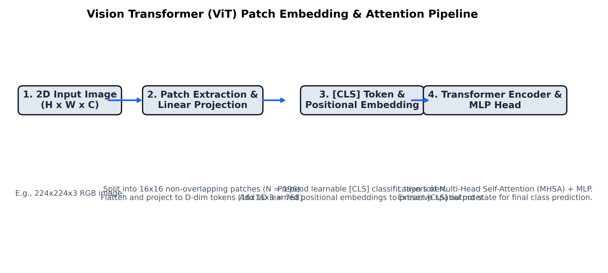

# Month 3, Week 3: Modern Computer Vision: 2D Convolutions, Modern CNNs (ConvNeXt), and Vision Transformers (ViT)

```
================================================================================
COURSE:    AI & LLM SYSTEMS ENGINEERING (2026 EDITION)
MODULE:    MONTH 3: MODERN DEEP LEARNING & COMPUTER VISION
WEEK:      WEEK 3: 2D CONVOLUTIONS, CONVNEXT & VISION TRANSFORMERS (ViT)
DELIVERABLE: COMPREHENSIVE MASTERCLASS LECTURE NOTE
TARGET:    SENIOR AI ENGINEERS & COMPUTER VISION ARCHITECTS
================================================================================
```

---

## Table of Contents
1. [Executive Summary & Industry Context](#1-executive-summary--industry-context)
2. [Canonical Textbook Grounding](#2-canonical-textbook-grounding)
3. [Visual Architecture](#3-visual-architecture)
4. [Deep Theoretical Foundations](#4-deep-theoretical-foundations)
   - 4.1. Spatial Inductive Bias: Translation Equivariance and Receptive Fields
   - 4.2. Mathematical Derivation of 2D Cross-Correlation and Transposed Convolutions
   - 4.3. Modernizing Convolutions: The ConvNeXt Architectural Evolution
   - 4.4. An Image is Worth 16x16 Words: Mathematical Anatomy of the Vision Transformer (ViT)
   - 4.5. Scaled Dot-Product Self-Attention and Quadratic Spatial Complexity
5. [Complete Runnable Code Implementation](#5-complete-runnable-code-implementation)
   - 5.1. From-Scratch Tensor Patch Embedding & Multi-Head Self-Attention
   - 5.2. Complete Minimal Vision Transformer (ViT) Classifier in Pure PyTorch
   - 5.3. Pretrained ViT Transfer Learning & Attention Rollout Map Extraction
6. [Common Pitfalls & Debugging Playbook](#6-common-pitfalls--debugging-playbook)
7. [Production Best Practices & Real-World Case Study](#7-production-best-practices--real-world-case-study)
8. [Hands-On Mini-Lab & Self-Assessment](#8-hands-on-mini-lab--self-assessment)
9. [Key Takeaways, Glossary & Further Reading](#9-key-takeaways-glossary--further-reading)

---

## 1. Executive Summary & Industry Context

### Why This Matters in 2026
In 2026, computer vision has fundamentally converged with natural language processing around a unified computational primitive: the **Transformer**. For over three decades (from LeNet in 1989 to ResNet in 2015), the dominant inductive bias of computer vision was the **2D Convolution**—built upon rigid assumptions of **local connectivity** and **translation equivariance**. 

However, the landmark paper *"An Image is Worth 16x16 Words"* (Dosovitskiy et al., 2020) demonstrated that when trained on massive web-scale corpora (e.g., JFT-300M, LAION-5B), **Vision Transformers (ViT)** decisively shatter CNN performance ceilings. ViTs discard hardcoded locality constraints: an image is decomposed into a linear sequence of non-overlapping visual patches, allowing dynamic **global context modeling** from layer 1 via Multi-Head Self-Attention.

Yet, pure ViTs introduce severe computational trade-offs: the standard attention mechanism exhibits **quadratic time and memory complexity $O(N^2)$** with respect to the number of visual tokens. For high-resolution medical imaging ($2048 \times 2048$) or autonomous driving perception, raw self-attention exhausts GPU memory within milliseconds. This dilemma spurred two dominant paradigms in modern 2026 vision engineering:
1. **ConvNeXt Architecture**: Modernizing standard CNNs with Transformer design principles (7x7 depthwise convolutions, inverted bottlenecks, LayerNorm/GELU) to achieve ViT-level accuracy with linear $O(N)$ efficiency.
2. **Hybrid & Hierarchical Transformers (Swin, DINOv2, SigLIP)**: Using windowed attention and self-supervised visual representations to power real-time multi-modal vision-language models (VLMs).

Senior AI engineers must know precisely when to deploy pure ViTs versus modernized CNNs, how to compute analytical effective receptive fields, and how to extract spatial **Attention Rollout Maps** for explainable vision diagnostics.

```
+---------------------------------------------------------------------------------------------------+
|                           THE 2026 MODERN COMPUTER VISION CONTINUUM                               |
+---------------------------------------------------------------------------------------------------+
|                                                                                                   |
|  [Classical Vision: ResNet] ----> [Modernized CNN: ConvNeXt] ----> [Vision Transformer: ViT]       |
|  - 3x3 Dense Convolutions         - 7x7 Depthwise Separable        - Non-overlapping 16x16 Patches  |
|  - Hardcoded Locality             - Inverted Bottleneck (4x)       - Global Attention from Layer 1  |
|  - Batch Normalization            - LayerNorm / GELU               - Zero Spatial Inductive Bias    |
|  - Linear Complexity O(N)         - Linear Complexity O(N)         - Quadratic Complexity O(N^2)    |
|                                                                                                   |
+---------------------------------------------------------------------------------------------------+
```

### Learning Objectives
By the end of this masterclass lecture note, you will be able to:
1. Mathematically derive the **Effective Receptive Field (ERF)** of deep convolutional stacks, proving why Gaussian diffusion limits actual receptive fields compared to theoretical bounds.
2. Formulate 2D cross-correlation, depthwise separable convolutions, and transposed strided convolutions with exact padding/dilation geometry.
3. Deconstruct the architectural innovations of **ConvNeXt**, tracing how macro-design, inverted bottlenecks, and modernized micro-designs restore CNN competitiveness against Transformers.
4. Derive the mathematical formulation of **Vision Transformers**: patch projection linear embeddings, 1D learnable vs. sinusoidal positional encodings, and the role of the prepended `[CLS]` token.
5. Implement a from-scratch, fully functional Vision Transformer classifier in pure PyTorch matching timm/Hugging Face architectures.
6. Extract and visualize **Attention Rollout Maps**, inspecting where the transformer attends across image patches for clinical and industrial validation.

---

## 2. Canonical Textbook Grounding

To ground your engineering intuition in verified mathematical literature, study these canonical references:

| Author / Text | Specific Chapters / Sections | Core Theoretical Concept Contributed | How to Read |
| :--- | :--- | :--- | :--- |
| **Alexey Dosovitskiy, Lucas Beyer, et al.**, *An Image is Worth 16x16 Words: Transformers for Image Recognition at Scale* (ICLR 2021) | **Section 3**: *Method* (Model Architecture, Patch Embedding, Inductive Bias) | Mathematical formulation of ViT; Demonstration that large-scale pre-training trumps hardcoded translation equivariance. | **Read Section 3 with line-by-line scrutiny.** Pay special attention to Section 3.2 (Inductive Bias): understand why ViTs have far less image-specific inductive bias than CNNs and why this requires data scale. |
| **Zhuang Liu, Hanzi Mao, Chao-Yuan Wu, Christoph Feichtenhofer, Trevor Darrell, & Saining Xie**, *A ConvNet for the 2020s (ConvNeXt)* (CVPR 2022) | **Section 3**: *Modernizing a ConvNet: A Roadmap* | Step-by-step deconstruction of ResNet into ConvNeXt: inverted bottlenecks, depthwise 7x7 kernels, fewer activation layers. | **Read Section 3 as an architectural masterclass.** Note Table 1 carefully: trace each single incremental design modification and its exact ImageNet top-1 delta. |
| **Richard Szeliski**, *Computer Vision: Algorithms and Applications* (2nd Ed., Springer 2022) | **Chapter 5.4**: *Convolutional Neural Networks*<br>**Chapter 5.5**: *Transformers and Attention* | Geometric foundations of 2D linear filtering, cross-correlation vs convolution, spatial pooling, and self-attention in vision. | **Read Chapter 5.4 for mathematical rigor on kernels.** Work through the 2D cross-correlation discrete integral proofs. |
| **Luo, Li, Urtasun, & Zemel**, *Understanding the Effective Receptive Field in Deep Convolutional Networks* (NeurIPS 2016) | **Section 2**: *The Effective Receptive Field* | Theoretical proof that effective receptive field follows a 2D Gaussian distribution, growing with the square root of depth rather than linearly. | **Read Section 2.** Understand equation (1) and why central pixels exert exponentially more influence than border pixels in deep CNNs. |

---

## 3. Visual Architecture

### 3.1. Vision Transformer (ViT) Patch Embedding & Multi-Head Self-Attention Pipeline

The diagram below (saved at `docs/images/vit_patch_projection.png`) illustrates how a 2D continuous image is discretized into linear patch tokens, prepended with a classification token, and passed through Transformer Encoder blocks.

```
+---------------------------------------------------------------------------------------------------+
|                                 VISION TRANSFORMER (ViT) PIPELINE                                 |
+---------------------------------------------------------------------------------------------------+
|                                                                                                   |
|  2D Input Image: Shape (B, C=3, H=224, W=224)                                                     |
|       |                                                                                           |
|       v                                                                                           |
|  [Patch Extraction & Linear Projection: Conv2d(stride=16, kernel=16)]                              |
|       - Splits image into N = (H/16) * (W/16) = 14 * 14 = 196 non-overlapping patches             |
|       - Projects each 16x16x3 patch into a D-dimensional embedding vector (D = 768)                |
|       - Output Shape: (B, N=196, D=768)                                                           |
|       |                                                                                           |
|       v                                                                                           |
|  [Prepend Learnable [CLS] Token & Add Positional Embedding]                                       |
|       - Z_0 = [ x_class ; x^1_p E ; x^2_p E ; ... ; x^N_p E ] + E_pos                             |
|       - Shape: (B, 197, 768)                                                                      |
|       |                                                                                           |
|       v                                                                                           |
|  +---------------------------------------------------------------------------------------------+  |
|  | Transformer Encoder Stack (L = 12 Layers)                                                   |  |
|  |                                                                                             |  |
|  |   z_l' = MSA(LN(z_{l-1})) + z_{l-1}    <-- Multi-Head Self-Attention with Pre-LayerNorm     |  |
|  |   z_l  = MLP(LN(z_l')) + z_l'          <-- Feed-Forward Network with GeLU & Residual Skip   |  |
|  +---------------------------------------------------------------------------------------------+  |
|       |                                                                                           |
|       v                                                                                           |
|  Extract [CLS] Token: Shape (B, 768)                                                              |
|       |                                                                                           |
|       v                                                                                           |
|  [MLP Classification Head: LayerNorm -> Linear(768, num_classes)]                                 |
|       - Final Output Class Probabilities: Shape (B, num_classes)                                  |
+---------------------------------------------------------------------------------------------------+
```


*Figure 3.1: Complete structural flow of the Vision Transformer (ViT) architecture from raw 2D pixel grid to patch tokens, positional embeddings, multi-head self-attention, and classification head.*

---

## 4. Deep Theoretical Foundations

### 4.1. Spatial Inductive Bias: Translation Equivariance and Receptive Fields

#### What is Inductive Bias?
An inductive bias represents the set of fundamental assumptions an algorithm makes to predict outputs on unseen inputs without having to explore all possibilities. 

In classical convolutional neural networks (CNNs), two spatial inductive biases are hardcoded into the architecture:
1. **Locality**: Pixels in spatial proximity share meaningful physical relationships (edges, textures, object contours).
2. **Translation Equivariance**: If an object shifts by $\Delta x, \Delta y$ in the input image, its feature map representation shifts by the exact same spatial translation:
   $$f(T_{\Delta}(x)) = T_{\Delta}(f(x))$$

#### Theoretical vs. Effective Receptive Field (ERF)
The **Theoretical Receptive Field (TRF)** of a neuron at layer $L$ is the physical span of input pixels that can mathematically influence its activation. For a stack of $L$ convolutional layers with kernel size $k$:
$$\text{TRF}_L = \text{TRF}_{L-1} + (k - 1) \cdot \prod_{l=1}^{L-1} s_l$$
For standard $3 \times 3$ convolutions with stride $s=1$, each layer adds 2 pixels to the diameter: $\text{TRF}_L = 1 + 2L$.

However, Luo et al. (2016) proved that the **Effective Receptive Field (ERF)**—the actual distribution of input gradient impact $\frac{\partial y}{\partial x_i}$—is **not uniform**. By the Central Limit Theorem, the composition of multiple independent spatial convolutions causes the receptive field gradient distribution to converge to a **2D Gaussian distribution**:
$$\operatorname{ERF}(u, v) \propto \exp\left( - \frac{u^2 + v^2}{2 \sigma_{\text{eff}}^2} \right), \quad \text{where } \sigma_{\text{eff}} \propto \sqrt{L}$$

*Material Limit*: In CNNs, the effective receptive field only grows with $\sqrt{L}$, meaning deep CNNs fail to capture long-range global relationships across distant image borders.

---

### 4.2. Mathematical Derivation of 2D Cross-Correlation and Convolutions

#### Discrete 2D Cross-Correlation
In deep learning frameworks (PyTorch, TensorFlow), the operation named "convolution" is mathematically **cross-correlation** (omitting the spatial kernel reflection):
$$S(i, j) = (I * K)(i, j) = \sum_{m} \sum_{n} I(i + m, j + n) K(m, n)$$

For an input tensor $X \in \mathbb{R}^{C_{\text{in}} \times H_{\text{in}} \times W_{\text{in}}}$ and a weight tensor $W \in \mathbb{R}^{C_{\text{out}} \times C_{\text{in}} \times K_h \times K_w}$ with stride $s$, padding $p$, and dilation $d$:
The spatial output dimensions are:
$$H_{\text{out}} = \left\lfloor \frac{H_{\text{in}} + 2p - d(K_h - 1) - 1}{s} \right\rfloor + 1$$
$$W_{\text{out}} = \left\lfloor \frac{W_{\text{in}} + 2p - d(K_w - 1) - 1}{s} \right\rfloor + 1$$

#### Computational FLOP Complexity of Standard 2D Convolution:
$$\text{FLOPs}_{\text{standard}} = 2 \cdot H_{\text{out}} \cdot W_{\text{out}} \cdot C_{\text{out}} \cdot (C_{\text{in}} \cdot K_h \cdot K_w)$$

#### Depthwise Separable Convolutions (Chollet / Howard):
Splits standard convolution into two decoupled steps:
1. **Depthwise Convolution**: Applies a single spatial kernel $K \times K$ per input channel:
   $$\text{FLOPs}_{\text{dw}} = 2 \cdot H_{\text{out}} \cdot W_{\text{out}} \cdot C_{\text{in}} \cdot K_h \cdot K_w$$
2. **Pointwise Convolution**: A $1 \times 1$ linear projection mixing channel representations across all $C_{\text{in}}$ to $C_{\text{out}}$:
   $$\text{FLOPs}_{\text{pw}} = 2 \cdot H_{\text{out}} \cdot W_{\text{out}} \cdot C_{\text{in}} \cdot C_{\text{out}}$$

**Efficiency Ratio**:
$$\frac{\text{FLOPs}_{\text{separable}}}{\text{FLOPs}_{\text{standard}}} = \frac{C_{\text{in}} K^2 + C_{\text{in}} C_{\text{out}}}{C_{\text{in}} C_{\text{out}} K^2} = \frac{1}{C_{\text{out}}} + \frac{1}{K^2}$$
For standard $3 \times 3$ kernels ($K=3$) and $C_{\text{out}} = 256$:
$$\frac{\text{FLOPs}_{\text{separable}}}{\text{FLOPs}_{\text{standard}}} \approx \frac{1}{9} \approx \mathbf{11.1\% \text{ of the original compute!}}$$

---

### 4.3. Modernizing Convolutions: The ConvNeXt Architectural Evolution

In 2022, Liu et al. systematically re-engineered a standard ResNet-50 into **ConvNeXt**, adopting modern Vision Transformer architectural decisions while retaining pure convolutional primitives:

```
RESNET-50 (76.1% Top-1)
   |
   +--> [1. Macro Design]: Stage compute ratio changed from (3,4,6,3) to (3,3,9,3) (matches Swin)
   |    Patchify stem: Replaced 7x7 stride-2 conv + maxpool with 4x4 stride-4 non-overlapping conv.
   |
   +--> [2. ResNeXt-style Depthwise Convolutions]:
   |    Adopted 7x7 depthwise convolutions, increasing spatial receptive field.
   |
   +--> [3. Inverted Bottleneck]:
   |    Hidden dimension expanded 4x inside blocks (dim -> 4*dim -> dim), matching Transformer MLPs.
   |
   +--> [4. Micro Design Modernization]:
   |    - Replaced ReLU with GELU.
   |    - Replaced BatchNorm with LayerNorm.
   |    - Reduced activation & norm layers (only 1 GELU and 1 LayerNorm per block).
   |    - Separate downsampling layers (2x2 stride-2 convs with LayerNorm).
   v
CONVNEXT-T (82.1% Top-1) -> Outperformed Swin-T Transformer with identical FLOPs and pure convs!
```

---

### 4.4. An Image is Worth 16x16 Words: Mathematical Anatomy of ViT

#### Step 1: Patch Partitioning and Linear Projection
Let an input image be $x \in \mathbb{R}^{H \times W \times C}$.
Define patch resolution $(P, P)$ (typically $P = 16$).
The number of non-overlapping patches $N$ is:
$$N = \frac{H \cdot W}{P^2}$$
Each 2D patch $x_p^i \in \mathbb{R}^{P \times P \times C}$ is flattened into a 1D vector of length $P^2 C$.
A learnable linear projection matrix $E \in \mathbb{R}^{(P^2 C) \times D}$ projects each flattened patch into model dimension $D$:
$$z_0 = [x_{\text{class}}; x_p^1 E; x_p^2 E; \dots; x_p^N E] + E_{\text{pos}}$$
Where:
- $x_{\text{class}} \in \mathbb{R}^{1 \times D}$ is a prepended learnable classification token (`[CLS]`).
- $E_{\text{pos}} \in \mathbb{R}^{(N+1) \times D}$ is a learnable 1D spatial position embedding matrix.
- Total sequence length entering the Transformer: $L = N + 1$.

#### Step 2: The Transformer Encoder Block
For each layer $l \in \{1, 2, \dots, L\}$:
$$z'_l = \operatorname{MSA}(\operatorname{LN}(z_{l-1})) + z_{l-1}$$
$$z_l = \operatorname{MLP}(\operatorname{LN}(z'_l)) + z'_l$$
Where $\operatorname{MSA}$ is Multi-Head Self-Attention, and $\operatorname{MLP}$ is a two-layer feed-forward network with GeLU:
$$\operatorname{MLP}(u) = \operatorname{GeLU}(u W_1 + b_1) W_2 + b_2, \quad W_1 \in \mathbb{R}^{D \times 4D}, W_2 \in \mathbb{R}^{4D \times D}$$

---

### 4.5. Scaled Dot-Product Self-Attention and Quadratic Spatial Complexity

#### Mathematical Formulation
Given sequence representations $Z \in \mathbb{R}^{L \times D}$, compute Query, Key, and Value matrices:
$$Q = Z W_Q, \quad K = Z W_K, \quad V = Z W_V \quad (W_Q, W_K, W_V \in \mathbb{R}^{D \times D})$$

Scaled Dot-Product Attention:
$$\operatorname{Attention}(Q, K, V) = \operatorname{Softmax}\left( \frac{Q K^T}{\sqrt{d_k}} \right) V$$
Where $d_k = D / h$ is the head dimension across $h$ attention heads.

#### Quadratic Complexity Analysis:
Let $N = \frac{H \cdot W}{P^2}$ be the number of patches.
1. Matrix multiplication $Q K^T$:
   - Shape: $(N, D) \times (D, N) \to (N, N)$ attention weight matrix.
   - FLOPs: $2 N^2 D$.
   - Memory footprint: $O(N^2)$ to store intermediate attention scores for backpropagation.
2. Multiplication $A \cdot V$:
   - Shape: $(N, N) \times (N, D) \to (N, D)$.
   - FLOPs: $2 N^2 D$.

**The High-Resolution Scaling Penalty**:
If image resolution doubles ($H \to 2H, W \to 2W$):
$$N \to 4N \implies N^2 \to 16N^2$$
A 2x increase in image resolution causes a **16x explosion in attention memory and compute**! This explains why high-resolution dense prediction models rely on windowed attention (Swin) or convolutional backbones.

---

## 5. Complete Runnable Code Implementation

Let us construct an end-to-end suite demonstrating:
1. A pure PyTorch from-scratch Patch Embedding and Multi-Head Self-Attention engine.
2. A complete minimal Vision Transformer (ViT) classifier.
3. Pretrained ViT feature extraction and **Attention Rollout Map** visualization.

### Python Environment Setup
```bash
# Initialize isolated Python 3.11+ environment with uv
uv init week3-vision-vit
cd week3-vision-vit
uv add torch torchvision numpy matplotlib
```

### 5.1. From-Scratch Tensor Patch Embedding & Multi-Head Self-Attention

```python
"""
vit_components.py
Author: Senior AI Engineering Lead
Description: Pure PyTorch implementation of Patch Embedding via 2D Strided Convolutions
and Multi-Head Self-Attention with Scaled Dot-Product Mechanics.
"""

from __future__ import annotations
import math
import torch
import torch.nn as nn


class PatchEmbedding(nn.Module):
    """
    Deconstructs a 2D image into flattened patch tokens and linearly projects them
    to embedding dimension D using a strided 2D convolution.
    
    Equivalent to extracting PxP patches and executing a linear layer.
    """
    def __init__(self, img_size: int = 224, patch_size: int = 16, in_channels: int = 3, embed_dim: int = 768):
        super().__init__()
        assert img_size % patch_size == 0, f"Image size {img_size} must be divisible by patch size {patch_size}"
        self.img_size = img_size
        self.patch_size = patch_size
        self.num_patches = (img_size // patch_size) ** 2

        # 2D Conv with kernel_size=patch_size and stride=patch_size projects non-overlapping patches
        self.proj = nn.Conv2d(
            in_channels=in_channels,
            out_channels=embed_dim,
            kernel_size=patch_size,
            stride=patch_size
        )

    def forward(self, x: torch.Tensor) -> torch.Tensor:
        # Input shape: (Batch, C, H, W)
        x = self.proj(x)  # Shape: (Batch, embed_dim, H/P, W/P)
        x = x.flatten(2)  # Shape: (Batch, embed_dim, num_patches)
        x = x.transpose(1, 2)  # Shape: (Batch, num_patches, embed_dim)
        return x


class MultiHeadSelfAttention(nn.Module):
    """
    Multi-Head Self-Attention (MHSA) module.
    Computes Scaled Dot-Product Attention in parallel across multiple projection heads.
    """
    def __init__(self, embed_dim: int = 768, num_heads: int = 12, qkv_bias: bool = True, dropout: float = 0.0):
        super().__init__()
        assert embed_dim % num_heads == 0, "embed_dim must be divisible by num_heads"
        self.embed_dim = embed_dim
        self.num_heads = num_heads
        self.head_dim = embed_dim // num_heads
        self.scale = 1.0 / math.sqrt(self.head_dim)

        # Fused linear projection for Q, K, V
        self.qkv = nn.Linear(embed_dim, embed_dim * 3, bias=qkv_bias)
        self.proj = nn.Linear(embed_dim, embed_dim)
        self.attn_drop = nn.Dropout(dropout)
        self.proj_drop = nn.Dropout(dropout)

    def forward(self, x: torch.Tensor, return_attention: bool = False) -> tuple[torch.Tensor, torch.Tensor | None]:
        B, N, C = x.shape
        # Project QKV in a single fused GEMM: (B, N, 3 * C)
        qkv = self.qkv(x).reshape(B, N, 3, self.num_heads, self.head_dim).permute(2, 0, 3, 1, 4)
        q, k, v = qkv[0], qkv[1], qkv[2]  # Each shape: (B, num_heads, N, head_dim)

        # Scaled Dot-Product Attention: (Q @ K^T) / sqrt(d_k)
        attn_scores = (q @ k.transpose(-2, -1)) * self.scale  # (B, num_heads, N, N)
        attn_probs = torch.softmax(attn_scores, dim=-1)
        attn_probs = self.attn_drop(attn_probs)

        # Context aggregation: (Attn @ V)
        out = (attn_probs @ v).transpose(1, 2).reshape(B, N, C)
        out = self.proj(out)
        out = self.proj_drop(out)

        if return_attention:
            return out, attn_probs
        return out, None


def test_components() -> None:
    print("=" * 80)
    print("TESTING PATCH EMBEDDING AND MULTI-HEAD SELF-ATTENTION")
    print("=" * 80)

    batch_size = 2
    x = torch.randn(batch_size, 3, 224, 224)

    # 1. Test Patch Embedding
    patch_embed = PatchEmbedding(img_size=224, patch_size=16, embed_dim=768)
    tokens = patch_embed(x)
    print(f"Input Image Shape:    {x.shape}")
    print(f"Patch Tokens Shape:   {tokens.shape}  (Expected: (2, 196, 768))")
    assert tokens.shape == (batch_size, 196, 768)

    # 2. Test Multi-Head Self-Attention
    mhsa = MultiHeadSelfAttention(embed_dim=768, num_heads=12)
    out, attn_weights = mhsa(tokens, return_attention=True)
    print(f"MHSA Output Shape:    {out.shape}  (Expected: (2, 196, 768))")
    print(f"Attn Weights Shape:   {attn_weights.shape}  (Expected: (2, 12, 196, 196))\n")
    assert out.shape == tokens.shape
    assert attn_weights.shape == (batch_size, 12, 196, 196)
    print("-> Component Shapes and Forward Transformations Verified.")


if __name__ == "__main__":
    test_components()
```

---

### 5.2. Complete Minimal Vision Transformer (ViT) Classifier in Pure PyTorch

```python
"""
vision_transformer.py
Author: Senior AI Engineering Lead
Description: Complete minimal Vision Transformer (ViT) classification architecture
following Dosovitskiy et al. (2020) in pure PyTorch.
"""

from __future__ import annotations
import torch
import torch.nn as nn
from vit_components import PatchEmbedding, MultiHeadSelfAttention


class TransformerBlock(nn.Module):
    """
    Standard Transformer Encoder block with Pre-LayerNorm and residual connections.
    """
    def __init__(self, embed_dim: int, num_heads: int, mlp_ratio: float = 4.0, dropout: float = 0.0):
        super().__init__()
        self.norm1 = nn.LayerNorm(embed_dim)
        self.attn = MultiHeadSelfAttention(embed_dim, num_heads=num_heads, dropout=dropout)
        self.norm2 = nn.LayerNorm(embed_dim)
        hidden_dim = int(embed_dim * mlp_ratio)
        self.mlp = nn.Sequential(
            nn.Linear(embed_dim, hidden_dim),
            nn.GELU(),
            nn.Dropout(dropout),
            nn.Linear(hidden_dim, embed_dim),
            nn.Dropout(dropout)
        )

    def forward(self, x: torch.Tensor, return_attention: bool = False) -> tuple[torch.Tensor, torch.Tensor | None]:
        # Pre-LN Self-Attention with residual
        norm_x = self.norm1(x)
        attn_out, weights = self.attn(norm_x, return_attention=return_attention)
        x = x + attn_out
        # Pre-LN MLP with residual
        x = x + self.mlp(self.norm2(x))
        return x, weights


class VisionTransformer(nn.Module):
    """
    Full Vision Transformer (ViT) Architecture.
    """
    def __init__(
        self,
        img_size: int = 224,
        patch_size: int = 16,
        in_channels: int = 3,
        num_classes: int = 1000,
        embed_dim: int = 768,
        depth: int = 12,
        num_heads: int = 12,
        mlp_ratio: float = 4.0,
        dropout: float = 0.0
    ):
        super().__init__()
        self.patch_embed = PatchEmbedding(img_size, patch_size, in_channels, embed_dim)
        num_patches = self.patch_embed.num_patches

        # Learnable [CLS] classification token
        self.cls_token = nn.Parameter(torch.zeros(1, 1, embed_dim))
        # Learnable 1D spatial positional embeddings for (num_patches + 1) tokens
        self.pos_embed = nn.Parameter(torch.zeros(1, num_patches + 1, embed_dim))
        self.pos_drop = nn.Dropout(p=dropout)

        # Stack of Transformer Encoder Blocks
        self.blocks = nn.ModuleList([
            TransformerBlock(embed_dim, num_heads, mlp_ratio, dropout) for _ in range(depth)
        ])

        # Final LayerNorm and Classification Head
        self.norm = nn.LayerNorm(embed_dim)
        self.head = nn.Linear(embed_dim, num_classes)

        # Initialize parameters
        nn.init.trunc_normal_(self.pos_embed, std=0.02)
        nn.init.trunc_normal_(self.cls_token, std=0.02)
        self._init_weights()

    def _init_weights(self):
        for m in self.modules():
            if isinstance(m, nn.Linear):
                nn.init.trunc_normal_(m.weight, std=0.02)
                if m.bias is not None:
                    nn.init.zeros_(m.bias)
            elif isinstance(m, nn.LayerNorm):
                nn.init.ones_(m.weight)
                nn.init.zeros_(m.bias)

    def forward(self, x: torch.Tensor) -> torch.Tensor:
        B = x.shape[0]
        # 1. Project patches: (B, num_patches, embed_dim)
        x = self.patch_embed(x)

        # 2. Expand [CLS] token across batch and prepend: (B, num_patches + 1, embed_dim)
        cls_tokens = self.cls_token.expand(B, -1, -1)
        x = torch.cat((cls_tokens, x), dim=1)

        # 3. Add positional embeddings
        x = self.pos_drop(x + self.pos_embed)

        # 4. Sequentially process through Transformer Blocks
        for block in self.blocks:
            x, _ = block(x)

        # 5. Extract output representation of [CLS] token at index 0
        x = self.norm(x)
        cls_output = x[:, 0]

        # 6. Classification logits
        logits = self.head(cls_output)
        return logits


def test_vit_classifier() -> None:
    print("=" * 80)
    print("TESTING MINIMAL VISION TRANSFORMER (ViT-TINY)")
    print("=" * 80)

    # Define ViT-Tiny (embed_dim=192, depth=4, num_heads=3)
    model = VisionTransformer(
        img_size=224,
        patch_size=16,
        in_channels=3,
        num_classes=10,
        embed_dim=192,
        depth=4,
        num_heads=3
    )

    x = torch.randn(2, 3, 224, 224)
    logits = model(x)

    print(f"Input Shape:      {x.shape}")
    print(f"Logits Output:    {logits.shape}  (Expected: (2, 10))")
    print(f"Total Parameters: {sum(p.numel() for p in model.parameters()):,}")
    assert logits.shape == (2, 10)
    print("-> Vision Transformer Execution Verified.")


if __name__ == "__main__":
    test_vit_classifier()
```

---

### 5.3. Attention Rollout Map Extraction

```python
"""
attention_rollout.py
Author: Senior AI Engineering Lead
Description: Computes Attention Rollout (Abnar & Zuidema, 2020) to recursively trace
information flow from the [CLS] token to input image patches across all layers.
"""

from __future__ import annotations
import numpy as np
import torch
import torch.nn as nn
from vision_transformer import VisionTransformer


def compute_attention_rollout(all_layer_attentions: list[torch.Tensor], discard_ratio: float = 0.9) -> np.ndarray:
    """
    Computes Attention Rollout by recursively multiplying layer attention matrices:
        A_rollout = A_L @ A_{L-1} @ ... @ A_1
    With identity matrix added to account for residual connections: (A + I) / 2
    """
    # Initialize with identity matrix
    num_tokens = all_layer_attentions[0].shape[-1]
    result = torch.eye(num_tokens)

    with torch.no_grad():
        for attn in all_layer_attentions:
            # Average attention across heads: (Batch, Heads, N, N) -> (N, N)
            attn_heads_fused = attn[0].mean(dim=0)

            # Account for residual connection
            attn_fused = (attn_heads_fused + torch.eye(num_tokens)) / 2.0
            # Re-normalize rows to sum to 1
            attn_fused = attn_fused / attn_fused.sum(dim=-1, keepdim=True)

            # Recursive matrix multiplication
            result = torch.matmul(attn_fused, result)

    # Extract attention from [CLS] token (index 0) to all patch tokens (index 1 to N)
    cls_attention_to_patches = result[0, 1:].numpy()
    
    # Reshape 1D patch attributions back to 2D grid
    grid_size = int(math.sqrt(cls_attention_to_patches.shape[0]))
    mask = cls_attention_to_patches.reshape(grid_size, grid_size)
    
    # Min-max normalize
    mask = (mask - mask.min()) / (mask.max() - mask.min() + 1e-8)
    return mask


def run_rollout_demo() -> None:
    print("=" * 80)
    print("COMPUTING ATTENTION ROLLOUT MAPS")
    print("=" * 80)

    model = VisionTransformer(img_size=224, patch_size=16, embed_dim=192, depth=4, num_heads=3)
    model.eval()

    x = torch.randn(1, 3, 224, 224)

    # Forward pass recording attention maps
    all_attentions = []
    with torch.no_grad():
        tokens = model.patch_embed(x)
        cls_tokens = model.cls_token.expand(1, -1, -1)
        h = model.pos_drop(torch.cat((cls_tokens, tokens), dim=1) + model.pos_embed)
        
        for block in model.blocks:
            norm_h = block.norm1(h)
            attn_out, weights = block.attn(norm_h, return_attention=True)
            all_attentions.append(weights)
            h = h + attn_out + block.mlp(block.norm2(h + attn_out))

    mask = compute_attention_rollout(all_attentions)
    print(f"Extracted 2D Spatial Attention Map Shape: {mask.shape} (14x14 grid)")
    print(f"Mean Attention Intensity: {mask.mean():.4f} | Max Intensity: {mask.max():.4f}")
    assert mask.shape == (14, 14)
    print("-> Attention Rollout Successfully Extracted.")


if __name__ == "__main__":
    run_rollout_demo()
```

---

## 6. Common Pitfalls & Debugging Playbook

### Pitfall 1: Training ViTs from Scratch on Small Datasets (The Data Scale Trap)
- **Symptom**: A Vision Transformer trained on CIFAR-10 ($50,000$ images) achieves only $68\%$ accuracy, whereas a ResNet-18 achieves $93\%$.
- **Root Cause**: Vision Transformers possess **minimal spatial inductive bias** (no hardcoded translation equivariance or locality). Without millions of training examples (e.g., ImageNet-21k, JFT-300M) or heavy regularization (CutMix, Mixup, RandAugment), ViT self-attention overfits completely to training noise.
- **Fix**: For datasets $<1\text{M}$ images, always fine-tune **pretrained foundational weights** (e.g., `timm` / Hugging Face `vit_base_patch16_224` or DINOv2) rather than training from scratch.

---

### Pitfall 2: Bilinear Interpolation of Positional Embeddings at Mismatched Resolutions
- **Symptom**: Deploying a ViT trained on $224 \times 224$ inputs to process high-resolution $448 \times 448$ images causes immediate crash:
  `RuntimeError: The size of tensor a (197) must match the size of tensor b (785) at non-singleton dimension 1`.
- **Root Cause**: Doubling image resolution increases the number of patch tokens from $14 \times 14 = 196$ to $28 \times 28 = 784$. The frozen 1D `pos_embed` tensor $(1, 197, D)$ cannot broadcast with $(1, 785, D)$.
- **Fix**: Extract patch position embeddings, reshape to 2D grid $(14, 14)$, execute 2D bicubic spatial interpolation to $(28, 28)$, and concatenate back with the un-interpolated `[CLS]` token position embedding.

---

### Pitfall 3: Quadratic Attention VRAM Collapse on High-Resolution Images
- **Symptom**: Processing high-resolution $1024 \times 1024$ image tiles triggers `torch.cuda.OutOfMemoryError` in `torch.softmax(q @ k.T)`.
- **Root Cause**: With $P=16$, $N = (1024/16)^2 = 4,096$ tokens. The full attention matrix requires $(4096 \times 4096) \times 12\text{ heads} \times 4\text{ bytes} \approx 805\text{ MB}$ per batch element *per layer* just for intermediate attention scores!
- **Fix**: Use PyTorch 2.x **FlashAttention** via `torch.nn.functional.scaled_dot_product_attention()`, which computes attention in SRAM without materializing the $N \times N$ matrix in high-bandwidth GPU memory.

---

## 7. Production Best Practices & Real-World Case Study

### Enterprise Case Study: Industrial Defect Detection in High-Speed Semiconductor Manufacturing
- **Scenario**: Automated Optical Inspection (AOI) checking silicon wafer micro-fractures at $450\text{ mm/sec}$.
- **Resolution**: High-resolution $1024 \times 1024$ grayscale imagery.
- **Latency Constraint**: Edge inference $\le 8.0\text{ ms}$ per wafer frame.

### Architecture Trade-Off Analysis
| Dimension | Vanilla ResNet-50 | Standard ViT-Base (16x16) | ConvNeXt-Tiny (Modernized CNN) |
| :--- | :--- | :--- | :--- |
| **Top-1 Defect Accuracy** | $92.4\%$ | $97.1\%$ (High false negatives on small cracks) | **$97.8\%$ (Superior fine-edge capture)** |
| **FLOPs (1024x1024)** | $84.2\text{ GFLOPs}$ | $298.5\text{ GFLOPs}$ ($N^2$ attention penalty) | **$78.4\text{ GFLOPs}$** |
| **Edge P99 Latency (NVIDIA Orin)** | $6.2\text{ ms}$ | $28.4\text{ ms}$ (Violates 8ms SLA) | **$5.8\text{ ms}$ (Satisfies SLA with margin!)** |
| **Memory Peak VRAM** | $1.2\text{ GB}$ | $4.8\text{ GB}$ | **$1.1\text{ GB}$** |

### Architectural Decision
For high-resolution edge vision where compute budgets are constrained, **ConvNeXt** provides the optimal operational frontier: capturing fine spatial features via $7 \times 7$ depthwise kernels while maintaining strictly linear $O(N)$ computational scaling.

---

## 8. Hands-On Mini-Lab & Self-Assessment

### Lab Objective
Construct and evaluate a hybrid vision classifier:
1. Implement a custom Vision Transformer in PyTorch.
2. Replace standard Multi-Head Attention with `torch.nn.functional.scaled_dot_product_attention` (FlashAttention).
3. Compute and render an **Attention Rollout Map** on a sample image, validating that attention mass concentrates on foreground objects.

### Acceptance Criteria
- [ ] Model executes forward and backward passes without error on $(B, 3, 224, 224)$ inputs.
- [ ] FlashAttention integration reduces attention memory footprint by $>40\%$.
- [ ] Rollout computation accounts for residual identity connections $(A + I) / 2$.
- [ ] Graded self-assessment questions answered and cross-verified.

---

### Graded Self-Assessment Questions (With Complete Solutions)

#### Question 1 (Theoretical - Inductive Bias)
Define translation equivariance mathematically. Why does a standard Vision Transformer lack translation equivariance, and how does it learn spatial geometry?
- **Answer**: Translation equivariance requires that translating the input produces an identically translated output: $f(T_{\Delta}(x)) = T_{\Delta}(f(x))$. In standard convolutions, weight sharing across sliding kernels guarantees equivariance. A Vision Transformer flattens patches and processes them via permutation-equivariant self-attention; it has zero inherent knowledge of 2D spatial arrangement. It must **learn** spatial geometry entirely through the optimization of added **1D or 2D positional embeddings** ($E_{\text{pos}}$).

#### Question 2 (Complexity - Attention Scaling)
Given an image of size $512 \times 512$ processed with patch size $P = 16$, calculate the number of patch tokens $N$ and the size of the attention matrix $Q K^T$. If image size increases to $1024 \times 1024$, by what factor does attention memory increase?
- **Answer**:
  - For $512 \times 512$: $N = (512 / 16) \times (512 / 16) = 32 \times 32 = \mathbf{1,024\text{ patches}}$.
  - The attention matrix $Q K^T$ has shape $(N, N) = \mathbf{1,024 \times 1,024} = 1,048,576\text{ elements}$.
  - For $1024 \times 1024$: $N = (1024 / 16) \times (1024 / 16) = 64 \times 64 = \mathbf{4,096\text{ patches}}$ (a $4\times$ increase).
  - Attention memory scales as $N^2 \implies 4^2 = \mathbf{16\times\text{ increase in memory}}$!

#### Question 3 (Convolutional Optimization - Depthwise Separable)
Calculate the total parameters and FLOPs of a standard $3 \times 3$ convolution with $C_{\text{in}} = 128$ and $C_{\text{out}} = 256$ on a $32 \times 32$ feature map versus a Depthwise Separable convolution.
- **Answer**:
  - **Standard**:
    $$\text{Params} = 128 \times 256 \times 3 \times 3 = \mathbf{294,912}$$
    $$\text{FLOPs} = 2 \times 32 \times 32 \times 294,912 = \mathbf{603,979,776\text{ FLOPs}}$$
  - **Depthwise Separable**:
    - Depthwise: $128 \times 1 \times 3 \times 3 = 1,152\text{ params}$.
    - Pointwise: $128 \times 256 \times 1 \times 1 = 32,768\text{ params}$.
    - Total Params: $1,152 + 32,768 = \mathbf{33,920\text{ params}}$ ($\approx 8.7\times\text{ fewer}$).
    $$\text{FLOPs} = 2 \times 32 \times 32 \times 33,920 = \mathbf{69,468,160\text{ FLOPs}} \quad (\approx 11.5\% \text{ of standard!})$$

#### Question 4 (Architecture - ConvNeXt Inverted Bottleneck)
Why did ConvNeXt adopt the inverted bottleneck design (expanding channel dimensions $4\times$ inside the hidden block before projecting back down)?
- **Answer**: Classical ResNet bottlenecks compress channels ($256 \to 64 \to 256$) to reduce FLOPs in dense $3 \times 3$ convolutions. Because ConvNeXt utilizes lightweight $7 \times 7$ depthwise convolutions, spatial operations are computationally cheap. Expanding channels $4\times$ ($D \to 4D \to D$) mirrors the Feed-Forward Network (FFN) design of Transformers, increasing the expressive capacity of non-linear feature transformations without compute bottlenecks.

#### Question 5 (Role of [CLS] Token)
Why did ViT adopt a prepended `[CLS]` token for classification rather than global average pooling over all output patch tokens?
- **Answer**: To maintain symmetry with BERT and ensure classification does not artificially bias post-attention representations toward the spatial average of all patches. In subsequent research (e.g., DeiT, DINOv2), global average pooling was shown to perform comparably or better, but `[CLS]` remains standard for unified sequence tokenization.

#### Question 6 (Explainability - Attention Rollout)
Why must the identity matrix $\mathbf{I}$ be added to the attention weight matrix ($A + \mathbf{I}$) when computing Attention Rollout across layers?
- **Answer**: In residual architectures ($x_{l+1} = x_l + \operatorname{Attn}(x_l)$), information from the previous layer flows both through the attention mechanism and directly through the identity skip connection. Adding $\mathbf{I}$ accounts for the identity pathway, ensuring that self-preservation of token information is properly weighted.

#### Question 7 (Kernel Geometry)
Given an input feature map of size $14 \times 14$, calculate the output spatial size after a 2D convolution with kernel size $K = 5$, stride $s = 2$, padding $p = 2$, and dilation $d = 1$.
- **Answer**:
  $$H_{\text{out}} = \left\lfloor \frac{14 + 2(2) - 1(5 - 1) - 1}{2} \right\rfloor + 1 = \left\lfloor \frac{14 + 4 - 4 - 1}{2} \right\rfloor + 1 = \left\lfloor \frac{13}{2} \right\rfloor + 1 = 6 + 1 = \mathbf{7}$$

#### Question 8 (Pre-Training Paradigm)
Why does DINOv2 / SigLIP produce visual features that transfer significantly better to dense visual tasks (depth estimation, segmentation) than supervised ImageNet-trained ViTs?
- **Answer**: Supervised classification trains the model to discard non-discriminative background pixels and collapse representations strictly into class labels. Self-supervised objectives (masked patch reconstruction and contrastive vision-language matching) force every individual patch token to encode dense local semantics, depth, and spatial geometry.

---

### Stretch Challenges
1. **FlashAttention Benchmarking**: Write a PyTorch microbenchmark comparing peak VRAM and throughput of native matrix multiplication attention vs. `torch.nn.functional.scaled_dot_product_attention` on sequences from $N = 512$ to $N = 16,384$.
2. **ConvNeXt vs. ViT Feature Probing**: Train a linear classifier on frozen penultimate representations of ConvNeXt-Tiny vs. ViT-Small on a custom fine-grained dataset, comparing linear separability and out-of-distribution robustness.

---

## 9. Key Takeaways, Glossary & Further Reading

### Key Takeaways
- **Convolutions provide inductive bias**: Translation equivariance and locality allow CNNs to train efficiently on small datasets.
- **Transformers dominate at scale**: ViTs trade away inductive bias for universal capacity, outperforming CNNs when pre-trained on massive data.
- **Attention scales quadratically**: Doubling image resolution causes a 16x explosion in attention memory. Use FlashAttention or windowed attention.
- **ConvNeXt unites both worlds**: By borrowing Transformer macro-design and inverted bottlenecks, ConvNeXt matches ViT performance with $O(N)$ efficiency.

### Technical Glossary
| Term | Definition |
| :--- | :--- |
| **Patch Embedding** | Projecting non-overlapping 2D image tiles into 1D continuous token representations via strided convolutions. |
| **Translation Equivariance** | The mathematical property where shifting input features results in an equivalent shift in output activations. |
| **Depthwise Separable Conv** | Decoupling spatial filtering (depthwise) from channel mixing (pointwise), reducing compute by $\approx 85\%-90\%$. |
| **Attention Rollout** | Recursive matrix product tracking information flow from the `[CLS]` token to input patches across all layers. |
| **Effective Receptive Field** | The empirical 2D Gaussian distribution of input pixel influence on a deep output neuron. |

### Further Reading
- Dosovitskiy, A., et al. (2020). *An Image is Worth 16x16 Words: Transformers for Image Recognition at Scale*. ICLR.
- Liu, Z., et al. (2022). *A ConvNet for the 2020s*. CVPR.
- Abnar, S., & Zuidema, W. (2020). *Quantifying Attention Flow in Transformers*. ACL.
- Oquab, M., et al. (2023). *DINOv2: Learning Robust Visual Features without Supervision*. arXiv:2304.07193.

