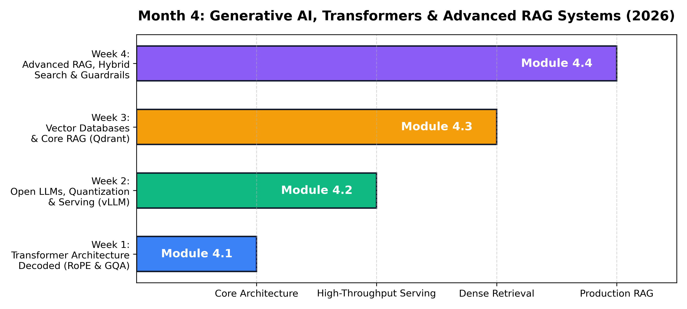
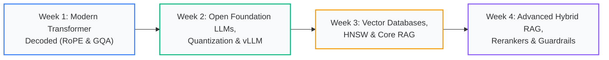

# Month 4: Generative AI, Transformers & Production RAG Systems (2026 Edition)

```
================================================================================
MODULE OVERVIEW: MONTH 4
FOCUS:           MODERN TRANSFORMERS, HIGH-THROUGHPUT SERVING & ENTERPRISE RAG
TOOLS:           PYTORCH 2.X, VLLM, QDRANT, TRANSFORMERS, SENTENCE-TRANSFORMERS, RAGAS
TARGET LEVEL:    SENIOR AI ENGINEER & LLM INFRASTRUCTURE ARCHITECT
================================================================================
```



## Curriculum Architecture



---

## Weekly Masterclass Index

| Week | Lecture Note & Masterclass | Core Theoretical Focus | Modern Toolchain | Key Architecture / Visual |
| :--- | :--- | :--- | :--- | :--- |
| **Week 1** | [Transformer Architecture Decoded: RoPE, SwiGLU & GQA](Week_1/lecture_notes/Week1_Transformer_Architecture_Decoded.md) | Modern Decoder Stack, RoPE Relative Invariance Proof, SwiGLU Gating, GQA Memory Sizing, KV-Cache Dynamics | `torch`, `numpy` | [RoPE Complex Plane Rotation](../docs/images/rope_complex_rotation.png) |
| **Week 2** | [Open LLMs, Quantization & vLLM High-Throughput Serving](Week_2/lecture_notes/Week2_Open_LLMs_Quantization_and_Serving.md) | Roofline Model & Arithmetic Intensity, Symmetric vs Asymmetric Affine Mapping, AWQ/GPTQ, PagedAttention Virtual Memory | `vllm`, `torch`, `numpy` | [PagedAttention Virtual Memory](../docs/images/paged_attention_blocks.png) |
| **Week 3** | [Vector Databases, HNSW Indexing & Core RAG Systems](Week_3/lecture_notes/Week3_Vector_Databases_and_Core_RAG.md) | Metric Spaces, Normalization Theorem, Curse of Dimensionality, HNSW Skip-Graph Routing, Product Quantization | `qdrant-client`, `numpy` | [HNSW Graph Layers](../docs/images/hnsw_graph_layers.png) |
| **Week 4** | [Advanced RAG: Hybrid Search, Re-Ranking & Guardrails](Week_4/lecture_notes/Week4_Advanced_RAG_Hybrid_Search_and_Guardrails.md) | Probabilistic BM25, Reciprocal Rank Fusion (RRF), Cross-Encoder Attention vs Bi-Encoders, Ragas Evaluation Triad | `rank-bm25`, `sentence-transformers` | [RAG Architecture](../docs/images/rag_architecture.png) |

---

## Practical Engineering Artifacts

Each week includes:
1. **Mathematical Derivations**: Step-by-step proofs with defined symbols and worked numerical examples.
2. **From-Scratch Engines**: Core algorithms implemented in pure Python/NumPy before using production libraries.
3. **Enterprise Playbooks**: Production latency budgets, containerized deployment patterns, and failure mode checklists.
4. **Graded Assessments**: 8–10 rigorous questions with complete answer keys and real-world coding challenges.
