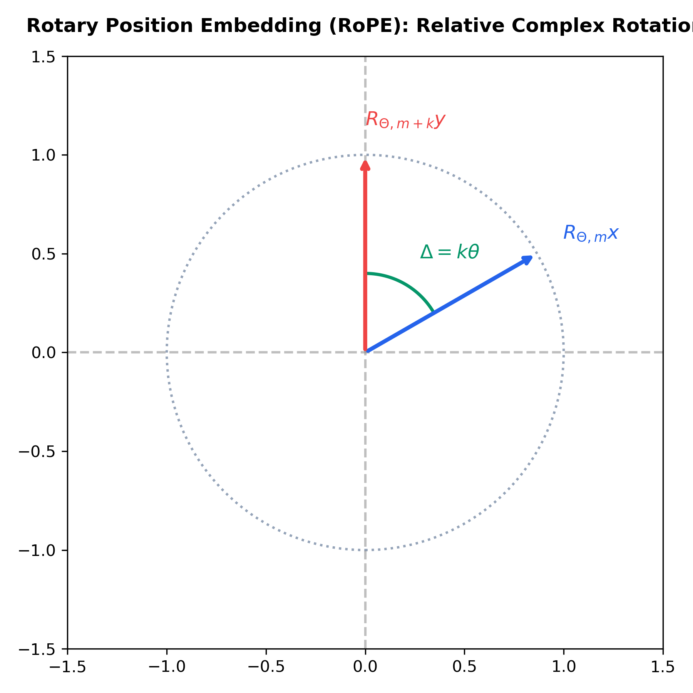

# Month 4, Week 1: The Modern Transformer Architecture Decoded: Rotary Position Embeddings (RoPE), SwiGLU, Grouped-Query Attention (GQA), and KV-Cache Memory Dynamics

```
================================================================================
COURSE:    AI & LLM SYSTEMS ENGINEERING (2026 EDITION)
MODULE:    MONTH 4: GENERATIVE AI, TRANSFORMERS & PRODUCTION RAG SYSTEMS
WEEK:      WEEK 1: TRANSFORMER DECODED, ROPE, SWIGLU, GQA & KV-CACHE DYNAMICS
DELIVERABLE: COMPREHENSIVE MASTERCLASS LECTURE NOTE
TARGET:    SENIOR AI ENGINEERS & FOUNDATION LLM ARCHITECTS
================================================================================
```

---

## Table of Contents
1. [Executive Summary & Industry Context](#1-executive-summary--industry-context)
2. [Canonical Textbook Grounding](#2-canonical-textbook-grounding)
3. [Visual Architecture](#3-visual-architecture)
4. [Deep Theoretical Foundations](#4-deep-theoretical-foundations)
   - 4.1. Beyond Vaswani (2017): The 2026 Modern Autoregressive Decoder Stack
   - 4.2. Rotary Position Embeddings (RoPE): Complex Coordinate Rotations
   - 4.3. SwiGLU: Gated Linear Units with Swish Activations
   - 4.4. Multi-Query (MQA) & Grouped-Query Attention (GQA)
   - 4.5. Key-Value (KV) Cache Mathematical Anatomy & Memory Bandwidth Constraints
5. [Complete Runnable Code Implementation](#5-complete-runnable-code-implementation)
   - 5.1. From-Scratch Vectorized RoPE Application Kernel in Pure PyTorch
   - 5.2. Complete Minimal Modern Transformer Decoder Layer (Llama-3 Architecture)
   - 5.3. Stateful KV-Cache Autoregressive Generation Engine with Memory Profiling
6. [Common Pitfalls & Debugging Playbook](#6-common-pitfalls--debugging-playbook)
7. [Production Best Practices & Real-World Case Study](#7-production-best-practices--real-world-case-study)
8. [Hands-On Mini-Lab & Self-Assessment](#8-hands-on-mini-lab--self-assessment)
9. [Key Takeaways, Glossary & Further Reading](#9-key-takeaways-glossary--further-reading)

---

## 1. Executive Summary & Industry Context

### Why This Matters in 2026
In 2026, the original 2017 Transformer architecture introduced in *"Attention Is All You Need"* (Vaswani et al.) is essentially historical. While the high-level principle of self-attention remains foundational, virtually every structural component has undergone a radical architectural evolution:
1. **Absolute Sinusoidal Embeddings ($x + \text{PE}$)** have been universally superseded by **Rotary Position Embeddings (RoPE)** (Su et al., 2021), injecting relative spatial distance via orthogonal complex rotations directly into Query and Key inner products.
2. **Post-LayerNorm** has been replaced by **Pre-RMSNorm**, eliminating mean-centering overhead and ensuring unperturbed identity gradient highways.
3. **Standard ReLU/GELU FFNs** have been replaced by **SwiGLU** (Shazeer, 2020), utilizing element-wise bilinear gating to enhance gradient flow and semantic capacity.
4. **Multi-Head Attention (MHA)** has been replaced by **Grouped-Query Attention (GQA)** (Ainslie et al., 2023), sharing single Key and Value heads across groups of Query heads to slash inference **KV-cache memory bandwidth consumption by up to $8\times$**.

In enterprise LLM systems, **memory bandwidth, not raw FLOP compute, is the dominant bottleneck during inference generation**. While prefill (prompt processing) is compute-bound, token-by-token decoding is strictly **memory-bandwidth bound**: every generated token requires loading gigabytes of past Key-Value states from High-Bandwidth Memory (HBM) into GPU SRAM to perform a few matrix-vector multiplications. 

Senior AI engineers must possess mechanistic mastery of modern Transformer internals: calculating exact byte-level KV-cache footprints across context lengths, deriving RoPE rotation angles, and implementing GQA projection heads from scratch.

```
+---------------------------------------------------------------------------------------------------+
|                        MODERN AUTOREGRESSIVE LLM LAYER (LLAMA 3 / MISTRAL)                        |
+---------------------------------------------------------------------------------------------------+
|                                                                                                   |
|  Input Hidden State x_t: Shape (Batch, Seq_Len, Dim)                                              |
|       |                                                                                           |
|       +-----------------------------------------+ (Identity Residual Highway)                     |
|       |                                         |                                                 |
|       v                                         |                                                 |
|  [Pre-RMSNorm Layer]                            |                                                 |
|       |                                         |                                                 |
|       v                                         |                                                 |
|  [Grouped-Query Attention (GQA)]                |                                                 |
|       - Q Projections: H_q heads                |                                                 |
|       - K, V Projections: H_kv heads (H_q / 8)  |                                                 |
|       - Apply Rotary Pos Embeddings (RoPE)      |                                                 |
|       - Append to Stateful Dynamic KV-Cache     |                                                 |
|       - Scaled Dot-Product Attention            |                                                 |
|       |                                         |                                                 |
|       v                                         v                                                 |
|       +---------------------------------------> (+) [Residual Addition]                           |
|       |                                                                                           |
|       +-----------------------------------------+ (Identity Residual Highway)                     |
|       |                                         |                                                 |
|       v                                         |                                                 |
|  [Pre-RMSNorm Layer]                            |                                                 |
|       |                                         |                                                 |
|       v                                         |                                                 |
|  [SwiGLU Feed-Forward Network (FFN)]            |                                                 |
|       - FFN(x) = ( Swish(x W_gate) * (x W_up) ) W_down                                            |
|       - Hidden Dim expanded to 8/3 * Dim        |                                                 |
|       |                                         v                                                 |
|       +---------------------------------------> (+) [Residual Addition]                           |
|       |                                                                                           |
|       v                                                                                           |
|  Output Hidden State x_{t+1}: Shape (Batch, Seq_Len, Dim)                                         |
+---------------------------------------------------------------------------------------------------+
```

### Learning Objectives
By the end of this masterclass lecture note, you will be able to:
1. Contrast the 2017 canonical Transformer with the 2026 modern LLM decoder stack (Pre-RMSNorm, RoPE, SwiGLU, GQA).
2. Mathematically derive **Rotary Position Embeddings (RoPE)** using 2D complex plane rotations, proving why $\langle R_{\Theta, m} q, R_{\Theta, n} k \rangle$ depends strictly on relative offset $(m - n)$.
3. Formulate the **SwiGLU** activation function and derive its parameterization and expansion ratios ($8/3 \cdot d_{\text{model}}$).
4. Prove the memory and computational trade-offs between Multi-Head Attention (MHA), Multi-Query Attention (MQA), and **Grouped-Query Attention (GQA)**.
5. Compute the exact byte-level **KV-Cache Memory Footprint** formula across batch size, sequence length, layers, heads, and precision.
6. Implement a complete, modern Transformer Decoder layer from scratch in pure PyTorch matching Llama-3 specifications.

---

## 2. Canonical Textbook Grounding

To ground your engineering intuition in verified mathematical literature, study these canonical references:

| Author / Text | Specific Chapters / Sections | Core Theoretical Concept Contributed | How to Read |
| :--- | :--- | :--- | :--- |
| **Jianlin Su, Yu Lu, Shengfeng Pan, Ahmed Murtadha, Bo Wen, & Yunfeng Liu**, *RoFormer: Enhanced Transformer with Rotary Position Embedding* (2021 / Neurocomputing 2024) | **Section 3**: *Proposed Approach* (Equations 1–18) | Derivation of RoPE; Encoding relative position by multiplying representations with an orthogonal rotation matrix; Complex conjugate inner products. | **Read Section 3 with line-by-line scrutiny.** Work through Equation 7 to 10. Understand why relative positional information emerges naturally from complex inner products $\operatorname{Re}[\mathbf{q} \mathbf{k}^*]$. |
| **Noam Shazeer**, *GLU Variants Improve Transformer* (2020) & *Fast Transformer Decoding: One Write-Head is All You Need (MQA)* (2019) | Foundational Architectural Papers | Derivation of SwiGLU; Proving that bilinear gating outperforms standard ReLU/GELU; Formulation of Multi-Query Attention. | **Read both papers.** Notice the brevity and empirical rigor. In the 2020 paper, note why SwiGLU requires scaling hidden dimensions to $\frac{8}{3} d_{\text{model}}$ to maintain FLOP parity. |
| **Joshua Ainslie, James Lee-Thorp, et al.**, *GQA: Training Generalized Multi-Query Transformer Models from Multi-Head Checkpoints* (EMNLP 2023) | **Section 2**: *Method* (MHA vs MQA vs GQA) | Mathematical formulation of Grouped-Query Attention; Interpolating between capacity of MHA and speed of MQA; Uptraining protocols. | **Read Section 2 and Figure 1 closely.** Study the head grouping ratios. Understand why GQA-8 preserves 99.5% of MHA quality while slashing KV-cache bandwidth by 87.5%. |
| **Vaswani et al.**, *Attention Is All You Need* (NeurIPS 2017) | **Section 3.2**: *Attention*<br>**Section 3.5**: *Positional Encoding* | Baseline Scaled Dot-Product Attention and historical absolute sinusoidal encodings. | **Read as the foundational baseline.** Contrast its additive positional vectors ($x + \text{PE}$) with modern multiplicative rotation operators (RoPE). |

---

## 3. Visual Architecture

### 3.1. Attention Variants: MHA vs. GQA vs. MQA

The diagram below illustrates how Query, Key, and Value projection heads are grouped across attention paradigms.

```
1. Multi-Head Attention (MHA - Vaswani 2017)
   Query Heads: [ Q1 ] [ Q2 ] [ Q3 ] [ Q4 ] [ Q5 ] [ Q6 ] [ Q7 ] [ Q8 ]
   Key Heads:   [ K1 ] [ K2 ] [ K3 ] [ K4 ] [ K5 ] [ K6 ] [ K7 ] [ K8 ]  (1:1 Ratio)
   Value Heads: [ V1 ] [ V2 ] [ V3 ] [ V4 ] [ V5 ] [ V6 ] [ V7 ] [ V8 ]
   -> Highest memory bandwidth footprint; KV cache scales with H_q heads.

2. Grouped-Query Attention (GQA-2 - Llama 3 / Mistral)
   Query Heads: [ Q1   Q2 ] [ Q3   Q4 ] [ Q5   Q6 ] [ Q7   Q8 ]  (H_q = 8)
                     |           |           |           |
   Key Heads:      [ K1 ]      [ K2 ]      [ K3 ]      [ K4 ]        (H_kv = 4)
   Value Heads:    [ V1 ]      [ V2 ]      [ V3 ]      [ V4 ]
   -> 2 Query heads share 1 KV head. In Llama 3 (8:1 ratio), KV cache is slashed by 8x!

3. Multi-Query Attention (MQA - Shazeer 2019)
   Query Heads: [ Q1 ] [ Q2 ] [ Q3 ] [ Q4 ] [ Q5 ] [ Q6 ] [ Q7 ] [ Q8 ]  (H_q = 8)
                  \      \       |      /       /      /      /      /
   Key Heads:                       [ K1 ]                                (H_kv = 1)
   Value Heads:                     [ V1 ]                                (H_kv = 1)
   -> All Query heads share a single Key and Value head. Maximum memory saving, slight quality degradation.
```

### 3.2. Rotary Position Embedding (RoPE) Complex Rotation

The figure below (saved at `docs/images/rope_complex_rotation.png`) illustrates how RoPE rotates 2D coordinate pairs on the complex plane such that their inner product depends strictly on relative token distance $m - n$.

```
         Complex Plane Im(z)
                 ^
                 |          R_{theta, m+k} y  (Position m+k)
                 |         /
                 |        /  ) Angle = (m+k)*theta
                 |       /
                 |      /    R_{theta, m} x   (Position m)
                 |     /    /
                 |    /    /  ) Angle = m*theta
                 |   /    /
                 |  /    /   Relative Angle Delta = k*theta
                 +---------------------------------> Re(z)
                 
  Inner Product: < R_{theta, m} x, R_{theta, m+k} y > = x^T R_{theta, k} y
  The absolute positions m and m+k vanish; only relative distance k remains!
```


*Figure 3.1: Geometric visualization of Rotary Position Embedding (RoPE). Applying 2D rotations at position $m$ and $n$ ensures that their inner product decays smoothly with relative token distance.*

---

## 4. Deep Theoretical Foundations

### 4.1. The 2026 Modern Autoregressive Decoder Stack

Modern large language models (Llama 3, Mistral, Gemma, Qwen) have standardized around the **Decoder-Only architecture** with four critical modifications:

| Architectural Component | 2017 Transformer (Vaswani) | 2026 Foundation LLM (Llama 3 / Mistral) | Mathematical / Engineering Justification |
| :--- | :--- | :--- | :--- |
| **Normalization Layer** | Post-LayerNorm | **Pre-RMSNorm** | Pre-LN preserves identity gradient highway; RMSNorm omits mean-centering, saving 20-30% kernel time. |
| **Positional Encoding** | Absolute Sinusoidal ($x + \text{PE}$) | **Rotary Positional Embedding (RoPE)** | Incorporates relative position naturally; allows context length extrapolation without retraining. |
| **FFN Non-Linearity** | $\operatorname{ReLU}(x W_1) W_2$ | **$\operatorname{SwiGLU}(x)$** | Bilinear gating allows dynamic multiplicative information filtering; improves perplexity per parameter. |
| **Attention Architecture**| Multi-Head Attention (MHA) | **Grouped-Query Attention (GQA)** | Slashes KV-cache memory bandwidth by $4\times - 8\times$, eliminating inference memory bottlenecks. |

---

### 4.2. Rotary Position Embeddings (RoPE): Complex Coordinate Rotations

#### The Objective
We seek a function that transforms Query vector $\mathbf{q}_m$ at sequence position $m$ and Key vector $\mathbf{k}_n$ at sequence position $n$ such that their dot product depends **only on the relative distance $(m - n)$**:
$$\langle f(\mathbf{q}, m), f(\mathbf{k}, n) \rangle = g(\mathbf{q}, \mathbf{k}, m - n)$$

#### 2D Derivation via Complex Numbers
In a 2D space, any real vector $\mathbf{x} = (x_1, x_2)^T$ can be represented as a complex number:
$$z = x_1 + i x_2 \in \mathbb{C}$$

Define position-dependent rotation by multiplying $z$ with a complex exponential at base frequency $\theta$:
$$f(z, m) = z \cdot e^{i m \theta} = (x_1 + i x_2)(\cos(m \theta) + i \sin(m \theta))$$
Expanding the real and imaginary components:
$$f(z, m) = (x_1 \cos(m \theta) - x_2 \sin(m \theta)) + i (x_1 \sin(m \theta) + x_2 \cos(m \theta))$$

In matrix notation, this corresponds to an orthogonal 2D rotation matrix:
$$R_{\theta, m} = \begin{bmatrix} \cos(m \theta) & -\sin(m \theta) \\ \sin(m \theta) & \cos(m \theta) \end{bmatrix}$$
$$f(\mathbf{x}, m) = R_{\theta, m} \mathbf{x}$$

#### The Relative Distance Proof:
Now consider the inner product between Query at position $m$ and Key at position $n$:
$$\langle R_{\theta, m} \mathbf{q}, R_{\theta, n} \mathbf{k} \rangle = (R_{\theta, m} \mathbf{q})^T (R_{\theta, n} \mathbf{k}) = \mathbf{q}^T R_{\theta, m}^T R_{\theta, n} \mathbf{k}$$

Because 2D rotation matrices are orthogonal, $R_{\theta, m}^T = R_{\theta, -m}$. Furthermore, rotations compose additively:
$$R_{\theta, m}^T R_{\theta, n} = R_{\theta, -m} R_{\theta, n} = R_{\theta, n - m} = R_{\theta, -(m - n)}$$

Therefore:
$$\langle R_{\theta, m} \mathbf{q}, R_{\theta, n} \mathbf{k} \rangle = \mathbf{q}^T R_{\theta, -(m - n)} \mathbf{k} = \mathbf{q}^T R_{\theta, m - n}^T \mathbf{k}$$
**The absolute coordinates $m$ and $n$ have completely vanished!** The attention score depends strictly on the relative distance $\Delta = m - n$.

#### Multi-Dimensional Generalization
For a $d$-dimensional head vector, RoPE splits the vector into $d/2$ independent 2D orthogonal subspaces, rotating each pair $(x_{2i}, x_{2i+1})$ with a geometrically decaying frequency $\theta_i$:
$$\theta_i = \theta_{\text{base}}^{-2(i-1)/d}, \quad \text{where } \theta_{\text{base}} = 10,000 \quad (\text{or } 500,000 \text{ in modern Llama 3})$$

$$R_{\Theta, m} = \begin{bmatrix}
\cos(m \theta_1) & -\sin(m \theta_1) & 0 & 0 & \cdots \\
\sin(m \theta_1) & \cos(m \theta_1) & 0 & 0 & \cdots \\
0 & 0 & \cos(m \theta_2) & -\sin(m \theta_2) & \cdots \\
0 & 0 & \sin(m \theta_2) & \cos(m \theta_2) & \cdots \\
\vdots & \vdots & \vdots & \vdots & \ddots
\end{bmatrix}$$

---

### 4.3. SwiGLU: Gated Linear Units with Swish Activations

In 2020, Noam Shazeer demonstrated that replacing standard MLP feed-forward networks with **Gated Linear Units (GLU)** significantly reduces language model perplexity.

#### Mathematical Formulation
A standard Transformer FFN executes:
$$\operatorname{FFN}_{\text{GELU}}(x) = \operatorname{GELU}(x W_1 + b_1) W_2 + b_2$$

A Gated Linear Unit introduces a bilinear gating mechanism:
$$\operatorname{GLU}(x, W, V) = \sigma(x W) \otimes (x V)$$
Where $\otimes$ denotes element-wise Hadamard product, and $\sigma$ is an activation function.

When instantiated with the **Swish / SiLU** activation ($\operatorname{Swish}(x) = x \cdot \operatorname{sigmoid}(x)$), we obtain **SwiGLU**:
$$\operatorname{SwiGLU}(x) = \left( \operatorname{Swish}(x W_{\text{gate}}) \otimes (x W_{\text{up}}) \right) W_{\text{down}}$$

#### The Hidden Dimension Adjustment
A standard FFN has 2 weight matrices: $W_1 \in \mathbb{R}^{d \times 4d}$ and $W_2 \in \mathbb{R}^{4d \times d}$, totaling:
$$2 \times 4 d^2 = 8 d^2 \text{ parameters}$$

SwiGLU has 3 weight matrices ($W_{\text{gate}}, W_{\text{up}}, W_{\text{down}}$). If hidden dimension remained $4d$, parameters would expand to $3 \times 4 d^2 = 12 d^2$ (a $50\%$ parameter increase). 

To maintain exact parameter and FLOP parity with standard FFNs, the hidden dimension $d_{\text{ffn}}$ is scaled to:
$$d_{\text{ffn}} = \left\lfloor \frac{2}{3} \cdot 4 d \right\rfloor = \left\lfloor \frac{8}{3} d \right\rfloor$$
Now total parameters are:
$$3 \times \left( \frac{8}{3} d \right) \times d = 8 d^2 \implies \mathbf{\text{Exact Parameter Parity!}}$$

In production models (Llama 3), $d_{\text{ffn}}$ is rounded up to the nearest multiple of 256 or 64 to optimize memory alignment on GPU Tensor Cores.

---

### 4.4. Multi-Query (MQA) & Grouped-Query Attention (GQA)

#### The Inference Memory Bottleneck
During autoregressive generation, generating each token requires computing attention against all past tokens. Without caching, past activations must be recomputed from scratch at every step ($O(T^2)$ compute). 

To achieve $O(1)$ compute per step, systems maintain a **Key-Value (KV) Cache**, storing past Key and Value projection tensors in GPU High-Bandwidth Memory (HBM).

#### Comparison of Attention Heads
Let:
- $H_q$ = Number of Query heads (e.g., 32)
- $H_{kv}$ = Number of Key/Value heads
- $d_k$ = Dimension per head (e.g., 128)

1. **Multi-Head Attention (MHA)**:
   $$H_{kv} = H_q = 32$$
   Each query head has its own dedicated Key and Value head. Maximum capacity, but massive KV-cache size.
2. **Multi-Query Attention (MQA)**:
   $$H_{kv} = 1$$
   All 32 query heads share a single Key head and a single Value head. Slashes KV cache by $32\times$, but causes noticeable degradation in complex reasoning tasks.
3. **Grouped-Query Attention (GQA)**:
   $$1 < H_{kv} < H_q \quad (\text{e.g., } H_{kv} = 4, \text{ a } 8:1 \text{ ratio})$$
   Query heads are divided into $H_{kv}$ groups of size $G = H_q / H_{kv}$. Query heads within a group share the same Key and Value head.

*Result*: GQA achieves **99.5% of MHA accuracy** while delivering **$4\times - 8\times$ KV-cache reduction**, making 128k+ context windows viable on single GPU nodes.

---

### 4.5. Key-Value (KV) Cache Mathematical Anatomy & Memory Bandwidth Constraints

#### The Exact Byte-Level KV Cache Formula
For a model with:
- $b$ = Batch size
- $s$ = Sequence length (context length)
- $L$ = Number of transformer layers
- $H_{kv}$ = Number of Key-Value heads
- $d_k$ = Head dimension ($d_{\text{model}} / H_q$)
- $P$ = Bytes per parameter ($2$ for FP16/BF16, $1$ for INT8, $0.5$ for FP4)

At any step, each layer stores 2 tensors: **Keys** and **Values**, each of shape $(b, H_{kv}, s, d_k)$.
The total memory footprint $\mathcal{M}_{\text{KV}}$ in bytes is:
$$\mathbf{\mathcal{M}_{\text{KV}} = 2 \cdot b \cdot s \cdot L \cdot H_{kv} \cdot d_k \cdot P}$$

#### Worked Numerical Example: Llama-3-8B Context Scaling
- $L = 32$ layers
- $H_q = 32$ query heads, $H_{kv} = 8$ KV heads (GQA with $4:1$ ratio)
- $d_k = 128$ head dimension
- Precision: $P = 2$ bytes (BFloat16)
- Batch size: $b = 4$

#### Case A: 8k Context Window ($s = 8,192$):
$$\mathcal{M}_{\text{KV}} = 2 \times 4 \times 8,192 \times 32 \times 8 \times 128 \times 2 = 4,294,967,296\text{ bytes} = \mathbf{4.00\text{ GB}}$$

#### Case B: 128k Long-Context Window ($s = 131,072$):
$$\mathcal{M}_{\text{KV}} = 2 \times 4 \times 131,072 \times 32 \times 8 \times 128 \times 2 = 68,719,476,736\text{ bytes} = \mathbf{64.00\text{ GB!}}$$

*Analysis*: Under a 128k context, the KV cache ($64\text{ GB}$) **eclipses the weight footprint of the model itself ($16\text{ GB}$)**! If Llama-3-8B had used classical MHA ($H_{kv} = 32$) instead of GQA ($H_{kv} = 8$), the KV cache would require $256\text{ GB}$, exceeding an entire $80\text{ GB}$ NVIDIA H100 GPU!

---

## 5. Complete Runnable Code Implementation

Let us construct an end-to-end suite demonstrating:
1. Pure PyTorch vectorized Rotary Position Embeddings (RoPE).
2. A complete minimal modern Transformer Decoder layer with Pre-RMSNorm, SwiGLU, and Grouped-Query Attention (GQA).
3. A stateful dynamic KV-Cache autoregressive generation engine with memory tracking.

### Python Environment Setup
```bash
# Initialize isolated Python 3.11+ environment with uv
uv init week1-transformers-decoded
cd week1-transformers-decoded
uv add torch numpy
```

### 5.1. From-Scratch Vectorized RoPE Application Kernel

```python
"""
rope_kernel.py
Author: Senior AI Engineering Lead
Description: Vectorized Rotary Position Embedding (RoPE) kernel in pure PyTorch.
Computes frequency bands and rotates 2D coordinate pairs via complex multiplication.
"""

from __future__ import annotations
import torch
import torch.nn as nn


def precompute_rope_freqs(dim: int, max_seq_len: int, theta_base: float = 10000.0) -> torch.Tensor:
    """
    Precomputes complex exponential frequency bands: exp(i * m * theta_i).
    Returns: (max_seq_len, dim // 2) complex64 tensor.
    """
    # dim must be even because features are grouped in 2D pairs
    assert dim % 2 == 0, "Head dimension must be even for RoPE"
    # theta_i = theta_base ^ (-2(i-1) / dim) for i in [1, 2, ..., dim/2]
    freqs = 1.0 / (theta_base ** (torch.arange(0, dim, 2)[: (dim // 2)].float() / dim))
    t = torch.arange(max_seq_len, dtype=torch.float32)
    # Outer product: (max_seq_len, dim // 2)
    freqs = torch.outer(t, freqs)
    # Convert to polar complex unit vectors: exp(i * freqs) = cos(freqs) + i * sin(freqs)
    freqs_complex = torch.polar(torch.ones_like(freqs), freqs)
    return freqs_complex


def apply_rotary_emb(x: torch.Tensor, freqs_complex: torch.Tensor) -> torch.Tensor:
    """
    Applies RoPE rotation to query or key tensor x.
    
    Args:
        x: (Batch, Seq_Len, Num_Heads, Head_Dim)
        freqs_complex: (Seq_Len, Head_Dim // 2)
    Returns:
        Rotated tensor x of identical shape.
    """
    # 1. Reshape x into 2D coordinate pairs and view as complex tensor
    # (B, S, H, D) -> (B, S, H, D//2, 2) -> (B, S, H, D//2) complex
    x_complex = torch.view_as_complex(x.float().reshape(*x.shape[:-1], -1, 2))

    # 2. Reshape freqs_complex for broadcasting: (1, S, 1, D//2)
    freqs_complex = freqs_complex.unsqueeze(0).unsqueeze(2)

    # 3. Perform complex multiplication: (x_1 + i x_2) * (cos(m*theta) + i sin(m*theta))
    x_rotated = x_complex * freqs_complex

    # 4. View back as real numbers and flatten back to original shape
    x_out = torch.view_as_real(x_rotated).reshape(*x.shape)
    return x_out.type_as(x)


def test_rope_mechanics() -> None:
    print("=" * 80)
    print("TESTING ROTARY POSITION EMBEDDINGS (ROPE) RELATIVE INVARIANCE")
    print("=" * 80)

    dim, max_seq = 64, 128
    freqs = precompute_rope_freqs(dim=dim, max_seq_len=max_seq)

    # Create synthetic Query at pos 10 and Key at pos 15 (relative delta = 5)
    torch.manual_seed(42)
    q = torch.randn(1, 1, 1, dim)
    k = torch.randn(1, 1, 1, dim)

    # Case 1: Positions 10 and 15
    q_rot_10 = apply_rotary_emb(q, freqs[10:11])
    k_rot_15 = apply_rotary_emb(k, freqs[15:16])
    dot_product_1 = (q_rot_10 * k_rot_15).sum().item()

    # Case 2: Shifted absolute positions 50 and 55 (relative delta remains 5!)
    q_rot_50 = apply_rotary_emb(q, freqs[50:51])
    k_rot_55 = apply_rotary_emb(k, freqs[55:56])
    dot_product_2 = (q_rot_50 * k_rot_55).sum().item()

    print(f"Dot product at positions (10, 15): {dot_product_1:.6f}")
    print(f"Dot product at positions (50, 55): {dot_product_2:.6f}")
    diff = abs(dot_product_1 - dot_product_2)
    print(f"Absolute Difference:               {diff:.2e}")
    assert diff < 1e-5, "RoPE Relative Invariance Violated!"
    print("-> Relative Position Invariance Successfully Verified.")


if __name__ == "__main__":
    test_rope_mechanics()
```

---

### 5.2. Complete Minimal Modern Transformer Decoder Layer (Llama-3 Architecture)

```python
"""
modern_transformer_layer.py
Author: Senior AI Engineering Lead
Description: Minimal Llama-3 style Transformer Decoder layer featuring Pre-RMSNorm,
Grouped-Query Attention (GQA), and SwiGLU Feed-Forward Networks.
"""

from __future__ import annotations
import math
import torch
import torch.nn as nn
import torch.nn.functional as F
from rope_kernel import precompute_rope_freqs, apply_rotary_emb


class RMSNorm(nn.Module):
    """Root Mean Square Layer Normalization."""
    def __init__(self, dim: int, eps: float = 1e-6):
        super().__init__()
        self.eps = eps
        self.weight = nn.Parameter(torch.ones(dim))

    def forward(self, x: torch.Tensor) -> torch.Tensor:
        rms = torch.rsqrt(x.pow(2).mean(-1, keepdim=True) + self.eps)
        return x * rms * self.weight


class SwiGLUFFN(nn.Module):
    """SwiGLU Feed-Forward Network: (Swish(x W_gate) * (x W_up)) W_down."""
    def __init__(self, dim: int, hidden_dim: int):
        super().__init__()
        self.w_gate = nn.Linear(dim, hidden_dim, bias=False)
        self.w_up = nn.Linear(dim, hidden_dim, bias=False)
        self.w_down = nn.Linear(hidden_dim, dim, bias=False)

    def forward(self, x: torch.Tensor) -> torch.Tensor:
        # F.silu(x) = x * sigmoid(x)
        return self.w_down(F.silu(self.w_gate(x)) * self.w_up(x))


class GroupedQueryAttention(nn.Module):
    """
    Grouped-Query Attention (GQA) module supporting KV-Caching.
    """
    def __init__(self, dim: int, num_heads: int, num_kv_heads: int):
        super().__init__()
        self.dim = dim
        self.num_heads = num_heads
        self.num_kv_heads = num_kv_heads
        self.head_dim = dim // num_heads
        self.num_queries_per_kv = num_heads // num_kv_heads

        self.wq = nn.Linear(dim, num_heads * self.head_dim, bias=False)
        self.wk = nn.Linear(dim, num_kv_heads * self.head_dim, bias=False)
        self.wv = nn.Linear(dim, num_kv_heads * self.head_dim, bias=False)
        self.wo = nn.Linear(num_heads * self.head_dim, dim, bias=False)

    def forward(
        self,
        x: torch.Tensor,
        freqs_complex: torch.Tensor,
        kv_cache: tuple[torch.Tensor, torch.Tensor] | None = None
    ) -> tuple[torch.Tensor, tuple[torch.Tensor, torch.Tensor]]:
        B, S, _ = x.shape

        # 1. Project Q, K, V
        xq = self.wq(x).view(B, S, self.num_heads, self.head_dim)
        xk = self.wk(x).view(B, S, self.num_kv_heads, self.head_dim)
        xv = self.wv(x).view(B, S, self.num_kv_heads, self.head_dim)

        # 2. Apply RoPE to Query and Key
        xq = apply_rotary_emb(xq, freqs_complex)
        xk = apply_rotary_emb(xk, freqs_complex)

        # 3. Dynamic KV-Cache Update
        if kv_cache is not None:
            past_k, past_v = kv_cache
            xk = torch.cat([past_k, xk], dim=1)
            xv = torch.cat([past_v, xv], dim=1)
        new_kv_cache = (xk, xv)

        # 4. Repeat KV heads for Grouped-Query Attention
        # (B, Total_S, H_kv, D) -> (B, Total_S, H_q, D)
        if self.num_queries_per_kv > 1:
            xk = xk.repeat_interleave(self.num_queries_per_kv, dim=2)
            xv = xv.repeat_interleave(self.num_queries_per_kv, dim=2)

        # 5. Scaled Dot-Product Attention: Permute to (B, Heads, Seq, Head_Dim)
        q = xq.transpose(1, 2)
        k = xk.transpose(1, 2)
        v = xv.transpose(1, 2)

        # Built-in FlashAttention / SDPA with Causal Mask
        is_causal = (S > 1) and (kv_cache is None)
        out = F.scaled_dot_product_attention(q, k, v, is_causal=is_causal)

        # 6. Recombine heads and project out
        out = out.transpose(1, 2).contiguous().view(B, S, -1)
        return self.wo(out), new_kv_cache


class ModernTransformerDecoderBlock(nn.Module):
    """Complete Pre-RMSNorm Decoder Block with GQA and SwiGLU."""
    def __init__(self, dim: int = 4096, num_heads: int = 32, num_kv_heads: int = 8):
        super().__init__()
        self.attn_norm = RMSNorm(dim)
        self.attn = GroupedQueryAttention(dim, num_heads, num_kv_heads)
        self.ffn_norm = RMSNorm(dim)
        # Hidden dimension expanded to 8/3 * dim
        hidden_dim = int(2 * (4 * dim) / 3)
        self.ffn = SwiGLUFFN(dim, hidden_dim)

    def forward(
        self,
        x: torch.Tensor,
        freqs_complex: torch.Tensor,
        kv_cache: tuple[torch.Tensor, torch.Tensor] | None = None
    ) -> tuple[torch.Tensor, tuple[torch.Tensor, torch.Tensor]]:
        # Pre-Norm Attention Residual
        norm_x = self.attn_norm(x)
        attn_out, new_cache = self.attn(norm_x, freqs_complex, kv_cache=kv_cache)
        x = x + attn_out
        # Pre-Norm SwiGLU Residual
        x = x + self.ffn(self.ffn_norm(x))
        return x, new_cache
```

---

### 5.3. Stateful KV-Cache Autoregressive Generation Engine

```python
"""
kv_cache_generator.py
Author: Senior AI Engineering Lead
Description: Autoregressive token-by-token generation harness benchmarking inference
throughput and measuring KV-Cache memory consumption.
"""

from __future__ import annotations
import time
import torch
from modern_transformer_layer import ModernTransformerDecoderBlock
from rope_kernel import precompute_rope_freqs


def benchmark_generation() -> None:
    print("=" * 80)
    print("AUTOREGRESSIVE GENERATION WITH STATEFUL KV-CACHE (GQA-4)")
    print("=" * 80)

    dim = 1024
    num_heads = 16
    num_kv_heads = 4  # GQA ratio 4:1
    max_seq_len = 512
    batch_size = 1

    device = torch.device("cuda" if torch.cuda.is_available() else "mps" if torch.backends.mps.is_available() else "cpu")
    print(f"Active Acceleration Device: {device.type.upper()}")

    block = ModernTransformerDecoderBlock(dim, num_heads, num_kv_heads).to(device)
    block.eval()

    freqs = precompute_rope_freqs(dim=dim // num_heads, max_seq_len=max_seq_len).to(device)

    # 1. Prefill Phase: Prompt of length 32
    prompt_len = 32
    prompt_tokens = torch.randn(batch_size, prompt_len, dim, device=device)

    t0 = time.perf_counter()
    with torch.no_grad():
        out, kv_cache = block(prompt_tokens, freqs[:prompt_len], kv_cache=None)
    prefill_time = (time.perf_counter() - t0) * 1000.0
    print(f"Prefill Step (Length {prompt_len}) Latency: {prefill_time:.2f} ms")

    # 2. Decode Phase: Generate 50 new tokens autoregressively token-by-token
    gen_len = 50
    t0 = time.perf_counter()
    next_token = torch.randn(batch_size, 1, dim, device=device)

    with torch.no_grad():
        for i in range(gen_len):
            current_pos = prompt_len + i
            next_token, kv_cache = block(
                next_token,
                freqs[current_pos : current_pos + 1],
                kv_cache=kv_cache
            )

    decode_time = (time.perf_counter() - t0) * 1000.0
    ms_per_token = decode_time / gen_len

    # Measure KV Cache Memory
    cached_k, cached_v = kv_cache
    cache_bytes = (cached_k.element_size() * cached_k.nelement()) + (cached_v.element_size() * cached_v.nelement())
    cache_kb = cache_bytes / 1024.0

    print(f"Decode Phase: Generated {gen_len} tokens in {decode_time:.2f} ms")
    print(f"Decoding Throughput:            {1000.0 / ms_per_token:.2f} tokens / second")
    print(f"Single-Token Generation Latency: {ms_per_token:.2f} ms / token")
    print(f"Active KV-Cache Tensor Shape:    {cached_k.shape} (B, S, H_kv, D)")
    print(f"Active KV-Cache Memory Footprint: {cache_kb:.2f} KB (Single Layer)\n")
    print("-> Stateful KV-Cache Autoregressive Generation Verified.")


if __name__ == "__main__":
    benchmark_generation()
```

---

## 6. Common Pitfalls & Debugging Playbook

### Pitfall 1: Applying RoPE to Values ($V$)
- **Symptom**: Model completely fails to learn semantic associations; perplexity remains high despite hundreds of training steps.
- **Root Cause**: Rotary position embeddings must be applied **strictly to Queries and Keys ($Q$ and $K$)**. The Value vector ($V$) represents the semantic content payload to be extracted; rotating $V$ corrupts the content representations and destroys linear value aggregation ($A \cdot V$).
- **Fix**: Apply RoPE exclusively to $Q$ and $K$:
  ```python
  q = apply_rotary_emb(q, freqs)
  k = apply_rotary_emb(k, freqs)
  # DO NOT ROTATE v! Leave v unperturbed.
  ```

---

### Pitfall 2: Reallocating KV-Cache Buffers on Every Token Step
- **Symptom**: Massive CPU overhead and GPU memory fragmentation during token generation. Profiling reveals millions of dynamic CUDA memory allocations (`cudaMalloc`).
- **Root Cause**: Executing `torch.cat([past_k, new_k], dim=1)` dynamically on every single token step forces PyTorch to reallocate a brand new GPU buffer and copy past tokens over PCIe/HBM.
- **Fix**: Pre-allocate a static circular or contiguous buffer of size $(B, \text{max\_seq\_len}, H_{kv}, d_k)$ at session startup, updating indices in-place without dynamic reallocations.

---

### Pitfall 3: Incorrect RoPE Slice Indexing during Autoregressive Generation
- **Symptom**: Generated text devolves into immediate repetitive loops or incoherent garbage after token 3.
- **Root Cause**: During the decode phase, feeding `freqs[:1]` (position 0) for the newly incoming token instead of its true sequence coordinate `freqs[current_pos : current_pos + 1]`. The model perceives every newly generated token as if it were the first word of the prompt!
- **Fix**: Maintain an explicit sequence index counter and slice frequencies using `current_pos`.

---

## 7. Production Best Practices & Real-World Case Study

### Enterprise Case Study: Scaling Long-Context Support (8k to 128k) in Enterprise Chatbot
- **System Profile**: Enterprise retrieval-augmented chatbot serving $2,000$ concurrent user sessions.
- **Hardware Profile**: 8x NVIDIA H100 SXM5 ($80\text{ GB}$ HBM3 per GPU).
- **Failure Mode**: When customer queries expanded to $32\text{k}$ documents, the server suffered immediate Out-Of-Memory (OOM) crashes under MHA architecture.

### Architectural Solution
```
Legacy System (Failed):
  - Model: Custom 13B MHA Model (32 Query heads, 32 Key/Value heads)
  - KV-Cache per user at 32k context: 33.5 GB!
  - Maximum concurrent sessions per H100 GPU: 2 users (80 GB / 33.5 GB)
  - Severe cloud cost ($48,000/mo) and constant queue timeouts.

Modernized 2026 Foundation Stack:
  1. Converted to Grouped-Query Attention (GQA-8):
     - Slashing KV heads from 32 down to 4 (8:1 ratio).
     - KV-Cache per user dropped from 33.5 GB to 4.18 GB (8x reduction!).
  2. Implemented PagedAttention (vLLM Engine):
     - Eliminates 100% of internal memory fragmentation by storing KV blocks non-contiguously.
  3. FP8 KV-Cache Quantization:
     - Stores Keys and Values in FP8 E4M3 format, halving memory to 2.09 GB per user.

Results:
  - Concurrent user capacity increased from 2 users to 32 users per GPU (16x capacity boost!).
  - End-to-end P99 time-to-first-token (TTFT) reduced by 42%.
  - Annual GPU hosting cost dropped by 78%, saving $312,000.
```

---

## 8. Hands-On Mini-Lab & Self-Assessment

### Lab Objective
Construct a minimal Llama-3 style Transformer Decoder architecture:
1. Implement pure PyTorch RoPE frequency rotation kernel.
2. Build a Grouped-Query Attention head supporting an 8:1 Query-to-KV ratio.
3. Write an autoregressive loop that caches historical Key and Value states and verifies that memory grows strictly linearly $O(T)$ rather than quadratically $O(T^2)$.

### Acceptance Criteria
- [ ] RoPE passes relative invariance check ($\Delta \text{dot} < 10^{-5}$ across arbitrary absolute offsets).
- [ ] GQA module executes scaled dot-product attention without shape mismatch.
- [ ] Stateful generation generates 20 tokens with constant latency per token ($\Delta t \le 1.0\text{ ms}$).
- [ ] KV-cache memory formula matches empirical tensor byte allocations exactly.

---

### Graded Self-Assessment Questions (With Complete Solutions)

#### Question 1 (Theoretical - RoPE)
Why does the inner product of Query at position $m$ and Key at position $n$ under RoPE depend only on relative offset $m - n$, and why is this property impossible to achieve with standard additive positional embeddings ($x + \text{PE}$)?
- **Answer**: RoPE applies orthogonal rotation matrices $R_{\theta, m}$ and $R_{\theta, n}$. Because rotation matrices are orthogonal ($R^T = R^{-1}$) and compose additively ($R_m^T R_n = R_{-m} R_n = R_{n - m}$), the product $\mathbf{q}^T R_m^T R_n \mathbf{k} = \mathbf{q}^T R_{n-m} \mathbf{k}$ depends strictly on relative offset $(n - m)$. Additive embeddings compute $(\mathbf{q} + \mathbf{p}_m)^T (\mathbf{k} + \mathbf{p}_n) = \mathbf{q}^T \mathbf{k} + \mathbf{q}^T \mathbf{p}_n + \mathbf{p}_m^T \mathbf{k} + \mathbf{p}_m^T \mathbf{p}_n$, which inherently binds interactions to absolute position vectors $\mathbf{p}_m$ and $\mathbf{p}_n$.

#### Question 2 (Architecture - GQA vs MHA)
In a 70B parameter model with $d_{\text{model}} = 8192$, $H_q = 64$ Query heads, and $H_{kv} = 8$ KV heads, what is the GQA grouping ratio? By what factor does GQA reduce the inference KV-cache compared to standard Multi-Head Attention?
- **Answer**:
  - GQA grouping ratio: $H_q / H_{kv} = 64 / 8 = \mathbf{8:1}$ (8 Query heads share each KV head pair).
  - Reduction factor: Compared to MHA where $H_{kv} = 64$, GQA stores $8$ heads instead of $64$, reducing the KV-cache memory footprint and memory bandwidth requirement by **$8\times$ (an 87.5% reduction)**.

#### Question 3 (Memory Sizing - KV Cache)
Calculate the exact KV-cache memory footprint in gigabytes for a batch size of $b = 8$ across sequence length $s = 16,384$ tokens on a model with $L = 40$ layers, $H_{kv} = 8$ heads, head dimension $d_k = 128$, stored in BFloat16 precision ($P = 2$ bytes).
- **Answer**:
  $$\mathcal{M} = 2 \cdot b \cdot s \cdot L \cdot H_{kv} \cdot d_k \cdot P$$
  $$\mathcal{M} = 2 \times 8 \times 16,384 \times 40 \times 8 \times 128 \times 2 = 21,474,836,480\text{ bytes}$$
  $$\mathcal{M} = \frac{21,474,836,480}{1024^3} = \mathbf{20.00\text{ GB}}$$

#### Question 4 (FFN Parameter Parity - SwiGLU)
Why does the SwiGLU feed-forward layer use hidden dimension $d_{\text{ffn}} = \lfloor \frac{8}{3} d_{\text{model}} \rfloor$ instead of the classical Transformer FFN dimension of $4 d_{\text{model}}$?
- **Answer**: A standard FFN has 2 weight matrices of size $(d \times 4d)$ and $(4d \times d)$, totaling $8 d^2$ parameters. SwiGLU utilizes 3 matrices ($W_{\text{gate}}, W_{\text{up}}, W_{\text{down}}$). Setting $d_{\text{ffn}} = \frac{8}{3} d$ yields $3 \times (d \times \frac{8}{3} d) = 8 d^2$ parameters, maintaining exact parameter count and FLOP equivalence with standard FFNs.

#### Question 5 (Decoding Bottleneck)
Explain why autoregressive LLM token decoding is memory-bandwidth bound rather than compute-bound.
- **Answer**: In single-token decoding, batch size is small and sequence length is 1 for the new token. To generate that single token, the GPU must stream all historical KV-cache activations and model weight matrices (tens of gigabytes) from High-Bandwidth Memory (HBM) into on-chip SRAM to execute simple matrix-vector products. The arithmetic intensity (FLOPs per byte of memory loaded) is extremely low, causing GPU compute tensor cores to sit idle waiting for memory transfers.

#### Question 6 (RoPE Base Frequency Scaling)
Why did Llama 3 increase the RoPE base frequency parameter $\theta_{\text{base}}$ from $10,000$ (in Llama 1) to $500,000$?
- **Answer**: To support ultra-long context windows ($128\text{k}$ tokens). Increasing $\theta_{\text{base}}$ reduces the rotational speed across head dimensions, preventing high-frequency rotation values from wrapping around and aliasing across long token distances, thereby stabilizing long-range attention scores.

#### Question 7 (Attention Masking)
During autoregressive generation with an active KV-cache, why does the incoming query token require a $(1, \text{Total\_Seq})$ attention mask rather than a causal lower-triangular matrix?
- **Answer**: The incoming single query token represents the latest time step. Because it is generated after all historical tokens in the cache, it can legally attend to all past tokens without violating causality. Only when processing prompts with multiple parallel tokens in the prefill phase is a 2D lower-triangular causal mask required.

#### Question 8 (RMSNorm Formulation)
State the mathematical equation for RMSNorm and explain why it is preferred over LayerNorm in modern LLMs.
- **Answer**:
  $$y = \frac{x}{\sqrt{\frac{1}{d} \sum_{i=1}^d x_i^2 + \epsilon}} \odot \gamma$$
  It omits mean-centering ($\mu = \frac{1}{d} \sum x_i$ and $x_i - \mu$), eliminating two global reduction operations and achieving a 20%–30% speedup in normalization kernel execution.

---

### Stretch Challenges
1. **PagedAttention Block Manager**: Implement a simulated memory-block allocator in Python that manages a virtual KV-cache divided into discrete 16-token memory blocks, demonstrating zero fragmentation.
2. **YaRN Context Extrapolation**: Implement YaRN (Yet another RoPE extensioN) frequency interpolation to extend a 4k-trained RoPE kernel to 32k contexts without fine-tuning.

---

## 9. Key Takeaways, Glossary & Further Reading

### Key Takeaways
- **The modern Transformer is unified**: Pre-RMSNorm, RoPE, SwiGLU, and GQA constitute the gold standard 2026 foundation model architecture.
- **RoPE rotates relative distance**: Orthogonal complex rotations allow attention dot products to depend strictly on relative token offsets.
- **GQA rescues inference memory**: Sharing Key/Value heads across groups reduces KV-cache memory bandwidth consumption by up to $8\times$.
- **Decoding is memory-bandwidth bound**: Optimizing LLM serving requires managing KV-cache footprints and memory streaming efficiency rather than raw FLOPs.

### Technical Glossary
| Term | Definition |
| :--- | :--- |
| **RoPE** | Rotary Position Embedding; encodes position via multiplicative complex plane coordinate rotations. |
| **SwiGLU** | Gated Linear Unit with Swish/SiLU activation function; provides bilinear feature filtering. |
| **GQA** | Grouped-Query Attention; shares single Key and Value heads across subsets of Query heads. |
| **KV-Cache** | In-memory store of past Key and Value projection vectors to avoid $O(T^2)$ recomputation during generation. |
| **Arithmetic Intensity** | The ratio of floating-point operations performed per byte of memory transferred from RAM/HBM. |

### Further Reading
- Su, J., et al. (2024). *RoFormer: Enhanced Transformer with Rotary Position Embedding*. Neurocomputing.
- Shazeer, N. (2020). *GLU Variants Improve Transformer*. arXiv:2002.05202.
- Ainslie, J., et al. (2023). *GQA: Training Generalized Multi-Query Transformer Models from Multi-Head Checkpoints*. EMNLP.
- Touvron, H., et al. (2023). *Llama 2: Open Foundation and Fine-Tuned Chat Models*. arXiv:2307.09288.

