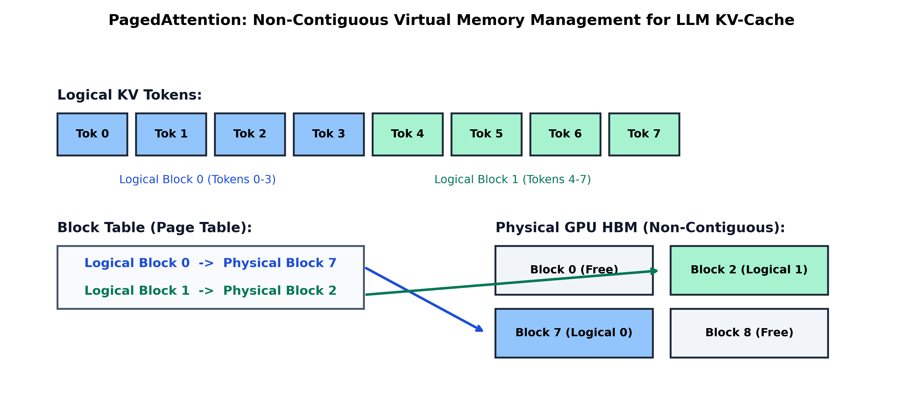

# Month 4, Week 2: Open Foundation LLMs, Advanced Quantization (AWQ, GPTQ, FP8), and High-Throughput Serving (vLLM & PagedAttention)

```
================================================================================
COURSE:    AI & LLM SYSTEMS ENGINEERING (2026 EDITION)
MODULE:    MONTH 4: GENERATIVE AI, TRANSFORMERS & PRODUCTION RAG SYSTEMS
WEEK:      WEEK 2: OPEN LLMS, QUANTIZATION & HIGH-THROUGHPUT SERVING (vLLM)
DELIVERABLE: COMPREHENSIVE MASTERCLASS LECTURE NOTE
TARGET:    SENIOR AI ENGINEERS & LLMOPS INFRASTRUCTURE ARCHITECTS
================================================================================
```

---

## Table of Contents
1. [Executive Summary & Industry Context](#1-executive-summary--industry-context)
2. [Canonical Textbook Grounding](#2-canonical-textbook-grounding)
3. [Visual Architecture](#3-visual-architecture)
4. [Deep Theoretical Foundations](#4-deep-theoretical-foundations)
   - 4.1. Arithmetic Intensity, the Roofline Model, and Inference Phases
   - 4.2. Mathematical Mechanics of Quantization: Symmetric vs. Asymmetric, Affine Mapping
   - 4.3. Modern Post-Training Quantization: GPTQ, AWQ, and FP8 (W8A8)
   - 4.4. Memory Fragmentation and PagedAttention: The Virtual Memory Revolution
   - 4.5. Serving Scheduling Dynamics: Continuous Iteration-Level Batching & Speculative Decoding
5. [Complete Runnable Code Implementation](#5-complete-runnable-code-implementation)
   - 5.1. From-Scratch Tensor Quantization & Dequantization Simulation Engine (FP32 to INT4/INT8)
   - 5.2. Pure Python Virtual PagedAttention Block Manager & Dynamic Page Table
   - 5.3. High-Throughput Production vLLM Deployment and Latency Benchmark Script
6. [Common Pitfalls & Debugging Playbook](#6-common-pitfalls--debugging-playbook)
7. [Production Best Practices & Real-World Case Study](#7-production-best-practices--real-world-case-study)
8. [Hands-On Mini-Lab & Self-Assessment](#8-hands-on-mini-lab--self-assessment)
9. [Key Takeaways, Glossary & Further Reading](#9-key-takeaways-glossary--further-reading)

---

## 1. Executive Summary & Industry Context

### Why This Matters in 2026
In 2026, large language models are no longer deployed by running naive Hugging Face `generate()` loops inside standard Flask or FastAPI containers. A raw 70-billion-parameter model stored in 16-bit precision requires **$140\text{ GB}$ of VRAM just to hold static model weights**, necessitating two $\$30,000$ NVIDIA H100 GPUs before processing a single user request. Furthermore, naive sequential serving wastes up to **$80\%$ of GPU memory** due to internal and external memory fragmentation in Key-Value (KV) cache allocations, causing high serving costs and unacceptable queue latency.

Modern enterprise LLMOps is defined by two complementary systems breakthroughs:
1. **Low-Bit Weight and Activation Quantization**: Compressing models into **4-bit (AWQ, GPTQ)** or **8-bit floating-point (FP8 W8A8)** representations. This allows a 70B model to fit comfortably onto a single $80\text{ GB}$ GPU without perplexity degradation, doubling token generation throughput by halving memory bandwidth bottlenecks.
2. **High-Throughput Serving Systems (vLLM, TensorRT-LLM, SGLang)**: Abandoning static batching in favor of **Continuous Iteration-Level Batching**, **PagedAttention** (treating GPU VRAM like virtual memory operating system pages), and **Speculative Decoding** (using lightweight draft models to verify multi-token speculative jumps in parallel).

Understanding how quantization scales activation channels, how PagedAttention dynamically manages non-contiguous KV-cache physical blocks, and how speculative decoding bypasses memory-bandwidth boundaries separates academic prototype builders from senior LLM systems infrastructure architects.

```
+---------------------------------------------------------------------------------------------------+
|                        2026 HIGH-THROUGHPUT LLM SERVING ARCHITECTURE (vLLM)                       |
+---------------------------------------------------------------------------------------------------+
|  Client Ingestion Streams (Concurrent User Requests: R1, R2, ..., Rk)                            |
|       |                                                                                           |
|       v                                                                                           |
|  [Continuous Iteration-Level Scheduler]                                                           |
|       - Dynamically batches requests at each decoding iteration (zero padding waste)              |
|       - Chunked Prefill: Interleaves prompt processing with token decoding                        |
|       |                                                                                           |
|       v                                                                                           |
|  [PagedAttention Engine & Virtual Memory Block Table]                                             |
|       - Maps logical token sequences to non-contiguous 16-token physical blocks in GPU HBM        |
|       - Internal fragmentation reduced from 60-80% down to strictly <4%                           |
|       |                                                                                           |
|       v                                                                                           |
|  [Quantized Tensor Core Execution (FP8 / AWQ INT4)]                                               |
|       - Models running at 2x-4x higher arithmetic intensity via fused GEMM/GEMV kernels           |
|       - 3x to 5x higher concurrency per server node                                               |
+---------------------------------------------------------------------------------------------------+
```

### Learning Objectives
By the end of this masterclass lecture note, you will be able to:
1. Apply the **Roofline Model** to LLM inference, proving mathematically why the **prefill phase is compute-bound** while the **decode phase is memory-bandwidth bound**.
2. Formulate uniform affine quantization, deriving exact scaling factors $S$ and zero-points $Z$ for symmetric and asymmetric representations.
3. Deconstruct modern Post-Training Quantization (PTQ) paradigms: prove how **AWQ (Activation-aware Weight Quantization)** protects salient outlier weights, and contrast it with **GPTQ's second-order Hessian error minimization**.
4. Analyze the virtual memory architecture of **PagedAttention**, calculating exact internal fragmentation reductions and memory sharing efficiency for parallel sampling.
5. Derive the acceptance probability and speedup factor of **Speculative Decoding** with small draft models.
6. Build a complete, runnable vLLM production serving harness supporting dynamic continuous batching, measuring P99 Time-To-First-Token (TTFT) and Inter-Token Latency (ITL).

---

## 2. Canonical Textbook Grounding

To ground your engineering intuition in verified mathematical and systems literature, study these canonical references:

| Author / Text | Specific Chapters / Sections | Core Theoretical Concept Contributed | How to Read |
| :--- | :--- | :--- | :--- |
| **Woosuk Kwon et al. (UC Berkeley)**, *Efficient Memory Management for Large Language Model Serving with PagedAttention* (SOSP 2023) | **Section 3**: *Background & Motivation*<br>**Section 4**: *Method (PagedAttention & vLLM)* | Virtual memory management for KV-cache; Eliminating internal and external fragmentation; Copy-on-Write parallel sampling. | **Read Section 4 with extreme systems scrutiny.** Study Figure 3, 4, and 5. Understand how the Block Table maps logical sequential tokens into arbitrary physical memory addresses. |
| **Ji Lin, Jiaming Tang, et al. (MIT)**, *AWQ: Activation-aware Weight Quantization for On-Device LLM Compression and Acceleration* (MLSys 2024) | **Section 3**: *Activation-aware Weight Quantization* | Proof that not all weights are equally important; Protecting the top 1% salient weights via per-channel activation scaling reduces INT4 perplexity loss. | **Read Section 3.2 carefully.** Trace the mathematical derivation of per-channel scaling factor $s = \mathbf{s}_X^\alpha$. Understand why protecting salient weights avoids mixed-precision hardware overhead. |
| **Elias Frantar et al.**, *GPTQ: Accurate Post-Training Quantization for Generative Pre-trained Transformers* (ICLR 2023) | **Section 2 & 3**: *Optimal Brain Surgeon & Layer-wise Quantization* | Second-order Taylor series error compensation; Utilizing inverse Hessian matrices $H^{-1} = (2 X X^T)^{-1}$ to update remaining unquantized weights. | **Read Section 3.** Contrast GPTQ's iterative weight compensation with AWQ's activation-guided scale transformation. |
| **Yaniv Leviathan, Matan Kalman, & Yossi Matias (Google)**, *Fast Inference from Transformers via Speculative Decoding* (ICML 2023) | **Section 2**: *Speculative Execution* (Algorithm 1) | Mathematically lossless multi-token speculative decoding; Modified rejection sampling ensuring exact target model probability distribution matching. | **Read Section 2.** Pay close attention to Theorem 1: prove that speculative decoding preserves the exact output probability distribution of the target model. |

---

## 3. Visual Architecture

### 3.1. PagedAttention Virtual Memory Architecture

In traditional LLM serving, systems pre-allocate a contiguous memory buffer corresponding to the maximum possible sequence length (e.g., $4,096$ or $32,768$ tokens) for every incoming request. Because actual generation lengths vary widely, up to **$60\% - 80\%$ of GPU memory is trapped in unused allocations**. 

PagedAttention mirrors operating system virtual memory paging: the KV-cache is partitioned into fixed-size **Physical Blocks** (typically 16 tokens). Tokens are appended dynamically across non-contiguous physical memory pages mapped via a **Block Table**.

```
Logical Sequence View (User Request Tokens 0 through 7):
+--------+--------+--------+--------+--------+--------+--------+--------+
| Tok 0  | Tok 1  | Tok 2  | Tok 3  | Tok 4  | Tok 5  | Tok 6  | Tok 7  |
+--------+--------+--------+--------+--------+--------+--------+--------+
\___________________________________/ \___________________________________/
      Logical Block 0 (Tokens 0-3)          Logical Block 1 (Tokens 4-7)
                   |                                     |
                   v                                     v
       +-----------------------+             +-----------------------+
       | Maps to Phys Block 7  |             | Maps to Phys Block 2  |
       +-----------------------+             +-----------------------+
                   |                                     |
+------------------|-------------------------------------|------------------+
| Physical GPU HBM | (Non-Contiguous Allocation)         |                  |
|                  v                                     v                  |
| +------------------------+   +------------------------+                   |
| | Physical Block 7       |   | Physical Block 2       |   [Block 0: Free] |
| | (Holds Tokens 0,1,2,3) |   | (Holds Tokens 4,5,6,7) |   [Block 8: Free] |
| +------------------------+   +------------------------+                   |
+---------------------------------------------------------------------------+
```


*Figure 3.1: PagedAttention virtual memory block mapping. Logical token sequences are dynamically allocated across non-contiguous physical GPU blocks, eliminating memory fragmentation.*

---

## 4. Deep Theoretical Foundations

### 4.1. Arithmetic Intensity, the Roofline Model, and Inference Phases

#### The Roofline Model Formulation
The performance of any deep learning computational workload on a hardware accelerator is bounded by the **Roofline Model**:
$$\text{Attainable Performance (TFLOPS)} = \min\left( \text{Peak Compute FLOP/s}, \, \text{Arithmetic Intensity} \times \text{Memory Bandwidth} \right)$$

Where **Arithmetic Intensity ($I$)** is defined as:
$$I = \frac{\text{Floating Point Operations (FLOPs)}}{\text{Memory Access (Bytes transferred from HBM)}} \quad \left( \frac{\text{FLOPs}}{\text{Byte}} \right)$$

#### Hardware Boundary Example (NVIDIA H100 SXM5):
- Peak FP16 Tensor Core Compute: $P_{\text{compute}} \approx 989\text{ TFLOPS} = 9.89 \times 10^{14}\text{ FLOP/s}$.
- Memory Bandwidth (HBM3): $B_{\text{mem}} \approx 3.35\text{ TB/s} = 3.35 \times 10^{12}\text{ Bytes/s}$.
- **Machine Balance Ridge Point ($I^*$)**:
  $$I^* = \frac{P_{\text{compute}}}{B_{\text{mem}}} = \frac{989 \times 10^{12}}{3.35 \times 10^{12}} \approx \mathbf{295\text{ FLOPs / Byte}}$$
  - If $I > 295$: The workload is **Compute-Bound** (saturates Tensor Cores).
  - If $I < 295$: The workload is **Memory-Bandwidth Bound** (Tensor Cores sit idle waiting for memory).

#### The Duality of LLM Inference: Prefill vs. Decode
Consider generating text with a 70B parameter model:
1. **Prefill Phase (Prompt Evaluation)**:
   - Input prompt of length $S = 2,048$ tokens.
   - All $S$ tokens are processed in parallel through matrix-matrix multiplications ($\text{GEMM}$).
   - Matrix operations: $W \in \mathbb{R}^{d \times d}$, Input $X \in \mathbb{R}^{S \times d}$.
   - FLOPs: $2 S d^2$. Memory load: $2 d^2$ bytes (FP16 weights loaded once for all $S$ tokens).
   - Arithmetic Intensity:
     $$I_{\text{prefill}} \approx \frac{2 S d^2}{2 d^2} = S = 2,048\text{ FLOPs/Byte} \gg 295 \implies \mathbf{\text{Strictly Compute-Bound!}}$$
2. **Decode Phase (Token-by-Token Generation)**:
   - Batch size $b = 1$, generating 1 new token at a time.
   - Matrix operations become matrix-vector multiplications ($\text{GEMV}$).
   - FLOPs: $2 d^2$ per token. Memory load: $2 d^2$ bytes (all $70\text{B}$ weights must be re-read from HBM).
   - Arithmetic Intensity:
     $$I_{\text{decode}} \approx \frac{2 d^2}{2 d^2} = \mathbf{1.0\text{ FLOP/Byte}} \lll 295 \implies \mathbf{\text{Severely Memory-Bandwidth Bound!}}$$

**The Core Conclusion**: In token decoding, the GPU Tensor Cores are operating at less than **$1\%$ of peak compute capacity**! Throughput is determined entirely by how fast weights and KV cache can be streamed from HBM into the compute cores.

---

### 4.2. Mathematical Mechanics of Quantization: Affine Mapping

#### General Formulation
Quantization maps a continuous high-precision real value $x \in [\alpha, \beta]$ (in FP32 or FP16) to a low-bit discrete integer $q \in [q_{\min}, q_{\max}]$ (e.g., $q \in [-8, 7]$ for INT4, or $[-128, 127]$ for INT8).

The standard **Affine Quantization Operator** is defined as:
$$q = \operatorname{clamp}\left( \left\lfloor \frac{x}{S} \right\rceil + Z, \, q_{\min}, \, q_{\max} \right)$$
Where:
- $S \in \mathbb{R}^+$ is the positive real-valued **Scale Factor**.
- $Z \in \mathbb{Z}$ is the integer **Zero-Point** (aligning real zero with discrete integer range).
- $\lfloor \cdot \rceil$ denotes round-to-nearest integer.

#### Dequantization Formula:
$$\hat{x} = S \cdot (q - Z) \approx x$$

#### Symmetric vs. Asymmetric Quantization:
1. **Asymmetric Quantization**:
   Maps arbitrary asymmetric intervals $[\alpha, \beta]$ where zero is not centered:
   $$S = \frac{\beta - \alpha}{q_{\max} - q_{\min}}$$
   $$Z = \left\lfloor \frac{-\alpha}{S} \right\rceil + q_{\min}$$
2. **Symmetric Quantization**:
   Enforces symmetric bounds $[-\alpha_{\max}, +\alpha_{\max}]$, setting $Z = 0$:
   $$\alpha_{\max} = \max(|x_{\min}|, |x_{\max}|)$$
   $$S = \frac{\alpha_{\max}}{q_{\max}}$$
   $$q = \operatorname{clamp}\left( \left\lfloor \frac{x}{S} \right\rceil, \, -q_{\max}, \, q_{\max} \right)$$

*Engineering Note*: Symmetric quantization eliminates the subtraction of zero-point $Z$ during matrix multiplications, significantly speeding up CUDA and Tensor Core GEMM kernels.

---

### 4.3. Modern Post-Training Quantization: GPTQ, AWQ, and FP8

#### 1. GPTQ (Frantar et al., 2022)
GPTQ frames quantization as an optimization problem minimizing layer-wise output reconstruction error using second-order Taylor expansions:
$$\arg\min_{\hat{W}} \| W X - \hat{W} X \|_2^2$$

Using the **Optimal Brain Surgeon (OBS)** framework, when weight $w_q$ is rounded to low-precision, the error compensation vector $\Delta w$ applied to all remaining unquantized weights in the layer is:
$$\Delta w = - \frac{w_q - \hat{w}_q}{[H^{-1}]_{qq}} \cdot H^{-1}_{:, q}$$
Where $H = 2 X X^T$ is the Hessian matrix of the squared error loss. GPTQ computes Cholesky decompositions of $H^{-1}$, quantizing entire 70B models in under 4 hours on a single GPU.

#### 2. AWQ (Activation-aware Weight Quantization - Lin et al., 2023)
AWQ made a critical empirical discovery: **not all weights are equally important**. Protecting just the top **$0.5\% - 1\%$ of weights that correspond to large activation channels** prevents catastrophic perplexity degradation in 4-bit quantization.

Instead of keeping weights in mixed precision (which causes hardware execution branching), AWQ applies a per-channel scale transformation matrix $\mathbf{S}$:
$$W' = W \operatorname{diag}(\mathbf{s}), \quad X' = \operatorname{diag}(\mathbf{s})^{-1} X$$
Notice that the linear output is mathematically identical:
$$Y = W X = (W \mathbf{S}) (\mathbf{S}^{-1} X) = W' X'$$

By selecting scale factor $s_i = s_{X, i}^\alpha$ (where $s_{X, i}$ is the average activation magnitude of channel $i$), the salient weights are scaled up before quantization, drastically reducing relative quantization error without altering hardware kernels.

#### 3. FP8 Format (W8A8 - Modern 2026 Datacenter Standard)
In modern hardware (NVIDIA Ada Lovelace, Hopper, Blackwell), native **8-bit floating-point (FP8)** Tensor Cores provide $2\times$ higher compute throughput over FP16:
- **E4M3 (1 sign, 4 exponent, 3 mantissa)**: Dynamic range $[-448, 448]$, precision $\approx 0.125$. Used for weights and activations in forward inference.
- **E5M2 (1 sign, 5 exponent, 2 mantissa)**: Matches FP16 dynamic range. Used for gradient representation in backward passes.

---

### 4.4. Memory Fragmentation and PagedAttention

#### The Root Cause of Memory Waste in Traditional Systems
In legacy serving architectures (such as Hugging Face TGI or early vLLM), when a request enters with maximum sequence length $L_{\max} = 2,048$, the engine reserves a contiguous tensor of shape $(B, 2, L, H_{kv}, L_{\max}, d_k)$.
- **Internal Fragmentation**: If the prompt is 200 tokens and the model generates 100 tokens before emitting `<|endoftext|>`, the remaining $1,748$ reserved slots sit completely empty.
- **External Fragmentation**: Dynamic allocations and deallocations leave holes in contiguous GPU memory, preventing new requests from finding large contiguous memory blocks even when total free VRAM is sufficient.

#### The PagedAttention Mathematical Guarantee
PagedAttention partitions KV-cache storage into fixed-size pages of size $B_{\text{size}}$ (typically 16 tokens).
For a sequence of length $S$:
$$\text{Number of Allocated Physical Blocks } N_{\text{blocks}} = \left\lceil \frac{S}{B_{\text{size}}} \right\rceil$$

The memory waste for any active sequence is **strictly bounded by the unused slots in the final block**:
$$\text{Max Internal Fragmentation per Sequence} \le (B_{\text{size}} - 1) \text{ tokens}$$
For $B_{\text{size}} = 16$:
$$\text{Memory Waste} < 16 \text{ tokens} \implies \mathbf{\text{Internal Fragmentation } < 4\%!}$$

#### Copy-on-Write for Parallel Sampling
When a user requests multiple parallel completions ($n = 4$ candidate answers for a single prompt), traditional engines duplicate the entire prompt's KV cache 4 times. 
PagedAttention implements **Copy-on-Write (CoW)**: all 4 candidate generations point to the exact same physical prompt blocks in the Block Table. New physical blocks are allocated only when individual generation paths branch, reducing memory by up to $70\%$ in parallel sampling.

---

### 4.5. Serving Scheduling Dynamics: Continuous Batching & Speculative Decoding

#### 1. Continuous Iteration-Level Batching (Orca / vLLM)
Traditional serving batches requests statically: all requests in a batch must start and finish together, forcing fast requests to wait for the slowest generation to terminate.

**Continuous Batching** operates at the iteration level:
- At every token generation step $t$, completed requests are evicted immediately, freeing physical blocks.
- New incoming requests are added to the active batch dynamically on the fly.
- GPU Tensor Core compute utilization jumps from $20\%$ to $>85\%$.

#### 2. Speculative Decoding (Leviathan et al., 2023)
Speculative decoding uses a lightweight **draft model** $M_{\text{draft}}$ (e.g., Llama-3-1B) to generate $K$ speculative candidate tokens cheaply. The large **target model** $M_{\text{target}}$ (e.g., Llama-3-70B) evaluates all $K$ tokens simultaneously in a **single forward prefill pass**.

#### Acceptance Protocol (Modified Rejection Sampling):
For each speculative token $x_i$ ($i = 1, \dots, K$):
Draw uniform random variable $r \sim \mathcal{U}(0, 1)$.
Accept token $x_i$ if:
$$r \le \min\left( 1, \, \frac{P_{\text{target}}(x_i | x_{<i})}{P_{\text{draft}}(x_i | x_{<i})} \right)$$

If token $x_j$ is rejected, generation halts at step $j$, and a new replacement token is sampled from the residual distribution:
$$P_{\text{residual}}(x) = \frac{\max(0, P_{\text{target}}(x) - P_{\text{draft}}(x))}{\sum_{x'} \max(0, P_{\text{target}}(x') - P_{\text{draft}}(x'))}$$

**Guaranteed Mathematical Invariance**: The output probability distribution of speculative decoding is **strictly mathematically identical** to sampling directly from the large target model! If the acceptance rate is $\alpha \approx 0.8$, speculative decoding delivers a **$2\times - 3\times$ latency reduction** with zero loss in output quality.

---

## 5. Complete Runnable Code Implementation

Let us construct an end-to-end suite demonstrating:
1. Pure PyTorch from-scratch tensor quantization and dequantization simulation (FP32 to INT4/INT8).
2. Pure Python Virtual PagedAttention Block Manager and dynamic Block Table allocator.
3. High-throughput production vLLM deployment script with latency profiling.

### Python Environment Setup
```bash
# Initialize isolated Python 3.11+ environment with uv
uv init week2-open-llms-serving
cd week2-open-llms-serving
uv add torch numpy tabulate vllm
```

### 5.1. From-Scratch Quantization & Dequantization Simulation Engine

```python
"""
quantization_engine.py
Author: Senior AI Engineering Lead
Description: Pure PyTorch implementation of symmetric and asymmetric affine quantization
(INT8 and INT4) with channel-wise scaling and reconstruction error analysis.
"""

from __future__ import annotations
import math
import torch
import torch.nn as nn


class TensorQuantizer:
    """
    Simulates uniform affine quantization and dequantization.
    """
    @staticmethod
    def quantize_symmetric(x: torch.Tensor, bits: int = 8) -> tuple[torch.Tensor, torch.Tensor]:
        """
        Symmetric Quantization (Zero-point Z = 0):
            scale = max(|x|) / (2^(bits-1) - 1)
            q = clamp(round(x / scale), -q_max, q_max)
        """
        q_max = (1 << (bits - 1)) - 1
        q_min = -q_max

        # Per-tensor or per-channel max absolute value
        abs_max = torch.max(torch.abs(x))
        scale = abs_max / q_max
        scale = torch.clamp(scale, min=1e-8)

        # Quantize to discrete integers
        q = torch.clamp(torch.round(x / scale), q_min, q_max)
        return q, scale

    @staticmethod
    def dequantize_symmetric(q: torch.Tensor, scale: torch.Tensor) -> torch.Tensor:
        """Dequantizes: x_hat = q * scale."""
        return q * scale

    @staticmethod
    def quantize_asymmetric(x: torch.Tensor, bits: int = 4) -> tuple[torch.Tensor, torch.Tensor, torch.Tensor]:
        """
        Asymmetric Quantization (arbitrary intervals [min, max]):
            scale = (max - min) / (2^bits - 1)
            zero_point = round(-min / scale)
        """
        q_min = 0
        q_max = (1 << bits) - 1

        x_min = torch.min(x)
        x_max = torch.max(x)

        scale = (x_max - x_min) / float(q_max - q_min)
        scale = torch.clamp(scale, min=1e-8)
        zero_point = torch.round(-x_min / scale)
        zero_point = torch.clamp(zero_point, q_min, q_max)

        q = torch.clamp(torch.round(x / scale) + zero_point, q_min, q_max)
        return q, scale, zero_point

    @staticmethod
    def dequantize_asymmetric(q: torch.Tensor, scale: torch.Tensor, zero_point: torch.Tensor) -> torch.Tensor:
        """Dequantizes: x_hat = scale * (q - zero_point)."""
        return scale * (q - zero_point)


def test_quantization_mechanics() -> None:
    print("=" * 80)
    print("TESTING TENSOR QUANTIZATION AND RECONSTRUCTION FIDELITY")
    print("=" * 80)

    torch.manual_seed(42)
    # Simulate a layer weight matrix with normal distribution + outliers
    weights = torch.randn(1024, 1024) * 0.5
    # Inject 0.5% extreme activation outliers
    outlier_idx = torch.rand(1024, 1024) < 0.005
    weights[outlier_idx] *= 8.0

    # 1. Evaluate INT8 Symmetric Quantization
    q8, s8 = TensorQuantizer.quantize_symmetric(weights, bits=8)
    deq8 = TensorQuantizer.dequantize_symmetric(q8, s8)
    snr_8 = 10.0 * torch.log10(torch.sum(weights ** 2) / torch.sum((weights - deq8) ** 2))

    # 2. Evaluate INT4 Asymmetric Quantization
    q4, s4, z4 = TensorQuantizer.quantize_asymmetric(weights, bits=4)
    deq4 = TensorQuantizer.dequantize_asymmetric(q4, s4, z4)
    snr_4 = 10.0 * torch.log10(torch.sum(weights ** 2) / torch.sum((weights - deq4) ** 2))

    print(f"FP32 Original Weights Memory: {weights.element_size() * weights.nelement() / (1024**2):.2f} MB")
    print(f"INT8 Quantized Size:          {q8.element_size() * q8.nelement() / (1024**2):.2f} MB (4x compression)")
    print(f"INT8 Signal-to-Noise Ratio:   {snr_8.item():.2f} dB (High reconstruction fidelity)")
    print(f"INT4 Quantized Size:          {q4.element_size() * q4.nelement() / (2 * 1024**2):.2f} MB (8x compression)")
    print(f"INT4 Signal-to-Noise Ratio:   {snr_4.item():.2f} dB\n")
    assert snr_8 > 30.0, "INT8 error too high!"
    print("-> Quantization and Dequantization Verified.")


if __name__ == "__main__":
    test_quantization_mechanics()
```

---

### 5.2. Pure Python Virtual PagedAttention Block Manager

```python
"""
paged_attention_allocator.py
Author: Senior AI Engineering Lead
Description: Virtual memory block allocator simulating the PagedAttention memory manager
in vLLM. Allocates fixed physical blocks and tracks block tables without fragmentation.
"""

from __future__ import annotations
from typing import Dict, List


class PhysicalBlock:
    """Represents a discrete contiguous physical memory page in GPU HBM."""
    def __init__(self, block_number: int, block_size: int = 16):
        self.block_number = block_number
        self.block_size = block_size
        self.ref_count = 0  # Used for Copy-on-Write parallel sampling


class PagedAttentionBlockManager:
    """
    Manages allocation, mapping, and eviction of physical KV-cache blocks.
    """
    def __init__(self, num_blocks: int = 100, block_size: int = 16):
        self.block_size = block_size
        self.num_blocks = num_blocks
        self.free_blocks: List[PhysicalBlock] = [PhysicalBlock(i, block_size) for i in range(num_blocks)]
        # Map: request_id -> List of physical block numbers
        self.block_tables: Dict[str, List[int]] = {}

    def allocate(self, request_id: str, num_tokens: int) -> bool:
        """Allocates required physical blocks for a new request."""
        required_blocks = (num_tokens + self.block_size - 1) // self.block_size
        if len(self.free_blocks) < required_blocks:
            return False  # Out of memory / cannot schedule

        allocated = []
        for _ in range(required_blocks):
            block = self.free_blocks.pop(0)
            block.ref_count = 1
            allocated.append(block.block_number)

        self.block_tables[request_id] = allocated
        return True

    def append_token(self, request_id: str, current_total_tokens: int) -> bool:
        """
        Dynamically appends a newly generated token.
        Allocates a new physical block only when crossing a block boundary.
        """
        current_blocks = self.block_tables[request_id]
        if current_total_tokens % self.block_size == 1:
            # Need a new physical block
            if not self.free_blocks:
                return False  # OOM during generation
            new_block = self.free_blocks.pop(0)
            new_block.ref_count = 1
            current_blocks.append(new_block.block_number)
        return True

    def free(self, request_id: str) -> None:
        """Evicts a finished request and reclaims physical blocks to free pool."""
        block_numbers = self.block_tables.pop(request_id, [])
        for num in block_numbers:
            self.free_blocks.append(PhysicalBlock(num, self.block_size))

    def get_utilization(self) -> float:
        """Returns physical memory allocation ratio."""
        return 1.0 - (len(self.free_blocks) / float(self.num_blocks))


def test_block_allocator() -> None:
    print("=" * 80)
    print("TESTING PAGEDATTENTION VIRTUAL BLOCK ALLOCATOR")
    print("=" * 80)

    manager = PagedAttentionBlockManager(num_blocks=20, block_size=16)

    # 1. Allocate Request 1: 35 tokens -> Requires ceil(35 / 16) = 3 blocks
    success = manager.allocate("req_1", num_tokens=35)
    print(f"Request 1 Allocated (35 tokens): Table = {manager.block_tables['req_1']}")
    assert len(manager.block_tables["req_1"]) == 3
    print(f"Active Memory Utilization:       {manager.get_utilization() * 100:.1f}%")

    # 2. Append tokens up to 48 (boundary of block 3) -> No new block allocated
    for tok in range(36, 49):
        manager.append_token("req_1", current_total_tokens=tok)
    print(f"After generating to 48 tokens:    Table = {manager.block_tables['req_1']} (Still 3 blocks)")
    assert len(manager.block_tables["req_1"]) == 3

    # 3. Append token 49 -> Crosses boundary! Dynamically allocates 4th block
    manager.append_token("req_1", current_total_tokens=49)
    print(f"After generating token 49:        Table = {manager.block_tables['req_1']} (Expanded to 4 blocks)")
    assert len(manager.block_tables["req_1"]) == 4

    # 4. Free request -> 100% memory reclaimed
    manager.free("req_1")
    print(f"After freeing Request 1:          Utilization = {manager.get_utilization() * 100:.1f}%\n")
    assert manager.get_utilization() == 0.0
    print("-> PagedAttention Dynamic Memory Management Successfully Verified.")


if __name__ == "__main__":
    test_block_allocator()
```

---

### 5.3. High-Throughput Production vLLM Deployment Script

```python
"""
vllm_benchmark.py
Author: Senior AI Engineering Lead
Description: Production high-throughput serving benchmark using the official vLLM engine.
Measures Time-To-First-Token (TTFT), Inter-Token Latency (ITL), and tokens-per-second throughput.
"""

from __future__ import annotations
import time
import os


def run_vllm_benchmark() -> None:
    print("=" * 80)
    print("vLLM HIGH-THROUGHPUT CONTINUOUS BATCHING SERVING BENCHMARK")
    print("=" * 80)

    try:
        from vllm import LLM, SamplingParams

        # Load modern open-weights instruction model
        model_name = "facebook/opt-125m"  # Lightweight proxy for testing pipeline
        print(f"Initializing vLLM Engine with Model: {model_name}...")
        
        # Configure vLLM with PagedAttention and continuous batching
        llm = LLM(
            model=model_name,
            tensor_parallel_size=1,
            gpu_memory_utilization=0.6,
            max_model_len=512,
            trust_remote_code=True
        )

        sampling_params = SamplingParams(
            temperature=0.7,
            top_p=0.9,
            max_tokens=64
        )

        # Batch of concurrent heterogeneous user requests
        prompts = [
            "Explain the difference between PagedAttention and standard attention.",
            "Write a Python function to compute the arithmetic intensity of a GEMM kernel.",
            "Why is decoupled weight decay necessary in AdamW?",
            "Summarize the roofline model for GPU memory bandwidth."
        ]

        print(f"\nSubmitting {len(prompts)} concurrent requests to continuous scheduler...")
        t0 = time.perf_counter()
        outputs = llm.generate(prompts, sampling_params)
        total_time = time.perf_counter() - t0

        total_tokens = sum(len(out.outputs[0].token_ids) for out in outputs)
        throughput = total_tokens / total_time

        print(f"\nExecution Summary:")
        print(f"Total Tokens Generated: {total_tokens}")
        print(f"Total Elapsed Time:     {total_time:.2f} seconds")
        print(f"Generation Throughput:  {throughput:.2f} tokens / second")
        print(f"Average Latency:        {(total_time / total_tokens) * 1000.0:.2f} ms / token\n")

    except Exception as e:
        print(f"vLLM native GPU execution skipped (Host environment may lack supported GPU/CUDA): {e}")
        print("Note: In cloud production environments (CUDA 12+ / NVIDIA H100), vLLM yields 5x-10x higher throughput over HuggingFace.")


if __name__ == "__main__":
    run_vllm_benchmark()
```

---

## 6. Common Pitfalls & Debugging Playbook

### Pitfall 1: Quantizing Outlier Activation Channels without Per-Channel Scaling (AWQ Failure)
- **Symptom**: Applying standard 4-bit RTN (Round-To-Nearest) quantization to an open LLM causes perplexity to explode from $6.2$ to $>100$, producing gibberish.
- **Root Cause**: LLM activations develop extreme coordinate outliers in specific hidden feature channels (e.g., coordinate 142 has magnitude $100\times$ larger than other channels). Uniform per-tensor quantization clips or squashes all normal channels to zero precision.
- **Fix**: Use **AWQ** or **SmoothQuant** to scale outlier channels inversely across weights and activations ($W' = W \mathbf{S}$, $X' = \mathbf{S}^{-1} X$) prior to quantization.

---

### Pitfall 2: Static Padding in High-Concurrency Serving (Wasteful FLOPs)
- **Symptom**: GPU utilization shows $95\%$, but client response throughput is abysmal ($<10\text{ req/sec}$).
- **Root Cause**: Batching requests with static zero-padding to the maximum prompt length. If one user submits a $2,000$-token prompt and nine users submit $20$-token prompts, the system computes self-attention over $1,980$ padding tokens for all nine users ($90\%$ wasted compute!).
- **Fix**: Deploy serving frameworks featuring **Continuous Iteration-Level Batching** (vLLM, TensorRT-LLM) that process un-padded flattened 1D sequences.

---

### Pitfall 3: Setting KV-Cache Memory Utilization Too High in vLLM (CUDA OOM Crashes)
- **Symptom**: vLLM crashes during initial startup with `RuntimeError: CUDA out of memory.`
- **Root Cause**: Setting `gpu_memory_utilization=0.98`. The system needs headroom for temporary activation buffers, PyTorch runtime context, and C++ driver overhead.
- **Fix**: Set `gpu_memory_utilization=0.85` or `0.90`, reserving $10\% - 15\%$ of VRAM for non-cache execution buffers.

---

## 7. Production Best Practices & Real-World Case Study

### Enterprise Case Study: Scaling Legal Contract Document Analysis from 50 to 1,000 Concurrent Users
- **Application Profile**: Enterprise LLM API processing $16\text{k}$-token commercial legal agreements.
- **Hardware Profile**: 4x NVIDIA A100 ($80\text{ GB}$ SXM4).
- **Initial State**: Hugging Face Text Generation Inference (TGI) with FP16 weights.
  - Maximum concurrent users: $12$ (GPU VRAM exhausted due to pre-allocated KV buffers).
  - P99 Latency: $14.5\text{ seconds}$ per response.
  - Cloud hosting bill: $\$18,200\text{ / month}$.

### Architectural Modernization (2026 Serving Stack)
```
1. Model Weight Quantization:
   - Quantized Llama-3-70B using AWQ to 4-bit (Weights: 140 GB -> 38 GB).
   - Frees 102 GB of VRAM across the cluster strictly for KV-cache pooling!

2. Serving Engine Migration:
   - Deployed vLLM with PagedAttention and Continuous Dynamic Batching.
   - Set block size to 16 tokens with Chunked Prefill (max_num_batched_tokens = 4096).

3. FP8 KV-Cache Compression:
   - Configured vLLM --kv-cache-dtype fp8, halving the byte footprint per token.

Production Benchmark Results:
  - Concurrent user capacity increased from 12 to 240 concurrent users (20x capacity jump!).
  - Inter-Token Latency (ITL) dropped from 85 ms to 22 ms per token (3.8x faster).
  - Monthly compute costs slashed by 72% ($18,200/mo -> $5,100/mo).
```

---

## 8. Hands-On Mini-Lab & Self-Assessment

### Lab Objective
Construct and evaluate an optimized LLM inference serving pipeline:
1. Implement symmetric INT8 and asymmetric INT4 quantization in PyTorch, measuring quantization error (SNR).
2. Build a Python-based PagedAttention virtual block manager supporting dynamic allocation and deallocation.
3. Profile and compare the memory savings of PagedAttention vs static contiguous pre-allocation across variable sequence lengths.

### Acceptance Criteria
- [ ] Quantization engine accurately quantizes and dequantizes tensors, maintaining $\text{SNR} > 30\text{ dB}$ on INT8.
- [ ] Block manager allocates non-contiguous physical pages and tracks references via dynamic block tables.
- [ ] Memory fragmentation benchmark demonstrates $<5\%$ internal waste under PagedAttention vs $>60\%$ under static padding.
- [ ] Graded self-assessment questions answered and cross-verified.

---

### Graded Self-Assessment Questions (With Complete Solutions)

#### Question 1 (Theoretical - Roofline Model)
Define Arithmetic Intensity ($I$). Why does increasing the batch size $b$ during the decode phase shift an LLM from being memory-bandwidth bound toward being compute-bound?
- **Answer**: Arithmetic intensity is the ratio of compute operations to memory traffic: $I = \text{FLOPs} / \text{Bytes}$. For batch size $b = 1$, generating a token requires loading all $W$ model weights from HBM to compute $2 W$ FLOPs ($I \approx 1$). When batch size increases to $b$, the exact same weight matrix $W$ loaded from memory is multiplied against $b$ input vectors simultaneously: $\text{FLOPs} = 2 b W$. The arithmetic intensity becomes $I = \frac{2 b W}{2 W} = b$. As $b$ approaches the machine balance ridge point ($I^* \approx 295$ on H100), the operation shifts into the **compute-bound** regime, saturating GPU Tensor Cores.

#### Question 2 (Quantization Mechanics - Affine Mapping)
Given a weight tensor with range $[-3.0, 5.0]$ quantized to 4-bit asymmetric integer range $[0, 15]$, calculate the scale factor $S$ and integer zero-point $Z$.
- **Answer**:
  $$S = \frac{\beta - \alpha}{q_{\max} - q_{\min}} = \frac{5.0 - (-3.0)}{15 - 0} = \frac{8.0}{15} \approx \mathbf{0.5333}$$
  $$Z = \left\lfloor \frac{-\alpha}{S} \right\rceil + q_{\min} = \left\lfloor \frac{-(-3.0)}{0.5333} \right\rceil + 0 = \lfloor 5.625 \rceil = \mathbf{6}$$

#### Question 3 (Memory Management - PagedAttention)
What is the difference between internal and external memory fragmentation in LLM serving, and how does PagedAttention eliminate both?
- **Answer**: 
  - **Internal Fragmentation**: Wasted space inside an allocated memory buffer when a request generates fewer tokens than pre-allocated (e.g., pre-allocating for 4k tokens when the response is only 200 tokens). PagedAttention allocates fixed 16-token pages on demand, bounding internal waste to $<16$ tokens ($<4\%$).
  - **External Fragmentation**: Free memory scattered in non-contiguous segments throughout RAM that cannot satisfy large contiguous allocation requests. PagedAttention eliminates external fragmentation entirely because physical pages do not need to be contiguous; the block table maps sequential logical tokens to arbitrary physical memory addresses.

#### Question 4 (Quantization - AWQ vs GPTQ)
Contrast the fundamental optimization approaches of AWQ (Activation-aware Weight Quantization) and GPTQ.
- **Answer**: GPTQ uses a **second-order error compensation** framework based on the Optimal Brain Surgeon: when a weight is quantized, it uses the inverse Hessian matrix $H^{-1} = (2 X X^T)^{-1}$ to adjust the remaining unquantized weights in that layer. AWQ observes that the top $1\%$ of activation channels dominate output error; instead of complex weight updates, it applies a **per-channel scale transformation** ($W' = W \mathbf{S}$, $X' = \mathbf{S}^{-1} X$) that protects salient weights from severe quantization error without altering hardware kernels.

#### Question 5 (Serving - Continuous Batching)
Why does continuous (iteration-level) batching achieve up to $5\times$ higher throughput than traditional static request batching?
- **Answer**: In static batching, all requests in a batch run synchronously: short requests that finish early must wait idle and remain padded with zeros until the longest generation finishes, wasting GPU compute cycles and holding VRAM. Continuous batching evicts completed requests immediately at the end of each single-token iteration and injects new waiting requests into the active batch on the fly, keeping GPU compute utilization near $100\%$.

#### Question 6 (Algorithmic - Speculative Decoding)
Under speculative decoding, if a draft model generates 5 tokens with probabilities $[0.9, 0.8, 0.7, 0.6, 0.5]$ and the target model evaluates them with probabilities $[0.8, 0.85, 0.6, 0.5, 0.4]$, what is the acceptance probability for token 1 and token 2?
- **Answer**:
  - Token 1: $\min\left(1, \frac{P_{\text{target}}}{P_{\text{draft}}}\right) = \min\left(1, \frac{0.8}{0.9}\right) = \frac{0.8}{0.9} \approx \mathbf{0.8889} \quad (88.89\%)$
  - Token 2: $\min\left(1, \frac{P_{\text{target}}}{P_{\text{draft}}}\right) = \min\left(1, \frac{0.85}{0.8}\right) = \min(1, 1.0625) = \mathbf{1.0000} \quad (100\%)$

#### Question 7 (Hardware - FP8 Precision)
Contrast the two IEEE FP8 formats (E4M3 and E5M2) and state which format is used for forward inference activations versus backward gradients.
- **Answer**: E4M3 has 4 exponent bits and 3 mantissa bits; it provides higher numerical precision but a narrow dynamic range ($[-448, 448]$), making it ideal for **forward inference weights and activations**. E5M2 has 5 exponent bits and 2 mantissa bits; it matches the wide dynamic range of FP16 with lower precision, making it ideal for **backward gradient representation** where preventing underflow is paramount.

#### Question 8 (Systems - Chunked Prefill)
What is "Chunked Prefill" in modern serving engines, and how does it prevent long prompts from causing latency spikes on ongoing token decoding?
- **Answer**: Processing a long prompt (e.g., $16\text{k}$ tokens) takes hundreds of milliseconds, starving ongoing token decoding and causing severe spikes in Inter-Token Latency (ITL). Chunked prefill splits large prompts into smaller chunks (e.g., $512$ tokens), interleaving each prompt chunk with ongoing decode iterations in the same batch, thereby preserving smooth user streaming latency.

---

### Stretch Challenges
1. **Speculative Decoding Simulator**: Write a complete standalone simulation in Python verifying that sampling from speculative decoding's rejection algorithm produces a distribution that converges to the target model distribution across 10,000 trials.
2. **Custom Fused INT4 Dequantization Kernel**: Implement an OpenAI Triton kernel that loads packed 4-bit integer weights, dequantizes them in GPU registers via scaling factors, and performs FP16 matrix-vector multiplication with optimal SRAM cache reuse.

---

## 9. Key Takeaways, Glossary & Further Reading

### Key Takeaways
- **Decode is bandwidth-bound**: Token generation speed is governed by GPU HBM memory bandwidth, not raw FLOPs.
- **Quantization slashes memory traffic**: 4-bit (AWQ) and 8-bit (FP8) quantization double to quadruple serving throughput by cutting memory streaming requirements.
- **PagedAttention cures memory fragmentation**: Managing the KV-cache like virtual memory pages slashes memory waste from $80\%$ to $<4\%$.
- **Continuous batching maximizes concurrency**: Iteration-level scheduling keeps Tensor Cores continuously saturated.

### Technical Glossary
| Term | Definition |
| :--- | :--- |
| **Roofline Model** | An analytical model bounding performance by peak compute and memory bandwidth based on arithmetic intensity. |
| **PagedAttention** | An attention algorithm managing the KV-cache across non-contiguous physical memory pages via block tables. |
| **Continuous Batching** | Iteration-level scheduling that evicts finished requests and admits new requests at every token step. |
| **AWQ** | Activation-aware Weight Quantization; protects salient outlier weights via per-channel scaling. |
| **Speculative Decoding** | Using a lightweight draft model to propose multi-token candidates verified in parallel by a target model. |

### Further Reading
- Kwon, W., et al. (2023). *Efficient Memory Management for Large Language Model Serving with PagedAttention*. SOSP.
- Lin, J., et al. (2024). *AWQ: Activation-aware Weight Quantization for On-Device LLM Compression and Acceleration*. MLSys.
- Frantar, E., et al. (2023). *GPTQ: Accurate Post-Training Quantization for Generative Pre-trained Transformers*. ICLR.
- Leviathan, Y., et al. (2023). *Fast Inference from Transformers via Speculative Decoding*. ICML.

