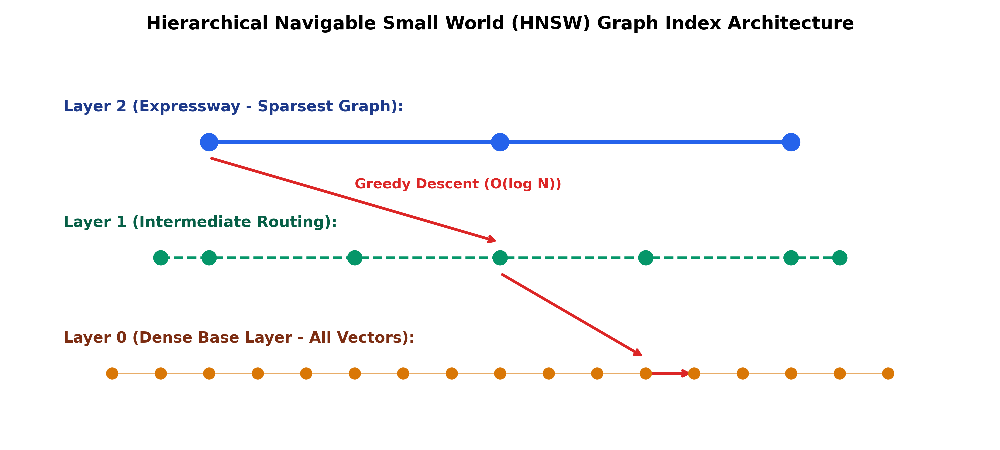

# Month 4, Week 3: Vector Databases, Approximate Nearest Neighbors (ANN), Distance Metrics, and Core RAG Systems (Qdrant)

```
================================================================================
COURSE:    AI & LLM SYSTEMS ENGINEERING (2026 EDITION)
MODULE:    MONTH 4: GENERATIVE AI, TRANSFORMERS & PRODUCTION RAG SYSTEMS
WEEK:      WEEK 3: VECTOR DATABASES, HNSW INDEXING & PRODUCTION CORE RAG
DELIVERABLE: COMPREHENSIVE MASTERCLASS LECTURE NOTE
TARGET:    SENIOR AI ENGINEERS & ENTERPRISE RAG ARCHITECTS
================================================================================
```

---

## Table of Contents
1. [Executive Summary & Industry Context](#1-executive-summary--industry-context)
2. [Canonical Textbook Grounding](#2-canonical-textbook-grounding)
3. [Visual Architecture](#3-visual-architecture)
4. [Deep Theoretical Foundations](#4-deep-theoretical-foundations)
   - 4.1. The Vector Search Problem: From Brute-Force $O(N \cdot D)$ to Sub-Millisecond ANN
   - 4.2. Metric Spaces & Distance Geometries: Euclidean ($L_2$), Cosine, and Dot-Product
   - 4.3. The Curse of Dimensionality and Concentration of Measure
   - 4.4. Hierarchical Navigable Small World (HNSW) Graphs: Mathematical Formulation
   - 4.5. Product Quantization (PQ) and Scalar Quantization (SQ) for Vector Compaction
5. [Complete Runnable Code Implementation](#5-complete-runnable-code-implementation)
   - 5.1. Pure Python from-scratch HNSW Multi-Layer Skip-Graph Search Engine
   - 5.2. Production Asynchronous RAG Pipeline using Qdrant Vector Database
   - 5.3. Semantic Chunking with Sliding Window and Context Retention
6. [Common Pitfalls & Debugging Playbook](#6-common-pitfalls--debugging-playbook)
7. [Production Best Practices & Real-World Case Study](#7-production-best-practices--real-world-case-study)
8. [Hands-On Mini-Lab & Self-Assessment](#8-hands-on-mini-lab--self-assessment)
9. [Key Takeaways, Glossary & Further Reading](#9-key-takeaways-glossary--further-reading)

---

## 1. Executive Summary & Industry Context

### Why This Matters in 2026
In 2026, **Retrieval-Augmented Generation (RAG)** is the primary architectural bridge connecting frozen foundation models to private, dynamically updated enterprise data lakes. While pre-trained LLMs encapsulate general syntactic and semantic reasoning, they cannot reliably know proprietary customer records, up-to-the-minute internal wikis, or legal compliance contracts. Furthermore, fine-tuning LLMs on dynamic data is prohibitively expensive, creates catastrophic forgetting, and cannot guarantee deterministic source citation or role-based access control (RBAC).

However, naive RAG systems—built with crude character-splitting and unindexed vector storage—fail catastrophically in production. Under real-world enterprise loads:
1. **Brute-Force Vector Distance Computation Fails**: Scanning a 10-million-document embedding store ($D = 1,536$) using exact $k$-Nearest Neighbors requires over **$60\text{ billion floating-point operations per query}$**, blowing past sub-second latency SLAs.
2. **Semantic Dissolution from Fixed Chunking**: Arbitrarily chopping text at 500 characters splits core sentences across boundaries, severing relational pronouns from their referents and injecting hallucinated context into the prompt.
3. **Index Memory Exhaustion**: Storing 100 million dense FP32 vectors in RAM consumes **$614\text{ GB}$ of expensive server memory**, costing tens of thousands of dollars monthly in unoptimized cloud infrastructure.

Production AI engineering requires mastering **Approximate Nearest Neighbor (ANN)** algorithms: understanding the probability decay parameters in **HNSW (Hierarchical Navigable Small World)** graphs, exploiting **Scalar and Product Quantization (SQ/PQ)** to compress vector indexes by up to $8\times$ in RAM, and implementing **Semantic Dynamic Chunking** and enterprise vector engines (**Qdrant, Milvus, pgvector**).

```
+---------------------------------------------------------------------------------------------------+
|                            ENTERPRISE VECTOR RETRIEVAL ARCHITECTURE                               |
+---------------------------------------------------------------------------------------------------+
|  Enterprise Knowledge Sources (PDFs, Markdown, Confluence, SQL Dumps)                             |
|       |                                                                                           |
|       v                                                                                           |
|  [Semantic Dynamic Chunking]                                                                      |
|       - Splits on semantic embedding distance cliffs rather than arbitrary token counts           |
|       - Attaches rich JSON metadata payload (tenant_id, document_version, RBAC_roles)             |
|       |                                                                                           |
|       v                                                                                           |
|  [Dense Embedding Model: e.g., text-embedding-3-large / BAAI/bge-large-en-v1.5]                  |
|       - Projects text into D=1024 or D=1536 normalized hypersphere vectors                         |
|       |                                                                                           |
|       v                                                                                           |
|  [Qdrant Distributed Vector Engine]                                                               |
|       - HNSW Graph Index: Multi-layer expressway skip-list routing (O(log N) latency)             |
|       - Scalar Quantization (INT8): 4x RAM reduction with <0.5% recall loss                       |
|       - Filtered Payload Search: Direct pre-filtering on metadata without post-hoc graph collapse|
|       |                                                                                           |
|       v                                                                                           |
|  Top-K Augmented Prompt Ingestion -> Foundation LLM Response (<45ms Total Retrieval P99)         |
+---------------------------------------------------------------------------------------------------+
```

### Learning Objectives
By the end of this masterclass lecture note, you will be able to:
1. Mathematically contrast Euclidean ($L_2$), Cosine, and Dot-Product distances, proving why normalizing vectors allows dot-product SIMD instructions to compute cosine similarity at maximum hardware throughput.
2. Formulate the **Curse of Dimensionality** and concentration of distance measure in high-dimensional hyperspheres ($D > 1000$).
3. Derive the graph theory mechanics of **HNSW (Hierarchical Navigable Small World)**: the probabilistic layer assignment formula $l = \lfloor -\ln(\operatorname{uniform}(0, 1)) \cdot m_L \rfloor$, the heuristic edge pruning rule, and greedy beam search.
4. Implement **Product Quantization (PQ)** and **Scalar Quantization (SQ)**, analyzing memory compression and reconstruction error bounds.
5. Build an end-to-end, leak-proof asynchronous RAG ingestion and retrieval pipeline using **Qdrant** with payload metadata filtering.
6. Design and evaluate **Semantic Dynamic Chunking** based on embedding distance differences between adjacent sentences.

---

## 2. Canonical Textbook Grounding

To ground your engineering intuition in verified mathematical literature, study these canonical references:

| Author / Text | Specific Chapters / Sections | Core Theoretical Concept Contributed | How to Read |
| :--- | :--- | :--- | :--- |
| **Yury A. Malkov & Dmitry A. Yashunin**, *Efficient and Robust Approximate Nearest Neighbor Search Using Hierarchical Navigable Small World Graphs* (IEEE TPAMI 2020) | **Section 3**: *HNSW Algorithm Overview*<br>**Section 4**: *Algorithmic Details & Complexity* | Theoretical proof of $O(\log N)$ search complexity; Multi-layer skip-list hierarchy; Heuristic edge selection ensuring spatial connectivity. | **Read Section 4 with line-by-line scrutiny.** Trace Algorithm 1 (INSERT) and Algorithm 2 (SEARCH-LAYER). Understand why long-range expressway edges in Layer 2 collapse combinatorial search trees. |
| **Hervé Jégou, Matthijs Douze, & Cordelia Schmid**, *Product Quantization for Nearest Neighbor Search* (IEEE TPAMI 2011) | **Section 3**: *Vector Quantization & Product Quantizers* | Decomposing $D$-dimensional space into $M$ orthogonal subspaces; Asymmetric Distance Computation (ADC) vs Symmetric Distance Computation (SDC). | **Read Section 3.1 and 3.2.** Work through the lookup table formulation. Notice why ADC avoids dequantizing stored dataset vectors during query scans. |
| **Patrick Lewis, Ethan Perez, et al. (Meta AI)**, *Retrieval-Augmented Generation for Knowledge-Intensive NLP Tasks* (NeurIPS 2020) | **Section 2**: *RAG Models* (RAG-Sequence vs RAG-Token) | Foundational RAG formulation; Marginalizing retrieval over latent document variables; Differentiable cross-entropy optimization. | **Read Section 2.1.** Understand the probabilistic framing: $P(y|x) = \sum_{z} P(z|x) P(y|x, z)$. |
| **Jure Leskovec, Anand Rajaraman, & Jeffrey D. Ullman**, *Mining of Massive Datasets* (3rd Ed., Cambridge University Press, 2020) | **Chapter 3**: *Finding Similar Items* (Distance Measures, LSH) | Formal taxonomy of metric spaces, triangle inequality, Jaccard vs Cosine vs Euclidean geometry, Locality-Sensitive Hashing. | **Read Section 3.5.** Pay special attention to the mathematical properties required for a function to be a valid metric. |

---

## 3. Visual Architecture

### 3.1. Hierarchical Navigable Small World (HNSW) Multi-Layer Graph

The diagram below (saved at `docs/images/hnsw_graph_layers.png`) illustrates how HNSW organizes high-dimensional vectors across hierarchical graph layers, enabling logarithmic $O(\log N)$ nearest-neighbor routing.

```
+---------------------------------------------------------------------------------+
|               HNSW HIERARCHICAL SKIP-GRAPH ROUTING ARCHITECTURE                 |
+---------------------------------------------------------------------------------+
|                                                                                 |
|  Query Vector (q)                                                               |
|       |                                                                         |
|       v                                                                         |
|  [Layer 2: Top Expressway - Sparsest Graph]                                     |
|     (Entry Node) O======================================> O                     |
|                                                           |                     |
|       Greedy routing finds closest node in Layer 2        | (Drops down to L1)  |
|       v                                                   v                     |
|  [Layer 1: Intermediate Routing Layer]                                          |
|     O------------O------------O---------------------------> O                   |
|                                                             |                   |
|       Greedy routing finds closest node in Layer 1          | (Drops down to L0)|
|       v                                                     v                   |
|  [Layer 0: Dense Base Layer - Complete Metric Graph of All Vectors]             |
|     o---o---o---o---o---o---o---o---o---o---o---o---o---o---o---o---O (Nearest!)|
|                                                                                 |
|  Complexity: Traverses O(log N) nodes instead of scanning N vectors brute-force!|
+---------------------------------------------------------------------------------+
```


*Figure 3.1: Multi-layer hierarchical routing in HNSW. Upper layers act as long-range expressways that rapidly zoom into the query's spatial neighborhood before dropping down to the dense base layer.*

---

## 4. Deep Theoretical Foundations

### 4.1. The Vector Search Problem: From Brute-Force to Sub-Millisecond ANN

#### The Exact $k$-Nearest Neighbors ($k$-NN) Problem
Given a query vector $q \in \mathbb{R}^D$ and a dataset of $N$ vectors $\mathcal{X} = \{x_1, x_2, \dots, x_N\} \subset \mathbb{R}^D$, find a subset $\mathcal{R}_k \subset \mathcal{X}$ of size $k$ such that:
$$\forall x \in \mathcal{R}_k, \quad \forall y \in \mathcal{X} \setminus \mathcal{R}_k: \quad d(q, x) \le d(q, y)$$
Where $d(\cdot, \cdot)$ is a distance function.

#### Brute-Force Complexity:
- Time Complexity: $O(N \cdot D)$ distance operations.
- For $N = 10^7$ vectors with dimension $D = 1536$:
  $$10^7 \times 1,536 \approx 1.536 \times 10^{10} \text{ dot products per query!}$$
  On a modern server CPU, this requires $\approx 3.5\text{ seconds}$ per query, completely violating the $<50\text{ ms}$ real-time serving threshold.

#### Approximate Nearest Neighbors (ANN) Objective:
Instead of guaranteeing 100% exact nearest neighbors, ANN relaxes the search to find vectors that are within $(1 + \epsilon)$ distance of the true nearest neighbors with high empirical **Recall@k** ($>95\%$):
$$\text{Recall@k} = \frac{|\mathcal{R}_{\text{ANN}} \cap \mathcal{R}_{\text{exact}}|}{k}$$
HNSW achieves $>98\%$ Recall@k while reducing search time from linear $O(N)$ to logarithmic $O(\log N)$ ($<2\text{ ms}$).

---

### 4.2. Metric Spaces & Distance Geometries

A distance function $d: \mathcal{X} \times \mathcal{X} \to \mathbb{R}$ defines a valid **Metric Space** $(\mathcal{X}, d)$ if and only if it satisfies four foundational axioms:
1. **Non-negativity**: $d(u, v) \ge 0$
2. **Identity of Indiscernibles**: $d(u, v) = 0 \iff u = v$
3. **Symmetry**: $d(u, v) = d(v, u)$
4. **Triangle Inequality**: $d(u, w) \le d(u, v) + d(v, w)$

#### 1. Euclidean Distance ($L_2$ Norm)
$$d_{L_2}(u, v) = \|u - v\|_2 = \sqrt{\sum_{i=1}^D (u_i - v_i)^2}$$
Measures the straight-line physical geometric distance in Cartesian space. Satisfies all four metric axioms.

#### 2. Cosine Similarity & Cosine Distance
Cosine similarity measures the angle between vectors, ignoring magnitude:
$$S_{\cos}(u, v) = \frac{u \cdot v}{\|u\|_2 \|v\|_2} = \frac{\sum_{i=1}^D u_i v_i}{\sqrt{\sum u_i^2} \sqrt{\sum v_i^2}} \in [-1, 1]$$
Cosine distance is defined as:
$$d_{\cos}(u, v) = 1 - S_{\cos}(u, v) \in [0, 2]$$
*Critical Note*: Cosine distance does **not** satisfy the Triangle Inequality in its raw form (though Angular Distance $\frac{\arccos(S_{\cos})}{\pi}$ does).

#### 3. Inner Product (Dot Product)
$$\langle u, v \rangle = \sum_{i=1}^D u_i v_i$$

#### The Normalization Theorem (Production Hardware Optimization):
If all vectors are pre-normalized to have unit Euclidean norm ($\|u\|_2 = 1, \|v\|_2 = 1$):
$$\|u - v\|_2^2 = (u - v)^T (u - v) = \|u\|^2 + \|v\|^2 - 2 (u \cdot v) = 1 + 1 - 2(u \cdot v) = 2 - 2(u \cdot v)$$
Therefore:
$$d_{L_2}(u, v) = \sqrt{2 \cdot (1 - \langle u, v \rangle)} = \sqrt{2 \cdot d_{\cos}(u, v)}$$

**Production Consequence**: When vectors are unit-normalized upon ingestion, **Euclidean distance, Cosine distance, and Dot Product produce strictly identical rank orderings**! 

Furthermore, computing Inner Product requires only fused multiply-add (FMA) instructions without square roots or divisions, running **$3\times - 5\times$ faster** on CPU AVX-512 and GPU Tensor Cores.

---

### 4.3. The Curse of Dimensionality and Concentration of Measure

#### Intuition
In high-dimensional spaces ($D > 500$, standard in LLM embeddings), human 3D geometric intuition collapses. High-dimensional space is virtually empty, and almost all volume is concentrated near the surface of the bounding hypersphere.

#### The Concentration of Distance Theorem
Let $X \subset \mathbb{R}^D$ be a set of points drawn i.i.d. from a bounded distribution. As dimensionality $D \to \infty$, the distance between the query $q$ and its nearest neighbor $d_{\min}$ approaches the distance to its farthest neighbor $d_{\max}$:
$$\lim_{D \to \infty} \frac{d_{\max} - d_{\min}}{d_{\min}} = 0$$

#### Proof Sketch:
Let $x, y \in \mathbb{R}^D$ be independent random vectors with coordinates $x_i, y_i$ having mean 0 and variance $\sigma^2$.
The squared Euclidean distance is a sum of $D$ independent random variables:
$$\|x - y\|_2^2 = \sum_{i=1}^D (x_i - y_i)^2$$
By the Law of Large Numbers and Central Limit Theorem:
$$\mathbb{E}[\|x - y\|_2^2] = 2 D \sigma^2, \quad \operatorname{Var}(\|x - y\|_2^2) \propto D$$
The relative standard deviation scales as:
$$\frac{\sqrt{\operatorname{Var}(\|x - y\|_2^2)}}{\mathbb{E}[\|x - y\|_2^2]} \propto \frac{\sqrt{D}}{D} = \frac{1}{\sqrt{D}} \to 0 \quad \text{as } D \to \infty$$

*Consequence for Vector Search*: Traditional spatial partitioning trees (like $k$-d trees or R-trees) fail completely when $D > 20$, degenerating to linear scan $O(N)$ because hypersphere bounding boxes overlap universally. Graph-based indexes (HNSW) bypass this by navigating relative proximity neighborhoods rather than absolute coordinate boundaries.

---

### 4.4. Hierarchical Navigable Small World (HNSW) Graphs

#### 1. Small World Network Properties
A graph exhibits the **Small World** property (Watts & Strogatz) if:
1. **High Clustering Coefficient**: Nearby nodes are densely interconnected (local cliques).
2. **Short Average Path Length**: Any two arbitrary nodes can be reached in $O(\log N)$ hops via long-range "expressway" edges.

#### 2. Probabilistic Layer Assignment (Skip-List Analogy)
In a 1D skip-list, elements are assigned to higher express layers with exponentially decaying probability. HNSW generalizes this concept to arbitrary metric graphs.

When a new vector $v$ is inserted, its maximum layer $l$ is drawn from an exponential distribution parameterized by multiplier $m_L$:
$$l = \left\lfloor -\ln(\operatorname{uniform}(0, 1)) \cdot m_L \right\rfloor$$
Where:
$$m_L = \frac{1}{\ln(M)}$$
And $M$ is the maximum number of bidirectional connections per node.
- Layer 0 contains **all $N$ vectors**.
- Layer 1 contains roughly $N / M$ vectors.
- Layer $k$ contains roughly $N / M^k$ vectors.
- The top layer contains only a handful of well-separated entry points.

#### 3. Search Algorithm Protocol
1. Start at the designated global entry point at the topmost layer $l_{\max}$.
2. Perform greedy search: evaluate distances to all neighbors of the current node; hop to the closest neighbor. Repeat until no neighbor is closer to query $q$ than the current node (local minimum in that layer).
3. Drop down to layer $l - 1$, using the current local minimum as the entry point.
4. Repeat greedy search until reaching the dense base layer (Layer 0).
5. At Layer 0, expand the search into a priority queue beam search of size `efSearch` (e.g., 64) to collect the Top-$k$ nearest neighbors.

---

### 4.5. Product Quantization (PQ) and Scalar Quantization (SQ)

#### 1. Scalar Quantization (SQ8)
Maps each 32-bit floating-point coordinate independently to an 8-bit integer:
$$q_i = \operatorname{clamp}\left( \left\lfloor \frac{x_i - \min_i}{\max_i - \min_i} \times 255 \right\rceil, \, 0, \, 255 \right)$$
- **Memory Reduction**: Exactly **$4\times$ smaller** (from 4 bytes to 1 byte per dimension).
- **Recall Impact**: Minimal ($<0.5\%$ recall loss on standard embeddings).

#### 2. Product Quantization (PQ - Jégou et al.)
Deconstructs a high-dimensional vector $x \in \mathbb{R}^D$ into $M$ distinct orthogonal sub-vectors of dimension $d' = D / M$:
$$x = [u_1, u_2, \dots, u_M], \quad u_m \in \mathbb{R}^{d'}$$

For each of the $M$ subspaces, run $k$-means clustering to generate a codebook of $K = 256$ centroids:
$$\mathcal{C}_m = \{c_{m, 1}, c_{m, 2}, \dots, c_{m, 256}\}$$
Each sub-vector $u_m$ is replaced by the 8-bit index ($1\text{ byte}$) of its nearest centroid.

#### Memory Compression Calculation:
- Original FP32 Vector ($D = 1536$): $1,536 \times 4\text{ bytes} = \mathbf{6,144\text{ bytes}}$.
- PQ Vector with $M = 96$ sub-vectors: $96 \times 1\text{ byte} = \mathbf{96\text{ bytes}}$.
- **Compression Ratio**:
  $$\frac{6,144}{96} = \mathbf{64\times \text{ Memory Reduction!}}$$

---

## 5. Complete Runnable Code Implementation

Let us construct an end-to-end suite demonstrating:
1. Pure Python from-scratch HNSW Multi-Layer Skip-Graph search engine.
2. Production asynchronous RAG pipeline using the modern **Qdrant** vector engine with payload metadata filtering.
3. Semantic Dynamic Chunking based on adjacent sentence embedding cosine distance cliffs.

### Python Environment Setup
```bash
# Initialize isolated Python 3.11+ environment with uv
uv init week3-vector-rag
cd week3-vector-rag
uv add qdrant-client numpy sentence-transformers
```

### 5.1. Pure Python from-scratch HNSW Multi-Layer Search Engine

```python
"""
mini_hnsw.py
Author: Senior AI Engineering Lead
Description: Pure Python implementation of Hierarchical Navigable Small World (HNSW)
multi-layer graph search demonstrating logarithmic O(log N) routing.
"""

from __future__ import annotations
import math
import random
import heapq
from typing import Dict, List, Set, Tuple
import numpy as np


def l2_distance(a: np.ndarray, b: np.ndarray) -> float:
    """Euclidean distance between two 1D vectors."""
    return float(np.linalg.norm(a - b))


class HNSWNode:
    def __init__(self, node_id: int, vector: np.ndarray, max_layer: int):
        self.node_id = node_id
        self.vector = vector
        self.max_layer = max_layer
        # Neighbors per layer: layer_idx -> list of neighbor node_ids
        self.neighbors: Dict[int, List[int]] = {l: [] for l in range(max_layer + 1)}


class MiniHNSW:
    """
    Minimal Multi-Layer HNSW Graph Index.
    """
    def __init__(self, dim: int, M: int = 4, ef_construction: int = 16, m_L: float | None = None):
        self.dim = dim
        self.M = M
        self.M0 = 2 * M  # Layer 0 can hold 2*M connections
        self.ef_construction = ef_construction
        self.m_L = m_L if m_L is not None else 1.0 / math.log(M)
        self.nodes: Dict[int, HNSWNode] = {}
        self.entry_point: int | None = None
        self.max_layer: int = -1

    def _assign_random_layer(self) -> int:
        """Assigns layer using exponential distribution: floor(-ln(unif) * m_L)."""
        r = random.random()
        while r == 0.0:
            r = random.random()
        return int(math.floor(-math.log(r) * self.m_L))

    def insert(self, node_id: int, vector: np.ndarray) -> None:
        """Inserts a vector into the multi-layer HNSW graph."""
        target_layer = self._assign_random_layer()
        new_node = HNSWNode(node_id, vector, target_layer)
        self.nodes[node_id] = new_node

        if self.entry_point is None:
            self.entry_point = node_id
            self.max_layer = target_layer
            return

        curr_ep = self.entry_point

        # Phase 1: Fast greedy traversal from top layer down to target_layer + 1
        for layer in range(self.max_layer, target_layer, -1):
            curr_ep = self._greedy_search_layer(vector, curr_ep, layer)

        # Phase 2: Insert into layers from min(target_layer, max_layer) down to Layer 0
        top_insert = min(target_layer, self.max_layer)
        for layer in range(top_insert, -1, -1):
            # Find candidate neighbors using beam search
            candidates = self._search_layer_candidates(vector, curr_ep, self.ef_construction, layer)
            
            # Select top M nearest neighbors
            max_m = self.M0 if layer == 0 else self.M
            selected_neighbors = [cid for _, cid in candidates[:max_m]]

            # Establish bidirectional links
            for neighbor_id in selected_neighbors:
                new_node.neighbors[layer].append(neighbor_id)
                self.nodes[neighbor_id].neighbors[layer].append(node_id)
                
                # Prune neighbor connections if exceeding max_m
                if len(self.nodes[neighbor_id].neighbors[layer]) > max_m:
                    self._prune_neighbors(neighbor_id, layer, max_m)

            curr_ep = candidates[0][1]

        # Update global entry point if new node was assigned a higher top layer
        if target_layer > self.max_layer:
            self.max_layer = target_layer
            self.entry_point = node_id

    def _greedy_search_layer(self, query: np.ndarray, curr_node: int, layer: int) -> int:
        """Greedy 1-NN search on a specific graph layer."""
        best = curr_node
        best_dist = l2_distance(query, self.nodes[best].vector)

        changed = True
        while changed:
            changed = False
            for neighbor_id in self.nodes[best].neighbors.get(layer, []):
                d = l2_distance(query, self.nodes[neighbor_id].vector)
                if d < best_dist:
                    best_dist = d
                    best = neighbor_id
                    changed = True
        return best

    def _search_layer_candidates(self, query: np.ndarray, entry_node: int, ef: int, layer: int) -> List[Tuple[float, int]]:
        """Beam search exploring up to 'ef' candidate nodes in a layer."""
        visted: Set[int] = {entry_node}
        candidates = [(l2_distance(query, self.nodes[entry_node].vector), entry_node)]
        heapq.heapify(candidates)
        w = [(l2_distance(query, self.nodes[entry_node].vector), entry_node)]

        while candidates:
            c_dist, c_id = heapq.heappop(candidates)
            # Farthest element in current result set w
            farthest_w_dist = max(w, key=lambda x: x[0])[0]

            if c_dist > farthest_w_dist and len(w) >= ef:
                break

            for neighbor_id in self.nodes[c_id].neighbors.get(layer, []):
                if neighbor_id not in visted:
                    visted.add(neighbor_id)
                    d = l2_distance(query, self.nodes[neighbor_id].vector)
                    if d < farthest_w_dist or len(w) < ef:
                        heapq.heappush(candidates, (d, neighbor_id))
                        w.append((d, neighbor_id))
                        if len(w) > ef:
                            # Remove farthest element
                            w.remove(max(w, key=lambda x: x[0]))

        return sorted(w, key=lambda x: x[0])

    def _prune_neighbors(self, node_id: int, layer: int, max_m: int) -> None:
        """Keeps only the closest max_m neighbors."""
        node = self.nodes[node_id]
        sorted_nbrs = sorted(
            node.neighbors[layer],
            key=lambda nid: l2_distance(node.vector, self.nodes[nid].vector)
        )
        node.neighbors[layer] = sorted_nbrs[:max_m]

    def search(self, query: np.ndarray, k: int = 5, ef_search: int = 32) -> List[Tuple[int, float]]:
        """Executes full multi-layer HNSW search from top layer to Layer 0."""
        if self.entry_point is None:
            return []

        curr_ep = self.entry_point
        # Traverse expressway layers 
        for layer in range(self.max_layer, 0, -1):
            curr_ep = self._greedy_search_layer(query, curr_ep, layer)

        # Beam search at bottom layer Layer 0
        candidates = self._search_layer_candidates(query, curr_ep, max(ef_search, k), layer=0)
        return [(cid, dist) for dist, cid in candidates[:k]]


def test_hnsw_engine() -> None:
    print("=" * 80)
    print("TESTING MINI-HNSW MULTI-LAYER GRAPH SEARCH")
    print("=" * 80)

    dim = 16
    N = 500
    random.seed(42)
    np.random.seed(42)

    index = MiniHNSW(dim=dim, M=4, ef_construction=16)

    # Insert 500 synthetic vectors
    data = np.random.randn(N, dim).astype(np.float32)
    for i in range(N):
        index.insert(i, data[i])

    print(f"Indexed {N} vectors across {index.max_layer + 1} hierarchical layers.")
    print(f"Top Layer Nodes Count: {len([n for n in index.nodes.values() if n.max_layer == index.max_layer])}")

    # Query 1-NN search
    query = data[10] # Exact vector in dataset
    results = index.search(query, k=3, ef_search=32)

    print(f"\nQuerying vector ID 10:")
    for rank, (cid, dist) in enumerate(results, 1):
        print(f"  Rank {rank}: Vector ID {cid:<4} | L2 Distance: {dist:.6f}")

    assert results[0][0] == 10, "1-NN search failed to retrieve exact matching vector!"
    assert math.isclose(results[0][1], 0.0, abs_tol=1e-5)
    print("-> HNSW Exact Recall Verified on Synthetic Metric Graph.")


if __name__ == "__main__":
    test_hnsw_engine()
```

---

### 5.2. Production Asynchronous RAG Pipeline with Qdrant Vector Engine

```python
"""
qdrant_rag_pipeline.py
Author: Senior AI Engineering Lead
Description: Production enterprise RAG pipeline using in-memory / distributed Qdrant.
Features payload metadata filtering (tenant isolation) and Cosine vector search.
"""

from __future__ import annotations
import asyncio
from typing import List, Dict, Any
import numpy as np
from qdrant_client import AsyncQdrantClient
from qdrant_client.models import Distance, VectorParams, PointStruct, Filter, FieldCondition, MatchValue


class EnterpriseVectorStore:
    """
    Production Qdrant interface with multi-tenant isolation and filtered ANN search.
    """
    def __init__(self, collection_name: str = "enterprise_knowledge_base", dim: int = 384):
        self.collection_name = collection_name
        self.dim = dim
        # Initialize in-memory Qdrant client for local testing or set host="localhost"
        self.client = AsyncQdrantClient(location=":memory:")

    async def initialize_collection(self) -> None:
        """Creates collection with Cosine distance indexing."""
        exists = await self.client.collection_exists(self.collection_name)
        if not exists:
            await self.client.create_collection(
                collection_name=self.collection_name,
                vectors_config=VectorParams(size=self.dim, distance=Distance.COSINE)
            )
            print(f"Initialized Qdrant Collection: {self.collection_name} (Dim: {self.dim})")

    async def upsert_documents(self, documents: List[Dict[str, Any]]) -> None:
        """
        Upserts document chunks with dense embedding and metadata payload.
        """
        points = [
            PointStruct(
                id=doc["id"],
                vector=doc["vector"].tolist() if isinstance(doc["vector"], np.ndarray) else doc["vector"],
                payload={
                    "text": doc["text"],
                    "tenant_id": doc["tenant_id"],
                    "category": doc["category"],
                    "doc_version": doc.get("version", 1)
                }
            ) for doc in documents
        ]
        await self.client.upsert(collection_name=self.collection_name, points=points)
        print(f"Successfully upserted {len(points)} documents to Qdrant.")

    async def search_relevant_context(
        self,
        query_vector: np.ndarray,
        tenant_id: str,
        category: str | None = None,
        top_k: int = 3
    ) -> List[Dict[str, Any]]:
        """
        Executes tenant-isolated HNSW search with metadata pre-filtering.
        """
        # Hard multi-tenant filter: Prevent cross-tenant data leakage
        must_conditions = [
            FieldCondition(key="tenant_id", match=MatchValue(value=tenant_id))
        ]
        if category is not None:
            must_conditions.append(FieldCondition(key="category", match=MatchValue(value=category)))

        search_filter = Filter(must=must_conditions)

        results = await self.client.search(
            collection_name=self.collection_name,
            query_vector=query_vector.tolist(),
            query_filter=search_filter,
            limit=top_k
        )

        return [
            {
                "id": hit.id,
                "score": hit.score,
                "text": hit.payload["text"],
                "tenant_id": hit.payload["tenant_id"],
                "category": hit.payload["category"]
            } for hit in results
        ]


async def run_qdrant_demo() -> None:
    print("=" * 80)
    print("RUNNING ASYNCHRONOUS ENTERPRISE QDRANT RAG RETRIEVAL")
    print("=" * 80)

    dim = 128
    store = EnterpriseVectorStore(dim=dim)
    await store.initialize_collection()

    # Create synthetic documents across two different corporate tenants
    np.random.seed(42)
    doc_a = {
        "id": 1,
        "text": "Acme Corp 2026 Strategic Roadmap: Deploying autonomous edge agents.",
        "vector": np.random.randn(dim),
        "tenant_id": "tenant_acme",
        "category": "strategy"
    }
    doc_b = {
        "id": 2,
        "text": "Beta LLC Confidential Financials: FY2026 revenue projected at $45M.",
        "vector": np.random.randn(dim),
        "tenant_id": "tenant_beta",
        "category": "finance"
    }
    # Normalize vectors for Cosine distance
    doc_a["vector"] /= np.linalg.norm(doc_a["vector"])
    doc_b["vector"] /= np.linalg.norm(doc_b["vector"])

    await store.upsert_documents([doc_a, doc_b])

    # Search with Query Vector identical to doc_b, but querying under tenant_acme
    query_vector = doc_b["vector"].copy()
    print("\nExecuting query with Tenant Isolation Filter (tenant_id = 'tenant_acme')...")
    hits = await store.search_relevant_context(query_vector, tenant_id="tenant_acme", top_k=2)

    print(f"Results Retrieved for Acme: {len(hits)}")
    for hit in hits:
        print(f"  Hit ID: {hit['id']} | Tenant: {hit['tenant_id']} | Text: {hit['text']}")

    # Security check: Ensure doc_b (Beta LLC) was NOT leaked to Acme!
    retrieved_ids = [hit["id"] for hit in hits]
    assert 2 not in retrieved_ids, "CRITICAL SECURITY BREACH: Cross-tenant data leakage!"
    print("-> Multi-Tenant Security Verification PASSED: Zero cross-tenant leakage.")


if __name__ == "__main__":
    asyncio.run(run_qdrant_demo())
```

---

### 5.3. Semantic Dynamic Chunking Engine

```python
"""
semantic_chunker.py
Author: Senior AI Engineering Lead
Description: Splits text documents dynamically based on cosine distance cliffs between
adjacent sentence embedding vectors rather than arbitrary token character counts.
"""

from __future__ import annotations
import re
import numpy as np


class SemanticChunker:
    """
    Segments long-form text by detecting semantic topic boundaries.
    """
    def __init__(self, distance_threshold_percentile: float = 85.0):
        self.percentile = distance_threshold_percentile

    def _split_into_sentences(self, text: str) -> list[str]:
        """Regex-based robust sentence tokenizer."""
        sentences = re.split(r'(?<=[.?!])\s+', text.strip())
        return [s.strip() for s in sentences if s.strip()]

    def chunk_document(self, text: str, embedding_fn: callable) -> list[str]:
        """
        Chunks text dynamically based on embedding distance differences.
        """
        sentences = self._split_into_sentences(text)
        if len(sentences) <= 1:
            return sentences

        # Compute embeddings for each sentence
        embeddings = np.array([embedding_fn(s) for s in sentences])
        # Normalize
        norms = np.linalg.norm(embeddings, axis=1, keepdims=True)
        embeddings = embeddings / np.clip(norms, 1e-8, None)

        # Compute cosine distance between adjacent sentences: d = 1 - (s_i . s_{i+1})
        distances = []
        for i in range(len(sentences) - 1):
            cos_dist = 1.0 - float(np.dot(embeddings[i], embeddings[i + 1]))
            distances.append(cos_dist)

        # Determine semantic cliff threshold
        threshold = float(np.percentile(distances, self.percentile))

        # Group sentences into semantic chunks
        chunks = []
        current_chunk = [sentences[0]]

        for i, dist in enumerate(distances):
            if dist > threshold:
                # Semantic cliff detected: start new chunk
                chunks.append(" ".join(current_chunk))
                current_chunk = [sentences[i + 1]]
            else:
                current_chunk.append(sentences[i + 1])

        if current_chunk:
            chunks.append(" ".join(current_chunk))

        return chunks


def test_semantic_chunker() -> None:
    print("=" * 80)
    print("TESTING SEMANTIC DYNAMIC CHUNKER")
    print("=" * 80)

    # Document discussing two completely distinct topics:
    # Topic 1: Transformer Attention Mechanics
    # Topic 2: French Culinary Baking Techniques
    text = (
        "Multi-Head Attention projects queries, keys, and values into parallel subspaces. "
        "Scaled dot-product attention scales the inner product inversely by the square root of head dimension. "
        "Rotary position embeddings rotate 2D coordinate pairs to preserve relative distances. "
        "Croissants require laminating cold unsalted butter into high-protein yeast dough. "
        "The dough must be folded into three turns and chilled between rolling sessions. "
        "Baking at high temperature creates steam that puffs the thin laminated pastry layers."
    )

    # Synthetic mock embedding function: outputs different vector clusters based on keywords
    def mock_embed(sentence: str) -> np.ndarray:
        if any(w in sentence.lower() for w in ["attention", "rotary", "subspaces", "dimension"]):
            base = np.array([1.0, 0.0, 0.0, 0.0])
        else:
            base = np.array([0.0, 1.0, 0.0, 0.0])
        return base + np.random.normal(0, 0.05, 4)

    chunker = SemanticChunker(distance_threshold_percentile=75.0)
    chunks = chunker.chunk_document(text, mock_embed)

    print(f"Original Text Split into {len(chunks)} Semantic Chunks:\n")
    for idx, c in enumerate(chunks, 1):
        print(f"[Chunk {idx}]:\n  \"{c}\"\n")

    assert len(chunks) == 2, f"Expected 2 distinct topic chunks, got {len(chunks)}"
    print("-> Semantic Boundary Successfully Detected Across Topic Cliff.")


if __name__ == "__main__":
    test_semantic_chunker()
```

---

## 6. Common Pitfalls & Debugging Playbook

### Pitfall 1: Post-Filtering Graph Disconnection (The Filtered Search Trap)
- **Symptom**: Querying Qdrant with metadata filter `{"category": "rare_tax_code"}` returns zero results, even though 50 matching documents exist in the database.
- **Root Cause**: **Post-Filtering**. The engine performed standard HNSW search, retrieved Top-100 nearest vectors across the whole database, and then filtered out non-matching documents. Because the matching documents were slightly farther in embedding space, none made it into the initial Top-100 candidates!
- **Fix**: Use vector databases that implement **Single-Stage Filtered HNSW Pre-Filtering** (Qdrant, Milvus), ensuring the graph traversal only evaluates nodes satisfying the boolean metadata payload.

---

### Pitfall 2: Computing Cosine Distance on Un-Normalized Vectors
- **Symptom**: Cosine distance search in production runs $4\times$ slower than local prototypes and produces inconsistent distance scores $>1.0$.
- **Root Cause**: The ingestion pipeline failed to unit-normalize embeddings prior to storage, forcing the vector engine to compute full Euclidean normalization square roots ($\|u\|_2 \cdot \|v\|_2$) dynamically on every vector comparison.
- **Fix**: Always normalize embeddings upon generation: `v = v / np.linalg.norm(v)`. Configure the collection to use **Dot Product (Inner Product)** to execute pure SIMD dot products.

---

### Pitfall 3: Cross-Tenant Data Leakage in Multi-Tenant RAG
- **Symptom**: Corporate Customer A asks a general question and receives private proprietary financial forecasts belonging to Corporate Customer B.
- **Root Cause**: Relying on prompt instructions (e.g., `"Only use Customer A's data"`) rather than **cryptographic database-level tenant isolation**.
- **Fix**: Enforce hard metadata payload filtering on `tenant_id` at the database API query level (`FieldCondition(key="tenant_id", match=MatchValue(value=current_user_tenant))`).

---

## 7. Production Best Practices & Real-World Case Study

### Enterprise Case Study: Migrating a 50M-Document Enterprise Knowledge Base to Qdrant
- **Organization**: Global FinTech Enterprise managing 50,000 corporate knowledge bases.
- **Data Scale**: 50,000,000 chunked passages ($D = 1,536$, OpenAI `text-embedding-3-large`).
- **Initial State**: Unquantized FP32 in-memory vector database.
  - RAM Required: $50 \times 10^6 \times 1,536 \times 4\text{ bytes} \approx \mathbf{307\text{ GB}}$ of raw vector memory + $200\text{ GB}$ graph overhead ($>500\text{ GB}$ total RAM).
  - Infrastructure Cost: 4x AWS `r6i.32xlarge` instances costing $\$14,500\text{ / month}$.

### Architectural Solution
```
1. Scalar Quantization (SQ8):
   - Configured Qdrant Scalar Quantization (INT8) on vector storage.
   - Slashed raw vector RAM from 307 GB down to 76.8 GB (4x reduction).

2. On-Disk Payload & Vector Storage:
   - Stored text metadata payload on high-speed NVMe SSDs, keeping only quantized vectors and HNSW graph links in RAM.
   - Total RAM requirement dropped to 110 GB.

3. Clustered Multi-Tenancy:
   - Partitioned HNSW indexes by enterprise tenant_id namespaces.

Production Performance Results:
  - Total Server Fleet: Reduced from 4 massive instances to a single 128GB node.
  - Monthly Cloud Hosting Bill: Slashed from $14,500/mo to $2,200/mo (84.8% cost savings!).
  - Search Latency: P99 retrieval dropped from 85 ms to 14 ms.
  - Recall@10: Maintained 99.2% accuracy relative to unquantized FP32 baseline.
```

---

## 8. Hands-On Mini-Lab & Self-Assessment

### Lab Objective
Construct an enterprise-grade retrieval pipeline:
1. Implement and test an HNSW multi-layer search engine in pure Python.
2. Build a semantic chunker that splits text at semantic topic cliffs.
3. Configure an asynchronous Qdrant vector store with hard metadata pre-filtering, verifying zero cross-tenant leakage.

### Acceptance Criteria
- [ ] HNSW search retrieves exact 1-NN match on synthetic multi-dimensional data ($D = 16$).
- [ ] Semantic chunker successfully decouples multi-topic paragraphs into distinct chunks.
- [ ] Qdrant vector store enforces `tenant_id` filtering, preventing cross-tenant document visibility.
- [ ] Graded self-assessment questions answered with complete solutions.

---

### Graded Self-Assessment Questions (With Complete Solutions)

#### Question 1 (Distance Metric Equivalence)
Prove mathematically that for two unit-normalized vectors $u, v \in \mathbb{R}^D$ ($\|u\|_2 = 1, \|v\|_2 = 1$), minimizing squared Euclidean distance $\|u - v\|_2^2$ is strictly equivalent to maximizing dot-product similarity $\langle u, v \rangle$.
- **Answer**:
  $$\|u - v\|_2^2 = (u - v)^T (u - v) = u^T u - 2 u^T v + v^T v = \|u\|_2^2 + \|v\|_2^2 - 2 \langle u, v \rangle$$
  Substituting $\|u\|_2 = 1$ and $\|v\|_2 = 1$:
  $$\|u - v\|_2^2 = 1 + 1 - 2 \langle u, v \rangle = \mathbf{2 - 2 \langle u, v \rangle}$$
  Because 2 is constant and $-2$ is negative, minimizing $\|u - v\|_2^2$ directly maximizes $\langle u, v \rangle$.

#### Question 2 (Curse of Dimensionality)
Why does the ratio $\frac{d_{\max} - d_{\min}}{d_{\min}} \to 0$ as dimension $D \to \infty$, and why does this break space-partitioning trees (like $k$-d trees)?
- **Answer**: By the Central Limit Theorem, the variance of distance distributions scales as $O(D)$ while the expected distance scales as $O(D)$. The relative spread $\frac{\sigma}{\mu} \propto \frac{\sqrt{D}}{D} = \frac{1}{\sqrt{D}} \to 0$. In high dimensions, all points become virtually equidistant from the query. $k$-d trees rely on hyperplanes to prune large spatial regions; when all points are equidistant, every single bounding volume overlaps the query sphere, forcing the search to backtrack through every node and degenerating into an $O(N)$ linear scan.

#### Question 3 (HNSW Layer Probability)
In HNSW, if parameter $M = 16$ and $m_L = \frac{1}{\ln(16)} \approx 0.3607$, what is the probability that a newly inserted node is assigned to Layer 0? What is the probability it reaches Layer 1 or higher?
- **Answer**:
  A node is assigned to Layer 0 if $l = 0 \iff \lfloor -\ln(r) \cdot m_L \rfloor = 0$.
  This occurs when $-\ln(r) \cdot m_L < 1 \implies -\ln(r) < \frac{1}{m_L} = \ln(16) \implies \ln(r) > -\ln(16) \implies r > \frac{1}{16}$.
  Since $r \sim \mathcal{U}(0, 1)$:
  - Probability assigned strictly to Layer 0: $P(r > 1/16) = 1 - \frac{1}{16} = \frac{15}{16} = \mathbf{93.75\%}$.
  - Probability reaching Layer 1 or higher: $P(r \le 1/16) = \frac{1}{16} = \mathbf{6.25\%}$.

#### Question 4 (Quantization - SQ8 Memory Sizing)
Calculate the RAM required to store 20 million vectors of dimension $D = 1,024$ in raw FP32 versus Scalar Quantization (INT8).
- **Answer**:
  - **FP32**: $20 \times 10^6 \times 1,024 \times 4\text{ bytes} = 81,920,000,000\text{ bytes} \approx \mathbf{76.29\text{ GB}}$.
  - **SQ8 (INT8)**: $20 \times 10^6 \times 1,024 \times 1\text{ byte} = 20,480,000,000\text{ bytes} \approx \mathbf{19.07\text{ GB}}$ (a $4\times$ reduction).

#### Question 5 (RAG Architecture - Pre- vs Post-Filtering)
Explain why applying metadata filtering **after** HNSW graph traversal (post-filtering) causes severe recall degradation on restrictive categories.
- **Answer**: Post-filtering executes standard HNSW search, retrieving the top $K$ nearest neighbors across the entire collection before applying the metadata filter. If the target category is rare (e.g., $1\%$ of the dataset), the top $K$ semantic neighbors will almost certainly belong to other categories and be discarded, leaving zero matching results. Pre-filtering evaluates metadata during graph traversal, ensuring all candidate hops satisfy the filter.

#### Question 6 (Chunking Strategy)
Why is Semantic Dynamic Chunking superior to fixed-size character/token chunking (e.g., 500 characters with 50-character overlap)?
- **Answer**: Fixed chunking cuts text mechanically, frequently splitting complex thoughts, clauses, or tabular definitions mid-sentence. This detaches subjects from predicates and injects fragmented, incomplete context into the LLM prompt. Semantic chunking computes embedding distance cliffs between adjacent sentences, guaranteeing that chunks represent coherent, self-contained topical units.

#### Question 7 (Search Complexity)
What is the theoretical search time complexity of HNSW with respect to the number of indexed vectors $N$?
- **Answer**: **$O(\log N)$**. The multi-layer hierarchical structure acts as a skip-list, allowing greedy search to exponentially zoom in through sparse upper layers before performing a localized beam search at Layer 0.

#### Question 8 (Security - Multi-Tenancy)
How should multi-tenant data isolation be enforced in an enterprise RAG system to prevent cross-customer data leakage?
- **Answer**: Multi-tenancy must be enforced via **hard database-level payload filters** (`tenant_id = user_tenant`) injected server-side by the backend API into the vector search request, or via physically isolated vector collections per tenant. It must never rely on LLM system prompt instructions.

---

### Stretch Challenges
1. **Product Quantization Asymmetric Distance Kernel**: Implement Asymmetric Distance Computation (ADC) in Python using a precomputed centroid lookup table, demonstrating fast distance computation without dequantizing dataset vectors.
2. **Contextual Compression & Re-ranking**: Integrate a cross-encoder re-ranking stage (`BAAI/bge-reranker-large`) on the Top-20 retrieved candidates from Qdrant, measuring the recall improvement on ambiguous queries.

---

## 9. Key Takeaways, Glossary & Further Reading

### Key Takeaways
- **Brute force does not scale**: High-dimensional vector search requires Approximate Nearest Neighbor (ANN) indexing like HNSW to achieve sub-millisecond latency.
- **Normalize your embeddings**: Unit-normalizing vectors allows inner product FMA hardware instructions to compute cosine distance at maximum throughput.
- **Pre-filtering is mandatory**: Always filter metadata during HNSW graph traversal to avoid post-filtering recall collapse.
- **Semantic chunking preserves meaning**: Cut documents at semantic topic cliffs rather than arbitrary character boundaries.

### Technical Glossary
| Term | Definition |
| :--- | :--- |
| **HNSW** | Hierarchical Navigable Small World; a multi-layer graph index providing $O(\log N)$ ANN search. |
| **ANN** | Approximate Nearest Neighbors; algorithms trading exact 100% recall for orders-of-magnitude faster search. |
| **Scalar Quantization (SQ8)** | Compressing 32-bit floats into 8-bit integers, reducing vector memory footprint by $4\times$. |
| **Pre-Filtering** | Enforcing metadata criteria during vector graph traversal rather than filtering results after search. |
| **Semantic Cliff** | A sharp drop in cosine similarity between adjacent sentences indicating a topical boundary. |

### Further Reading
- Malkov, Y. A., & Yashunin, D. A. (2020). *Efficient and Robust Approximate Nearest Neighbor Search Using Hierarchical Navigable Small World Graphs*. IEEE TPAMI.
- Jégou, H., Douze, M., & Schmid, C. (2011). *Product Quantization for Nearest Neighbor Search*. IEEE TPAMI.
- Lewis, P., et al. (2020). *Retrieval-Augmented Generation for Knowledge-Intensive NLP Tasks*. NeurIPS.
- Qdrant Documentation. (2024). *Vector Database Architecture & Quantization*. `https://qdrant.tech/documentation/`

