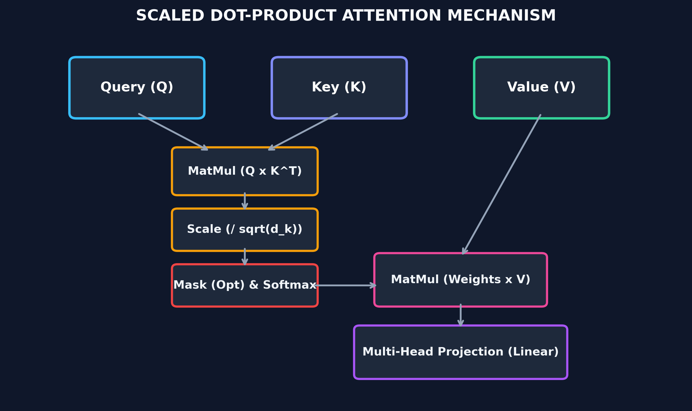
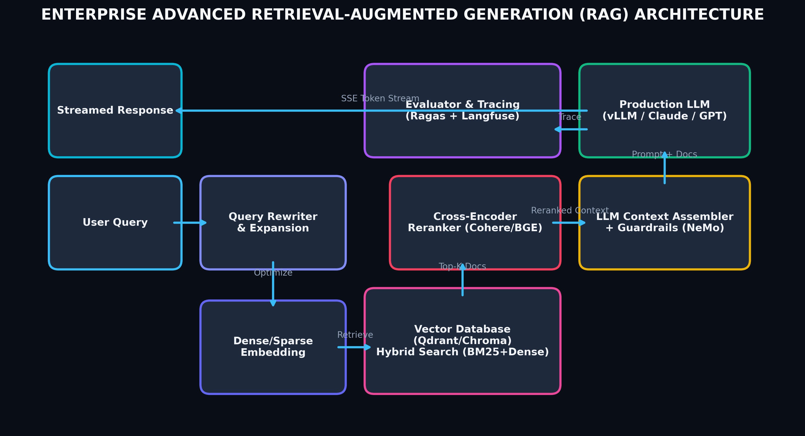

# Month 4, Week 4: Generative AI, LLMs & Retrieval-Augmented Generation (RAG)



## Overview & The Paradigm Shift
In earlier decades of Machine Learning and classical NLP, sequential models like **Recurrent Neural Networks (RNNs)** and **Long Short-Term Memory networks (LSTMs)** dominated. However, RNNs suffered from fundamental architectural limitations:
1. **Sequential Bottleneck:** Inability to parallelize operations over time steps during training.
2. **Context Degradation:** Vanishing gradients over long sequence lengths despite gating mechanisms.

The **Transformer** (introduced in *"Attention Is All You Need"*, Vaswani et al., 2017) revolutionized natural language understanding and generation by replacing recurrent recurrence entirely with **Self-Attention**. Today, **Large Language Models (LLMs)** and **Retrieval-Augmented Generation (RAG)** form the foundational architecture for modern AI Engineering.

---

## 1. The Transformer Architecture Decoded

### Scaled Dot-Product Attention
At the core of the Transformer is the mechanism that allows every token in a sequence to dynamically attend to every other token based on semantic relevance:

$$\text{Attention}(Q, K, V) = \text{softmax}\left(\frac{Q K^T}{\sqrt{d_k}}\right) V$$

Where:
* **$Q$ (Query):** What the current token is seeking.
* **$K$ (Key):** What each token offers / represents.
* **$V$ (Value):** The actual informational content of each token.
* **$\sqrt{d_k}$:** Scaling factor that prevents dot products from growing excessively large, which would push softmax gradients into vanishing regions.

### Multi-Head Attention
Rather than computing a single attention representation, multi-head attention projects Queries, Keys, and Values $h$ times with distinct, learnable linear projections:

$$\text{MultiHead}(Q, K, V) = \text{Concat}(\text{head}_1, \dots, \text{head}_h) W^O$$
$$\text{where } \text{head}_i = \text{Attention}(Q W_i^Q, K W_i^K, V W_i^V)$$

This enables the model to simultaneously attend to information from different representation subspaces (e.g., syntactic structure, long-distance pronouns, semantic sentiment).

---

## 2. Open-Source LLMs & Local Inference

Modern AI engineers deploy and fine-tune open-weight models (such as **Llama 3.x, Mistral, Qwen 2.5**) locally and in production cloud environments.

### Local Serving with Ollama and vLLM
Using high-throughput engines like **vLLM** (powered by PagedAttention) or lightweight daemons like **Ollama** enables sub-millisecond time-to-first-token (TTFT) and high concurrent throughput:

```python
# Serving inference with vLLM
from vllm import LLM, SamplingParams

prompts = [
    "Explain the concept of Vector Embeddings to a software engineer:",
    "How does Cross-Encoder reranking improve RAG precision?"
]

sampling_params = SamplingParams(temperature=0.7, top_p=0.9, max_tokens=150)
llm = LLM(model="meta-llama/Meta-Llama-3-8B-Instruct")

outputs = llm.generate(prompts, sampling_params)

for output in outputs:
    prompt = output.prompt
    generated_text = output.outputs[0].text
    print(f"\n--- Output ---\n{generated_text}")
```

---

## 3. Retrieval-Augmented Generation (RAG) Architecture



Large Language Models possess extensive parametric knowledge, but suffer from knowledge cutoffs and hallucinations when queried about private enterprise documentation. **Retrieval-Augmented Generation (RAG)** grounds model generation in verifiable, external context.

### The 4 Stages of Production RAG:
1. **Ingestion & Semantic Chunking:**
   * Raw text (PDFs, Markdown, Web pages) is cleaned and split into semantic chunks (e.g., 500 tokens with 50-token overlap).
2. **Dense Vector Embeddings:**
   * Chunks are transformed into dense mathematical vectors using embedding models (e.g., `text-embedding-3-small`, `BAAI/bge-large-en-v1.5`).
3. **Hybrid Vector Search:**
   * Queries are matched against vector stores (**Qdrant**, **Chroma**) combining dense cosine similarity with sparse BM25 keyword matching.
4. **Cross-Encoder Reranking & Context Assembly:**
   * Candidate chunks are scored and reranked using a Cross-Encoder (e.g., Cohere Rerank or `bge-reranker-large`).
   * The top-k reranked passages are injected into the system prompt.

---

## 4. Hands-On Implementation: Building a Modern RAG Pipeline

```python
import chromadb
from sentence_transformers import SentenceTransformer
from transformers import pipeline

# 1. Initialize Vector Database & Embedding Model
chroma_client = chromadb.Client()
collection = chroma_client.create_collection(name="engineering_docs")
embedder = SentenceTransformer("BAAI/bge-small-en-v1.5")

# 2. Knowledge Base Ingestion
documents = [
    "FastAPI is a modern, fast web framework for building APIs with Python 3.8+ based on standard Python type hints.",
    "LangGraph is a library for building stateful, multi-actor applications with LLMs, ideal for agentic workflows.",
    "Qdrant is a vector similarity search engine that provides a production-ready service with an easy-to-use API.",
    "Model Context Protocol (MCP) is an open protocol that standardizes how applications provide context to LLMs."
]

doc_embeddings = embedder.encode(documents).tolist()
collection.add(
    documents=documents,
    embeddings=doc_embeddings,
    ids=[f"doc_{i}" for i in range(len(documents))]
)

# 3. Query Retrieval
query = "What framework is used for stateful multi-agent LLM systems?"
query_vector = embedder.encode([query]).tolist()

results = collection.query(
    query_embeddings=query_vector,
    n_results=2
)
retrieved_context = "\n".join(results['documents'][0])

# 4. Context-Augmented Generation
generator = pipeline("text-generation", model="Qwen/Qwen2.5-Coder-1.5B-Instruct")

system_prompt = f"""You are an expert AI software architect. Answer the user question based strictly on the retrieved context below.

Context:
{retrieved_context}

Question: {query}
Answer:"""

response = generator(system_prompt, max_new_tokens=100, do_sample=False)
print(response[0]['generated_text'])
```

---

## 5. Summary & Modern Takeaway
* **LSTMs and traditional sequential text networks** are historical stepping stones; modern AI engineering is built entirely on the **Transformer self-attention mechanism**.
* High-value AI systems combine **pretrained open/closed LLMs** with **high-precision Vector Search (RAG)** to provide grounded, real-time factual accuracy without retraining costs.

