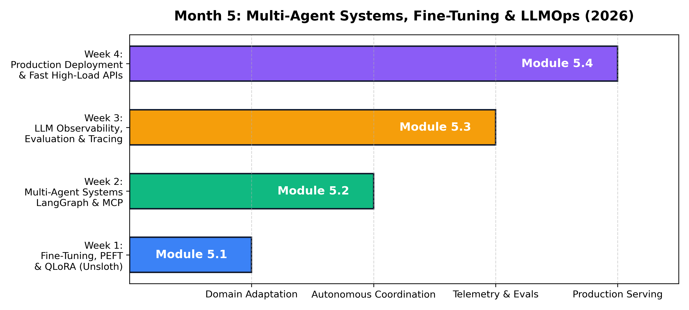
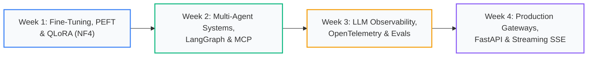

# Month 5: Multi-Agent Systems, Fine-Tuning & Production LLMOps (2026 Edition)

```
================================================================================
MODULE OVERVIEW: MONTH 5
FOCUS:           DOMAIN ADAPTATION, AGENTIC SYSTEMS, OBSERVABILITY & FAST SERVING
TOOLS:           PEFT, LORA, QLORA, LANGGRAPH, MODEL CONTEXT PROTOCOL (MCP), OPENTELEMETRY, FASTAPI
TARGET LEVEL:    STAFF AI ENGINEER & DISTRIBUTED AGENTIC ARCHITECT
================================================================================
```



## Curriculum Architecture



---

## Weekly Masterclass Index

| Week | Lecture Note & Masterclass | Core Theoretical Focus | Modern Toolchain | Key Architecture / Visual |
| :--- | :--- | :--- | :--- | :--- |
| **Week 1** | [Fine-Tuning, PEFT, LoRA & QLoRA](Week_1/lecture_notes/Week1_Fine_Tuning_PEFT_and_QLoRA.md) | Intrinsic Rank Hypothesis, Low-Rank Decomposition ($BA$), 4-bit NormalFloat (NF4), Double Quantization, Unsloth | `torch`, `peft`, `bitsandbytes` | [LoRA Architecture](../docs/images/lora_architecture.png) |
| **Week 2** | [Multi-Agent Systems, StateGraph & MCP](Week_2/lecture_notes/Week2_Multi_Agent_Systems_LangGraph_and_MCP.md) | Cyclic StateGraphs (Pregel), State Reducers (`operator.add`), Model Context Protocol (MCP), Human-in-the-Loop | `langgraph`, `langchain-core` | [Agentic Workflow](../docs/images/agentic_workflow.png) |
| **Week 3** | [LLM Observability, OpenTelemetry & Evals](Week_3/lecture_notes/Week3_LLM_Observability_and_Evaluation.md) | Observability Triad, OpenTelemetry GenAI Conventions, G-Eval Logit Expectations, Fleiss' Kappa, Manifold Drift | `prometheus-client`, `numpy` | [Distributed Spans](../docs/images/llm_observability_spans.png) |
| **Week 4** | [Production Deployment, FastAPI & Streaming SSE](Week_4/lecture_notes/Week4_Production_Deployment_and_FastAPI.md) | Asynchronous I/O Multiplexing (`epoll`), Token-Bucket Rate Limiting, Server-Sent Events (SSE), JWT RBAC Security | `fastapi`, `uvicorn`, `pydantic` | [FastAPI Gateway](../docs/images/production_fastapi_gateway.png) |

---

## Practical Engineering Artifacts

Each week includes:
1. **Mathematical Derivations**: Step-by-step proofs with defined symbols and worked numerical examples.
2. **From-Scratch Engines**: Core algorithms implemented in pure Python/NumPy before using production libraries.
3. **Enterprise Playbooks**: Production latency budgets, containerized deployment patterns, and failure mode checklists.
4. **Graded Assessments**: 8–10 rigorous questions with complete answer keys and real-world coding challenges.
