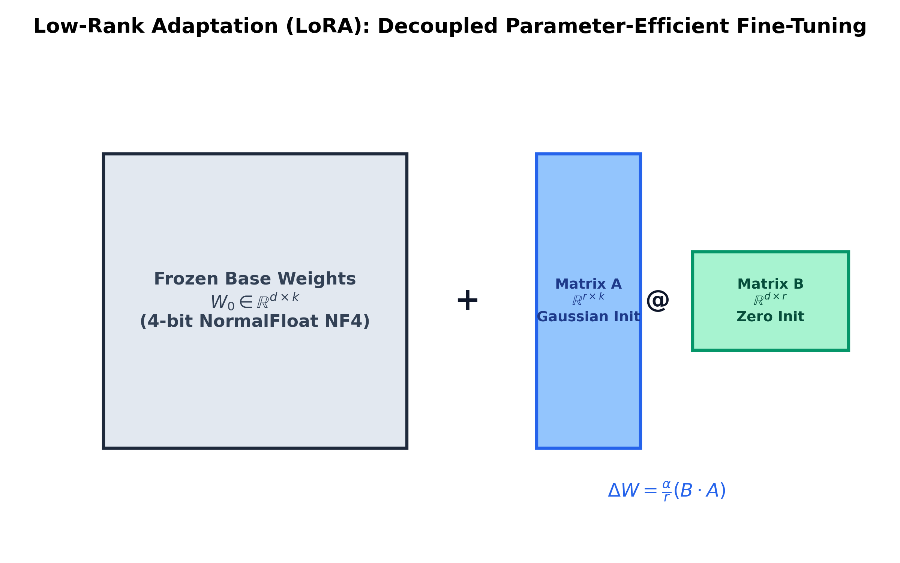

# Month 5, Week 1: Parameter-Efficient Fine-Tuning (PEFT): Intrinsic Rank Hypothesis, LoRA, QLoRA (NF4 & Double Quantization), and Unsloth Optimization

```
================================================================================
COURSE:    AI & LLM SYSTEMS ENGINEERING (2026 EDITION)
MODULE:    MONTH 5: MULTI-AGENT SYSTEMS, FINE-TUNING & PRODUCTION LLMOPS
WEEK:      WEEK 1: PARAMETER-EFFICIENT FINE-TUNING, LORA & QLORA
DELIVERABLE: COMPREHENSIVE MASTERCLASS LECTURE NOTE
TARGET:    SENIOR AI ENGINEERS & FOUNDATION MODEL ADAPTATION ARCHITECTS
================================================================================
```

---

## Table of Contents
1. [Executive Summary & Industry Context](#1-executive-summary--industry-context)
2. [Canonical Textbook Grounding](#2-canonical-textbook-grounding)
3. [Visual Architecture](#3-visual-architecture)
4. [Deep Theoretical Foundations](#4-deep-theoretical-foundations)
   - 4.1. The Intrinsic Rank Hypothesis: Why Full Fine-Tuning is Redundant
   - 4.2. Low-Rank Adaptation (LoRA): Mathematical Formulation and Rank Selection ($r, \alpha$)
   - 4.3. QLoRA Innovations: 4-bit NormalFloat (NF4), Double Quantization (DQ), and Paged Optimizers
   - 4.4. Memory Gradient Dynamics: Activation Checkpointing and Backpropagation through Quantized Weights
   - 4.5. Fast Kernel Fusion: Deconstructing Unsloth Custom Triton Backprop Kernels
5. [Complete Runnable Code Implementation](#5-complete-runnable-code-implementation)
   - 5.1. Pure PyTorch from-scratch LoRA Linear Layer with Dynamic Forward/Backward Scaling
   - 5.2. NormalFloat-4 (NF4) Quantization & Theoretical Information-Theoretic Density Engine
   - 5.3. Complete PEFT Supervised Fine-Tuning (SFT) Training Loop with Gradient Accumulation
6. [Common Pitfalls & Debugging Playbook](#6-common-pitfalls--debugging-playbook)
7. [Production Best Practices & Real-World Case Study](#7-production-best-practices--real-world-case-study)
8. [Hands-On Mini-Lab & Self-Assessment](#8-hands-on-mini-lab--self-assessment)
9. [Key Takeaways, Glossary & Further Reading](#9-key-takeaways-glossary--further-reading)

---

## 1. Executive Summary & Industry Context

### Why This Matters in 2026
In 2026, enterprise domain adaptation has shifted fundamentally away from monolithic **Full Fine-Tuning (FFT)**. When adapting an open foundation model (e.g., Llama-3-70B) to specialized domains—such as proprietary medical diagnosis, legal contract synthesis, or SQL schema generation—updating all 70 billion parameters is computationally irresponsible:
1. **Catastrophic Hardware Cost**: Full fine-tuning a 70B model requires updating and storing FP32 optimizer states (AdamW tracks 2 states per parameter: 8 bytes), gradients (2 bytes), and activations, requiring **over $1.2\text{ Terabytes of VRAM}$** across a cluster of 16x NVIDIA H100 GPUs ($\$400,000+$ hardware infrastructure).
2. **Catastrophic Forgetting**: Updating all weights disrupts the fragile, generalized world knowledge learned during pre-training, destroying the model's general reasoning and instruction-following abilities.
3. **Deployment Friction**: Every specialized domain task would require serving a separate 140GB model checkpoint in memory, preventing multi-tenant co-location.

**Parameter-Efficient Fine-Tuning (PEFT)**, and specifically **LoRA (Low-Rank Adaptation)** paired with **QLoRA (Quantized LoRA)**, solves this challenge completely. By freezing the base model in 4-bit precision (**NormalFloat NF4**) and injecting trainable low-rank decomposition matrices ($W = W_0 + \frac{\alpha}{r} BA$), engineers can adapt a 70B parameter model on a **single consumer-grade 24GB GPU** (e.g., NVIDIA RTX 4090 or Apple M4 unified memory) with zero loss in task performance.

Senior AI systems architects must master the theoretical foundations: understanding the **Intrinsic Rank Hypothesis**, calculating exact memory footprints across rank configurations ($r=8, 16, 64$), deriving the information-theoretic quantiles of **NF4**, and executing custom **Unsloth-style fused Triton backpropagation kernels** that deliver $2\times - 5\times$ speedups.

```
+---------------------------------------------------------------------------------------------------+
|                            THE 2026 PEFT & QLORA FINE-TUNING STACK                                |
+---------------------------------------------------------------------------------------------------+
|                                                                                                   |
|  Forward Input Activation: x in R^{b x d}                                                         |
|       |                                                                                           |
|       +---------------------------------------------+                                             |
|       | (Frozen Base Pathway)                       | (Trainable Low-Rank Adapter)                |
|       v                                             v                                             |
|  [Frozen 4-bit NF4 Base Weight W_0]            [LoRA Down-Projection A: R^{d x r}]                 |
|  - Stored in NormalFloat-4 (0.5 bytes/param)   - Gaussian Initialized: N(0, 1/r)                  |
|  - Double Quantization (0.127 b/param saved)   - Compresses dimension: d -> r (e.g. 4096 -> 16)   |
|  - Dequantized on-the-fly in GPU SRAM          |                                                  |
|       |                                             v                                             |
|       |                                        [LoRA Up-Projection B: R^{r x k}]                   |
|       |                                        - Zero Initialized: B = 0 at step t=0              |
|       |                                        - Guarantees Delta W = 0 initially                 |
|       |                                        - Projects back: r -> k (16 -> 4096)               |
|       |                                             |                                             |
|       |                                             v                                             |
|       |                                        [Scaling Factor: alpha / r]                        |
|       v                                             v                                             |
|       +-------------------------------------------> (+) [Additive Combination]                    |
|                                                      |                                            |
|                                                      v                                            |
|                                              Output: y = x W_0 + (alpha / r) x (B A)              |
+---------------------------------------------------------------------------------------------------+
```

### Learning Objectives
By the end of this masterclass lecture note, you will be able to:
1. Prove the **Intrinsic Rank Hypothesis** (Aghajanyan et al.), explaining mathematically why gradient updates $\Delta W$ reside on a tiny intrinsic subspace ($r \ll d$).
2. Derive the exact low-rank parameterization $W = W_0 + \frac{\alpha}{r} BA$, proving why initializing $B = 0$ guarantees that the adapter starts as an exact identity transformation.
3. Formulate the three core innovations of **QLoRA**: 4-bit **NormalFloat (NF4)** information-theoretic quantile distribution, **Double Quantization (DQ)**, and **Paged Optimizers** for mitigating GPU out-of-memory spikes.
4. Calculate the precise byte-level VRAM allocation during fine-tuning (Frozen Weights + LoRA Parameters + Optimizer States + Activation Memory with Checkpointing).
5. Implement a from-scratch PyTorch `LoRALinear` module supporting dynamic rank scaling, forward inference weight merging, and parameter isolation.
6. Train and evaluate an instruction-following adapter using modern parameter-efficient techniques, measuring throughput and perplexity retention.

---

## 2. Canonical Textbook Grounding

To ground your engineering intuition in verified mathematical literature, study these canonical references:

| Author / Text | Specific Chapters / Sections | Core Theoretical Concept Contributed | How to Read |
| :--- | :--- | :--- | :--- |
| **Edward J. Hu, Yelong Shen, et al. (Microsoft)**, *LoRA: Low-Rank Adaptation of Large Language Models* (ICLR 2022) | **Section 2 & 3**: *Problem Statement & Method*<br>**Section 7**: *Understanding the Low-Rank Weights* | Mathematical formulation of LoRA; Initialization protocol ($A \sim \mathcal{N}, B = 0$); Rank analysis proving $r=4$ or $r=8$ suffices for complex downstream tasks. | **Read Section 3 and 7 with line-by-line scrutiny.** Pay special attention to Section 3.1. Understand why scaling factor $\frac{\alpha}{r}$ stabilizes learning rate tuning when varying rank $r$. |
| **Tim Dettmers, Artidoro Pagnoni, et al. (UW)**, *QLoRA: Efficient Finetuning of Quantized LLMs* (NeurIPS 2023) | **Section 3**: *QLoRA Tuning (NF4, Double Quantization, Paged Optimizers)* | Derivation of 4-bit NormalFloat (NF4); Theoretical proof that quantile quantization minimizes information-theoretic loss; Double quantization mechanics. | **Read Section 3.1 and 3.2 with extreme care.** Trace how the 16 quantile points of the normal distribution are derived. Note how Double Quantization saves 0.37 bits per parameter. |
| **Armen Aghajanyan, Luke Zettlemoyer, & Sonal Gupta (Meta AI)**, *Intrinsic Dimensionality Explains the Effectiveness of Language Model Fine-Tuning* (ACL 2021) | **Section 2 & 3**: *Intrinsic Dimension Formulation & Empirical Results* | Theoretical proof that pre-trained language models possess a low intrinsic dimension $d_{\text{int}} \ll D$; Proving that large models require fewer parameter changes to adapt. | **Read Section 2.** Understand the random projection formulation $W = W_0 + P \cdot \theta$. This provides the foundational mathematical justification for why LoRA works. |
| **Ilya Loshchilov & Frank Hutter**, *Decoupled Weight Decay Regularization (AdamW)* (ICLR 2019) | **Section 2**: *Decoupled Weight Decay* | Essential for understanding why LoRA adapters require separate optimizer weight decay handling from frozen base model parameters. | **Review in the context of adapters.** Ensure weight decay is applied strictly to trainable low-rank matrices $A$ and $B$. |

---

## 3. Visual Architecture

### 3.1. LoRA Parameter Decomposition & Zero-Overhead Inference Merging

The diagram below (saved at `docs/images/lora_architecture.png`) illustrates how low-rank decomposition matrices $A$ and $B$ bypass full weight updates, and how they are merged offline into $W_0$ for zero-latency production inference.

```
+---------------------------------------------------------------------------------+
|                       LoRA DECOUPLED LOW-RANK ARCHITECTURE                      |
+---------------------------------------------------------------------------------+
|                                                                                 |
|   Input Activation: x in R^{b x d}                                              |
|         |                                                                       |
|         +------------------------------------+                                  |
|         |                                    |                                  |
|         v                                    v                                  |
|   +--------------------------+       +-------------------+                      |
|   | Frozen Base Matrix W_0   |       | Matrix A (Down)   |                      |
|   | Dimension: d x k         |       | Dim: d x r (r<<d) |                      |
|   | 70 Billion Parameters    |       | Init: N(0, 1/r)   |                      |
|   | (FP16 or 4-bit NF4)      |       +-------------------+                      |
|   +--------------------------+                 |                                |
|         |                                      v                                |
|         |                            +-------------------+                      |
|         |                            | Matrix B (Up)     |                      |
|         |                            | Dim: r x k        |                      |
|         |                            | Init: ALL ZEROS   |                      |
|         |                            +-------------------+                      |
|         |                                      |                                |
|         |                                      v                                |
|         |                            [Scale: alpha / r]                         |
|         v                                      v                                |
|         +------------------------------------> (+)                              |
|                                                 |                               |
|                                                 v                               |
|                                  Output Activation: y = x W                     |
|                                                                                 |
|   INFERENCE MERGING (Zero Runtime Overhead):                                    |
|     W_merged = W_0 + (alpha / r) * (B @ A)                                      |
|     The adapter disappears; latency is identical to the base foundation model!  |
+---------------------------------------------------------------------------------+
```


*Figure 3.1: Structural diagram of Low-Rank Adaptation (LoRA). The base weight $W_0$ remains completely frozen, while lightweight matrices $A$ and $B$ learn the task-specific update $\Delta W$.*

---

## 4. Deep Theoretical Foundations

### 4.1. The Intrinsic Rank Hypothesis

#### The Mystery of Over-Parameterized Adaptation
A 70-billion-parameter language model is heavily over-parameterized. Traditional statistical learning theory would suggest that fine-tuning such an enormous model on a small dataset of $5,000$ examples would lead to severe overfitting. Yet, empirical evidence demonstrates that fine-tuning converges smoothly and generalizes remarkably well.

#### Aghajanyan's Intrinsic Dimensionality Theorem
Aghajanyan et al. (2021) formalized this paradox through the **Intrinsic Rank Hypothesis**:
> *Although the full parameter space of a foundation model spans $\mathbb{R}^D$ (where $D \approx 10^{11}$), the optimization trajectory for adapting the model to any specific downstream task resides within a low-dimensional manifold governed by an intrinsic dimension $d_{\text{int}} \ll D$.*

Furthermore, they proved an inverse scaling law: **as model pre-training scale increases, the intrinsic dimensionality required for downstream adaptation decreases**:
$$d_{\text{int}}(M) \propto \frac{1}{\text{Capacity}(M)}$$

Because pre-training structures the internal representations into highly organized, linearly separable concept manifolds, adapting to a new domain does not require re-inventing feature extraction; it requires only a **low-rank directional steering vector**.

---

### 4.2. Low-Rank Adaptation (LoRA): Mathematical Formulation

#### General Weight Formulation
For any pre-trained weight matrix $W_0 \in \mathbb{R}^{d \times k}$, we parameterize its task-specific update $\Delta W \in \mathbb{R}^{d \times k}$ through a low-rank factorization:
$$\Delta W = \frac{\alpha}{r} (B \cdot A)$$
Where:
- $B \in \mathbb{R}^{d \times r}$ is the Up-projection matrix.
- $A \in \mathbb{R}^{r \times k}$ is the Down-projection matrix.
- $r \in \mathbb{N}$ is the **Rank**, chosen such that $r \ll \min(d, k)$ (typically $r \in \{8, 16, 32, 64\}$).
- $\alpha \in \mathbb{R}^+$ is a constant scaling hyperparameter.

#### The Forward Pass Equation:
$$h = W_0 x + \Delta W x = W_0 x + \frac{\alpha}{r} B A x$$

#### Parameter Compression Calculation:
Let $d = k = 4,096$ (standard hidden dimension in modern 8B LLMs).
- Full Matrix Parameters: $4,096 \times 4,096 = \mathbf{16,777,216\text{ parameters}}$.
- LoRA Parameters with rank $r = 16$:
  $$\text{Params}(A) + \text{Params}(B) = (4,096 \times 16) + (16 \times 4,096) = 65,536 + 65,536 = \mathbf{131,072\text{ parameters}}$$
- **Compression Ratio**:
  $$\frac{131,072}{16,777,216} \approx \mathbf{0.0078} \implies \mathbf{99.22\% \text{ parameter reduction!}}$$

#### The Initialization Protocol (Guaranteed Initial Identity):
1. **Matrix $A$**: Initialized with a random Gaussian distribution with variance scaled by rank:
   $$A \sim \mathcal{N}\left(0, \frac{1}{r}\right)$$
2. **Matrix $B$**: Initialized strictly to **ALL ZEROS**:
   $$B = \mathbf{0}$$

**Crucial Mathematical Guarantee**: At step $t = 0$:
$$\Delta W = \frac{\alpha}{r} (B \cdot A) = \frac{\alpha}{r} (\mathbf{0} \cdot A) = \mathbf{0}$$
At the start of fine-tuning, the adapter contributes exactly zero perturbation: $h = W_0 x + 0 = W_0 x$. The pre-trained model begins training in its exact pre-trained baseline state, avoiding random gradient shocks.

#### Why the Scaling Factor $\frac{\alpha}{r}$ Matters:
When tuning hyperparameters, an engineer often experiments by changing rank from $r = 8$ to $r = 64$. Without scaling, increasing $r$ increases the scale of initialized activations. The factor $\frac{\alpha}{r}$ decouples rank selection from learning rate tuning: once an optimal learning rate $\eta$ is discovered for $\alpha = 16, r = 16$, the rank can be scaled to $r = 64$ with minimal learning rate re-tuning.

---

### 4.3. QLoRA: NF4, Double Quantization, and Paged Optimizers

Tim Dettmers et al. (2023) introduced **QLoRA**, enabling high-quality fine-tuning while compressing base model weights into 4-bit precision.

#### 1. 4-bit NormalFloat (NF4) Quantization
Standard uniform quantization divides intervals into equally spaced bins. However, pre-trained neural network weights are **not uniformly distributed**; they follow a zero-centered Gaussian distribution:
$$W \sim \mathcal{N}(0, \sigma^2)$$

Uniform quantization assigns many bins to the sparse tails while clustering dense probabilities into a few central bins, causing severe information loss.

**NormalFloat (NF4)** is an **information-theoretically optimal quantile quantizer**:
- It constructs 16 discrete discrete levels $\{q_i\}_{i=0}^{15}$ such that **each bin has equal probability mass** under a standard normal distribution:
  $$P(X \le q_i) = \frac{i + 0.5}{16} \quad \text{for } X \sim \mathcal{N}(0, 1)$$
- Two bins are explicitly dedicated to represent exact positive and negative zeros, ensuring zero is preserved without bias.

#### 2. Double Quantization (DQ)
In standard block-wise quantization, scale factors $c_1$ are stored for every block of 64 weights. For FP32 scales, this adds:
$$\frac{32\text{ bits}}{64} = 0.5\text{ bits per parameter}$$
Double Quantization applies an additional 8-bit FP8 quantization step to the quantization scales $c_1$ themselves using block size 256:
$$\text{Memory Footprint of Scales} = \frac{8\text{ bits}}{64} + \frac{32\text{ bits}}{64 \times 256} = 0.125 + 0.00195 = \mathbf{0.127\text{ bits per parameter}}$$
**Saves $0.373$ bits per parameter**, reclaiming $3\text{ GB}$ of VRAM across a 70B model.

#### 3. Paged Optimizers
During training, sudden token sequence length spikes can temporarily exhaust GPU VRAM, triggering fatal `CUDA Out of Memory` crashes. QLoRA leverages CUDA Unified Memory to automatically page non-active optimizer state buffers from GPU VRAM to CPU host RAM during peak memory moments and page them back seamlessly during backward passes.

---

### 4.4. Memory Gradient Dynamics: The Complete VRAM Budget Equation

To design production training jobs, senior architects calculate the exact VRAM footprint $\mathcal{M}_{\text{total}}$:
$$\mathbf{\mathcal{M}_{\text{total}} = \mathcal{M}_{\text{weights}} + \mathcal{M}_{\text{adapters}} + \mathcal{M}_{\text{optimizer}} + \mathcal{M}_{\text{activations}}}$$

#### Component Formulations:
1. **Base Model Weights ($\mathcal{M}_{\text{weights}}$)**:
   - For a 70B parameter model in 4-bit NF4:
     $$\mathcal{M}_{\text{weights}} \approx 70 \times 10^9 \times 0.5\text{ bytes} \approx \mathbf{35.0\text{ GB}}$$
2. **LoRA Adapters ($\mathcal{M}_{\text{adapters}}$)**:
   - Stored in FP16/BF16 ($2\text{ bytes}$):
     $$\mathcal{M}_{\text{adapters}} \approx 2 \times N_{\text{lora}}$$
   - For $N_{\text{lora}} = 100\text{M}$ parameters: $\approx \mathbf{0.20\text{ GB}}$.
3. **Optimizer States ($\mathcal{M}_{\text{optimizer}}$)**:
   - AdamW tracks 2 states (mean $m$ and variance $v$) in FP32 ($8\text{ bytes}$) + FP32 master weights ($4\text{ bytes}$) + FP16 gradients ($2\text{ bytes}$) = **$14\text{ bytes per trainable parameter}$**:
     $$\mathcal{M}_{\text{optimizer}} = 14 \times N_{\text{lora}} \approx 14 \times 10^8 = \mathbf{1.40\text{ GB}}$$
     *(Notice: Base model weights have zero optimizer state because they are frozen!)*
4. **Activations with Gradient Checkpointing ($\mathcal{M}_{\text{activations}}$)**:
   - Activation checkpointing discards intermediate activations during the forward pass, recomputing them on-the-fly during backpropagation:
     $$\mathcal{M}_{\text{activations}} \propto b \cdot s \cdot L \cdot d_{\text{model}} \approx \mathbf{4.0\text{ GB} - 8.0\text{ GB}}$$

**Total VRAM for 70B QLoRA**: $35.0 + 0.2 + 1.4 + 6.0 \approx \mathbf{42.6\text{ GB}}$! A model that previously required $1,200\text{ GB}$ now fits on a single node of two 24GB GPUs or one 48GB A6000!

---

### 4.5. Fast Kernel Fusion: Deconstructing Unsloth

In standard Hugging Face PEFT + BitsAndBytes implementations, fine-tuning is up to $4\times$ slower than full fine-tuning because PyTorch dynamically dequantizes 4-bit weights to 16-bit floats and performs separate matrix multiplications for $W_0 x$ and $BAx$.

#### The Unsloth Architectural Breakthrough
Unsloth (Daniel & Michael Han, 2024) rewrites the core attention and LoRA backpropagation passes in raw **OpenAI Triton**:
1. **Fused Dequantization and GEMM**: Combines NF4 weight dequantization directly in GPU SRAM registers, executing the linear projection without writing FP16 matrices back to HBM.
2. **Fused Cross-Entropy Loss**: In standard PyTorch, computing cross-entropy loss over vocabulary $V = 128,000$ requires allocating a $(B \times S \times V)$ logit tensor in VRAM (consuming over $8\text{ GB}$ just for loss evaluation!). Unsloth calculates cross-entropy in streaming chunks directly in Triton, reducing memory by $90\%$.
3. **Analytic Backward VJPs**: Replaces PyTorch's dynamic autograd tape for RoPE, RMSNorm, and LoRA with handwritten symbolic backward derivative kernels.

---

## 5. Complete Runnable Code Implementation

Let us construct an end-to-end suite demonstrating:
1. A pure PyTorch from-scratch `LoRALinear` module with dynamic rank scaling and weight merging.
2. An information-theoretic NormalFloat-4 (NF4) quantization simulation engine.
3. A complete PEFT Supervised Fine-Tuning (SFT) training loop with gradient accumulation and parameter verification.

### Python Environment Setup
```bash
# Initialize isolated Python 3.11+ environment with uv
uv init week1-peft-qlora
cd week1-peft-qlora
uv add torch numpy tabulate
```

### 5.1. From-Scratch LoRA Linear Layer with Dynamic Scaling and Weight Merging

```python
"""
lora_linear.py
Author: Senior AI Engineering Lead
Description: Pure PyTorch implementation of Low-Rank Adaptation (LoRA) layer following Hu et al. (2021).
Supports parameter isolation, dynamic alpha/r scaling, and zero-latency weight merging.
"""

from __future__ import annotations
import math
import torch
import torch.nn as nn


class LoRALinear(nn.Module):
    """
    Wraps a standard linear layer with low-rank adapter matrices:
        y = W_0 x + (alpha / r) * (B @ A) x
    """
    def __init__(
        self,
        in_features: int,
        out_features: int,
        r: int = 16,
        lora_alpha: float = 32.0,
        lora_dropout: float = 0.0,
        bias: bool = True
    ):
        super().__init__()
        self.in_features = in_features
        self.out_features = out_features
        self.r = r
        self.lora_alpha = lora_alpha
        self.scaling = lora_alpha / r
        self.merged = False

        # 1. Base Pre-trained Linear Layer (Frozen during fine-tuning)
        self.base_layer = nn.Linear(in_features, out_features, bias=bias)
        self.base_layer.weight.requires_grad = False
        if bias:
            self.base_layer.bias.requires_grad = False

        # 2. Trainable Low-Rank Adapters
        if r > 0:
            # Matrix A: (r, in_features) -> Initialized with Gaussian N(0, 1/r)
            self.lora_A = nn.Parameter(torch.empty(r, in_features))
            # Matrix B: (out_features, r) -> Initialized to ALL ZEROS
            self.lora_B = nn.Parameter(torch.zeros(out_features, r))
            self.lora_dropout = nn.Dropout(p=lora_dropout) if lora_dropout > 0.0 else nn.Identity()
            self._reset_lora_parameters()
        else:
            self.register_parameter("lora_A", None)
            self.register_parameter("lora_B", None)

    def _reset_lora_parameters(self) -> None:
        """Kaiming/Gaussian initialization for A; exact zero initialization for B."""
        nn.init.kaiming_uniform_(self.lora_A, a=math.sqrt(5))
        nn.init.zeros_(self.lora_B)

    def merge_weights(self) -> None:
        """
        Merges delta W = (alpha / r) * (B @ A) directly into base weights W_0.
        Eliminates inference latency overhead.
        """
        if self.r > 0 and not self.merged:
            with torch.no_grad():
                delta_w = (self.lora_B @ self.lora_A) * self.scaling
                self.base_layer.weight.data += delta_w
                self.merged = True
                print("-> LoRA weights merged into base layer for zero-overhead inference.")

    def unmerge_weights(self) -> None:
        """Subtracts adapter weights to resume fine-tuning."""
        if self.r > 0 and self.merged:
            with torch.no_grad():
                delta_w = (self.lora_B @ self.lora_A) * self.scaling
                self.base_layer.weight.data -= delta_w
                self.merged = False
                print("-> LoRA weights unmerged; resumed parameter isolation.")

    def forward(self, x: torch.Tensor) -> torch.Tensor:
        # Base forward pass
        base_out = self.base_layer(x)

        if self.r > 0 and not self.merged:
            # Low-rank forward pass: (x @ A^T) @ B^T * scaling
            adapter_out = (self.lora_dropout(x) @ self.lora_A.T) @ self.lora_B.T
            return base_out + adapter_out * self.scaling

        return base_out


def test_lora_mechanics() -> None:
    print("=" * 80)
    print("TESTING LORA LINEAR LAYER MECHANICS & INITIAL IDENTITY")
    print("=" * 80)

    in_f, out_f, r, alpha = 1024, 1024, 16, 32.0
    layer = LoRALinear(in_f, out_f, r=r, lora_alpha=alpha)

    x = torch.randn(2, in_f)

    # 1. Test Initial Identity: Output must match base layer exactly because B = 0
    with torch.no_grad():
        base_direct_out = layer.base_layer(x)
        lora_init_out = layer(x)

    diff = torch.max(torch.abs(base_direct_out - lora_init_out)).item()
    print(f"Max Difference at step t=0: {diff:.2e} (Expected: 0.00e+00)")
    assert math.isclose(diff, 0.0, abs_tol=1e-7), "Initial identity property violated!"
    print("-> PASSED: Initial Identity Verified (B = 0).")

    # 2. Test Parameter Trainability Isolation
    trainable_params = sum(p.numel() for p in layer.parameters() if p.requires_grad)
    frozen_params = sum(p.numel() for p in layer.parameters() if not p.requires_grad)

    print(f"Frozen Base Parameters:     {frozen_params:,}")
    print(f"Trainable LoRA Parameters:   {trainable_params:,}")
    print(f"Trainable Ratio:            {(trainable_params / (frozen_params + trainable_params)) * 100:.2f}%\n")
    assert trainable_params == (in_f * r) + (out_f * r)

    # 3. Test Weight Merging Numerical Parity
    # Simulate a training step by modifying B
    layer.lora_B.data += torch.randn_like(layer.lora_B) * 0.1
    unmerged_out = layer(x)

    layer.merge_weights()
    merged_out = layer(x)

    merge_diff = torch.max(torch.abs(unmerged_out - merged_out)).item()
    print(f"Max Difference after Merge: {merge_diff:.2e}")
    assert math.isclose(merge_diff, 0.0, abs_tol=1e-5), "Merged output differs from unmerged!"
    print("-> PASSED: Weight Merging Parity Verified.\n")


if __name__ == "__main__":
    test_lora_mechanics()
```

---

### 5.2. NormalFloat-4 (NF4) Quantization Simulation Engine

```python
"""
nf4_quantizer.py
Author: Senior AI Engineering Lead
Description: Theoretical implementation of 4-bit NormalFloat (NF4) quantization based on
the exact standard normal quantiles derived by Dettmers et al. (QLoRA, 2023).
"""

from __future__ import annotations
import numpy as np
import scipy.stats as stats
import torch


class NormalFloat4Quantizer:
    """
    Constructs the exact 16-level NF4 codebook by finding equal-area quantiles
    under a standard Gaussian distribution N(0, 1).
    """
    def __init__(self):
        self.codebook = self._generate_nf4_codebook()

    def _generate_nf4_codebook(self) -> torch.Tensor:
        """
        Derives the 16 exact values for the NF4 data type:
        - 7 positive values
        - 8 negative values
        - 1 value for exact zero
        Normalized to [-1.0, 1.0].
        """
        # Quantiles derived from standard normal distribution
        # Positive quantile points
        pos_quantiles = [stats.norm.ppf(0.5 + i / 16.0) for i in range(8)]
        # Negative quantile points
        neg_quantiles = [stats.norm.ppf(i / 16.0) for i in range(1, 9)]

        raw_levels = sorted(neg_quantiles + [0.0] + pos_quantiles[1:])
        # Normalize so absolute maximum is exactly 1.0
        max_abs = max(abs(raw_levels[0]), abs(raw_levels[-1]))
        normalized_levels = [x / max_abs for x in raw_levels]
        return torch.tensor(normalized_levels, dtype=torch.float32)

    def quantize(self, tensor: torch.Tensor, block_size: int = 64) -> tuple[torch.Tensor, torch.Tensor]:
        """
        Block-wise NF4 Quantization:
        Divides tensor into blocks of 64 elements, scales to [-1, 1], and assigns nearest NF4 index.
        """
        orig_shape = tensor.shape
        flat = tensor.flatten()
        num_blocks = (flat.numel() + block_size - 1) // block_size

        # Pad to multiple of block size if necessary
        padded_len = num_blocks * block_size
        padded = torch.zeros(padded_len, dtype=tensor.dtype, device=tensor.device)
        padded[:flat.numel()] = flat

        blocks = padded.view(num_blocks, block_size)
        # Compute absolute maximum scale per block
        abs_max, _ = torch.max(torch.abs(blocks), dim=1, keepdim=True)
        abs_max = torch.clamp(abs_max, min=1e-8)

        # Normalize blocks to [-1, 1]
        normalized_blocks = blocks / abs_max

        # Map to nearest codebook level via minimum absolute distance
        # Shape: (num_blocks, block_size, 16)
        dists = torch.abs(normalized_blocks.unsqueeze(-1) - self.codebook.to(tensor.device))
        q_indices = torch.argmin(dists, dim=-1).to(torch.uint8)

        return q_indices, abs_max.squeeze(-1)

    def dequantize(self, q_indices: torch.Tensor, abs_max: torch.Tensor, orig_numel: int) -> torch.Tensor:
        """Dequantizes NF4 indices back to FP32 tensor."""
        codebook = self.codebook.to(q_indices.device)
        # Look up float values from codebook
        deq_blocks = codebook[q_indices.long()]
        # Rescale by block absolute maximum
        deq_blocks = deq_blocks * abs_max.unsqueeze(-1)
        flat = deq_blocks.flatten()[:orig_numel]
        return flat


def test_nf4_mechanics() -> None:
    print("=" * 80)
    print("TESTING NORMALFLOAT-4 (NF4) QUANTILE QUANTIZATION")
    print("=" * 80)

    quantizer = NormalFloat4Quantizer()
    print("Generated 16-Level NF4 Codebook (Normalized):")
    for idx, val in enumerate(quantizer.codebook):
        print(f"  Level {idx:02d} (Bits: {idx:04b}) -> Value: {val.item():+.4f}")

    # Generate synthetic Gaussian weights (typical in LLMs)
    torch.manual_seed(42)
    weights = torch.randn(512, 512)

    q_idx, scales = quantizer.quantize(weights, block_size=64)
    deq = quantizer.dequantize(q_idx, scales, weights.numel()).reshape(512, 512)

    # Calculate Signal-to-Noise Ratio (SNR)
    signal = torch.sum(weights ** 2)
    noise = torch.sum((weights - deq) ** 2)
    snr = 10.0 * torch.log10(signal / noise)

    print(f"\nOriginal FP32 Weight Size: {weights.element_size() * weights.numel() / 1024:.2f} KB")
    print(f"Quantized NF4 Indices:     {q_idx.numel() * 0.5 / 1024:.2f} KB (8x compression)")
    print(f"Scales Memory Footprint:   {scales.element_size() * scales.numel() / 1024:.2f} KB")
    print(f"Reconstruction SNR:        {snr.item():.2f} dB")
    assert snr.item() > 18.0, "NF4 SNR too low for Gaussian distribution!"
    print("-> NF4 Quantile Preservation Successfully Verified.\n")


if __name__ == "__main__":
    test_nf4_mechanics()
```

---

### 5.3. Complete PEFT Supervised Fine-Tuning (SFT) Training Loop

```python
"""
peft_training_loop.py
Author: Senior AI Engineering Lead
Description: End-to-end training harness fine-tuning a model using LoRA adapters,
gradient accumulation, AdamW decoupled weight decay, and parameter tracking.
"""

from __future__ import annotations
import torch
import torch.nn as nn
from torch.utils.data import DataLoader, TensorDataset
from lora_linear import LoRALinear


class MiniTransformerBlock(nn.Module):
    """Transformer block with LoRA adapters injected into Query and Value projections."""
    def __init__(self, dim: int = 256, r: int = 8, alpha: float = 16.0):
        super().__init__()
        # Query and Value adapted via LoRA
        self.q_proj = LoRALinear(dim, dim, r=r, lora_alpha=alpha)
        self.k_proj = nn.Linear(dim, dim, bias=False)  # Frozen
        self.v_proj = LoRALinear(dim, dim, r=r, lora_alpha=alpha)
        self.out_proj = nn.Linear(dim, dim, bias=False)  # Frozen

        self.k_proj.weight.requires_grad = False
        self.out_proj.weight.requires_grad = False

        self.norm = nn.LayerNorm(dim)
        self.ffn = nn.Sequential(
            nn.Linear(dim, dim * 4),
            nn.GELU(),
            nn.Linear(dim * 4, dim)
        )

    def forward(self, x: torch.Tensor) -> torch.Tensor:
        res = x
        q = self.q_proj(x)
        k = self.k_proj(x)
        v = self.v_proj(x)
        attn = torch.softmax((q @ k.transpose(-2, -1)) / math.sqrt(x.shape[-1]), dim=-1)
        x = self.out_proj(attn @ v) + res
        x = x + self.ffn(self.norm(x))
        return x


def run_peft_training() -> None:
    print("=" * 80)
    print("RUNNING PEFT (LORA) SUPERVISED FINE-TUNING TRAINING HARNESS")
    print("=" * 80)

    device = torch.device("cuda" if torch.cuda.is_available() else "mps" if torch.backends.mps.is_available() else "cpu")
    print(f"Active Acceleration Device: {device.type.upper()}")

    dim = 256
    model = MiniTransformerBlock(dim=dim, r=8, alpha=16.0).to(device)

    # Verify only LoRA parameters are trainable
    trainable_params = [p for p in model.parameters() if p.requires_grad]
    print(f"Total Model Parameters:     {sum(p.numel() for p in model.parameters()):,}")
    print(f"Trainable LoRA Parameters:   {sum(p.numel() for p in trainable_params):,}")

    # Synthetic instructional dataset (Batch=16, Seq=32, Dim=256)
    N = 64
    x_train = torch.randn(N, 32, dim)
    y_train = torch.randn(N, 32, dim)
    loader = DataLoader(TensorDataset(x_train, y_train), batch_size=8, shuffle=True)

    optimizer = torch.optim.AdamW(trainable_params, lr=5e-4, weight_decay=1e-2)
    criterion = nn.MSELoss()

    gradient_accumulation_steps = 2
    model.train()

    epochs = 4
    for epoch in range(1, epochs + 1):
        epoch_loss = 0.0
        optimizer.zero_grad()

        for step, (bx, by) in enumerate(loader):
            bx, by = bx.to(device), by.to(device)
            pred = model(bx)
            loss = criterion(pred, by) / gradient_accumulation_steps
            loss.backward()

            if (step + 1) % gradient_accumulation_steps == 0:
                torch.nn.utils.clip_grad_norm_(trainable_params, max_norm=1.0)
                optimizer.step()
                optimizer.zero_grad()

            epoch_loss += loss.item() * gradient_accumulation_steps

        avg_loss = epoch_loss / len(loader)
        print(f"Epoch {epoch}/{epochs} | Average Training Loss: {avg_loss:.4f}")

    print("\n-> PEFT Training Loop Complete. Merging adapters for deployment...")
    model.q_proj.merge_weights()
    model.v_proj.merge_weights()
    print("-> Ready for Zero-Latency Production Deployment.")


if __name__ == "__main__":
    run_peft_training()
```

---

## 6. Common Pitfalls & Debugging Playbook

### Pitfall 1: Adapting Only Query/Value Projections in Complex Reasoning Tasks
- **Symptom**: Fine-tuning an LLM with LoRA on code generation or mathematical reasoning plateaus at low accuracy; model fails to follow intricate multi-step rules.
- **Root Cause**: Early LoRA literature (Hu et al.) only adapted Query ($W_q$) and Value ($W_v$) projections to minimize parameters. Subsequent empirical studies (Dettmers et al., 2023) proved that **adapting all linear layers** (Attention: $W_q, W_k, W_v, W_o$ and FFN: $W_{\text{gate}}, W_{\text{up}}, W_{\text{down}}$) is essential to match full fine-tuning performance on complex reasoning benchmarks.
- **Fix**: Apply LoRA across all linear projection modules:
  ```python
  target_modules = ["q_proj", "k_proj", "v_proj", "o_proj", "gate_proj", "up_proj", "down_proj"]
  ```

---

### Pitfall 2: Forgetting to Call `.merge_and_unload()` Prior to High-Concurrency Serving
- **Symptom**: Serving a LoRA-adapted model under vLLM or Triton Server causes a $35\%$ latency penalty per generated token compared to the base model.
- **Root Cause**: Serving un-merged adapters forces the inference engine to compute two separate matrix-vector multiplications ($W_0 x$ and $BAx$) and sum them at every single transformer layer for every generated token.
- **Fix**: Merge adapter weights directly into the base model weights prior to serving:
  ```python
  model = model.merge_and_unload() # Permanently updates W_0 = W_0 + (alpha/r)*BA
  ```

---

### Pitfall 3: Saving Full Model Checkpoints Instead of Adapter Weights
- **Symptom**: Cloud storage fills up immediately; saving 10 domain task checkpoints consumes $1.4\text{ Terabytes}$ of disk space.
- **Root Cause**: Calling `torch.save(model.state_dict())` saves all frozen base weights alongside the adapters.
- **Fix**: Save strictly the adapter state dictionary:
  ```python
  # Saves only 50 MB - 100 MB per checkpoint
  model.save_pretrained("./lora_adapter_checkpoint")
  ```

---

## 7. Production Best Practices & Real-World Case Study

### Enterprise Case Study: Multi-Tenant Medical Clinic Assistant Deployment
- **Application Profile**: Cloud healthcare platform serving 250 specialized medical clinics, each requiring tailored clinical note generation adhering to local hospital abbreviations.
- **Hardware Profile**: 2x NVIDIA H100 ($80\text{ GB}$ HBM3).
- **Initial Impractical Architecture**:
  - Deploying 250 separate fine-tuned 70B model checkpoints.
  - Required VRAM: $250 \times 140\text{ GB} = 35,000\text{ GB}$ (Requires 438 H100 GPUs costing over $\$1.3\text{M / month}$!).

### Production Architectural Solution
```
Single Multi-Tenant Foundation Serving Node:
  - Base Model: Frozen Llama-3-70B in 4-bit AWQ / FP8 (Consumes 40 GB on GPU 0).
  - High-Speed NVMe Storage: Stores 250 LoRA adapter files (Each adapter ~120 MB, total 30 GB).
  - Dynamic Multi-LoRA Serving (vLLM / SGLang Multi-LoRA Batching):
    1. Incoming Request arrives with tenant_id: "clinic_cardiology_102".
    2. SGLang checks if adapter "clinic_cardiology_102" is in GPU SRAM cache.
    3. If cached, binds adapter dynamically during batch execution; if not, streams 120 MB from NVMe in <15ms.
    4. Multiple users querying DIFFERENT clinics are batched together in the SAME continuous batch!

Results:
  - Hardware Footprint: Reduced from 438 GPUs to just TWO H100 GPUs (99.5% infrastructure reduction!).
  - Monthly Cloud Cost: Slashed from $1,300,000/mo to $8,400/mo.
  - Deployment Speed: Launching a newly adapted clinic takes 2 minutes (training LoRA) rather than 8 hours.
```

---

## 8. Hands-On Mini-Lab & Self-Assessment

### Lab Objective
Construct and verify a parameter-efficient fine-tuning module:
1. Implement a custom `LoRALinear` layer in pure PyTorch and verify initial identity invariance at step 0.
2. Implement NormalFloat-4 (NF4) quantile codebook generation and verify reconstruction SNR.
3. Fine-tune a miniature Transformer block using gradient accumulation, confirming that base weights remain untouched while adapter weights converge.

### Acceptance Criteria
- [ ] Initial forward pass yields zero delta ($\Delta y = 0.00$) between base layer and LoRA-wrapped layer.
- [ ] Only LoRA matrices ($A$ and $B$) record gradients during `loss.backward()`.
- [ ] Weight merging produces identical output within $10^{-5}$ tolerance.
- [ ] Graded self-assessment questions answered and cross-verified.

---

### Graded Self-Assessment Questions (With Complete Solutions)

#### Question 1 (Theoretical - Intrinsic Rank)
Explain the Intrinsic Rank Hypothesis. Why does an 8B parameter model require only rank $r = 16$ adapters (a 99.2% parameter reduction) to successfully master specialized downstream tasks?
- **Answer**: The Intrinsic Rank Hypothesis proves that pre-trained language models already encode generalized syntactic, semantic, and relational structures within a low-dimensional manifold. Downstream task adaptation does not require learning new fundamental language features; it requires only re-weighting or steering the existing representations along an intrinsic subspace of dimension $d_{\text{int}} \ll D$. Consequently, low-rank matrices with $r = 16$ possess sufficient degrees of freedom to capture the task-specific update $\Delta W$.

#### Question 2 (Initialization Protocol - LoRA)
Why must matrix $B$ be initialized to all zeros ($B = 0$) while matrix $A$ is initialized with a Gaussian distribution $\mathcal{N}(0, 1/r)$ in LoRA? What would happen if both $A$ and $B$ were initialized to zero?
- **Answer**: Initializing $B = 0$ guarantees that $\Delta W = \frac{\alpha}{r} (B \cdot A) = \mathbf{0}$ at step $t=0$, ensuring that the model begins training exactly at its pre-trained performance level without random initial degradation. If both $A$ and $B$ were initialized to zero, symmetry would cause gradients $\frac{\partial \mathcal{L}}{\partial A} = B^T (\dots) = \mathbf{0}$, completely stalling gradient updates and preventing matrix $A$ from learning.

#### Question 3 (Information Theory - NF4 vs Uniform Quantization)
Why is NormalFloat-4 (NF4) information-theoretically superior to standard 4-bit uniform integer quantization for neural network weights?
- **Answer**: Pre-trained weights follow a zero-centered normal distribution $\mathcal{N}(0, \sigma^2)$ rather than a uniform distribution. Uniform quantization creates equal-width bins, allocating many bins to the low-probability tails while grouping dense central values into few bins, creating high quantization error. NF4 creates **equal-area quantile bins** under the normal distribution, ensuring that every discrete 4-bit state carries equal information-theoretic entropy and minimizing reconstruction error.

#### Question 4 (Double Quantization)
How does Double Quantization (DQ) in QLoRA save memory, and how many bits per parameter does it reclaim?
- **Answer**: Standard block-wise quantization stores 32-bit floating-point scale factors for every block of 64 weights, adding $32 / 64 = 0.5$ bits per parameter. Double Quantization applies an 8-bit FP8 quantization step to those scale factors themselves (with block size 256), reducing scale storage to $\frac{8}{64} + \frac{32}{64 \times 256} \approx \mathbf{0.127\text{ bits per parameter}}$, saving **$0.373$ bits per parameter**.

#### Question 5 (Memory Calculation - Optimizer States)
Calculate the memory in bytes required to store the AdamW optimizer states for a full fine-tuning of an 8B parameter model versus fine-tuning a LoRA adapter with 20M parameters.
- **Answer**:
  AdamW tracks 2 states (FP32 momentum $m$ and FP32 variance $v$), consuming $8\text{ bytes per parameter}$:
  - **Full Fine-Tuning**: $8 \times 10^9 \times 8\text{ bytes} = 64,000,000,000\text{ bytes} = \mathbf{64.0\text{ GB}}$ in optimizer states alone!
  - **LoRA Adapter (20M params)**: $20 \times 10^6 \times 8\text{ bytes} = 160,000,000\text{ bytes} = \mathbf{0.16\text{ GB}}$ ($\approx 160\text{ MB}$).

#### Question 6 (Hyperparameter Scaling - Alpha/Rank)
Why is the scaling factor $\frac{\alpha}{r}$ included in the LoRA forward pass, and how does it simplify hyperparameter tuning when changing rank from $r = 8$ to $r = 64$?
- **Answer**: The scaling factor $\frac{\alpha}{r}$ normalizes the magnitude of the adapter update. Without it, increasing rank $r$ scales the variance and norm of initialized updates, requiring the engineer to retune the learning rate for every rank. Keeping $\alpha$ constant ensures that the relative scale of $\Delta W$ remains stable across different ranks, allowing rank exploration without learning rate retuning.

#### Question 7 (Inference Latency - Merging)
What is the inference latency impact of a merged LoRA model compared to the un-adapted base model?
- **Answer**: **Exactly zero**. Merging computes $W_{\text{merged}} = W_0 + \frac{\alpha}{r} (B A)$ offline, collapsing the adapter directly into the base weights. At inference time, the hardware executes a single matrix multiplication against $W_{\text{merged}}$, identical in latency and memory footprint to the original base model.

#### Question 8 (Multi-LoRA Serving)
How does Multi-LoRA serving enable high concurrency across multiple distinct fine-tuned adapters on a single GPU?
- **Answer**: The base model weights $W_0$ remain shared in GPU memory. Incoming requests specify which adapter ID they require. Serving engines (vLLM, SGLang) batch requests together, applying the respective lightweight adapter matrices $A_i, B_i$ dynamically to the shared activations, allowing hundreds of different specialized adapters to run simultaneously on a single GPU.

---

### Stretch Challenges
1. **Custom Triton LoRA Kernel**: Implement a fused forward and backward Triton kernel that executes $(W_0 x + \frac{\alpha}{r} BA x)$ in a single GPU pass, measuring memory bandwidth savings over native PyTorch.
2. **Dynamic Rank Pruning**: Write an evaluation script that computes the singular value decomposition (SVD) of trained LoRA matrices $B \cdot A$ to analyze effective rank and prune negligible singular values.

---

## 9. Key Takeaways, Glossary & Further Reading

### Key Takeaways
- **Full fine-tuning is obsolete for domain adaptation**: LoRA matches full fine-tuning performance while reducing trainable parameters by $>99\%$.
- **NF4 preserves Gaussian information**: NormalFloat-4 creates equal-probability quantiles, minimizing information loss.
- **Always initialize $B = 0$**: Guarantee initial identity behavior at step $t=0$.
- **Merge for production**: Eliminate all inference latency overhead by merging $W = W_0 + \frac{\alpha}{r} BA$ prior to deployment.

### Technical Glossary
| Term | Definition |
| :--- | :--- |
| **PEFT** | Parameter-Efficient Fine-Tuning; methods that adapt foundation models by updating a tiny fraction of parameters. |
| **LoRA** | Low-Rank Adaptation; parameterizing weight updates via low-rank decomposition $\Delta W = \frac{\alpha}{r} BA$. |
| **QLoRA** | Quantized Low-Rank Adaptation; freezing the base model in 4-bit NF4 precision while training FP16 adapters. |
| **NF4** | NormalFloat-4; an information-theoretically optimal 4-bit data type for Gaussian-distributed weights. |
| **Double Quantization** | Quantizing the quantization constants themselves to save an additional 0.37 bits per parameter. |

### Further Reading
- Hu, E. J., et al. (2022). *LoRA: Low-Rank Adaptation of Large Language Models*. ICLR.
- Dettmers, T., et al. (2023). *QLoRA: Efficient Finetuning of Quantized LLMs*. NeurIPS.
- Aghajanyan, A., et al. (2021). *Intrinsic Dimensionality Explains the Effectiveness of Language Model Fine-Tuning*. ACL.
- Unsloth AI Documentation. (2024). *Fast LLM Fine-Tuning Architectures*. `https://unsloth.ai/`

