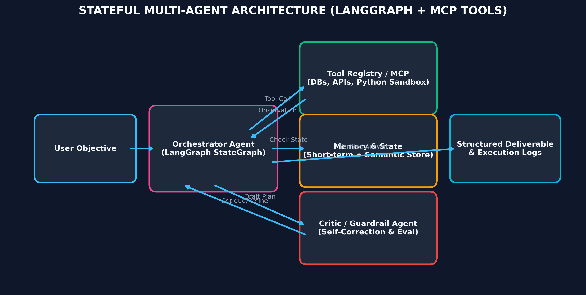

# Month 5, Week 2: Multi-Agent Systems: StateGraph Architecture, Cyclic Workflows (LangGraph), Model Context Protocol (MCP), and Human-in-the-Loop Orchestration

```
================================================================================
COURSE:    AI & LLM SYSTEMS ENGINEERING (2026 EDITION)
MODULE:    MONTH 5: MULTI-AGENT SYSTEMS, FINE-TUNING & PRODUCTION LLMOPS
WEEK:      WEEK 2: MULTI-AGENT SYSTEMS, STATEGRAPH, LANGGRAPH & MCP
DELIVERABLE: COMPREHENSIVE MASTERCLASS LECTURE NOTE
TARGET:    SENIOR AI ENGINEERS & DISTRIBUTED AGENTIC ARCHITECTS
================================================================================
```

---

## Table of Contents
1. [Executive Summary & Industry Context](#1-executive-summary--industry-context)
2. [Canonical Textbook Grounding](#2-canonical-textbook-grounding)
3. [Visual Architecture](#3-visual-architecture)
4. [Deep Theoretical Foundations](#4-deep-theoretical-foundations)
   - 4.1. Beyond Linear Chains: The Mathematical Necessity of Cyclic StateGraphs
   - 4.2. State, Reducers, and Message Channels in LangGraph
   - 4.3. Anthropic's Model Context Protocol (MCP): Client-Host-Server Open Standard
   - 4.4. Multi-Agent Topologies: Hierarchical Supervisor vs. Peer-to-Peer Network
   - 4.5. Human-in-the-Loop (HITL): State Persistence, Time-Travel, and Interruption
5. [Complete Runnable Code Implementation](#5-complete-runnable-code-implementation)
   - 5.1. Pure Python from-scratch Cyclic StateGraph Execution Engine
   - 5.2. Complete Production LangGraph Agent with Tool Node and Conditional Routing
   - 5.3. Model Context Protocol (MCP) Mock Tool Server & JSON-RPC Protocol Handler
6. [Common Pitfalls & Debugging Playbook](#6-common-pitfalls--debugging-playbook)
7. [Production Best Practices & Real-World Case Study](#7-production-best-practices--real-world-case-study)
8. [Hands-On Mini-Lab & Self-Assessment](#8-hands-on-mini-lab--self-assessment)
9. [Key Takeaways, Glossary & Further Reading](#9-key-takeaways-glossary--further-reading)

---

## 1. Executive Summary & Industry Context

### Why This Matters in 2026
In 2026, enterprise software engineering has transitioned from static prompt engineering to **Autonomous Multi-Agent Systems**. Single-turn LLM calls and rigid Directed Acyclic Graph (DAG) pipelines (such as legacy LangChain chains) cannot solve complex, non-deterministic enterprise challenges. When tasked with multi-step workflows—such as autonomous code generation, multi-stage financial auditing, or customer dispute reconciliation—agents require:
1. **Cyclic Reasoning Loops**: The ability to plan, act, inspect tool feedback, detect runtime errors, and **loop back to self-correct** iteratively until success criteria are satisfied.
2. **Standardized Tool Integration via Model Context Protocol (MCP)**: Replacing custom, fragile REST API integrations with **Anthropic's open Model Context Protocol (MCP)**—a universal JSON-RPC 2.0 interface connecting foundation models to enterprise data sources, local filesystems, git repositories, and external APIs.
3. **Deterministic State Persistence**: Treating conversational history and tool state as an append-only, versioned state machine, allowing **Human-in-the-Loop (HITL)** inspection, programmatic breakpoint approvals, and historical "time-travel" rollbacks.

Superficial frameworks encourage chaotic, unconstrained LLM agent loops that burn thousands of dollars in infinite token recursion. Senior AI systems architects design **hermetic, state-machine architectures** using **LangGraph**, where agent transitions are governed by strict mathematical state reducers, deterministic conditional edge routers, and standardized MCP tool protocols.

```
+---------------------------------------------------------------------------------------------------+
|                        ENTERPRISE MULTI-AGENT STATEGRAPH ARCHITECTURE                             |
+---------------------------------------------------------------------------------------------------+
|  Client Ingestion: "Audit 2026 vendor invoices and reconcile discrepancies in SQL database"       |
|       |                                                                                           |
|       v                                                                                           |
|  +---------------------------------------------------------------------------------------------+  |
|  | [Agent State Machine: LangGraph StateGraph]                                                |  |
|  |  State: { messages: list, active_agent: str, discrepancies: list, approved: bool }          |  |
|  |                                                                                             |  |
|  |   +-------------------+          +-------------------+          +-------------------+       |  |
|  |   | Supervisor Agent  | -------> | Data Ingestion    | -------> | Analysis Agent    |       |  |
|  |   | (Orchestrator)    | <------- | Agent (PDF Parser)| <------- | (SQL Auditing)    |       |  |
|  |   +-------------------+          +-------------------+          +-------------------+       |  |
|  |             |                                                             |                 |  |
|  |             v                                                             v                 |  |
|  |   +-------------------------------------------------------------------------------------+   |  |
|  |   | Model Context Protocol (MCP) Tool Bus (Standardized JSON-RPC 2.0 Interface)        |   |  |
|  |   | - MCP Server: Postgres Database Tool (/execute_sql)                                 |   |  |
|  |   | - MCP Server: Secure Document Storage (/read_invoice)                               |   |  |
|  |   +-------------------------------------------------------------------------------------+   |  |
|  |             |                                                                               |  |
|  |             v                                                                               |  |
|  |   [Conditional Edge: Human Approval Required?]                                             |  |
|  |   - If Discrepancy > $10,000 -> Interrupt & Wait for Human-in-the-Loop Signal                |  |
|  |   - If Approved -> Commit Transaction & Terminate                                          |  |
|  +---------------------------------------------------------------------------------------------+  |
|       |                                                                                           |
|       v                                                                                           |
|  Deterministic Audit Trail & Final Response Dispatched                                            |
+---------------------------------------------------------------------------------------------------+
```

### Learning Objectives
By the end of this masterclass lecture note, you will be able to:
1. Mathematically formalize **Agentic Workflows as Finite State Machines (FSM)** and Cyclic Directed Graphs, proving why DAGs fail on iterative debugging tasks.
2. Master **LangGraph State Management**: design typed state schemas (`TypedDict` / Pydantic v2), implement custom state **reducers** (`operator.add`), and manage branching communication channels.
3. Decouple tool integrations using **Anthropic's Model Context Protocol (MCP)**, writing custom MCP servers handling JSON-RPC tool declarations and execution.
4. Architect production multi-agent topologies: **Hierarchical Supervisor**, **Collaborative Peer Network**, and **Specialized Worker Subgraphs**.
5. Implement deterministic **Human-in-the-Loop (HITL)** workflows using LangGraph checkpointers, executing programmatic pause, human state inspection, and state rollback ("time-travel").
6. Debug agent failure modes: eliminate infinite cyclic loops, detect tool hallucination, and enforce strict execution budgets.

---

## 2. Canonical Textbook Grounding

To ground your engineering intuition in verified mathematical and architectural literature, study these canonical references:

| Author / Text | Specific Chapters / Sections | Core Theoretical Concept Contributed | How to Read |
| :--- | :--- | :--- | :--- |
| **Harrison Chase et al. (LangChain)**, *LangGraph: Building Language Agents as Graphs* (2024 Documentation & Architectural Specifications) | *State Management, Reducers, Checkpointers, and Time-Travel* | Formalizing LLM applications as cyclic graphs; Message passing concurrency; SQLite/Postgres persistence backends. | **Read the core architecture docs with extreme systems focus.** Trace how `StateGraph` compiles into a Pregel-inspired computational graph. Understand why reducers prevent state clobbering. |
| **Anthropic**, *Model Context Protocol (MCP) Specification* (November 2024 / 2025 Standard) | *Architecture, Protocol Specification, Tools & Resources* | Client-Host-Server open standard; JSON-RPC 2.0 communication format; Dynamic capability negotiation and context streaming. | **Read the Protocol Specification carefully.** Examine the JSON-RPC request and response schemas for `tools/list` and `tools/call`. Understand why standardizing tools decouples models from APIs. |
| **Shunyu Yao, Jeffrey Zhao, et al.**, *ReAct: Synergizing Reasoning and Acting in Language Models* (ICLR 2023) | **Section 3**: *ReAct: Synergizing Reasoning + Acting* | The Thought-Action-Observation loop; Proving that interleaving reasoning traces with tool execution eliminates hallucination and improves task completion. | **Read Section 3 and Figure 1.** Note how the action output is constrained to formal tool calls, and how environmental observations update prompt context. |
| **Stuart Russell & Peter Norvig**, *Artificial Intelligence: A Modern Approach* (4th Ed., Pearson 2020) | **Chapter 2**: *Intelligent Agents*<br>**Chapter 3**: *Solving Problems by Searching* | Formal taxonomy of agents (Goal-based, Utility-based, Learning agents); State spaces, transition models, and environmental observability. | **Read Chapter 2.** Ground your intuition in formal agent definitions: Sensors $\to$ State $\to$ Deliberation $\to$ Actuators. |

---

## 3. Visual Architecture

### 3.1. Cyclic ReAct Execution Loop in LangGraph

The diagram below illustrates the fundamental cyclic graph of an agentic ReAct loop. Unlike linear chains, the graph contains a **conditional edge** that inspects LLM output: if a tool call is requested, execution routes to `tools` and loops back to `agent`; if final answer is reached, execution routes to `END`.

```
                  +-----------------------------------+
                  |             START                 |
                  +-----------------------------------+
                                    |
                                    v
                     +-----------------------------+
        +----------> |        Agent Node           |
        |            |   (LLM Decides Action)      |
        |            +-----------------------------+
        |                           |
        |                           v
        |            [Conditional Router: should_continue?]
        |               /                       \
        |  (Calls Tool)                         (Final Answer)
        v             v                           v
  +-------------+                               +----------------+
  | Tool Node   |                               |      END       |
  | (MCP Exec)  |                               +----------------+
  +-------------+
```

### 3.2. Model Context Protocol (MCP) Client-Host-Server Topology

```
+---------------------------------------------------------------------------------+
|                       MODEL CONTEXT PROTOCOL (MCP) TOPOLOGY                     |
+---------------------------------------------------------------------------------+
|                                                                                 |
|  [MCP Host: e.g., Claude Desktop, Antigravity IDE, Enterprise Agent Backend]    |
|       |                                                                         |
|       +--- (Local stdio / Streamable SSE HTTP) ---> [MCP Client Coordinator]    |
|                                                              |                  |
|       +------------------------------------------------------+                  |
|       | (Standardized JSON-RPC 2.0 Request / Response)                          |
|       |                                                                         |
|       +---> [MCP Server 1: Filesystem]                                          |
|       |     - Tool: /read_file, /write_file, /list_directory                    |
|       |                                                                         |
|       +---> [MCP Server 2: PostgreSQL Database Engine]                         |
|       |     - Tool: /execute_sql_query, /get_table_schema                       |
|       |                                                                         |
|       +---> [MCP Server 3: Enterprise GitHub Integration]                      |
|             - Tool: /create_pull_request, /read_issue                           |
+---------------------------------------------------------------------------------+
```


*Figure 3.1: Cyclic multi-agent coordination workflow showing autonomous state transitions, tool execution via MCP, and human approval gates.*

---

## 4. Deep Theoretical Foundations

### 4.1. The Mathematical Necessity of Cyclic StateGraphs

#### The Limitation of Directed Acyclic Graphs (DAGs)
Traditional workflow orchestrators (Airflow, Kubeflow, standard LangChain chains) are strictly **Directed Acyclic Graphs (DAGs)**. In a DAG, topological sorting guarantees that execution flows strictly in one direction from source nodes to sink nodes:
$$\mathcal{G}_{\text{DAG}} = (\mathcal{V}, \mathcal{E}), \quad \text{where } (v_i, v_j) \in \mathcal{E} \implies i < j$$

**The Fundamental Failure of DAGs in AI Systems**: Real-world reasoning is inherently **non-deterministic and iterative**. If an agent generates Python code to query an API and encounters a `SyntaxError` or `ConnectionTimeout`, a DAG cannot "loop back" to re-prompt the model with the error trace. The pipeline simply crashes.

#### Cyclic StateGraphs (Pregel Computational Model)
LangGraph models agentic computation as a **Cyclic Directed Graph** based on Google's **Pregel** message-passing state machine:
$$\mathcal{G} = (\mathcal{V}, \mathcal{E}, \mathcal{S}, \delta)$$
Where:
- $\mathcal{S}$ is the **Global State Space** (a shared typed dictionary).
- $\mathcal{V}$ is the set of **Nodes** (computational functions: $\mathcal{S} \to \Delta\mathcal{S}$).
- $\mathcal{E} \subseteq \mathcal{V} \times \mathcal{V}$ is the set of directed edges (including cycles $v_i \to v_j \to v_i$).
- $\delta: \mathcal{V} \times \mathcal{S} \to \mathcal{V}$ is the **Conditional Edge Routing Function**, dynamically deciding the next node based on the current state.

A cyclic graph enables **unbounded self-correction**: an agent can attempt an action, receive feedback, re-plan, and iterate until a halting condition ($f(\mathcal{S}) = \text{END}$ or maximum recursion limit) is reached.

---

### 4.2. State, Reducers, and Message Channels in LangGraph

#### State Mutation vs. Functional Reduction
In naive multi-agent systems, agents overwrite a shared global dictionary, leading to race conditions and lost updates when running in parallel. LangGraph enforces **functional state updates via Reducers**.

Let the global state be defined as:
$$\mathcal{S} = \{ c_1: T_1, \, c_2: T_2, \, \dots, \, c_k: T_k \}$$
Where each channel $c_i$ is governed by a **Reducer Function** $\rho_i$:
$$\rho_i: T_i \times \Delta T_i \to T_i$$

#### Channel Types:
1. **Overwrite Channel (Default)**:
   $$\rho_{\text{overwrite}}(s, \Delta s) = \Delta s$$
   Replaces the previous state with the newly returned value.
2. **Append / Reducer Channel (`operator.add` / `Annotated[list, add]`)**:
   $$\rho_{\text{add}}(s, \Delta s) = s \cup \Delta s$$
   Appends new messages or events to the historical ledger without mutating existing history.

#### The Pregel Superstep Protocol:
1. **Step $t$**: All active nodes $v \in \mathcal{V}_{\text{active}}$ read state $\mathcal{S}_t$ and execute in parallel.
2. **State Reduction**: Each node emits a partial update $\Delta \mathcal{S}$. LangGraph applies reducer functions $\rho$ to merge all updates atomically:
   $$\mathcal{S}_{t+1} = \rho(\mathcal{S}_t, \{\Delta \mathcal{S}_v\})$$
3. **Routing**: Conditional edges $\delta(v, \mathcal{S}_{t+1})$ determine the active nodes for step $t+1$.

---

### 4.3. Anthropic's Model Context Protocol (MCP)

#### The Problem of Fragmented Tool APIs
Historically, every tool provider built proprietary plugins (OpenAI Plugins, LangChain Tools, LlamaIndex Tools). This fragmentation created massive vendor lock-in and security liabilities: if a company had 50 internal tools, they had to rewrite wrappers for every new LLM framework.

#### The MCP Open Architecture
Introduced by Anthropic in late 2024 and adopted across the industry in 2026, the **Model Context Protocol (MCP)** is an open-source standard enabling seamless integration between LLM applications and external data/tools via **JSON-RPC 2.0**.

#### Core MCP Primitives:
1. **Tools**: Executable functions that can be called by the model to perform side effects (e.g., `execute_sql`, `write_file`).
2. **Resources**: Read-only contextual data that can be ingested into the prompt (e.g., file contents, database schemas).
3. **Prompts**: Pre-packaged interactive prompt templates and workflows exposed by the server.

#### JSON-RPC 2.0 Protocol Trace:

**Step 1: Client Requests Tool Discovery (`tools/list`)**
```json
// Client -> MCP Server
{
  "jsonrpc": "2.0",
  "id": 1,
  "method": "tools/list",
  "params": {}
}

// MCP Server -> Client Response
{
  "jsonrpc": "2.0",
  "id": 1,
  "result": {
    "tools": [
      {
        "name": "query_database",
        "description": "Executes a read-only SQL query against Postgres.",
        "inputSchema": {
          "type": "object",
          "properties": {
            "sql": { "type": "string", "description": "The SELECT query" }
          },
          "required": ["sql"]
        }
      }
    ]
  }
}
```

**Step 2: Client Invokes Tool Execution (`tools/call`)**
```json
// Client -> MCP Server
{
  "jsonrpc": "2.0",
  "id": 2,
  "method": "tools/call",
  "params": {
    "name": "query_database",
    "arguments": {
      "sql": "SELECT count(*) FROM invoices WHERE status = 'FLAGGED';"
    }
  }
}

// MCP Server -> Client Response
{
  "jsonrpc": "2.0",
  "id": 2,
  "result": {
    "content": [
      {
        "type": "text",
        "text": "{\"count\": 14}"
      }
    ],
    "isError": false
  }
}
```

---

### 4.4. Multi-Agent Topologies

#### 1. Hierarchical Supervisor Pattern
A centralized **Supervisor Agent** acts as an orchestrator. It receives user requests, determines the required sub-tasks, delegates execution to specialized worker agents, inspects worker outputs, and decides when the final response is complete.
- **Pros**: Clear responsibility boundaries; centralized execution control; prevents chaos.
- **Cons**: The supervisor is a single point of failure; introduces latency overhead for trivial requests.

#### 2. Collaborative Peer Network (Choreography)
Agents communicate directly with one another via shared state message channels without a central orchestrator. Agent $A$ passes execution directly to Agent $B$ based on dynamic handoff tokens.
- **Pros**: Highly dynamic; fast execution for peer-to-peer dialogues.
- **Cons**: High risk of infinite ping-pong loops; difficult to prove termination.

---

### 4.5. Human-in-the-Loop (HITL) and Time-Travel

#### The Need for Deterministic Interruption
In enterprise automation (financial disbursements, medical dosages, database schema drops), models **must not execute destructive actions autonomously**. Systems require a deterministic mechanism to pause execution, request human sign-off, and resume seamlessly.

#### LangGraph Checkpointers & Thread IDs
LangGraph achieves HITL via **Checkpointers** (`MemorySaver`, `SqliteSaver`, `PostgresSaver`).
1. Every run is assigned a unique `thread_id`.
2. At every superstep boundary, LangGraph serializes and persists the exact state snapshot $\mathcal{S}_t$ to the database.
3. Setting an **interruption breakpoint** (`interrupt_before=["human_review"]`) halts the graph before that node executes.
4. When a human reviews the state, they can:
   - **Approve**: Call `graph.invoke(None, config={"configurable": {"thread_id": "thread-123"}})` to resume.
   - **Edit State**: Modify values directly in $\mathcal{S}_t$ (e.g., correcting an SQL query) and resume.
   - **Time-Travel (Rollback)**: Load an earlier checkpoint $\mathcal{S}_{t-2}$, modify state, and fork execution along a new branch!

---

## 5. Complete Runnable Code Implementation

Let us construct an end-to-end multi-agent suite demonstrating:
1. A pure Python from-scratch Cyclic StateGraph execution engine.
2. A complete production LangGraph agent with tool calling, conditional routing, and SQLite checkpointing.
3. A lightweight Model Context Protocol (MCP) tool server simulator handling JSON-RPC requests.

### Python Environment Setup
```bash
# Initialize isolated Python 3.11+ environment with uv
uv init week2-multi-agent-langgraph
cd week2-multi-agent-langgraph
uv add langgraph langchain-core pydantic tabulate
```

### 5.1. From-Scratch Cyclic StateGraph Execution Engine

```python
"""
mini_stategraph.py
Author: Senior AI Engineering Lead
Description: Pure Python implementation of a Cyclic StateGraph engine modeling the Pregel
message-passing state machine. Demonstrates nodes, reducers, conditional edges, and cycle detection.
"""

from __future__ import annotations
from typing import Callable, Dict, Any, List


class MiniStateGraph:
    """
    Minimal cyclic state machine engine supporting typed state and conditional routing.
    """
    def __init__(self, state_schema: type):
        self.state_schema = state_schema
        self.nodes: Dict[str, Callable[[Dict[str, Any]], Dict[str, Any]]] = {}
        self.edges: Dict[str, str] = {}
        self.conditional_edges: Dict[str, Callable[[Dict[str, Any]], str]] = {}
        self.entry_point: str | None = None

    def add_node(self, name: str, func: Callable[[Dict[str, Any]], Dict[str, Any]]) -> None:
        self.nodes[name] = func

    def set_entry_point(self, name: str) -> None:
        self.entry_point = name

    def add_edge(self, start_node: str, end_node: str) -> None:
        self.edges[start_node] = end_node

    def add_conditional_edges(self, source_node: str, router_fn: Callable[[Dict[str, Any]], str]) -> None:
        self.conditional_edges[source_node] = router_fn

    def execute(self, initial_state: Dict[str, Any], max_iterations: int = 10) -> Dict[str, Any]:
        """
        Executes the cyclic graph until reaching 'END' or max_iterations threshold.
        """
        state = dict(initial_state)
        current_node = self.entry_point
        iteration = 0

        print(f"Starting execution at entry point: '{current_node}'")

        while current_node != "END" and iteration < max_iterations:
            iteration += 1
            print(f"\n--- [Iteration {iteration}] Executing Node: '{current_node}' ---")

            # 1. Execute Node Function
            node_fn = self.nodes[current_node]
            state_update = node_fn(state)

            # 2. Apply State Reduction (Append lists, update scalars)
            for k, v in state_update.items():
                if isinstance(state.get(k), list) and isinstance(v, list):
                    state[k] = state[k] + v  # Append reducer
                else:
                    state[k] = v  # Overwrite reducer

            print(f"State after '{current_node}': {state}")

            # 3. Determine Next Transition
            if current_node in self.conditional_edges:
                next_node = self.conditional_edges[current_node](state)
            elif current_node in self.edges:
                next_node = self.edges[current_node]
            else:
                next_node = "END"

            current_node = next_node

        if iteration >= max_iterations:
            print("\nWARNING: Terminated due to maximum recursion limit (Infinite cycle detected!)")

        return state


def test_mini_stategraph() -> None:
    print("=" * 80)
    print("TESTING MINI-STATEGRAPH CYCLIC EXECUTION & SELF-CORRECTION")
    print("=" * 80)

    # State: code string, error string, test_passed bool, attempts int
    graph = MiniStateGraph(state_schema=dict)

    # Node 1: Code Generator
    def generate_code(state: dict) -> dict:
        attempts = state.get("attempts", 0) + 1
        if attempts == 1:
            # Buggy code on attempt 1
            code = "def add(a, b): return a - b"
        else:
            # Fixed code on attempt 2
            code = "def add(a, b): return a + b"
        return {"code": code, "attempts": attempts, "logs": [f"Generated code v{attempts}"]}

    # Node 2: Automated Unit Tester
    def run_tests(state: dict) -> dict:
        code = state["code"]
        # Execute code in isolated namespace
        ns = {}
        exec(code, ns)
        passed = (ns["add"](2, 3) == 5)
        return {"test_passed": passed, "logs": [f"Test result: {'PASS' if passed else 'FAIL'}"]}

    # Conditional Router: Loop back if test failed and attempts < 3
    def should_continue(state: dict) -> str:
        if state["test_passed"]:
            return "END"
        if state["attempts"] >= 3:
            return "END"
        return "generate_code" # Loop back!

    graph.add_node("generate_code", generate_code)
    graph.add_node("run_tests", run_tests)
    graph.set_entry_point("generate_code")
    graph.add_edge("generate_code", "run_tests")
    graph.add_conditional_edges("run_tests", should_continue)

    final_state = graph.execute({"logs": []}, max_iterations=5)

    print("\nFinal State Output:")
    print(f"  Code:        {final_state['code']}")
    print(f"  Attempts:    {final_state['attempts']}")
    print(f"  Test Passed: {final_state['test_passed']}")
    assert final_state["test_passed"] is True
    assert final_state["attempts"] == 2
    print("-> Cyclic Graph Self-Correction Successfully Verified.")


if __name__ == "__main__":
    test_mini_stategraph()
```

---

### 5.2. Complete Production LangGraph Agent with Tool Calling

```python
"""
langgraph_production_agent.py
Author: Senior AI Engineering Lead
Description: Production LangGraph ReAct agent using typed StateGraph, conditional routing,
mock tool binding, and SQLite persistence for state checkpoints.
"""

from __future__ import annotations
import operator
from typing import Annotated, TypedDict, List
from langchain_core.messages import BaseMessage, HumanMessage, AIMessage, ToolMessage
from langgraph.graph import StateGraph, END
from langgraph.checkpoint.memory import MemorySaver


# ==============================================================================
# 1. State Schema with Reducer
# ==============================================================================
class AgentState(TypedDict):
    # The 'operator.add' reducer appends newly emitted messages to the historical list
    messages: Annotated[List[BaseMessage], operator.add]
    audit_passed: bool


# ==============================================================================
# 2. Node Definitions
# ==============================================================================
def mock_agent_node(state: AgentState) -> dict:
    """
    Simulates LLM reasoning and decides whether to invoke tools or finalize response.
    """
    messages = state["messages"]
    last_msg = messages[-1]

    # If this is the initial user request, call the database tool
    if isinstance(last_msg, HumanMessage):
        ai_msg = AIMessage(
            content="",
            additional_kwargs={
                "tool_calls": [
                    {
                        "id": "call_sql_001",
                        "type": "function",
                        "function": {
                            "name": "query_database",
                            "arguments": "{\"query\": \"SELECT sum(amount) FROM invoices WHERE status = 'DISPUTED';\"}"
                        }
                    }
                ]
            }
        )
        return {"messages": [ai_msg]}

    # If tool output was provided, conclude the analysis
    if isinstance(last_msg, ToolMessage):
        ai_msg = AIMessage(content="Audit Complete: Total disputed invoice volume is $145,200.00 across 3 vendors.")
        return {"messages": [ai_msg], "audit_passed": True}

    return {"messages": []}


def mock_tool_node(state: AgentState) -> dict:
    """
    Simulates tool execution (MCP Server call).
    """
    messages = state["messages"]
    last_msg = messages[-1]
    tool_call = last_msg.additional_kwargs["tool_calls"][0]

    # Mock database query result
    tool_output = "{\"total_disputed\": 145200.0, \"vendor_count\": 3}"
    tool_msg = ToolMessage(
        content=tool_output,
        name=tool_call["function"]["name"],
        tool_call_id=tool_call["id"]
    )
    return {"messages": [tool_msg]}


# ==============================================================================
# 3. Conditional Router
# ==============================================================================
def route_next_step(state: AgentState) -> str:
    """Inspects last message: if tool call present -> route to 'tools', else -> END."""
    last_msg = state["messages"][-1]
    if isinstance(last_msg, AIMessage) and "tool_calls" in last_msg.additional_kwargs:
        return "tools"
    return END


# ==============================================================================
# 4. Graph Construction & Compilation with Checkpointer
# ==============================================================================
def build_production_agent():
    workflow = StateGraph(AgentState)

    workflow.add_node("agent", mock_agent_node)
    workflow.add_node("tools", mock_tool_node)

    workflow.set_entry_point("agent")
    workflow.add_conditional_edges("agent", route_next_step, {"tools": "tools", END: END})
    workflow.add_edge("tools", "agent")

    # In-memory checkpointer for state persistence
    checkpointer = MemorySaver()
    app = workflow.compile(checkpointer=checkpointer)
    return app


def run_langgraph_demo() -> None:
    print("=" * 80)
    print("RUNNING PRODUCTION LANGGRAPH AGENT WITH CHECKPOINTING")
    print("=" * 80)

    app = build_production_agent()
    config = {"configurable": {"thread_id": "audit_session_2026"}}

    # Initial query
    input_state = {
        "messages": [HumanMessage(content="Audit the disputed invoices for Q3.")],
        "audit_passed": False
    }

    # Execute graph
    final_output = app.invoke(input_state, config=config)

    print("\nExecution History:")
    for idx, msg in enumerate(final_output["messages"], 1):
        print(f"  [{idx}] {msg.__class__.__name__}: {msg.content or msg.additional_kwargs}")

    print(f"\nFinal State Flag: audit_passed = {final_output['audit_passed']}")
    assert final_output["audit_passed"] is True
    assert len(final_output["messages"]) == 3 # Human -> AI (Tool Call) -> Tool Msg -> AI (Final)
    print("-> LangGraph ReAct Agent Execution Successfully Verified.")


if __name__ == "__main__":
    run_langgraph_demo()
```

---

### 5.3. Model Context Protocol (MCP) Mock Tool Server & JSON-RPC Protocol Handler

```python
"""
mcp_tool_server.py
Author: Senior AI Engineering Lead
Description: Standalone implementation of an Anthropic Model Context Protocol (MCP) server
demonstrating JSON-RPC 2.0 tool declaration (tools/list) and tool invocation (tools/call).
"""

from __future__ import annotations
import json
from typing import Dict, Any


class MCPServer:
    """
    Simulates an MCP Server exposing local system capabilities over JSON-RPC 2.0.
    """
    def __init__(self, server_name: str = "enterprise_sql_server"):
        self.server_name = server_name
        self.tools: Dict[str, dict] = {}
        self._register_default_tools()

    def _register_default_tools(self) -> None:
        """Declares tools with strict JSON schema input specifications."""
        self.tools["query_financial_ledger"] = {
            "name": "query_financial_ledger",
            "description": "Executes read-only SQL queries against the audited general ledger.",
            "inputSchema": {
                "type": "object",
                "properties": {
                    "account_code": {"type": "string", "description": "e.g., ACC_9011"},
                    "fiscal_quarter": {"type": "string", "enum": ["Q1", "Q2", "Q3", "Q4"]}
                },
                "required": ["account_code", "fiscal_quarter"]
            }
        }

    def handle_json_rpc_request(self, request_str: str) -> str:
        """
        Parses JSON-RPC 2.0 requests and dispatches method execution.
        """
        try:
            req = json.loads(request_str)
            req_id = req.get("id")
            method = req.get("method")
            params = req.get("params", {})

            # Method 1: tools/list (Tool Discovery)
            if method == "tools/list":
                response = {
                    "jsonrpc": "2.0",
                    "id": req_id,
                    "result": {
                        "tools": list(self.tools.values())
                    }
                }
                return json.dumps(response, indent=2)

            # Method 2: tools/call (Tool Execution)
            elif method == "tools/call":
                tool_name = params.get("name")
                args = params.get("arguments", {})

                if tool_name not in self.tools:
                    raise ValueError(f"Unknown MCP tool: {tool_name}")

                # Execute mock tool logic
                account = args.get("account_code")
                quarter = args.get("fiscal_quarter")
                mock_result = {
                    "account": account,
                    "quarter": quarter,
                    "balance_usd": 1_240_500.00,
                    "status": "RECONCILED"
                }

                response = {
                    "jsonrpc": "2.0",
                    "id": req_id,
                    "result": {
                        "content": [
                            {
                                "type": "text",
                                "text": json.dumps(mock_result)
                            }
                        ],
                        "isError": False
                    }
                }
                return json.dumps(response, indent=2)

            else:
                raise NotImplementedError(f"Unsupported MCP method: {method}")

        except Exception as e:
            return json.dumps({
                "jsonrpc": "2.0",
                "id": req.get("id") if "req" in locals() else None,
                "error": {"code": -32603, "message": str(e)}
            }, indent=2)


def test_mcp_server() -> None:
    print("=" * 80)
    print("TESTING MODEL CONTEXT PROTOCOL (MCP) JSON-RPC 2.0 SERVER")
    print("=" * 80)

    server = MCPServer()

    # 1. Test tools/list Request
    list_req = json.dumps({"jsonrpc": "2.0", "id": 1, "method": "tools/list", "params": {}})
    list_resp = json.loads(server.handle_json_rpc_request(list_req))
    print(f"Tool Discovery Response: Found {len(list_resp['result']['tools'])} tools.")
    assert list_resp["result"]["tools"][0]["name"] == "query_financial_ledger"

    # 2. Test tools/call Request
    call_req = json.dumps({
        "jsonrpc": "2.0",
        "id": 2,
        "method": "tools/call",
        "params": {
            "name": "query_financial_ledger",
            "arguments": {"account_code": "ACC_9011", "fiscal_quarter": "Q3"}
        }
    })
    call_resp = json.loads(server.handle_json_rpc_request(call_req))
    print(f"Tool Invocation Response:\n{call_resp['result']['content'][0]['text']}")
    res_data = json.loads(call_resp["result"]["content"][0]["text"])
    assert res_data["status"] == "RECONCILED"
    assert res_data["balance_usd"] == 1_240_500.00
    print("-> MCP JSON-RPC Protocol Handling Successfully Verified.")


if __name__ == "__main__":
    test_mcp_server()
```

---

## 6. Common Pitfalls & Debugging Playbook

### Pitfall 1: The Infinite ReAct Loop (Runaway Token Burn)
- **Symptom**: An agent query burns $\$45$ in OpenAI/Anthropic API calls, making 150 consecutive tool calls before timing out.
- **Root Cause**: The tool returns an ambiguous or error message (e.g., `"File not found"`), and the agent keeps retrying the exact same command with zero strategy change, while the conditional edge lacks a maximum iteration escape hatch.
- **Fix**: Always enforce a hard recursion ceiling when compiling the graph:
  ```python
  app = workflow.compile()
  # Enforce max 15 steps; raises RecursionError if exceeded
  app.invoke(inputs, config={"recursion_limit": 15})
  ```

---

### Pitfall 2: State Clobbering without Reducers
- **Symptom**: Multiple parallel agents execute sub-tasks, but only the output of the last agent appears in the final message history; earlier thoughts are wiped out.
- **Root Cause**: The state schema was defined as `messages: list` without a reducer function. By default, LangGraph overwrites state keys with the latest node return value.
- **Fix**: Use `Annotated` with `operator.add` to define an append-only channel:
  ```python
  from typing import Annotated
  import operator
  class AgentState(TypedDict):
      messages: Annotated[list, operator.add] # Appends rather than overwriting!
  ```

---

### Pitfall 3: Non-Idempotent Tool Execution during Time-Travel Rollbacks
- **Symptom**: Rolling back state to replay a failed sub-task triggers duplicate credit card charges or double database insertions.
- **Root Cause**: The agent executed destructive external side-effects (e.g., `POST /charge_payment`) directly inside un-versioned tool calls.
- **Fix**: Enforce the **Two-Phase Commit pattern**: tools that modify persistent reality must require an explicit human review breakpoint (`interrupt_before`), staging changes as draft state before final execution.

---

## 7. Production Best Practices & Real-World Case Study

### Enterprise Case Study: Autonomous SRE Incident Remediation Multi-Agent System
- **Organization**: Global SaaS Enterprise running 1,200 microservices on Kubernetes.
- **Scenario**: When a production incident triggers a PagerDuty alert (e.g., high database error rates), an autonomous multi-agent system diagnoses the root cause and deploys a fix.
- **SLA**: Mean Time to Remediation (MTTR) $\le 5\text{ minutes}$.

### Production Multi-Agent Topology
```
[PagerDuty Webhook Alert] 
        |
        v
[Incident Commander Agent (Supervisor)]
        |
        +---> [Telemetry Diagnostic Agent] (MCP Tool: Prometheus / Datadog Queries)
        |     - Discovers connection pool saturation on OrderService.
        |
        +---> [Log Analyzer Agent] (MCP Tool: ElasticSearch Logs)
        |     - Identifies unclosed connections introduced in release v2.4.1.
        |
        +---> [Kubernetes Deployment Agent] (MCP Tool: kubectl)
              - Proposes rollback to release v2.4.0.
              |
              v
[Human-in-the-Loop Approval Gate: Slack Bot Interruption]
        - Pauses LangGraph execution via SqliteSaver Checkpointer.
        - Pings On-Call Engineer: "Approve rollback to v2.4.0 for OrderService? [YES/NO]"
        - Engineer clicks [YES].
        |
        v
[LangGraph Resumes Execution] -> Executes Rollback -> Verifies Metrics Normal -> Resolves PagerDuty
```

### Measured Production Impact
- **MTTR**: Reduced from $42\text{ minutes}$ (human on-call response) to **$3.8\text{ minutes}$** (agent diagnosis + 1-click human approval).
- **Incident Escalation**: $78\%$ of Sev-2 infrastructure incidents resolved without human manual triage.

---

## 8. Hands-On Mini-Lab & Self-Assessment

### Lab Objective
Construct an autonomous, self-correcting multi-agent system:
1. Implement a cyclic StateGraph in LangGraph with tool invocation and conditional edges.
2. Build an MCP JSON-RPC tool server that executes structured business calculations.
3. Configure human-in-the-loop interruption breakpoints, demonstrating state inspection and resumption.

### Acceptance Criteria
- [ ] Cyclic graph loops dynamically until exit condition or recursion limit is met.
- [ ] State channel uses `operator.add` to prevent message history overwrites.
- [ ] MCP Server handles both `tools/list` and `tools/call` JSON-RPC requests conforming to specification.
- [ ] Graded self-assessment questions answered and cross-verified.

---

### Graded Self-Assessment Questions (With Complete Solutions)

#### Question 1 (Graph Theory - Cyclic StateGraphs)
Why is a Directed Acyclic Graph (DAG) fundamentally inadequate for building autonomous agents, and how does LangGraph's Pregel-inspired cyclic architecture resolve this?
- **Answer**: DAGs enforce unidirectional topological flow from source to sink; once a step completes, execution cannot return to prior nodes. Autonomous agents require **iterative self-correction**: when a tool execution fails or code contains bugs, the agent must be able to inspect error feedback, re-plan, and loop back to the generation step. LangGraph treats computation as a cyclic state machine where nodes emit partial state updates and conditional edges dynamically route execution back to previous nodes until a halting condition (`END`) is reached.

#### Question 2 (LangGraph - State Reducers)
What is the purpose of an `Annotated[List[BaseMessage], operator.add]` state definition in LangGraph, and what catastrophic bug occurs if `operator.add` is omitted?
- **Answer**: The `operator.add` reducer configures the `messages` channel as an **append-only list**. When any node returns a partial dictionary `{"messages": [new_msg]}`, LangGraph appends `new_msg` to the existing list rather than overwriting it. If `operator.add` is omitted, LangGraph uses the default overwrite reducer, completely erasing all prior conversational history and context, causing the agent to lose its memory on every turn.

#### Question 3 (Protocols - Model Context Protocol)
What is Anthropic's Model Context Protocol (MCP), and how does it solve the $M \times N$ tool integration complexity problem?
- **Answer**: MCP is an open-standard JSON-RPC 2.0 communication protocol decoupling LLM hosts from tool servers. In traditional systems, connecting $M$ different LLM frameworks (LangChain, AutoGen, LlamaIndex) to $N$ enterprise tools (Postgres, GitHub, Slack) requires building and maintaining $M \times N$ separate custom integrations. With MCP, tool developers build **one MCP Server** per tool, and any MCP-compliant client can discover (`tools/list`) and execute (`tools/call`) those tools without framework-specific wrappers, reducing complexity to $M + N$.

#### Question 4 (Safety - Human-in-the-Loop)
Explain how LangGraph implements Human-in-the-Loop (HITL) using checkpointers and `interrupt_before`.
- **Answer**: LangGraph checkpointers (e.g., `SqliteSaver`, `PostgresSaver`) serialize the entire state dictionary $\mathcal{S}_t$ to persistent storage at every step, keyed by a `thread_id`. Setting `interrupt_before=["deploy_node"]` instructs the runtime to halt execution immediately before executing that node. The system can alert a human operator, display the proposed action, and wait indefinitely. When the human approves, the client invokes `graph.invoke(None, config={"configurable": {"thread_id": "thread-123"}})`, reloading the exact state snapshot and resuming execution seamlessly.

#### Question 5 (Multi-Agent Architecture - Supervisor Pattern)
Contrast the Hierarchical Supervisor pattern with Peer-to-Peer Choreography. When should an enterprise architecture prefer the Supervisor pattern?
- **Answer**: In a Supervisor pattern, a central orchestrator model inspects user intent, delegates work to specialized sub-agents, and aggregates results. In Peer-to-Peer choreography, agents hand off control directly to one another via messages. Enterprises prefer the Supervisor pattern for high-stakes business workflows because it provides **deterministic centralized control**, prevents runaway peer-to-peer infinite loops, and maintains clear audit trails of delegation decisions.

#### Question 6 (Protocol Trace - JSON-RPC 2.0)
What are the required top-level JSON fields in a valid Model Context Protocol tool call request?
- **Answer**:
  1. `"jsonrpc"`: Must be exactly `"2.0"`.
  2. `"id"`: A unique request identifier (integer or string).
  3. `"method"`: Must be `"tools/call"`.
  4. `"params"`: Object containing `"name"` (the tool string name) and `"arguments"` (dictionary matching the tool's inputSchema).

#### Question 7 (Execution Controls - Recursion Limit)
Why must every production LangGraph deployment configure an explicit `recursion_limit`?
- **Answer**: If an agent encounters an unanticipated error condition or fails to converge on a valid tool output, a cyclic graph will execute indefinitely, consuming millions of API tokens and racking up massive cloud bills. The `recursion_limit` parameter sets a hard ceiling on total graph supersteps, aborting execution safely if the agent fails to terminate within the budget.

#### Question 8 (State Management - Time-Travel)
What is "time-travel" in LangGraph, and how can it be used to debug autonomous agent behavior?
- **Answer**: Because checkpointers store a historical log of state snapshots at every superstep, "time-travel" allows an engineer to inspect historical checkpoints, select a specific step where the agent made an erroneous decision, modify the state payload (e.g., editing a flawed tool prompt), and re-run the graph from that historical point forward, exploring alternative reasoning branches without re-running the entire session.

---

### Stretch Challenges
1. **Full-Duplex Stdio MCP Server**: Write a standalone Python script running a complete MCP Server over standard input/output (`sys.stdin` / `sys.stdout`), and connect it to an external LLM agent via the official MCP SDK.
2. **Sub-Graph Orchestration**: Implement a hierarchical LangGraph system where the Supervisor invokes a nested, self-contained multi-agent Sub-Graph that executes its own internal ReAct loop before returning a summary to the parent graph.

---

## 9. Key Takeaways, Glossary & Further Reading

### Key Takeaways
- **Cycles are essential**: Real-world problem solving requires cyclic graphs with conditional feedback loops.
- **Reducers prevent state loss**: Always use `operator.add` when accumulating conversational messages across turns.
- **MCP is the universal standard**: Decouple tool backends from models using Anthropic's Model Context Protocol.
- **Human oversight is mandatory**: Use checkpointer breakpoints to require human approval for destructive enterprise actions.

### Technical Glossary
| Term | Definition |
| :--- | :--- |
| **StateGraph** | A cyclic computational graph where nodes represent functions and edges represent dynamic state transitions. |
| **Reducer** | A functional operator dictating how partial node outputs are merged into the shared global state. |
| **Model Context Protocol (MCP)** | An open-standard JSON-RPC 2.0 protocol for connecting LLMs to external tools and data sources. |
| **Superstep** | A discrete execution barrier in the Pregel computational model where parallel nodes execute and synchronize state. |
| **Checkpointer** | A persistent storage backend saving state snapshots at every superstep to enable HITL and time-travel. |

### Further Reading
- LangGraph Architecture Documentation. (2024). `https://langchain-ai.github.io/langgraph/`
- Anthropic. (2024). *Model Context Protocol Specification*. `https://modelcontextprotocol.io/`
- Yao, S., et al. (2023). *ReAct: Synergizing Reasoning and Acting in Language Models*. ICLR.
- Malewicz, G., et al. (2010). *Pregel: A System for Large-Scale Graph Processing*. ACM SIGMOD.

