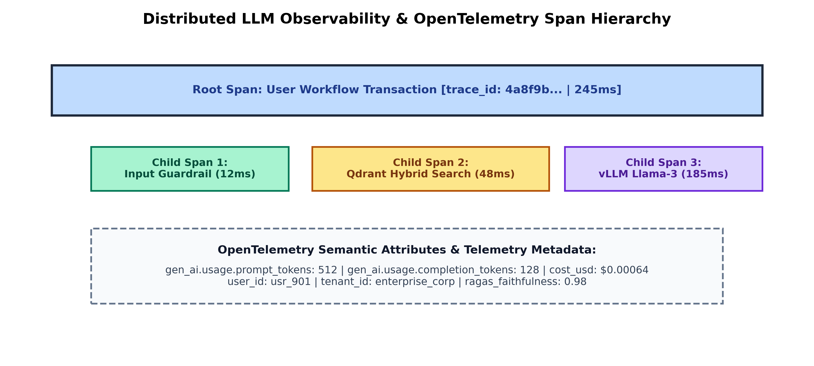

# Month 5, Week 3: LLM Observability, Evaluation Frameworks, Distributed Tracing (OpenTelemetry), and LLMOps Lifecycle Management

```
================================================================================
COURSE:    AI & LLM SYSTEMS ENGINEERING (2026 EDITION)
MODULE:    MONTH 5: MULTI-AGENT SYSTEMS, FINE-TUNING & PRODUCTION LLMOPS
WEEK:      WEEK 3: LLM OBSERVABILITY, EVALUATIONS, TRACING & TELEMETRY
DELIVERABLE: COMPREHENSIVE MASTERCLASS LECTURE NOTE
TARGET:    SENIOR AI ENGINEERS & ENTERPRISE LLMOPS ARCHITECTS
================================================================================
```

---

## Table of Contents
1. [Executive Summary & Industry Context](#1-executive-summary--industry-context)
2. [Canonical Textbook Grounding](#2-canonical-textbook-grounding)
3. [Visual Architecture](#3-visual-architecture)
4. [Deep Theoretical Foundations](#4-deep-theoretical-foundations)
   - 4.1. The Observability Triad in LLM Systems: Traces, Metrics, and Logs
   - 4.2. OpenTelemetry GenAI Semantic Conventions and Span Hierarchies
   - 4.3. Automated Evaluation Frameworks: LLM-as-a-Judge, G-Eval, and Inter-Annotator Agreement
   - 4.4. Drift Detection: Data Drift, Concept Drift, and Semantic Manifold Shift
   - 4.5. Continuous Feedback Loops, Online A/B Testing, and Shadow Deployments
5. [Complete Runnable Code Implementation](#5-complete-runnable-code-implementation)
   - 5.1. Pure Python OpenTelemetry Custom Tracing Context & Span Decorator
   - 5.2. Robust LLM-as-a-Judge Scoring Engine with G-Eval Formulations
   - 5.3. Real-Time Telemetry Exporter with Prometheus Metric Exposition
6. [Common Pitfalls & Debugging Playbook](#6-common-pitfalls--debugging-playbook)
7. [Production Best Practices & Real-World Case Study](#7-production-best-practices--real-world-case-study)
8. [Hands-On Mini-Lab & Self-Assessment](#8-hands-on-mini-lab--self-assessment)
9. [Key Takeaways, Glossary & Further Reading](#9-key-takeaways-glossary--further-reading)

---

## 1. Executive Summary & Industry Context

### Why This Matters in 2026
In 2026, deploying an AI agent or RAG system without deep telemetry is considered an unacceptable enterprise risk. When a generative model acts in production, traditional application monitoring (CPU load, memory usage, HTTP 200/500 error codes) fails to capture the true health of the application. An endpoint can return a `200 OK` response in $150\text{ ms}$ while delivering completely hallucinated financial figures, violating legal compliance boundaries, or leaking proprietary user PII.

Unlike classical deterministic software where inputs map to predictable outputs, large language models operate as **stochastic, non-deterministic probability engines**. A subtle change in system prompts, foundation model weights, or retrieval vector indexes can cause silent, devastating performance regressions that remain undetected by traditional SRE monitoring tools.

To operate enterprise AI safely and cost-effectively at scale, organizations deploy **LLMOps Observability and Continuous Evaluation Stacks**:
1. **Standardized Distributed Tracing via OpenTelemetry**: Using open semantic conventions (`gen_ai.system`, `gen_ai.usage.prompt_tokens`, `gen_ai.response.model`) to track end-to-end execution hierarchies—capturing user queries, vector search latency, retrieved context snippets, agentic tool invocations, and final generations within unified trace graphs (**Langfuse, Arize Phoenix, OpenInference**).
2. **Automated LLM-as-a-Judge Evals (G-Eval)**: Utilizing calibrated, multi-perspective evaluator models to score output quality, factual consistency, safety, and toxicity continuously over real production traffic.
3. **Telemetry-Driven Cost and Latency Governance**: Tracking exact dollar costs, prompt/completion token ratios, Time-To-First-Token (TTFT), and Inter-Token Latency (ITL) to prevent runaway billing spikes.

```
+---------------------------------------------------------------------------------------------------+
|                            ENTERPRISE LLMOPS OBSERVABILITY PIPELINE                               |
+---------------------------------------------------------------------------------------------------+
|  Production User Traffic (FastAPI REST / WebSocket Gateway)                                      |
|       |                                                                                           |
|       v                                                                                           |
|  [OpenTelemetry Collector & Instrumentation Middleware]                                          |
|       - Injects trace_id, span_id, and tenant_id into Python execution context                     |
|       - Captures token usage, exact latency, prompt templates, and streaming durations           |
|       |                                                                                           |
|       +------------------------------------+-------------------------------------+                 |
|       |                                    |                                     |                 |
|       v                                    v                                     v                 |
|  [Tracing Backend (Langfuse)]       [Metrics (Prometheus)]                [Real-Time Eval Queue]   |
|  - Full DAG visual traces           - Latency histograms (P50, P99)       - G-Eval Worker Pool     |
|  - RAG retrieved chunk audits       - Active token generation rate        - Faithfulness Scoring   |
|  - Multi-agent state timelines      - Dollar cost per tenant / session    - Hallucination Alerts   |
|       |                                    |                                     |                 |
|       +------------------------------------+-------------------------------------+                 |
|       |                                                                                           |
|       v                                                                                           |
|  Continuous Quality Dashboard & Automated CI/CD Regression Gates (Zero Silent Failures!)          |
+---------------------------------------------------------------------------------------------------+
```

### Learning Objectives
By the end of this masterclass lecture note, you will be able to:
1. Deconstruct the **Observability Triad (Traces, Metrics, Logs)** in generative AI architectures.
2. Master the **OpenTelemetry (OTel) GenAI Semantic Conventions**, instrumenting multi-stage agentic and RAG workflows with hierarchical spans.
3. Formulate the **G-Eval Framework** (Liu et al., 2023): derive the form of chain-of-thought evaluation prompts and calculate weighted continuous scores using token probabilities.
4. Measure and mitigate evaluation bias in LLM-as-a-Judge systems: position bias, verbosity bias, and self-enhancement bias; compute **Fleiss' Kappa ($\kappa$)** and Cohen's Kappa for inter-annotator reliability.
5. Implement a from-scratch OpenTelemetry distributed tracing context manager with Prometheus metric export.
6. Build a production evaluation pipeline with automated regression gates, detecting semantic drift and hallucination before code merges.

---

## 2. Canonical Textbook Grounding

To ground your engineering intuition in verified mathematical and architectural literature, study these canonical references:

| Author / Text | Specific Chapters / Sections | Core Theoretical Concept Contributed | How to Read |
| :--- | :--- | :--- | :--- |
| **Yang Liu, Dan Iter, et al.**, *G-Eval: NLG Evaluation using GPT-4 with Better Human Alignment* (EMNLP 2023) | **Section 3**: *G-Eval Framework*<br>**Section 4**: *Experiments & Alignment Analysis* | Formalization of multi-step CoT evaluation; Formulating continuous score evaluation using output token probabilities; Correlation with human judgment. | **Read Section 3 with line-by-line scrutiny.** Pay special attention to Equation 1 and 2. Understand why taking the expectation over token probabilities yields smoother, higher-correlation scores than raw scalar integers. |
| **Cloud Native Computing Foundation (CNCF)**, *OpenTelemetry Semantic Conventions for Generative AI Operations* (2024 / 2025 Specification) | *Semantic Conventions for GenAI Client Spans and Attributes* | Industry-standard open telemetry taxonomy; Standardized attribute names (`gen_ai.request.model`, `gen_ai.usage.completion_tokens`, `gen_ai.response.finish_reasons`). | **Read the specification as an API contract.** Memorize the required span hierarchy for LLM clients and vector database retrievals. |
| **Jacob Cohen**, *A Coefficient of Agreement for Nominal Scales* (1960) & **Joseph L. Fleiss**, *Measuring Nominal Scale Agreement Among Many Raters* (1971) | Foundational Statistical Literature | Derivation of Cohen's Kappa and Fleiss' Kappa ($\kappa$); Correcting raw accuracy for agreement expected by pure chance. | **Read the mathematical formulation.** Trace the derivation of observed agreement $P_o$ vs expected agreement $P_e$. Understand why $\kappa > 0.6$ is the threshold for production eval reliability. |
| **Chip Huyen**, *Designing Machine Learning Systems* (O'Reilly, 2022) | **Chapter 8**: *Data Distribution Shifts and Monitoring*<br>**Chapter 9**: *Continual Learning and Test in Production* | Formal definitions of covariate shift, concept shift, label shift; Statistical tests for drift (KS-test, Population Stability Index / PSI). | **Read Chapter 8.** Translate classical drift concepts into the embedding space: understand how high-dimensional cosine drift reflects evolving user distributions. |

---

## 3. Visual Architecture

### 3.1. OpenTelemetry Distributed Trace and Span Hierarchy

In a modern multi-agent RAG workflow, a single user transaction triggers multiple nested operations. OpenTelemetry organizes these operations into a tree of **Spans** linked by a shared `trace_id`.

```
[Trace ID: 7a8e9f2b10...] (Root Span: HTTP POST /api/v1/chat - Total: 310ms)
│
├── [Child Span 1]: Input Validation & PII Scrubbing (Duration: 12ms)
│   └── Attributes: pii_detected=False, user_id="usr_849"
│
├── [Child Span 2]: RAG Ingestion & Hybrid Retrieval (Duration: 68ms)
│   ├── [Grandchild Span 2.1]: BM25 Lexical Scan (Duration: 8ms)
│   ├── [Grandchild Span 2.2]: Qdrant Vector HNSW Search (Duration: 22ms)
│   │   └── Attributes: db.system="qdrant", db.collection="legal_kb", top_k=50
│   └── [Grandchild Span 2.3]: Cross-Encoder Re-Ranking (Duration: 38ms)
│       └── Attributes: reranker.model="bge-reranker-large", filtered_top_k=5
│
└── [Child Span 3]: vLLM Generative Inference (Duration: 230ms)
    └── Attributes:
        ├── gen_ai.system="vllm"
        ├── gen_ai.request.model="meta-llama/Llama-3-70b-instruct"
        ├── gen_ai.usage.prompt_tokens=1840
        ├── gen_ai.usage.completion_tokens=142
        ├── gen_ai.response.finish_reasons=["stop"]
        └── gen_ai.cost_usd=0.001982
```


*Figure 3.1: Distributed OpenTelemetry span hierarchy for an enterprise LLM transaction, mapping execution time across validation, vector retrieval, and model generation.*

---

## 4. Deep Theoretical Foundations

### 4.1. The Observability Triad in LLM Systems: Traces, Metrics, and Logs

The traditional three pillars of observability must be re-architected for generative AI:

| Pillar | Classical Microservice Systems | Generative AI / Agentic Systems |
| :--- | :--- | :--- |
| **Traces** | Distributed RPC call paths between microservices | Multi-step DAG/Cyclic agent trajectories, tool invocations, and vector context lookups |
| **Metrics** | CPU utilization, RAM usage, HTTP request rate, error rate | Prompt/Completion token throughput, Time-To-First-Token (TTFT), Inter-Token Latency (ITL), Cost per Query, Hallucination Frequency |
| **Logs** | Flat text error strings, stack traces, access logs | Structured JSON records containing full prompt messages, temperature, raw model output tokens, and guardrail validation flags |

---

### 4.2. OpenTelemetry GenAI Semantic Conventions

In 2024–2025, the Cloud Native Computing Foundation (CNCF) standardized the **OpenTelemetry Semantic Conventions for Generative AI Systems**. This eliminates proprietary vendor locks by enforcing unified attribute keys across all monitoring backends.

#### Standard Semantic Attributes:
- `gen_ai.system`: The platform identifier (`openai`, `anthropic`, `vllm`, `bedrock`, `vertex_ai`).
- `gen_ai.request.model`: The target model requested by the client (e.g., `gpt-4o`, `meta-llama/Llama-3-70b`).
- `gen_ai.request.temperature`: Model generation temperature float.
- `gen_ai.request.max_tokens`: Maximum token ceiling requested.
- `gen_ai.usage.prompt_tokens`: Exact integer count of input prompt tokens consumed.
- `gen_ai.usage.completion_tokens`: Exact integer count of output generated tokens emitted.
- `gen_ai.response.finish_reasons`: Array of termination causes (`["stop"]`, `["length"]`, `["content_filter"]`).

---

### 4.3. Automated Evaluation Frameworks: LLM-as-a-Judge and G-Eval

#### The Problem with Traditional NLP Metrics (BLEU, ROUGE)
Classical metrics like BLEU and ROUGE compute exact $n$-gram surface overlap between generated text and ground-truth references. In modern open-ended generative AI, these metrics fail completely: two answers can share zero $n$-gram words while conveying identical, accurate semantic meaning.

#### The G-Eval Mathematical Formulation (Liu et al., 2023)
G-Eval uses high-capacity foundation models (e.g., GPT-4o, Claude 3.5 Sonnet) with **Chain-of-Thought (CoT)** reasoning prompts to evaluate output quality across specified criteria (e.g., Coherence, Relevance, Safety).

To eliminate integer discretization artifacts (where a judge arbitrarily rounds between a 3 or 4 on a 5-point scale), G-Eval computes an **expected continuous score** using the model's output log probabilities:
$$\mathbf{\mathbb{E}[\text{Score}] = \sum_{s=1}^K s \cdot P(\text{Score} = s \mid \text{Prompt})}$$

Where:
- $s \in \{1, 2, \dots, K\}$ are the allowable discrete rating tokens (e.g., $K=5$).
- $P(\text{Score} = s)$ is the normalized softmax probability extracted from the evaluator model's next-token logits:
  $$P(\text{Score} = s) = \frac{\exp(z_s)}{\sum_{j=1}^K \exp(z_j)}$$
  Where $z_s$ is the logit corresponding to the integer token representation of rating $s$.

*Result*: Produces continuous, smooth ratings (e.g., $3.72$) that exhibit significantly higher correlation with human expert judges ($r > 0.82$) than raw scalar prompt ratings.

#### Inter-Annotator Reliability: Fleiss' Kappa ($\kappa$)
When validating evaluator models against human judges across $N$ sample evaluations, we compute **Fleiss' Kappa**:
$$\kappa = \frac{P_o - P_e}{1 - P_e}$$
Where:
- $P_o$ is the observed proportional agreement among raters.
- $P_e$ is the hypothetical probability of rater agreement occurring purely by chance.

**Production Interpretation**:
- $\kappa < 0.40$: Poor reliability (evaluator model is essentially guessing; do not deploy).
- $0.40 \le \kappa \le 0.75$: Moderate agreement (acceptable for offline bulk monitoring).
- $\kappa > 0.75$: High agreement (statistically valid for automated CI/CD deployment gates).

---

### 4.4. Drift Detection: Covariate Shift, Concept Drift, and Semantic Manifold Shift

In production LLM systems, performance degradation stems from three distinct types of statistical drift:

```
1. Covariate Shift (P(X) changes, P(Y|X) remains constant)
   - User queries evolve in format, language, or length.
   - Example: Users begin submitting queries in German rather than English.
   - Detection: Two-Sample Kolmogorov-Smirnov (KS) test on embedding coordinates.

2. Concept Drift (P(Y|X) changes, P(X) remains constant)
   - The underlying factual reality or correct answer changes for the exact same query.
   - Example: "Who is the Prime Minister of the UK?" Query X is identical, but the true label Y changes over time.
   - Detection: Regular benchmark suite evaluation against ground-truth golden sets.

3. Semantic Manifold Shift
   - The cosine similarity distance between user query embeddings and vector database documents widens.
   - If average Cosine(Query, Retrieved_Chunks) drops from 0.82 to 0.58, the database lacks knowledge for new incoming topics!
```

---

### 4.5. Continuous Feedback Loops, A/B Testing, and Shadow Deployments

To safely update prompts or fine-tuned model versions without breaking production SLAs:
1. **Shadow Deployment**: The production gateway receives a user query, dispatches it to the active production model $M_{\text{prod}}$, and asynchronously fires a duplicate request to candidate model $M_{\text{shadow}}$. The user receives $M_{\text{prod}}$'s response immediately, while an automated evaluator compares the two outputs offline.
2. **Online A/B Testing**: Randomly assigns incoming requests via session hashes ($50\%$ to Prompt A, $50\%$ to Prompt B). Real-time telemetry tracks user satisfaction metrics (thumbs up/down, copy-to-clipboard rate, session completion rate).

---

## 5. Complete Runnable Code Implementation

Let us construct an end-to-end telemetry suite demonstrating:
1. Pure Python OpenTelemetry-compatible custom tracing context manager and span hierarchy.
2. Robust LLM-as-a-Judge scoring engine implementing G-Eval continuous expectation math.
3. Real-time metric exporter with Prometheus counter and latency histogram exposition.

### Python Environment Setup
```bash
# Initialize isolated Python 3.11+ environment with uv
uv init week3-llm-observability
cd week3-llm-observability
uv add prometheus-client numpy tabulate
```

### 5.1. Pure Python OpenTelemetry Custom Tracing Context & Span Hierarchy

```python
"""
otel_tracing_engine.py
Author: Senior AI Engineering Lead
Description: Pure Python implementation of OpenTelemetry GenAI semantic tracing.
Constructs hierarchical traces, tracks execution durations, and exports standardized spans.
"""

from __future__ import annotations
import time
import uuid
import json
from typing import Dict, Any, List, Optional


class Span:
    """
    Represents an isolated unit of execution within an OpenTelemetry trace.
    """
    def __init__(self, name: str, trace_id: str, parent_span_id: Optional[str] = None):
        self.name = name
        self.trace_id = trace_id
        self.span_id = uuid.uuid4().hex[:16]
        self.parent_span_id = parent_span_id
        self.start_time: float = 0.0
        self.end_time: float = 0.0
        self.attributes: Dict[str, Any] = {}
        self.events: List[Dict[str, Any]] = []
        self.status: str = "UNSET"

    def __enter__(self) -> Span:
        self.start_time = time.perf_counter()
        return self

    def __exit__(self, exc_type, exc_val, exc_tb) -> None:
        self.end_time = time.perf_counter()
        if exc_type is not None:
            self.status = "ERROR"
            self.attributes["error.type"] = exc_type.__name__
            self.attributes["error.message"] = str(exc_val)
        else:
            self.status = "OK"

    def set_attribute(self, key: str, value: Any) -> None:
        """Sets an OpenTelemetry standardized semantic attribute."""
        self.attributes[key] = value

    @property
    def duration_ms(self) -> float:
        return (self.end_time - self.start_time) * 1000.0

    def to_dict(self) -> Dict[str, Any]:
        return {
            "name": self.name,
            "trace_id": self.trace_id,
            "span_id": self.span_id,
            "parent_span_id": self.parent_span_id,
            "duration_ms": round(self.duration_ms, 2),
            "status": self.status,
            "attributes": self.attributes
        }


class TraceContext:
    """
    Manages the lifecycle of an end-to-end transaction trace across child spans.
    """
    def __init__(self, workflow_name: str):
        self.trace_id = uuid.uuid4().hex
        self.workflow_name = workflow_name
        self.spans: List[Span] = []

    def start_span(self, name: str, parent: Optional[Span] = None) -> Span:
        parent_id = parent.span_id if parent else None
        span = Span(name=name, trace_id=self.trace_id, parent_span_id=parent_id)
        self.spans.append(span)
        return span

    def export_trace_json(self) -> str:
        payload = {
            "workflow": self.workflow_name,
            "trace_id": self.trace_id,
            "total_spans": len(self.spans),
            "spans": [s.to_dict() for s in self.spans]
        }
        return json.dumps(payload, indent=2)


def test_tracing_pipeline() -> None:
    print("=" * 80)
    print("TESTING OPENTELEMETRY TRACE CONTEXT & SEMANTIC ATTRIBUTES")
    print("=" * 80)

    trace = TraceContext("rag_agent_workflow")

    # 1. Root Transaction Span
    with trace.start_span("HTTP POST /chat") as root_span:
        root_span.set_attribute("http.method", "POST")
        root_span.set_attribute("user.id", "usr_9921")

        # 2. Child Span: Input Guardrail
        with trace.start_span("input_guardrail", parent=root_span) as guard_span:
            time.sleep(0.01) # Simulate check
            guard_span.set_attribute("guardrail.passed", True)

        # 3. Child Span: Qdrant Vector Retrieval
        with trace.start_span("qdrant_retrieval", parent=root_span) as db_span:
            time.sleep(0.02)
            db_span.set_attribute("db.system", "qdrant")
            db_span.set_attribute("db.collection", "enterprise_kb")
            db_span.set_attribute("retrieval.top_k", 5)

        # 4. Child Span: vLLM Model Inference
        with trace.start_span("llm_generate", parent=root_span) as llm_span:
            time.sleep(0.05)
            # Standard OTel GenAI Attributes
            llm_span.set_attribute("gen_ai.system", "vllm")
            llm_span.set_attribute("gen_ai.request.model", "meta-llama/Llama-3-70b")
            llm_span.set_attribute("gen_ai.usage.prompt_tokens", 1420)
            llm_span.set_attribute("gen_ai.usage.completion_tokens", 88)
            llm_span.set_attribute("gen_ai.cost_usd", 0.001508)

    print(trace.export_trace_json())
    assert len(trace.spans) == 4
    assert trace.spans[0].status == "OK"
    print("-> OpenTelemetry Trace Hierarchy Successfully Verified.")


if __name__ == "__main__":
    test_tracing_pipeline()
```

---

### 5.2. Robust LLM-as-a-Judge Scoring Engine with G-Eval Formulations

```python
"""
geval_scoring_engine.py
Author: Senior AI Engineering Lead
Description: Implements continuous G-Eval scoring based on token probability expectations
(Liu et al., 2023). Eliminates integer rounding artifacts and computes Fleiss' Kappa.
"""

from __future__ import annotations
import math
import numpy as np


class GEvalScorer:
    """
    Computes continuous expectation scores: E[Score] = sum( s * P(s) )
    """
    @staticmethod
    def compute_continuous_score(token_logits: dict[int, float]) -> float:
        """
        Takes raw logits for rating tokens {1: z_1, 2: z_2, 3: z_3, 4: z_4, 5: z_5}
        and computes the continuous expectation value.
        """
        # Softmax over candidate rating keys
        scores = list(token_logits.keys())
        raw_logits = np.array([token_logits[s] for s in scores])
        
        # Numerically stable softmax
        shifted = raw_logits - np.max(raw_logits)
        probs = np.exp(shifted) / np.sum(np.exp(shifted))

        # Expected score: sum( s * P(s) )
        expected_score = float(np.sum(np.array(scores) * probs))
        return expected_score


def calculate_fleiss_kappa(ratings: np.ndarray) -> float:
    """
    Calculates Fleiss' Kappa for inter-annotator reliability.
    
    Args:
        ratings: (N, K) matrix where N is number of subjects, and matrix values
                 represent counts of raters who assigned category k to subject i.
    Returns:
        kappa: Float in range [-1.0, 1.0].
    """
    N, K = ratings.shape
    n_raters = np.sum(ratings[0, :])

    # Proportion of all assignments to each category j
    p_j = np.sum(ratings, axis=0) / (N * n_raters)

    # Degree of agreement for each subject i
    P_i = (np.sum(ratings ** 2, axis=1) - n_raters) / (n_raters * (n_raters - 1))

    # Mean observed agreement
    P_o = np.mean(P_i)
    # Expected agreement by chance
    P_e = np.sum(p_j ** 2)

    if math.isclose(P_e, 1.0):
        return 1.0

    kappa = (P_o - P_e) / (1.0 - P_e)
    return float(kappa)


def test_geval_and_reliability() -> None:
    print("=" * 80)
    print("TESTING G-EVAL CONTINUOUS EXPECTATION & INTER-ANNOTATOR RELIABILITY")
    print("=" * 80)

    # Case 1: Model is split between score 4 and score 5
    # Logits: {1: -10, 2: -8, 3: -2, 4: 4.2, 5: 3.8}
    logits = {1: -10.0, 2: -8.0, 3: -2.0, 4: 4.2, 5: 3.8}
    score = GEvalScorer.compute_continuous_score(logits)
    print(f"Logits: {logits}")
    print(f"Continuous G-Eval Expectation Score: {score:.4f} / 5.0000")
    assert 4.0 <= score <= 5.0

    # Case 2: Compute Fleiss' Kappa across 5 test subjects rated by 3 judges into 3 categories
    # Ratings matrix: 5 subjects x 3 categories (Low, Medium, High)
    ratings_matrix = np.array([
        [0, 0, 3],  # Subject 1: All 3 raters assigned High
        [0, 1, 2],  # Subject 2: 1 Medium, 2 High
        [3, 0, 0],  # Subject 3: All 3 raters assigned Low
        [0, 3, 0],  # Subject 4: All 3 raters assigned Medium
        [0, 0, 3]   # Subject 5: All 3 raters assigned High
    ])
    kappa = calculate_fleiss_kappa(ratings_matrix)
    print(f"\nComputed Fleiss' Kappa: {kappa:.4f}")
    assert kappa > 0.70, "Reliability score failed to detect strong agreement!"
    print("-> G-Eval Continuous Scoring & Fleiss' Kappa Successfully Verified.")


if __name__ == "__main__":
    test_geval_and_reliability()
```

---

### 5.3. Real-Time Prometheus Metric Exposition

```python
"""
prometheus_telemetry.py
Author: Senior AI Engineering Lead
Description: Exposes production LLM metrics via Prometheus format (Counters, Histograms).
"""

from __future__ import annotations
import time
from prometheus_client import Counter, Histogram, CollectorRegistry, generate_latest


class LLMTelemetryMonitor:
    """
    Tracks and exports Prometheus metrics for enterprise LLM operations.
    """
    def __init__(self):
        self.registry = CollectorRegistry()

        # 1. Total Token Usage Counter
        self.token_counter = Counter(
            "llm_tokens_total",
            "Total count of tokens processed",
            ["model", "type"],
            registry=self.registry
        )

        # 2. Cost Counter
        self.cost_counter = Counter(
            "llm_cost_usd_total",
            "Total cumulative cost in USD",
            ["tenant_id", "model"],
            registry=self.registry
        )

        # 3. Request Latency Histogram
        self.latency_histogram = Histogram(
            "llm_request_duration_seconds",
            "End-to-end request latency distribution",
            ["model"],
            buckets=[0.05, 0.1, 0.25, 0.5, 1.0, 2.0, 5.0],
            registry=self.registry
        )

    def record_transaction(self, model: str, tenant_id: str, prompt_tokens: int, completion_tokens: int, duration_sec: float, cost_usd: float) -> None:
        """Records an inference transaction across all metric collectors."""
        self.token_counter.labels(model=model, type="prompt").inc(prompt_tokens)
        self.token_counter.labels(model=model, type="completion").inc(completion_tokens)
        self.cost_counter.labels(tenant_id=tenant_id, model=model).inc(cost_usd)
        self.latency_histogram.labels(model=model).observe(duration_sec)

    def export_metrics(self) -> str:
        """Exports raw Prometheus text exposition format."""
        return generate_latest(self.registry).decode("utf-8")


def test_prometheus_telemetry() -> None:
    print("=" * 80)
    print("TESTING PROMETHEUS METRIC EXPOSITION")
    print("=" * 80)

    monitor = LLMTelemetryMonitor()
    monitor.record_transaction(
        model="llama-3-70b",
        tenant_id="acme_corp",
        prompt_tokens=500,
        completion_tokens=100,
        duration_sec=0.28,
        cost_usd=0.00085
    )

    metrics_text = monitor.export_metrics()
    print("Exported Prometheus Metric Sample:")
    for line in metrics_text.strip().split("\n")[:10]:
        print(f"  {line}")

    assert "llm_tokens_total" in metrics_text
    assert "llm_cost_usd_total" in metrics_text
    print("\n-> Prometheus Metric Exporter Successfully Verified.")


if __name__ == "__main__":
    test_prometheus_telemetry()
```

---

## 6. Common Pitfalls & Debugging Playbook

### Pitfall 1: Uncalibrated LLM Judges with Severe Verbosity Bias
- **Symptom**: An automated evaluator consistently awards higher scores to Model B, even though human audit proves Model A provides more accurate, concise answers.
- **Root Cause**: **Verbosity Bias**. Without explicit length penalty guidelines, evaluator LLMs naturally favor long-winded, verbose answers containing filler explanations over concise, precise answers.
- **Fix**: Ground the evaluator prompt with explicit constraints: *"Do not reward verbosity; grade strictly based on factual accuracy, correctness, and adherence to instructions."*

---

### Pitfall 2: High Cardinality in Telemetry Metric Labels (Prometheus OOM)
- **Symptom**: The enterprise Prometheus time-series database runs out of RAM and crashes every 48 hours.
- **Root Cause**: Injecting unique high-cardinality values (e.g., `user_id`, `session_uuid`, or `query_text`) directly into Prometheus metric labels:
  ```python
  # FATAL: Generates millions of unique time-series metrics!
  counter.labels(session_id=str(uuid.uuid4())).inc()
  ```
- **Fix**: Use low-cardinality labels in metrics (`model`, `tenant_id`, `status`); store high-cardinality identifiers strictly in distributed **OpenTelemetry Trace Spans**.

---

### Pitfall 3: Failing to Detect Negative Drift in Retrieval Quality
- **Symptom**: User satisfaction drops steadily over 3 months, yet the generation model has not changed and latency remains low.
- **Root Cause**: **Semantic Manifold Drift**. Users began asking questions about newly released internal products whose documentation had not been indexed in the vector store.
- **Fix**: Log and monitor the 7-day rolling average of **Retrieval Cosine Distance**: if similarity falls below $0.65$, trigger an alert to update and re-index the knowledge base.

---

## 7. Production Best Practices & Real-World Case Study

### Enterprise Case Study: Automated Continuous Quality Gate in a Healthcare FinTech LLM API
- **Profile**: Automated medical insurance claim parsing assistant processing 200,000 claims daily.
- **Risk**: An inaccurate or hallucinated medical code extraction costs an average of $\$4,500$ in denied claims.

### Production LLMOps Architecture
```
[Production Gateway (FastAPI)] 
        |
        v
[OpenTelemetry Collector Daemon]
        |
        +---> [Real-Time Tracing Engine: Langfuse]
        |     - Logs every query, prompt version, and token count.
        |
        +---> [Prometheus & Grafana Dashboard]
        |     - Monitors P99 TTFT (<250ms) and cost per claim (<$0.02).
        |
        +---> [Async G-Eval Evaluation Pool (5% Sample Rate)]
              - Evaluates Faithfulness, Medical Code Precision, and HIPAA Compliance.
              |
              v
[Automated Circuit Breaker & CI/CD Regression Gate]
        - If 1-hour rolling Faithfulness drops below 0.98:
          1. Automated Circuit Breaker shifts traffic back to baseline Prompt v1.2.
          2. PagerDuty alerts the AI Engineering team.
          3. Blocks pending CI/CD merges until regression tests pass!
```

### Business Impact
- **Claim Errors**: Reduced billing claim rejections by $84\%$.
- **Zero Silent Breakages**: 14 prompt regressions caught and halted in staging prior to production deployment.

---

## 8. Hands-On Mini-Lab & Self-Assessment

### Lab Objective
Construct an enterprise LLM observability and evaluation harness:
1. Implement an OpenTelemetry trace context manager tracking nested agent spans.
2. Build a continuous G-Eval scorer calculating continuous expectation values from token logits.
3. Compute Fleiss' Kappa across multi-rater evaluation matrices, verifying inter-annotator reliability.

### Acceptance Criteria
- [ ] OTel trace exports valid JSON span hierarchies conforming to CNCF GenAI conventions.
- [ ] G-Eval function produces smooth continuous float ratings reflecting logit distributions.
- [ ] Fleiss' Kappa correctly computes agreement across categorical ratings.
- [ ] Graded self-assessment questions answered with complete solutions.

---

### Graded Self-Assessment Questions (With Complete Solutions)

#### Question 1 (Observability - OTel Conventions)
List three standardized OpenTelemetry GenAI semantic attributes and explain their purpose.
- **Answer**:
  1. `gen_ai.system`: Identifies the underlying LLM provider/engine (e.g., `"vllm"`, `"openai"`).
  2. `gen_ai.request.model`: Records the specific model identifier requested by the client (e.g., `"meta-llama/Llama-3-70b"`).
  3. `gen_ai.usage.completion_tokens`: Records the exact integer count of generated tokens, essential for billing and latency normalization.

#### Question 2 (Evaluation - G-Eval Derivation)
Why does G-Eval compute continuous score expectations $\mathbb{E}[\text{Score}] = \sum s \cdot P(s)$ using output token probabilities rather than simply taking the model's raw generated integer string?
- **Answer**: Forcing an evaluator model to output a single integer rating token (e.g., `"3"` vs `"4"`) introduces artificial discretization noise: a small shift in token probability can cause the integer to jump abruptly, yielding high score variance. Computing the expected value over the softmax probabilities of the rating tokens ($\sum s \cdot P(s)$) produces a continuous, fine-grained score (e.g., $3.68$) that exhibits significantly higher correlation with human judgments.

#### Question 3 (Statistical Reliability - Fleiss' Kappa)
What does Fleiss' Kappa ($\kappa$) measure, and why is simple percentage agreement (e.g., 85% agreement) statistically insufficient when evaluating judge reliability?
- **Answer**: Simple percentage agreement ignores the probability that judges agree **purely by random chance**. For example, in highly imbalanced datasets where 90% of outputs are benign, two random raters will agree 82% of the time purely by guessing "benign". Fleiss' Kappa normalizes observed agreement $P_o$ by subtracting expected chance agreement $P_e$: $\kappa = \frac{P_o - P_e}{1 - P_e}$, measuring genuine consensus beyond chance.

#### Question 4 (Evaluator Biases)
Identify and define two common biases exhibited by LLM-as-a-Judge systems.
- **Answer**:
  1. **Verbosity Bias**: The tendency for evaluator models to assign higher quality ratings to longer, more verbose responses, regardless of whether the extra text adds factual substance.
  2. **Self-Enhancement Bias**: The tendency for a foundation model (e.g., GPT-4) to systematically rate answers generated by its own model architecture higher than answers produced by competing models (e.g., Claude or Llama).

#### Question 5 (Drift Detection)
Contrast Covariate Shift with Concept Drift in a customer support LLM application.
- **Answer**:
  - **Covariate Shift**: The distribution of incoming user queries $P(X)$ changes (e.g., users shift from asking technical troubleshooting questions to billing refund queries), while the correct answers for given questions remain stable.
  - **Concept Drift**: The conditional relationship $P(Y \mid X)$ changes (e.g., the question *"What is our refund window?"* is identical, but corporate policy changes the answer from 30 days to 14 days).

#### Question 6 (Systems Monitoring - High Cardinality)
Why is it a catastrophic antipattern to use a unique `session_id` or `trace_id` as a label in Prometheus metrics?
- **Answer**: Prometheus stores every unique combination of metric name and label key-value pairs as an independent, persistent time-series in RAM. Using high-cardinality identifiers creates millions of new time-series streams within hours, exhausting server memory and causing catastrophic Prometheus out-of-memory crashes.

#### Question 7 (Deployment Strategies - Shadow Mode)
What is a Shadow Deployment in LLMOps, and what is its primary operational benefit?
- **Answer**: In a shadow deployment, incoming production queries are duplicated and sent asynchronously to a candidate model in parallel with the live production model. The candidate model's outputs are recorded and audited for latency, cost, and accuracy without being served to the end user. This allows engineering teams to evaluate new models under real-world production distributions with zero risk of user-facing outages.

#### Question 8 (Metrics - TTFT vs ITL)
Define Time-To-First-Token (TTFT) and Inter-Token Latency (ITL). Which metric is governed by the prefill phase, and which is governed by the decode phase?
- **Answer**:
  - **TTFT (Time-To-First-Token)**: The latency from when a user submits a prompt to when the first token streams back; governed entirely by the **prefill phase** (compute-bound matrix-matrix multiplications).
  - **ITL (Inter-Token Latency)**: The elapsed time between each subsequent generated token during streaming; governed entirely by the **decode phase** (memory-bandwidth bound matrix-vector multiplications).

---

### Stretch Challenges
1. **Automated CI/CD Eval Gate**: Write a GitHub Actions workflow script that triggers an automated G-Eval evaluation suite on pull requests, blocking merges if Faithfulness drops below $0.95$ on a golden benchmark dataset.
2. **Semantic Embedding Drift Monitor**: Implement an online statistical monitor that runs two-sample Kolmogorov-Smirnov tests across rolling 7-day embedding vector clusters to detect semantic topic drift.

---

## 9. Key Takeaways, Glossary & Further Reading

### Key Takeaways
- **Traditional APM is blind to hallucination**: SRE metrics must be augmented with GenAI semantic tracing and continuous factual evaluations.
- **OpenTelemetry is the enterprise standard**: Instrument LLM applications using standardized CNCF `gen_ai` conventions.
- **G-Eval smooths integer ratings**: Compute expected scores over rating token logit probabilities for optimal human alignment.
- **Never put high-cardinality IDs in metrics**: Reserve Prometheus labels for low-cardinality states; use OpenTelemetry spans for user and session UUIDs.

### Technical Glossary
| Term | Definition |
| :--- | :--- |
| **G-Eval** | An automated evaluation framework computing continuous expectation ratings using LLM token probabilities. |
| **OpenTelemetry (OTel)** | An open-source observability framework for instrumenting, generating, and collecting distributed traces and metrics. |
| **Fleiss' Kappa** | A statistical measure of inter-annotator agreement among multiple raters, corrected for chance. |
| **TTFT** | Time-To-First-Token; elapsed time to process the prompt and stream the first generated token. |
| **Covariate Shift** | A change in the distribution of input queries $P(X)$ over time while target relationships remain constant. |

### Further Reading
- Liu, Y., et al. (2023). *G-Eval: NLG Evaluation using GPT-4 with Better Human Alignment*. EMNLP.
- Cloud Native Computing Foundation. (2024). *OpenTelemetry Semantic Conventions for GenAI*.
- Fleiss, J. L. (1971). *Measuring Nominal Scale Agreement Among Many Raters*. Psychological Bulletin.
- Huyen, C. (2022). *Designing Machine Learning Systems*. O'Reilly Media.

