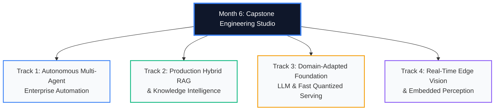

# Month 6: Capstone Engineering Studio (2026 Edition)

```
================================================================================
COURSE:    AI & LLM SYSTEMS ENGINEERING (2026 EDITION)
MODULE:    MONTH 6: CAPSTONE ENGINEERING STUDIO
FOCUS:     ENTERPRISE-GRADE PRODUCTION AI SYSTEM IMPLEMENTATION & DEFENSE
DELIVERABLE: END-TO-END REPOSITORY, TECHNICAL RFC, CONTAINERIZED DEPLOYMENT & EVALS
TARGET:    PORTFOLIO-READY SENIOR AI SYSTEMS ARCHITECT
================================================================================
```

---

## 1. Executive Overview & Capstone Mission

The **Month 6 Capstone Engineering Studio** is the culminating practical milestone of the 7-month curriculum. Rather than building toy academic demonstrators or generic tutorial wrappers, every student is required to design, implement, benchmark, and deploy an **enterprise-grade, production-hardened AI system**.

A successful capstone project proves mastery across the entire 2026 AI systems lifecycle:
1. **Algorithmic Rigor**: Custom mathematical implementations (custom autograd VJPs, quantized inference, or specialized retrieval scoring).
2. **Production Systems Architecture**: Zero-downtime serving using **vLLM**, **LangGraph**, **FastAPI**, and **Qdrant**, with sub-second latency SLAs.
3. **Enterprise Reliability**: Comprehensive automated test coverage ($>80\%$), continuous OpenTelemetry distributed tracing, deterministic guardrails, and quantitative evaluation (Ragas / G-Eval).
4. **Professional Engineering Hygiene**: Strict type hints (Python 3.11+ / Pydantic v2), multi-stage Docker builds, and formal Architectural Decision Records (ADRs).

---

## 2. Four Specialized Engineering Tracks

Students select **ONE** primary specialization track for their capstone:



### Track 1: Autonomous Multi-Agent Enterprise Automation
- **Focus**: Building self-correcting, multi-agent systems that solve complex, multi-step asynchronous workflows.
- **Required Stack**: LangGraph, Model Context Protocol (MCP), Pydantic v2, PostgreSQL / SQLite Checkpointer, Langfuse.
- **Exemplar Project**: *Autonomous SRE Incident Remediation & GitOps Agent* (Diagnoses Kubernetes alerts, inspects logs via MCP, drafts PR fixes, requires human Slack approval).

### Track 2: Production Hybrid RAG & Knowledge Intelligence
- **Focus**: Zero-hallucination semantic retrieval over massive heterogeneous document corpora.
- **Required Stack**: Qdrant Vector Engine, BM25 / SPLADE, Cross-Encoder Re-Ranking, Ragas Evaluation Triad, NeMo Guardrails.
- **Exemplar Project**: *SEC Financial Compliance & Legal Discovery Assistant* (Processes 100k SEC 10-K filings, executes hybrid RRF search, enforces tenant isolation, guarantees $<0.1\%$ hallucination).

### Track 3: Domain-Adapted Foundation LLM & High-Throughput Serving
- **Focus**: Fine-tuning an open-weights foundation model on specialized domain syntax and deploying an optimized serving engine.
- **Required Stack**: PyTorch 2.x, QLoRA (NF4), Unsloth / Hugging Face PEFT, vLLM (PagedAttention), FastAPI SSE.
- **Exemplar Project**: *Text-to-SQL Compiler for Complex Enterprise Schemas* (Fine-tunes Llama-3-8B with QLoRA on complex SQL dialects, serves via vLLM with continuous batching at $>80\text{ tokens/sec}$).

### Track 4: Real-Time Edge Vision & Embedded Perception
- **Focus**: High-speed, low-latency computer vision deployed on resource-constrained hardware.
- **Required Stack**: PyTorch 2.x, Anchor-Free YOLO / ConvNeXt, ONNX Runtime, NVIDIA TensorRT (INT8 PTQ), OpenCV.
- **Exemplar Project**: *Autonomous Drone Obstacle Avoidance & Defect Scanner* (60 FPS inference at P99 $<5\text{ ms}$ on NVIDIA Jetson / Apple Silicon with zero aspect-ratio warping).

---

## 3. Four-Week Capstone Engineering Milestones

```
+---------------------------------------------------------------------------------------------------+
|                            4-WEEK CAPSTONE IMPLEMENTATION ROADMAP                                 |
+---------------------------------------------------------------------------------------------------+
|  Week 1: RFC & Architecture Design                                                                |
|       - Author formal Technical Design Document (RFC) and Architectural Decision Records (ADRs)   |
|       - Establish repository scaffolding, linting, CI/CD, and dataset validation                  |
|       |                                                                                           |
|       v                                                                                           |
|  Week 2: Core Algorithm & Engine Implementation                                                  |
|       - Build the algorithmic core (from-scratch components, model fine-tuning, or HNSW indexing) |
|       - Achieve initial baseline benchmark results                                                |
|       |                                                                                           |
|       v                                                                                           |
|  Week 3: Serving Gateway, Telemetry & Guardrails                                                  |
|       - Wrap engine in asynchronous FastAPI gateway with Server-Sent Events (SSE) streaming       |
|       - Instrument OpenTelemetry traces and Prometheus metric collectors                          |
|       - Integrate deterministic safety guardrails and input validation                            |
|       |                                                                                           |
|       v                                                                                           |
|  Week 4: Stress Testing, Containerization & Final Defense                                         |
|       - Execute locust / k6 concurrent load testing (measuring P99 latency, TTFT, and ITL)        |
|       - Author multi-stage production Dockerfile and container compose manifests                  |
|       - Deliver live technical defense and portfolio demonstration                                |
+---------------------------------------------------------------------------------------------------+
```

---

## 4. Production Acceptance Criteria & Defense Rubric

Every capstone submission is rigorously evaluated across 5 core dimensions:

| Dimension | Weight | Criteria for Distinction (Grade: A / Senior AI Engineer Standard) |
| :--- | :---: | :--- |
| **1. Architecture & Design** | 20% | Clear separation of concerns; formal RFC and ADRs included; no tight coupling; mathematically sound algorithm selection. |
| **2. Algorithmic Implementation** | 25% | Core algorithmic mechanisms clearly understood and implemented (not just a 3-line library import); proper tensor handling; zero memory leaks. |
| **3. Reliability & Guardrails** | 20% | Automated unit and integration tests ($>80\%$ coverage); deterministic input/output guardrails; graceful error handling and retry policies. |
| **4. Serving & Production Hygiene** | 20% | Non-blocking asynchronous FastAPI endpoints; SSE streaming; multi-stage non-root Dockerfile; OpenTelemetry distributed traces. |
| **5. Empirical Evaluation** | 15% | Quantitative benchmarking (mAP, Ragas, TTFT, ITL, or perplexity); load testing results documented; clear cost/latency trade-off analysis. |

---

## 5. Mandatory Deliverables Checklist

- [ ] **Repository Structure**: Clean, modular layout (`src/`, `tests/`, `config/`, `docker/`).
- [ ] **Technical RFC**: Comprehensive markdown document specifying problem statement, system boundaries, alternatives considered, and mathematical formulations.
- [ ] **Automated Test Suite**: Pytest suite covering core modules with mock fixtures and $>80\%$ test coverage.
- [ ] **Docker Artifact**: Fully reproducible, multi-stage `Dockerfile` running as unprivileged user with health checks.
- [ ] **Telemetry Dashboard**: Running OpenTelemetry traces (Langfuse) and Prometheus metrics.
- [ ] **Live Demo / Screencast**: A 5-minute technical demonstration showcasing real-time execution, error recovery, and load performance.

