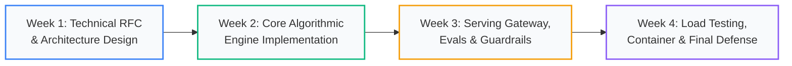

# Month 6: Capstone Engineering Studio (2026 Edition)

```
================================================================================
MODULE OVERVIEW: MONTH 6
FOCUS:           ENTERPRISE CAPSTONE IMPLEMENTATION, DEFENSE & PORTFOLIO DEPLOYMENT
TRACKS:          MULTI-AGENT SYSTEMS, ADVANCED RAG, FINE-TUNED SERVING, EDGE VISION
DELIVERABLES:    TECHNICAL RFC, PRODUCTION CODEBASE, TESTS (>80%), CONTAINER & DEFENSE
TARGET LEVEL:    PORTFOLIO-READY SENIOR AI SYSTEMS ARCHITECT
================================================================================
```

## Studio Architecture



---

## Core Capstone Documents

1. **[Capstone Project Guide](Capstone_Project_Guide.md)**: Detailed 4-week milestones, mandatory deliverables, defense rubric, and graduation criteria.
2. **[Capstone Project Ideas & Blueprints](Capstone_Project_Ideas.md)**: Four enterprise-grade blueprints spanning Autonomous Multi-Agent SRE, SEC Financial Hybrid RAG, High-Throughput Domain SQL Compiler, and Real-Time Edge Vision Inspection.

---

## Specialized Engineering Tracks

| Track | Core Technologies | Primary Production Metric | Deliverable Profile |
| :--- | :--- | :--- | :--- |
| **Track 1: Autonomous Multi-Agent Automation** | `langgraph`, `mcp`, `pydantic`, `postgresql` | Task Completion Rate, Re-planning efficiency | Self-correcting agent team with Human-in-the-Loop approval gates |
| **Track 2: Production Hybrid RAG & Knowledge** | `qdrant`, `bm25`, `bge-reranker`, `ragas` | Retrieval Recall@K, Faithfulness (>0.95) | Zero-hallucination document intelligence engine |
| **Track 3: Domain Foundation LLM & Serving** | `peft`, `qlora`, `unsloth`, `vllm`, `fastapi` | Throughput (>80 tok/s), P99 TTFT (<200ms) | Fine-tuned 8B/70B model served with PagedAttention & SSE |
| **Track 4: Real-Time Edge Vision Perception** | `torch`, `yolo`, `onnxruntime`, `tensorrt` | Frame Rate (>60 FPS), Latency (<5ms) | Quantized INT8 edge detection pipeline on embedded hardware |

---

## Graduation & Portfolio Defense
Upon successful completion of Week 4, students present their technical defense to industry faculty, demonstrating:
- Live streaming execution under stress.
- Graceful recovery under fault-injection scenarios.
- Comprehensive telemetry dashboards (OpenTelemetry / Prometheus).
