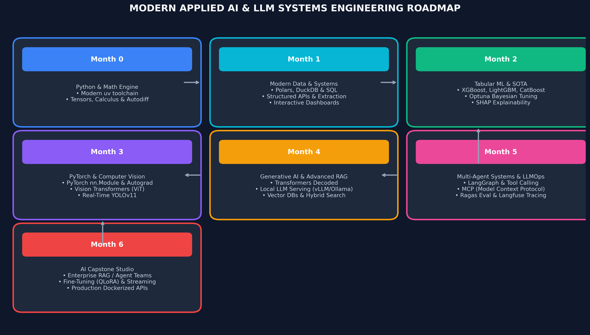
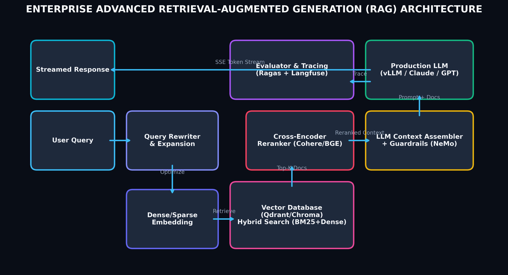
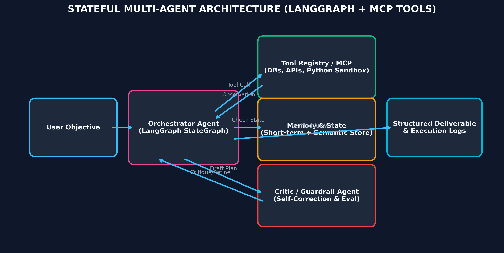

# AI Engineering Professional Training Curriculum (2026 Edition)



## Overview
This repository contains the complete syllabus, lecture notes, assignments, code implementations, and cheatsheets for an intensive **7-month Applied AI & LLM Systems Engineering program** (Month 0 through Month 6). 

The program takes students from fundamental programming and mathematical intuition to engineering production-grade AI systems: **Modern Tabular ML, PyTorch Deep Learning, Vision Transformers, Generative AI, Advanced RAG, Autonomous Multi-Agent Workflows, and LLMOps**.

---

## Pedagogical Philosophy & Toolchain Standards

```
Modern Toolchain Stack:
• Package & Runtime Management: uv (fast, reproducible virtual environments)
• Neural Network Architecture: PyTorch 2.x-first (TorchVision, timm)
• Structured Data Validation: Pydantic v2
• Analytical Querying: DuckDB, Polars & PostgreSQL
• Generative AI & Vector Search: Hugging Face Transformers, Chroma, Qdrant
• Orchestration & Agents: LangGraph, Model Context Protocol (MCP)
• Observability & Evaluation: Langfuse, Ragas, MLflow
```

---

## Curriculum Structure

### Month 0: Essential Foundations for AI Engineering
**Goal:** Build rock-solid programming logic, data validation skills, and mathematical intuition for tensors and optimization.
* **Week 1: Modern Python Toolchain & Programming Foundations**
  * Modern Python 3.11+, virtual environments via `uv`, terminal mastery, Git basics.
  * Core types, mutable vs immutable constructs, expressions, and debugging workflows.
* **Week 2: Control Flow, Functions & Structured Typing**
  * Conditionals, loops, list/dict comprehensions, functions, and scope.
  * Defensive error handling and data schema validation using **Pydantic**.
* **Week 3: Linear Algebra & Tensors from Scratch**
  * Scalars, vectors, matrices, dot products, vectorization in NumPy.
  * Tensor dimensions, broadcasting rules, and geometric intuition behind data transformations.
* **Week 4: Calculus, Autodiff & Probability for Machine Learning**
  * Partial derivatives, chain rule, and step-by-step intuition of Gradient Descent.
  * Probability distributions, Bayes' theorem, expectation, and variance.

---

### Month 1: Modern Data Systems & Exploratory Engineering
**Goal:** Ingest, clean, transform, and analyze structured and unstructured data using modern high-performance libraries.
* **Week 1: High-Performance Data Processing**
  * Transition from standard Pandas to **Polars** and **DuckDB** for blazingly fast data manipulation.
  * Handling Parquet, Arrow, and memory-efficient data structures.
* **Week 2: Relational Databases & SQL for AI**
  * Relational database design, indexes, joins, aggregations, and window functions in PostgreSQL.
  * Extracting, querying, and preparing dataset splits directly through SQL pipelines.
* **Week 3: Data Acquisition & Structured Extraction**
  * Querying REST APIs, async fetching with `httpx`, handling rate limits and auth tokens.
  * Web scraping fundamentals with BeautifulSoup and parsing unstructured HTML/JSON into clean records.
* **Week 4: Exploratory Data Analysis & Interactive Dashboards**
  * Statistical profiling, distribution visualization, outlier detection, and correlation matrices.
  * Interactive data visualizations with Plotly and building live analytical dashboards in **Streamlit**.

---

### Month 2: Supervised Learning & Tabular SOTA
**Goal:** Master the theory, implementation from scratch, and production deployment of machine learning algorithms.
* **Week 1: Linear & Logistic Models with Regularization**
  * Simple and multiple linear regression; implementing gradient descent from scratch.
  * L1 (Lasso), L2 (Ridge), and ElasticNet regularization.
  * Logistic regression, log-loss, decision boundaries, ROC-AUC, Precision, Recall, and F1-score.
* **Week 2: Tree Models & State-of-the-Art Gradient Boosting**
  * Decision tree theory (Gini, entropy, information gain, tree pruning).
  * Ensemble learning: Random Forests and feature importance.
  * Modern Gradient Boosting libraries: **XGBoost, LightGBM, and CatBoost**.
* **Week 3: Validation, Class Imbalance & Bayesian Optimization**
  * Cross-validation strategies (Stratified K-Fold, Time-Series splits) and preventing data leakage.
  * Handling severe class imbalance (SMOTE, class weighting, focal loss concepts).
  * Automated hyperparameter optimization with **Optuna**.
* **Week 4: Feature Engineering & Explainable AI (XAI)**
  * Constructing robust pipelines using `scikit-learn.pipeline.Pipeline`.
  * Model interpretability with **SHAP** (SHapley Additive exPlanations) and permutation importance.

---

### Month 3: Deep Learning with PyTorch & Computer Vision
**Goal:** Standardize entirely on PyTorch and build modern neural networks for computer vision.
* **Week 1: PyTorch Foundations & Autograd**
  * Tensors, GPU/Metal acceleration (`mps`/`cuda`), computational graphs, and `autograd`.
  * Constructing modular networks with `torch.nn.Module`, custom Datasets, and DataLoaders.
* **Week 2: Training Dynamics & Optimization**
  * Loss functions (CrossEntropy, MSE), optimizers (AdamW, SGD with momentum), learning rate schedulers.
  * Regularization techniques: Dropout, Batch Normalization, Layer Normalization, early stopping.
* **Week 3: Computer Vision & Transfer Learning**
  * Convolutional layers, feature maps, and pooling.
  * Transfer learning with pre-trained backbones (ResNet, ConvNeXt) using `torchvision` and `timm`.
  * Overview of **Vision Transformers (ViT)** and self-attention in visual feature extraction.
* **Week 4: Object Detection & Real-World Computer Vision**
  * Object detection concepts: bounding boxes, IoU, non-max suppression.
  * Hands-on real-time detection and segmentation using **Ultralytics YOLO (v11)**.

---

### Month 4: Generative AI, Transformers & Advanced RAG
**Goal:** Master the architecture powering modern AI: Large Language Models, Vector Databases, and Retrieval-Augmented Generation.



* **Week 1: The Transformer Architecture Decoded**
  * Self-Attention mechanism, Multi-Head Attention, Scaled Dot-Product, and Positional Encodings.
  * Encoder-only (BERT), Encoder-Decoder (T5), and Decoder-only (GPT/Llama) paradigms.
  * Modern tokenization: Byte-Pair Encoding (BPE), SentencePiece, and vocabulary limits.
* **Week 2: Open-Source LLMs & Local Inference Engines**
  * Hugging Face `transformers` ecosystem: models, tokenizers, pipelines, and configuration.
  * Local inference runtimes: **Ollama, vLLM, and Apple MLX**.
  * Quantization mechanics: 4-bit/8-bit weights, GGUF, AWQ, and bitsandbytes.
* **Week 3: Vector Databases & Core RAG Pipeline**
  * Dense vector embeddings (OpenAI, HuggingFace BGE) and cosine similarity metrics.
  * Chunking strategies (fixed-size, semantic, sentence-window).
  * Building vector indexes with **Chroma** and **Qdrant**.
  * Complete end-to-end question-answering pipeline over private documentation.
* **Week 4: Advanced RAG, Hybrid Search & Guardrails**
  * Hybrid retrieval combining dense vector search and sparse keyword search (BM25).
  * Context reranking with Cross-Encoders (Cohere / BGE Reranker).
  * Query transformation (Hypothetical Document Embeddings - HyDE, query decomposition).
  * Implementing safety guardrails and input/output sanitization with **NeMo Guardrails**.

---

### Month 5: Multi-Agent Systems, Fine-Tuning & LLMOps
**Goal:** Build autonomous multi-agent applications, adapt models with parameter-efficient fine-tuning, and operationalize AI pipelines.



* **Week 1: Parameter-Efficient Fine-Tuning (PEFT / LoRA)**
  * When to fine-tune vs when to prompt/RAG.
  * Low-Rank Adaptation (LoRA) and QLoRA mechanics.
  * Fine-tuning open models using Hugging Face `peft`, `trl` (SFTTrainer), and Unsloth.
* **Week 2: Autonomous Agents & Tool Use (LangGraph & MCP)**
  * Structured LLM tool calling (JSON Schema / Pydantic function arguments).
  * Stateful multi-agent graphs with **LangGraph** (human-in-the-loop, branching, cycles).
  * Integrating tool standards using the **Model Context Protocol (MCP)** for database, file, and web access.
* **Week 3: LLM Observability & Evaluation Harnesses**
  * Quantitative evaluation for generative systems: **Ragas** (Faithfulness, Answer Relevance, Context Recall).
  * Distributed tracing, token tracking, latency auditing, and prompt versioning with **Langfuse**.
* **Week 4: Production Deployment & Serving**
  * Containerizing AI apps with Docker (handling GPU runtimes and dependencies).
  * High-performance asynchronous APIs using **FastAPI** with Server-Sent Events (SSE) streaming.
  * Zero-downtime serving architectures and model registry workflows.

---

### Month 6: Capstone Engineering Studio
**Goal:** Deliver a production-grade, portfolio-defining AI application running end-to-end with tests, CI/CD, and live deployment.

#### Specialized Project Tracks:
1. **Track A — Enterprise Autonomous Agent System:** Multi-agent research/operations assistant with LangGraph, MCP tools, state persistence, and Langfuse tracing.
2. **Track B — Production Domain-Specific RAG Application:** High-accuracy knowledge retrieval system with Hybrid Search (Qdrant), reranking, citations, streaming FastAPI backend, and Streamlit/React frontend.
3. **Track C — Domain-Adapted Fine-Tuned Model Pipeline:** Specializing a 7B/8B model (Llama/Mistral/Qwen) on proprietary domain tasks with QLoRA, evaluated against baseline benchmarks and served via vLLM.
4. **Track D — Real-Time Multimodal Vision & Edge System:** Industrial quality inspection or medical scanner pipeline utilizing YOLOv11/Vision Transformers with FastAPI inference endpoints.

#### Weekly Milestones:
* **Week 1: Product Proposal & Architecture Specification:** Detailed PRD, system architecture diagram, GitHub repository setup, branching model, and automated linting.
* **Week 2: Data Engineering & Baseline Benchmark:** Ingestion pipeline, dataset curation, reproducible cleaning, and baseline benchmark tracking.
* **Week 3: Core Iterative Engineering & Rigorous Evaluation:** Model fine-tuning, RAG retrieval tuning, agent graph validation, and Ragas/MLflow quantitative scoring.
* **Week 4: Containerization, Deployment & Executive Presentation:** Docker packaging, cloud deployment, live demo recording, and comprehensive engineering report.

---

## Getting Started

1. **Clone the Repository:**
   ```bash
   git clone https://github.com/Oduobuk/AI-ML-Curriculum.git
   cd AI-ML-Curriculum
   ```

2. **Initialize Modern Environment with `uv`:**
   ```bash
   # Install uv if not present
   curl -LsSf https://astral.sh/uv/install.sh | sh
   
   # Create virtual environment and sync dependencies
   uv venv
   source .venv/bin/activate
   ```

3. **Explore Course Modules:**
   Navigate into each month directory (`Month0/`, `Month1/`, etc.) to review lecture notes, runnable code examples, exercises, and assignment briefs.
