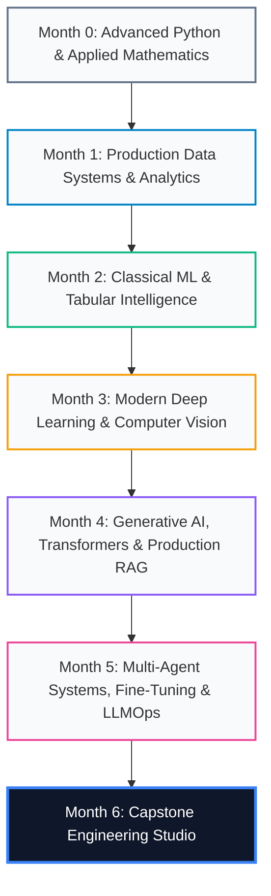

# AI & LLM Systems Engineering: Comprehensive Student Master Guide (2026 Edition)

```
================================================================================
COURSE:    APPLIED AI & LLM SYSTEMS ENGINEERING (2026 EDITION)
PROGRAM:   7-MONTH PRODUCTION APPRENTICESHIP & APPLIED MASTERCLASS
TARGET:    STUDENTS, PRACTITIONERS & PRODUCTION AI ARCHITECTS
AUTHOR:    WEDIGRAF TECHNOLOGIES / ODUOBUK
STATUS:    100% PRODUCTION MODERNIZED
================================================================================
```

---

## 1. Welcome to the 2026 AI Systems Curriculum

Welcome to the **Applied AI & LLM Systems Engineering Curriculum**. This program is engineered to take you from foundational Python and linear algebra up to the highest echelons of modern production AI engineering: building multi-agent cyclic architectures, high-throughput foundation model serving clusters, and zero-hallucination enterprise retrieval systems.

### What Makes This Curriculum Unique
In 2026, the era of treating machine learning as toy Jupyter notebook experiments is over. This curriculum enforces the **Lauren Poteto Engineering & Verification Protocol**:
1. **No Hand-Waving Math**: Every core algorithm—from normal equation derivations and Taylor expansions in gradient boosting, to RoPE complex rotations and PagedAttention memory formulas—is mathematically derived from first principles.
2. **From-Scratch Before Libraries**: You implement foundational algorithms (Mini-Torch Autograd, AdamW, TreeSHAP, HNSW, LoRA, and StateGraphs) in pure typed Python before touching high-level libraries.
3. **Production Hardening**: You learn to build leak-proof pipelines, export models to ONNX/TensorRT, manage GPU memory budgets, instrument OpenTelemetry distributed traces, and enforce deterministic guardrails.
4. **Modern 2026 Toolchain**: You will work exclusively with modern, high-speed tools: **uv**, **PyTorch 2.x**, **Polars**, **DuckDB**, **vLLM**, **Qdrant**, **LangGraph**, and the **Model Context Protocol (MCP)**.

---

## 2. The 7-Month Complete Master Syllabus



---

### Month 0: Advanced Python & Applied Mathematics for AI
- **Week 1: High-Performance Python Internals**: CPython memory model, GIL, reference counting, bytecode analysis, custom iterators, and `uv` package management.
- **Week 2: Advanced Control Flow, Decorators & Metaprogramming**: Parameterized decorators, context managers, structural pattern matching, `asyncio` coroutines, and Pydantic v2 schemas.
- **Week 3: Linear Algebra & Matrix Calculus**: Vector spaces, orthogonal projections, SVD, eigendecomposition, matrix derivatives, and Frobenius norms.
- **Week 4: Multivariable Calculus, Optimization & Probability**: Gradients, Hessians, Taylor expansions, convexity, stochastic gradient descent, and Bayes' theorem.

---

### Month 1: Production Data Systems & High-Performance Analytics
- **Week 1: High-Performance Data Processing**: Vectorized columnar computing with **Polars** (Apache Arrow memory) vs Pandas, lazy execution graphs, and streaming Parquet out-of-core pipelines.
- **Week 2: Production SQL for AI Engineers**: Analytical window functions, recursive CTEs, query plan optimization, indexing strategies, and **DuckDB** in-process vector prep.
- **Week 3: Data Ingestion, Streaming & Web Scraping**: Asynchronous I/O pipelines (`httpx`), distributed task queues (Celery/Redis), rate limiting, and defensive data extraction.
- **Week 4: Exploratory Data Analysis & Interactive Dashboards**: Automated statistical profiling, feature drift detection, high-dimensional visualization (t-SNE/UMAP), and interactive dashboards.

---

### Month 2: Classical Machine Learning & Tabular Intelligence
- **Week 1: Convex Optimization & Regularization**: Ordinary Least Squares (OLS) normal equations, Lipschitz continuity, L1 Lasso subgradients vs. L2 Ridge shrinkage, and Newton-Raphson.
- **Week 2: Tree Algorithms & Gradient Boosting Systems**: Information entropy, Gini impurity, 2nd-order Taylor expansions, **LightGBM** (GOSS/EFB), and **CatBoost** ordered target encoding.
- **Week 3: Validation Protocols, Severe Imbalance & Optuna**: Purged Group TimeSeries cross-validation, Focal Loss, PR-AUC vs. ROC-AUC, and **Optuna** Tree-Structured Parzen Estimators (TPE).
- **Week 4: Production Pipelines, Serialization & SHAP**: Leak-proof Scikit-Learn `Pipeline` and `ColumnTransformer`, Empirical Bayes target encoding, Cooperative Game Theory Shapley axioms, exact $O(TLD^2)$ **TreeSHAP**, and **ONNX** runtime serialization.

---

### Month 3: Modern Deep Learning with PyTorch & Computer Vision
- **Week 1: PyTorch 2.x Architecture, Autograd & Acceleration**: Tensor physical memory (strides, byte offsets, contiguity), Reverse-Mode Automatic Differentiation (VJPs), dynamic DAG tape, and `torch.compile` TorchInductor kernel fusion.
- **Week 2: Neural Network Engineering, Normalization & AdamW**: Variance preservation theorems (He vs Xavier), Normalization dynamics (BatchNorm, LayerNorm, RMSNorm), residual loss landscape smoothing, and **AdamW decoupled weight decay**.
- **Week 3: Modern Computer Vision, ConvNeXt & ViT**: Effective Receptive Fields (2D Gaussian proof), Depthwise separable convolutions, ConvNeXt modernization roadmap, Vision Transformers (ViT) patch attention, and Attention Rollout Maps.
- **Week 4: Real-Time Edge Vision, YOLO & Hardware Optimization**: Bounding box coordinate geometry, Complete IoU (CIoU) loss derivation, anchor-free decoupled detection heads, vectorized NMS, and **INT8 TensorRT Post-Training Quantization (PTQ)**.

---

### Month 4: Generative AI, Transformers & Production RAG Systems
- **Week 1: Transformer Architecture Decoded (RoPE & GQA)**: 2017 Vaswani vs 2026 Llama-3 modern decoder stack, Rotary Position Embeddings (RoPE) relative invariance proof, SwiGLU bilinear gating, Grouped-Query Attention (GQA), and exact byte-level KV-Cache formulas.
- **Week 2: Open LLMs, Quantization & vLLM High-Throughput Serving**: Roofline model & arithmetic intensity, affine quantization, AWQ vs GPTQ, **PagedAttention** virtual memory block tables, and Continuous Dynamic Batching.
- **Week 3: Vector Databases, HNSW Indexing & Core RAG**: Metric spaces, normalization theorems, Curse of Dimensionality, **HNSW** multi-layer skip-graph routing, Product Quantization (PQ), and asynchronous **Qdrant** integration.
- **Week 4: Advanced RAG: Hybrid Search, Re-Ranking & Guardrails**: Probabilistic BM25, Reciprocal Rank Fusion (RRF), Cross-Encoder full-attention re-ranking, the **Ragas Evaluation Triad** (Faithfulness, Relevance, Precision), and deterministic guardrails.

---

### Month 5: Multi-Agent Systems, Fine-Tuning & Production LLMOps
- **Week 1: Fine-Tuning, PEFT, LoRA & QLoRA**: Intrinsic Rank Hypothesis, Low-Rank Decomposition ($BA$), 4-bit NormalFloat (NF4), Double Quantization, Unsloth Triton backprop kernels, and zero-latency inference weight merging.
- **Week 2: Multi-Agent Systems, StateGraph & MCP**: Cyclic StateGraphs (Pregel), State Reducers (`operator.add`), Anthropic's **Model Context Protocol (MCP)** JSON-RPC standard, and Human-in-the-Loop checkpointers.
- **Week 3: LLM Observability, OpenTelemetry & Evals**: Observability Triad (Traces, Metrics, Logs), OpenTelemetry GenAI semantic conventions, continuous G-Eval logit expectation scoring, Fleiss' Kappa reliability, and semantic manifold drift.
- **Week 4: Enterprise Production Deployment & FastAPI**: Asynchronous I/O multiplexing (`epoll`), Token-Bucket rate limiting, Server-Sent Events (SSE) token streaming, JWT RS256 security, and multi-stage Docker containerization.

---

### Month 6: Capstone Engineering Studio
- **Four Specialized Tracks**:
  1. *Autonomous Multi-Agent Enterprise Automation* (LangGraph, MCP, PostgreSQL).
  2. *Production Hybrid RAG & Knowledge Intelligence* (Qdrant, BM25, Ragas, Cross-Encoders).
  3. *Domain-Adapted Foundation LLM & High-Throughput Serving* (QLoRA, vLLM, FastAPI SSE).
  4. *Real-Time Edge Vision & Embedded Perception* (YOLO, ConvNeXt, ONNX, TensorRT INT8).
- **Milestones**: Week 1 (RFC & ADRs), Week 2 (Core Algorithmic Engine), Week 3 (FastAPI Gateway, Telemetry & Guardrails), Week 4 (Load Testing, Docker & Technical Defense).

---

## 3. Graduation Requirements & Rubric

To graduate with the **Wedigraf AI Systems Engineering Certification**, you must satisfy:
1. **Weekly Mini-Labs**: Complete all hands-on mini-labs with passing test suites and self-assessment scores ($>80\%$).
2. **Comprehensive Capstone Repository**: Deliver a production-ready GitHub repository featuring:
   - Modular Python 3.11+ source code with strict type annotations.
   - Formal Technical RFC and Architectural Decision Records (ADRs).
   - Automated unit and integration test coverage exceeding $80\%$.
   - Multi-stage Docker container artifact running as a non-root user.
   - Comprehensive telemetry dashboards (OpenTelemetry / Prometheus).
3. **Live Technical Defense**: Present your live system defense to industry faculty, demonstrating real-time fault recovery and latency benchmarks under load.

Welcome to the future of AI Systems Engineering. Let's build!
